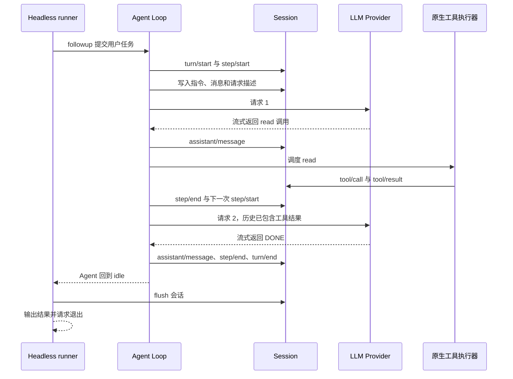

# 01｜一条指令怎么跑完：从 DSH CLI 到 Agent Loop

> 源码基线为 DeepSeek Harness `dsh-v0.2.3-alpha.2`，提交 `4b399c39a6d1479cd84ca591b4d7c88e24d38a96`。[系列目录](../README.md) · [上游仓库](https://github.com/deepseek-ai/deepseek-harness)

`dsh --profile headless "读取 greeting.txt"` 只交给程序一条输入，模型却可能要调用两次。第一次决定调用 `read`，DSH 在本地执行并记录结果。第二次请求带着工具结果，模型才有依据作答。中途如果遇到可重试的模型失败，请求次数还会增加，step 数却可能保持不变。

读懂这条链路，可以回答 Agent 工程中三个常见问题：谁决定再调一次模型？工具失败是给模型的反馈，还是给进程的退出信号？屏幕上出现文字以后，重启能从哪里恢复？仓库里的 `fs-read` 样本刚好给出了一个完整的正常路径。[会话样本](../deepseek-harness/snapshots/session/fs-read/session.v4.jsonl)

## 1. CLI 先装配应用，再把任务交给 headless

`apps/cli/src/bin.ts` 的 `runCli()` 从 `process.argv` 解析调用模式。运行 Profile 时，它调用 `runProfile()`，将应用自己的参数交给插件上下文。启动器汇总 Profile 声明的 Bundle、Profile 补丁、Harness home 补丁和命令行 `--patch`。这些层决定模型适配器、工具、持久化和任务入口实际挂载了什么。换一个 Profile，同一套 Agent 能力就能由不同入口驱动。[CLI](../deepseek-harness/apps/cli/src/bin.ts#L26) · [Profile 启动](../deepseek-harness/apps/cli/src/profile-boot.ts#L210)

默认 headless 叠加在 `dsh-base` 上。基础层提供 Agent Loop、原生工具执行器和 JSONL 持久化。headless 层增加 `headless-startup` 与 `headless-runner`，分别负责解析任务参数和驱动一次运行。该 Profile 直接调用进程内的 Agent 服务，启动链上没有 Web Host、浏览器或 HTTP API。[基础配置](../deepseek-harness/packages/bundle/base/cordis.patch.yml) · [headless 配置](../deepseek-harness/packages/bundle/headless/cordis.patch.yml)

Runner 等 Loader 完成装配再创建 Agent，因为模型、工具等兄弟插件可能并行挂载。它从位置参数或 stdin 取任务，通过默认模型服务取得本次选择，并解析工作目录。常规调用新建一个 `session-<uuid>`。传入 `--session-id` 时，runner 只接管匹配的既有会话，并检查工作目录、会话归属和 Preset。错误的 ID 会在任务执行前被拒绝。[headless runner](../deepseek-harness/packages/bundle/headless/src/index.ts#L242)

## 2. Agent 管执行，Session 存事实

| 对象 | 在本例中负责什么 |
| --- | --- |
| Agent | 持有运行状态与 inbox，驱动模型请求和工具调用，响应取消。该路径的实现类是 `ReactLoopAgent`。 |
| Session | 保存有序事件，供模型历史重建、恢复和输出投影使用。持久化插件负责把同一事件序列写到存储。 |
| Headless runner | 提交一次任务，等待 Agent 和受管子 Agent 的工作稳定下来，再依据这一运行区间的会话事件输出结果。 |

生产路径经 `ctx.agents.create()` 创建 Agent。Agent Loop 先准备 Session，有持久化插件时取得写句柄，然后构造运行对象。在发布过程中，Session 先进入存储和发布 `session/created`，然后执行 setup，并在 Agent 注册后等待 `agent/created`。这样，消费创建事件的插件可以在收到首条任务前完成初始化。[Agent 创建](../deepseek-harness/packages/core/agent-loop/src/index.ts#L725) · [发布顺序](../deepseek-harness/packages/core/agent-loop/src/index.ts#L622)

Runner 调用 `followup(createUserMessage(...))`。`followup()` 把输入放到 `next-turn` 队列并唤醒驱动器，同一个 Agent 的 `steer()` 则面向 `next-step`。对照快照会看到，`agent/inbox/spliced` 先记录入队，之后才出现真正进入模型历史的 `user/message`。两条事件分别回答「输入在等谁处理」和「模型实际收到了什么」。[入口调用](../deepseek-harness/packages/bundle/headless/src/index.ts#L405) · [Agent 收件箱入口](../deepseek-harness/packages/core/agent-loop/src/agent.ts#L168)

## 3. 一个 turn 有几个 step？

| 单位 | 定义 | `fs-read` 的数量 |
| --- | --- | --- |
| 用户提交 | 本次 CLI 调用交给 `followup()` 的人工输入 | 1 |
| Turn | 从 `turn/start` 到 `turn/end` 的一轮工作，可容纳零或多个 step | 1 |
| Step | 从 `step/start` 到 `step/end` 的执行单元，负责准备模型请求、处理尝试及其工具批次。请求准备阶段出错也会结束这一 step | 2 |
| Attempt | Step 内进入模型流的一次尝试，失败后的重试能留在同一个 step | 2，两个 step 各一次 |
| Tool call | 模型提出的工具调用，以调用 ID 关联请求、执行记录和结果 | 1，`read` |

下面保留样本中的关键事件。第 11 行是 Harness 追加的运行时上下文，在历史里也用 `user/message` 表示。统计用户输入时，应该检查消息的来源字段。表中的行号是文件物理行号，包含第一行 Session 头部。[完整 JSONL](../deepseek-harness/snapshots/session/fs-read/session.v4.jsonl)

| JSONL 行 | 事件 | 发生了什么 |
| --- | --- | --- |
| 5–8 | 入队 → `turn/start` → 认领 → `step/start` | 首条输入被第 1 轮第 1 步认领。 |
| 9–13 | `system/message`、`user/message`、`request/header`、`request/context` | 记录系统指令、任务、运行时上下文与请求配置。 |
| 15 | `assistant/message` | 第一次模型响应提出 `read` 调用。 |
| 16–18 | `tool/call` → `tool/result` → `step/end` | 工具读取 `greeting.txt` 得到 `hello`，结果使用同一个 `callId` 回填。 |
| 19–21 | `step/start` → `assistant/message` → `step/end` | 第 2 步的模型看到工具结果，并按样本任务要求输出 `DONE`。 |
| 22 | `turn/end` | 状态为 `completed`。 |



## 4. 从已经接纳的事件组装模型请求

`turn()` 先写 `turn/start`，再调用 `preStep()` 认领消息。`preStep()` 固定本步的模型选择、解析能用的工具、组装 System Prompt，并通过 `agent/pre-step` 让插件接纳、改写或拒绝。首批输入被拒绝或改写为空时，这一轮可以零 step 结束。进入 `step()` 以后，循环会准备 Provider 调用，提交本次使用的系统和用户内容，并记录必要的请求描述。[Pre-step](../deepseek-harness/packages/core/agent-loop/src/agent.ts#L286) · [Turn](../deepseek-harness/packages/core/agent-loop/src/agent.ts#L322) · [Step](../deepseek-harness/packages/core/agent-loop/src/agent.ts#L431)

`buildRequest()` 用 `session.deriveMessages()` 重建模型历史，将历史与请求配置冻结后交给 Provider。Provider 的文本、推理和 tool-call 增量由 `AssistantStreamAttempt` 接收，过程通过 `agent/assistant-stream` 散发给实时观察者。成功完成时，Loop 写一条 `assistant/message`，其中带有聚合后的消息和紧凑的流记录。如果 Provider 返回可恢复的失败，且 `agent/request-error` 返回 `retry`，Loop 会在当前 step 重新准备请求，原始用户消息只在首次尝试入历史。[请求构造](../deepseek-harness/packages/core/agent-loop/src/agent.ts#L650) · [流与重试](../deepseek-harness/packages/core/agent-loop/src/agent.ts#L470) · [生命周期图](../deepseek-harness/docs/agent-lifecycle.zh.md)

在正常路径中，模型最终消息包含 `tool-call` 时，Loop 才把调用交给工具执行器。增量里出现了可读的工具名，仍要等本次模型流结算后再调度。这个时机让工具处理的是完整参数，也让请求来源在 Session 里有对应记录。[工具派发](../deepseek-harness/packages/core/agent-loop/src/agent.ts#L556)

## 5. 工具回填为何会驱动第二次请求

原生执行器把模型给出的调用交给批处理调度器。`read` 是 `tool-fs` 注册的工具，本例收到 `{"file_path":"greeting.txt"}`。执行器经过参数、权限和调度流程，通过文件系统 Provider 读取 UTF-8 文本，并把结果渲染成模型可读的带行号文本。工具接口与本地文件实现之间还有 Provider 这一层，测试和其他部署可以替换 Provider。[原生执行器](../deepseek-harness/packages/core/tool-executor-native/src/index.ts) · [调度器](../deepseek-harness/packages/core/tools/src/batch.ts#L50) · [read 定义](../deepseek-harness/packages/fs/tool-fs/src/read.ts#L78)

模型的 `assistant/message` 里带工具请求，执行器追加 `tool/call` 和对应的 `tool/result`。这些事件有不同含义。前者记录 Harness 接手了哪次调用，后者记录它已取得的结果，可能是正常内容、被拒绝、报错或合成的取消结果。批处理可让并行安全的工具体重叠执行，同时按模型提出调用的顺序提交结果。[工具结果记录](../deepseek-harness/packages/core/tools/src/batch.ts#L236) · [工具流水线](../deepseek-harness/docs/tool-execution-pipeline.zh.md)

本例的 `read` 结果没有要求结束 turn。Loop 结束当前 step，继续下一步，下一次 `deriveMessages()` 就能读到工具结果。模型给出 `DONE` 且没有待执行调用后，Loop 得到 `completed`。若 `agent/turn-stopping` 补入了下一步输入，仍可继续。待办清空后才追加 `turn/end`。工具参数错误等可归入工具结果的失败，通常仍能交给模型判断下一步。[继续条件](../deepseek-harness/packages/core/agent-loop/src/agent.ts#L341) · [工具流水线实现](../deepseek-harness/packages/core/tools/src/pipeline.ts)

## 6. 内存提交、刷盘和进程退出

`Session.append()` 先接纳事件到内存日志，再通知 `session/event` 观察者。默认 Profile 的 JSONL Provider 写入追加式会话日志，物理文件默认采用 Zstandard 压缩。`--json` 的 stdout 是运行事件投影，包含 `session`、`status`、`tool_call`、`tool_result`、`text` 等。它可以随已接纳的事件输出，但只有模型消息结算后才会投影对应的 `text`。因此消费者如果要逐 token 展示，需要使用实时流接口。[Session 提交](../deepseek-harness/packages/core/session/src/index.ts#L665) · [JSONL 存储](../deepseek-harness/packages/session/session-persistence-jsonl/README.md) · [Headless JSON 投影](../deepseek-harness/packages/bundle/headless/src/json-stream.ts#L244)

基础配置装配了 `session-checkpoint-policy`。它在模型流进入下游 Provider 前刷盘请求前缀，在顶层工具体启动前刷盘已记录的调用，并在下一步的 `agent/pre-step` 检查点刷盘此前的事件。刷盘失败会阻止对应的模型派发或工具执行。Headless runner 等 `whenIdle()` 和受管子任务稳定后，再显式 `await sessions.flush(agent.session)`，按本次序列区间选取最后一段非空 assistant 文本与最后一轮的结束原因。`completed` 退出码为 `0`，其它结果退出码为 `1`。正常的 `--json` 收尾用 `final` 输出结论。[检查点实现](../deepseek-harness/packages/session/session-checkpoint-policy/src/index.ts) · [摘要](../deepseek-harness/packages/bundle/headless/src/index.ts#L85) · [Runner 收尾](../deepseek-harness/packages/bundle/headless/src/index.ts#L416)

检查点只能持久化 DSH 当时已经知道的事实。假设顶层调用去创建一张工单，外部服务已创建成功，DSH 却在写回结果前被杀死。重启看到的 `tool/call` 证明 Harness 已经接手调用。它同时涵盖工具体还没开始、工具正在跑，以及工具已完成但结果未持久化几种情况。恢复代码用 `TOOL_OUTCOME_UNKNOWN` 补齐结果，并关闭残留的 step 与 turn。要确认外部结果，需要按幂等键查询、对账或请用户核对，再决定是否重试。[恢复逻辑](../deepseek-harness/packages/core/session/src/repair.ts) · [持写句柄恢复](../deepseek-harness/packages/core/agent-loop/src/index.ts#L790)

## 7. 用仓库快照复核

在学习仓库根目录执行下面的命令，读取已提交的 `fs-read` 记录。脚本断言两个 step、两个成功模型响应、一个工具调用，且 `tool/call` 与 `tool/result` 的调用 ID 一致。该方法只需要 Python 3。

```bash
python3 - <<'PY'
import json
from collections import Counter
from pathlib import Path

path = Path('deepseek-harness/snapshots/session/fs-read/session.v4.jsonl')
records = [json.loads(line) for line in path.read_text(encoding='utf-8').splitlines()]
header, *events = records
counts = Counter(event['type'] for event in events)
assert header['version'] == 4
assert counts['turn/start'] == counts['turn/end'] == 1
assert counts['step/start'] == counts['step/end'] == counts['assistant/message'] == 2
assert counts['assistant/attempt'] == 0
assert counts['tool/call'] == counts['tool/result'] == 1
call = next(event['data'] for event in events if event['type'] == 'tool/call')
result = next(event['data'] for event in events if event['type'] == 'tool/result')
assert call['name'] == 'read' and call['callId'] == result['message']['source']['callId']
assert events[-1]['type'] == 'turn/end' and events[-1]['data']['reason']['kind'] == 'completed'

for line, event in enumerate(events, start=2):
    if event['type'].startswith(('turn/', 'step/', 'assistant/', 'tool/')):
        data = event['data']
        print(f"{line:>2} {event['type']:<18} turn={data.get('turn', '-')} step={data.get('step', '-')}")
PY
```

若已经按项目开发指南准备好 Node、pnpm 和构建产物，可以从 `deepseek-harness/` 用 `pnpm run test:snapshot -t 'replays fs-read through dsh --profile headless'` 运行完整回放。该入口重放已录制的模型响应，验证实际启动的 headless 应用。本文实跑的是上面的快照解析和断言。[回放入口](../deepseek-harness/snapshots/session/headless.snapshot.ts#L1375) · [开发指南](../deepseek-harness/docs/development.zh.md)

## 8. 面试官会怎么追问

### 一条输入触发三次模型请求，一共有几个 step？

先问清三次请求的原因。如果前两次分别产生工具调用，第三次给出结论，那么是一个 turn、三个 step、三个 attempt。若第一次失败并在同一步内重试，成功后调用工具，第三次请求读到结果再结束，则是一个 turn、两个 step、三个 attempt。若 pre-step 拒绝输入，甚至可以有 turn 而造不出 step。业务统计中应分别记录 `turn`、`step` 与 `attempt`。

### `tool/call` 已经写进会话，能把这次工具算作完成吗？

要看 `tool/result` 和结果语义。`tool/call` 是 Harness 接手这次调用的记录。一个有调用记录、缺失结果的崩溃尾部会被标为未知。把场景换成读文件，可以按语义重新读取。换成创建工单，优先设计幂等键和结果查询。进一步追问可以让候选人指出刷盘点，以及为什么本地日志与远程副作用之间仍存在不确定窗口。

### 能看到 assistant 字符或 `tool_result`，能否认定任务成功？

实时字符提供生成进度，`tool_result` 说明某次调用已结算。任务级判断应该看 `turn/end` 和 runner 最终的 `final.reason`，再结合退出码。即使最后一段文本写着 `DONE`，后续工具、子 Agent 或刷盘仍可能失败。业务成功还需要读文件内容、测试通过或外部系统回执等独立证据。

### 再设计一步，怎样让调用方跨进程重连？

先定义两个读取接口。历史按 Session 事件序列号读取已持久化部分，实时流给出当前 attempt 的身份和进度。重连先补历史，再接上当前流，并以已结算的 `assistant/message` 或 `assistant/attempt` 关闭临时视图。面试时可以画出客户端断开、服务中途重启、完成事件重复送达三种时序，分别说明续接位置、去重键和可恢复的数据范围。

下一篇会从 `dsh-base` 和 `headless` 的装配方式切入，跟读 Cordis 的依赖、作用域与插件卸载。
