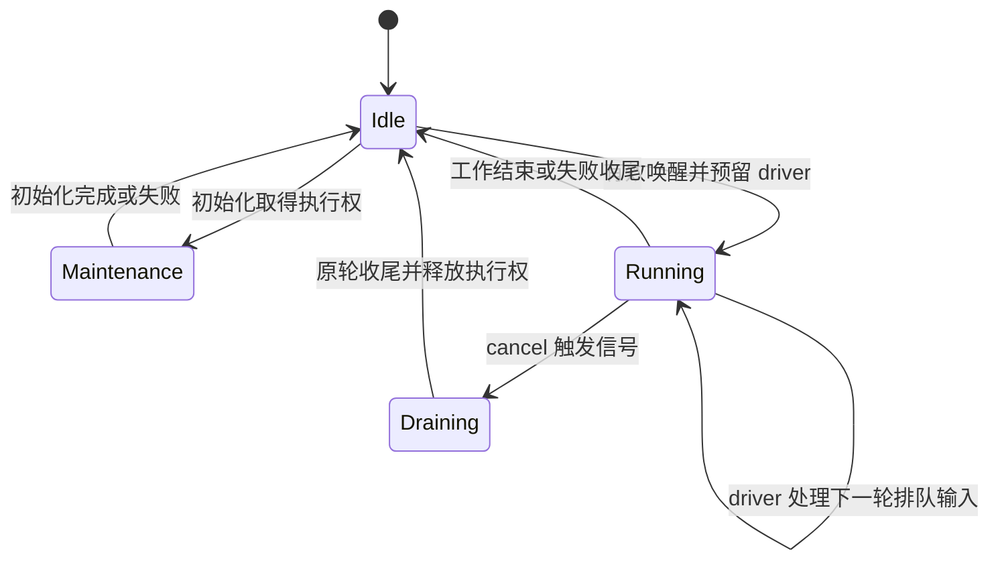

# 03｜Agent Loop 与运行状态机

> 源码基线为 DeepSeek Harness `dsh-v0.2.3-alpha.2`，提交 `4b399c39a6d1479cd84ca591b4d7c88e24d38a96`。[系列目录](../README.md) · [上一篇](02-cordis-profile-bundle.md) · [上游仓库](https://github.com/deepseek-ai/deepseek-harness)

用户点下停止，几乎同时发来一条新消息。旧模型流还在取消，可能还有工具在收尾。此时怎样保证新消息会被处理，又不会让两个 driver 同时写一段会话？如果这时进程崩溃，重启还能确认哪些事情已经发生？

DSH 的实现把答案分在三处。Agent 的 `phase` 管本进程谁在运行。Inbox 投影管哪些输入仍待认领。Session 日志记录 turn、模型输出和工具调用的事实，供恢复使用。三者各有自己的时序，界面上的 `idle`、一次模型请求结束以及日志已经刷盘也就有了不同含义。[运行对象](../deepseek-harness/packages/core/agent-loop/src/agent.ts) · [Inbox 投影](../deepseek-harness/packages/core/agent-loop/src/inbox.ts) · [Session 生命周期](../deepseek-harness/docs/agent-lifecycle.zh.md)

## 1. 一个 Agent 怎样取得执行权

| 内部 `phase` | 公开 `status` | 持有的运行状态 |
| --- | --- | --- |
| `idle` | `idle` | 保留上一轮编号，可以领取新一轮。 |
| `maintenance` | `idle` | 初始化等维护作业持有执行权，带取消信号和延迟唤醒标记。 |
| `running` | `running` | driver 持有当前 turn、step、`AbortController` 和延迟唤醒标记。 |

`wakeDriver()` 在空闲时先建立 `activityDone` Promise，再同步切换 `phase`，然后启动 `kick()`。状态通知可以同步触发监听器，即使监听器此时又发来消息，它看到的也已经是 `running`。运行中的 driver 继续负责认领输入。维护期间或旧轮已收到取消信号时，如果新的唤醒需要等旧活动结束，会设置 `wakeRequested`，结算后再尝试启动。[Phase 定义](../deepseek-harness/packages/core/agent-loop/src/agent.ts#L52) · [状态发布](../deepseek-harness/packages/core/agent-loop/src/agent.ts#L154) · [唤醒实现](../deepseek-harness/packages/core/agent-loop/src/agent.ts#L224)

`whenIdle()` 循环等待当前活动的 Promise。等到旧 `activityDone` 完成后，它还会比较引用。如果旧 driver 收尾时已启动新活动，等待者会接着等新的 Promise。这样调用方能等待实际的活动收敛，单看公开 `status` 则可能漏掉内部维护作业。`whenIdle()` 的等待范围是 Agent 活动，调用方需要持久化保证时还要在适当位置 `flush()`，headless runner 就是如此。[等待实现](../deepseek-harness/packages/core/agent-loop/src/agent.ts#L256) · [Headless 收尾](../deepseek-harness/packages/bundle/headless/src/index.ts#L423)



图中的 `Draining` 表示 `running` 的取消收尾阶段。源码仍以 `running` 和已触发的 `AbortSignal` 表达它。[状态与取消](../deepseek-harness/packages/core/agent-loop/src/agent.ts#L189)

## 2. Inbox 怎样接纳、认领和恢复输入

| API | 目标队列 | 是否唤醒 | 典型用途 |
| --- | --- | --- | --- |
| `followup(input)` | `next-turn` | 是 | 提交一个独立的新任务。 |
| `steer(input)` | `next-step` | 是 | 在后续 step 调整方向，空闲时也能启动 turn。 |
| `inject(input)` | `next-step` | 否 | 暂存后台通知或上下文，等下一次有执行机会。 |

这三条 API 最终走 `send()`。已有活动被取消后，`send()` 会把需要唤醒的新输入放到 `next-turn`，以免它被归入正在关闭的旧轮。新 turn 的首个提议调用 `claim('next-turn')`，先取走当前 `next-step` 的全部输入，再取 `next-turn` 队首一条。轮内后续提议只认领 `next-step`。所以用户的第二条独立请求仍在下一轮等待，正在执行的工具也会先结算，随后才处理这一步新到的引导。[输入 API](../deepseek-harness/packages/core/agent-loop/src/agent.ts#L168) · [认领顺序](../deepseek-harness/packages/core/agent-loop/src/inbox.ts#L102) · [工具执行期间注入测试](../deepseek-harness/packages/core/agent-loop/tests/loop.spec.ts#L1142)

Inbox 通过 `agent/inbox/spliced` 记录变更。`inboxProjectionDefinition.apply()` 从事件重建两条队列，并检查位置、删除数量和待处理消息 ID 的唯一性。认领会追加删除事件，再发布实时 `agent/inbox/claimed` 通知。认领发生在 `agent/pre-step` 接纳之前，因此认领过的消息可能随后被拒绝，也可能在请求准备阶段被取消。在这些情况下，队列已经消费了这批输入，而模型历史还没有写入对应的 `user/message`。[Inbox fold](../deepseek-harness/packages/core/agent-loop/src/inbox.ts#L19) · [持久变更与实时通知](../deepseek-harness/packages/core/agent-loop/src/inbox.ts#L214) · [拒绝后无 step 测试](../deepseek-harness/packages/core/agent-loop/tests/interception.spec.ts#L254)

这里可以用两个问题判断一条输入的位置。它是否仍在队列中，取决于已存储的 splice 序列。它是否进入了为模型准备的请求历史，取决于已接纳的消息和请求边界。要证明 Provider 收到了请求，还要看请求是否实际派发。恢复可重建仍待处理的输入，一个已持久化的空闲 `inject()` 也能跨重启继续等待。恢复本身不会替它制造一个唤醒。[空闲注入恢复测试](../deepseek-harness/packages/core/agent-loop/tests/resume.spec.ts#L1015)

## 3. 哪一层决定继续，哪一层能结束

`turn()` 先追加 `turn/start`，再通过 `preStep()` 认领输入，确定模型选择和可用工具，组装提示词，最后交给 `agent/pre-step` Waterfall。若被拒绝，轮以 `blocked` 结束。若首批被改写为空且未开 step，轮可以 `completed` 结束。二者都没有模型请求，所以仅统计 `turn/start` 会高估调用量。[提议准备](../deepseek-harness/packages/core/agent-loop/src/agent.ts#L286) · [轮次状态转换](../deepseek-harness/packages/core/agent-loop/src/agent.ts#L322)

进入 step 后，Loop 先写 `step/start`，再走 `agent/request` 和 `prepareCall()`。这两个异步阶段都可能被取消，取消时不会把待应用的系统提示词和新接纳用户消息写入模型历史。准备成功后，Loop 写入需要的消息、请求 header 与 context，派生并冻结请求，然后开始消费模型流。重试在同一个 step 内重新准备调用，沿用该步已捕获的模型选择和提示词组装结果，已接纳的用户消息不会重复提交。[Step 实现](../deepseek-harness/packages/core/agent-loop/src/agent.ts#L431) · [准备和请求构造](../deepseek-harness/packages/core/agent-loop/src/agent.ts#L600)

| step 的结果 | driver 如何继续 |
| --- | --- |
| 工具批次已结算，后续还需要模型处理 | step 返回 `null`，driver 可开下一步，即使 `next-step` 队列里没有额外输入。 |
| 模型完成且无工具，或工具已要求结束轮次 | 得到 `completed` 候选。如果没有待处理的 `next-step`，会先运行 `agent/turn-stopping`。该钩子补入输入后仍可继续。 |
| 模型返回 `max-tokens` | 保留该轮的 `max-tokens` 结果。正常完成的后续 step 不会把它覆盖成 `completed`。 |
| 取消、不可恢复失败或 pre-step 拒绝 | 走对应的终止分支。已经打开的 step 尝试写 `step/end`，turn 尝试写 `turn/end`。 |

这里也要区分两类工具失败。可预期的参数错误、策略拒绝等通常由执行流水线生成 `tool/result`，模型可以据此调整动作。调度器或扩展抛出的错误会结束 step，Loop 在写 `step/end` 前为悬空的工具请求补一份错误结果，尽量保持后续模型历史的调用和结果成对。[继续与结束分支](../deepseek-harness/packages/core/agent-loop/src/agent.ts#L339) · [工具结果分支](../deepseek-harness/packages/core/agent-loop/src/agent.ts#L574) · [停止钩子测试](../deepseek-harness/packages/core/agent-loop/tests/loop.spec.ts#L1221)

## 4. 取消如何穿过模型流、工具和收尾逻辑

`cancel()` 默认会清空待处理输入；`keepInbox: true` 会保留仍在队列里的输入。无论清队列的追加操作是否失败，`finally` 都会触发活动的 `AbortController`。已认领的输入已经从 Inbox 移除，`keepInbox` 不会把它恢复回来。保留住的队列也可能继续停放，直到出现新的有效唤醒。[取消实现](../deepseek-harness/packages/core/agent-loop/src/agent.ts#L189) · [队列写失败测试](../deepseek-harness/packages/core/agent-loop/tests/input-lifecycle.spec.ts#L56) · [保留队列测试](../deepseek-harness/packages/core/agent-loop/tests/cancel.spec.ts#L168)

用户在取消之后立即点发送时，`wakeDriver()` 把这次需要启动的新任务记在 `wakeRequested`。旧活动收尾后，如果队列仍有工作，driver 才会启动下一轮。用户再次清空队列，或句柄进入 `disposed`，则有相应的抑制规则。测试把旧流的收尾故意延后，覆盖新输入在取消到空闲窗口内、真正空闲后以及销毁期间到达的情况。[延迟唤醒](../deepseek-harness/packages/core/agent-loop/src/agent.ts#L224) · [取消窗口测试](../deepseek-harness/packages/core/agent-loop/tests/cancel.spec.ts#L222) · [销毁窗口测试](../deepseek-harness/packages/core/agent-loop/tests/cancel.spec.ts#L314)

### 界面已经显示的字符去哪了？

`AssistantStreamAttempt` 把同一个模型 chunk 交给消息组装器、紧凑流记录和实时帧。实时帧用 `attemptId`、`revision` 与 chunk `index` 帮消费者跟踪进度。结算时先追加 Session 事件，再发 `end`，并在帧里带上事件类型和序列号。追加失败则发出 `abandoned` 的结束帧。这里的 `committed` 表示事件已被 Session 接纳，磁盘持久性仍由已刷盘的检查点或实际后端写入决定。[流事件实现](../deepseek-harness/packages/core/agent-loop/src/assistant-stream.ts#L50) · [内存提交](../deepseek-harness/packages/core/session/src/index.ts#L665)

| 场景 | Session 处理 | 后续模型历史 |
| --- | --- | --- |
| 模型流正常结束 | 追加带流记录的 `assistant/message`。 | 按消息投影取得有效内容。 |
| 有文本或推理前缀，用户在流期间取消 | 追加 `interrupted: true` 的 `assistant/message`，保留可见前缀，去掉尚未派发的工具调用块。 | 保留已显示的文字前缀。 |
| 已启动的尝试失败或被重试，没有消息可发布 | 追加 `assistant/attempt` 保存尝试流，后续可供回放和排查。 | 不把失败尝试当作对话消息。 |
| 进程在尝试结算前硬中断 | 恢复以已经保存的事件为准。 | 实时流中已显示的字符可能丢失。 |

具体分支可跟读 `step()` 的流异常处理，以及 `BlockAssembler.interruptedBlocks()` 对文本、推理和工具调用的过滤。已有完整工具请求时，工具批次也会尽量结算已开始的调用，并为取消后无法派发的调用生成对应错误结果。[流取消分支](../deepseek-harness/packages/core/agent-loop/src/agent.ts#L479) · [前缀提取](../deepseek-harness/packages/llm/llm/src/assembler.ts#L164) · [并行派发取消](../deepseek-harness/packages/core/tools/src/batch.ts#L74) · [取消流测试](../deepseek-harness/packages/core/agent-loop/tests/cancel.spec.ts#L699)

## 5. 恢复是重新取得写入权，再补全旧轮

新建和恢复最终都走受回滚保护的 `initializeAgent()`。新建时先准备 Session 和写句柄。恢复时先以写模式打开同一个 Session，排除同时持有写入权的 driver，再读取存储前缀。Agent Loop 在新 Agent 发布前通过同一个句柄追加修复事件，然后种入 Session。两条路径均在维护阶段完成 Session 发布、setup 与 Agent 发布。正常销毁先取消并排空 driver，再撤销作用域、关闭写句柄，最后移出 Agent 和 Session 注册表。[创建与发布](../deepseek-harness/packages/core/agent-loop/src/index.ts#L622) · [恢复写入](../deepseek-harness/packages/core/agent-loop/src/index.ts#L775) · [销毁顺序](../deepseek-harness/packages/core/agent-loop/src/index.ts#L491)

`interruptedTurnClosers()` 在已存储前缀上查找敞开的 turn、step 与悬空调用。只要尾部仍有敞开的 turn，修复按「缺失的工具结果 → 尚缺的 `step/end` → `turn/end(interrupted)`」追加。若已经有 `tool/call`，合成结果引用其事件序号；若结果已在前缀里，修复会保留该结果。只有 `turn/start` 的空尾部也可以直接补出 `turn/end`。[尾部修复函数](../deepseek-harness/packages/core/session/src/repair.ts#L44) · [写入回归测试](../deepseek-harness/packages/core/agent-loop/tests/resume.spec.ts#L515)

| 已存储前缀在哪里截断 | 修复行为 |
| --- | --- |
| `assistant/message` 提出了 `read`，还没有 `tool/call` | 合成 `TOOL_NOT_STARTED`，说明记录里没有调用启动。 |
| 已有 `tool/call`，缺 `tool/result` | 合成 `TOOL_OUTCOME_UNKNOWN`，保留「可能执行过」的不确定性。 |
| 已有对应 `tool/result`，缺 `step/end` 和 `turn/end` | 保留原工具结果，只补生命周期事件。 |

前两个错误码回答的是 Harness 已持久化到哪个阶段。对于远程写操作，超时或崩溃还可能落在对方成功、响应尚未返回的窗口。面试中可把真正的恢复设计扩展为预先生成幂等键、按键查询外部结果，并用确认记录驱动下一步。DSH 的会话修复负责把未知状态表达清楚。[缺失结果生成](../deepseek-harness/packages/core/session/src/repair.ts#L151)

## 6. 实验：在同一份会话上切出三个崩溃前缀

在学习仓库根目录使用 Node 24 运行以下脚本。它从第 01 篇的 `fs-read` 样本取得 `turn/start`、`step/start`、assistant 工具请求及真实工具事件，构造一个最小逻辑前缀。测试补入连续序号和示例时间，然后直接调用源码的 `interruptedTurnClosers()`。它检查修复事件、错误码、调用来源以及重复修复的行为。[样本](../deepseek-harness/snapshots/session/fs-read/session.v4.jsonl)

```bash
node --experimental-transform-types --input-type=module <<'JS'
import assert from 'node:assert/strict'
import { readFileSync } from 'node:fs'
import { registerHooks } from 'node:module'

const sources = new Map([
  ['@deepseek-ai/dsh-brand', './deepseek-harness/packages/util/brand/src/index.ts'],
  ['@deepseek-ai/dsh-util-values', './deepseek-harness/packages/util/values/src/index.ts'],
])
const hooks = registerHooks({
  resolve(specifier, context, next) {
    const source = sources.get(specifier)
    return next(source ? new URL(source, import.meta.url).href : specifier, context)
  },
})

try {
  const { interruptedTurnClosers } = await import('./deepseek-harness/packages/core/session/src/repair.ts')
  const path = 'deepseek-harness/snapshots/session/fs-read/session.v4.jsonl'
  const records = readFileSync(path, 'utf8').trim().split('\n').map(line => JSON.parse(line))
  const types = ['turn/start', 'step/start', 'assistant/message', 'tool/call', 'tool/result']
  const events = types.map((type, seq) => {
    const record = records.find(entry => entry.type === type)
    assert.ok(record)
    return { ...record, seq, time: 100 + seq }
  })

  for (const [length, errorCode] of [[3, 'TOOL_NOT_STARTED'], [4, 'TOOL_OUTCOME_UNKNOWN'], [5, undefined]]) {
    const prefix = events.slice(0, length)
    const closers = interruptedTurnClosers(prefix)
    assert.deepEqual(closers.map(event => event.type), [
      ...(errorCode ? ['tool/result'] : []), 'step/end', 'turn/end',
    ])
    assert.equal(closers[0].data.error?.code, errorCode)
    if (length === 4) assert.deepEqual(closers[0].sourceEventSeqs, [prefix[3].seq])
    assert.deepEqual(closers.at(-1).data.reason, { kind: 'interrupted' })
    assert.deepEqual(interruptedTurnClosers([...prefix, ...closers]), [])
    console.log(`${prefix.at(-1).type} -> ${errorCode ?? '保留已有结果'} -> interrupted`)
  }
} finally {
  hooks.deregister()
}
JS
```

这个实验验证的是逻辑修复函数。完整持久化恢复与并发取消分别由仓库的 `resume.spec.ts` 和 `cancel.spec.ts` 覆盖。准备好工作区依赖后，可以从 `deepseek-harness/` 用 `pnpm exec vitest run packages/core/agent-loop/tests/resume.spec.ts packages/core/agent-loop/tests/cancel.spec.ts` 运行；本文实跑的是以上三个前缀实验。[恢复测试](../deepseek-harness/packages/core/agent-loop/tests/resume.spec.ts#L540) · [取消测试](../deepseek-harness/packages/core/agent-loop/tests/cancel.spec.ts#L508)

## 7. 面试官会怎么追问

### Agent 显示 `idle` 时，可以立刻释放会话和工具吗？

先问 `idle` 是界面状态还是活动完成信号。维护期的公开状态也是 `idle`。旧活动完成时还可能触发新的唤醒，`whenIdle()` 会追踪变化后的 Promise。要销毁资源，应先停止接收新工作，发出 `disposed` 取消并等待驱动器结束，再释放 Scope 和写句柄。面试深挖可以要求候选人用一个尚未 resolve 的维护 Promise，验证销毁时资源确实没有提前被回收。

### `keepInbox` 后，哪些输入会回来？

说明 splice、claim 与 `user/message` 的顺序。`keepInbox` 保留待认领列表。若旧轮已认领 A，队列中还排着 B，保留的是 B。若取消期间又来了具有唤醒语义的 C，会触发延迟唤醒，待旧轮停稳后由 driver 按队列规则处理。进一步可以让候选人画出「保留队列后又手动移除 C」的时序，说明怎样验证无空转、无丢失既有挂起状态。

### 流里已经收到半个工具参数，取消后要不要执行？

用两道判断。第一道看模型流有没有完成并形成正式的工具调度输入，半截 tool-call 块不会因为取消时保留文字前缀就得到执行。第二道看工具调用是在调度前、执行中还是已结算，分别处理取消、等待已启动调用与结果回填。继续追问时可以让候选人列出客户端实时帧、Session 消息和磁盘事件，用序列号证明每个观察点看到什么。

### 多个 Worker 要一起恢复同一个 Agent，最先解决什么？

先确定由谁取得独占写入权，以及写入权过期后如何拒绝旧 Worker 提交。接着从已持久化前缀恢复，合成缺失的生命周期事件，对外部工具结果未知的调用查询幂等键或对账。可用两次故障注入来验证设计：一个 Worker 在写结果前失联，另一个 Worker 取得所有权后，旧 Worker 恢复并试图回填结果。好的回答会分别解释日志顺序、写入授权、外部副作用和用户可见状态。

下一篇继续跟到模型适配器，具体看 DeepSeek Messages 的鉴权、SSE 增量解析与错误分类。
