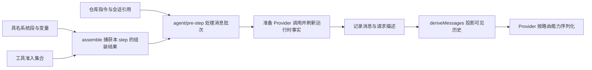

# 05｜System Prompt、指令与上下文来源

> 源码基线为 DeepSeek Harness `dsh-v0.2.3-alpha.2`，提交 `4b399c39a6d1479cd84ca591b4d7c88e24d38a96`。[系列目录](../README.md) · [上一篇](04-llm-provider-auth-sse.md) · [上游仓库](https://github.com/deepseek-ai/deepseek-harness)

假设你在 DSH 的对话里让 Agent 修改 `src/editor`，半途切到了另一个 worktree，子目录里还有自己的 `AGENTS.md`。下一次请求会看到哪一份目录、哪组项目指令和哪批工具？回答这道题，得先知道这些信息在会话里分别是什么类型，以及它们何时被接纳。

## 1. 「给模型的上下文」由几条路径产生

| 输入 | 谁提供 | 进入请求前如何记录 |
| --- | --- | --- |
| Harness 身份、Persona、工具使用说明 | `ctx.systemPrompt.section()` 注册具名提示词段，渲染时可引用变量 | `system/message`，记录段名、顺序和内容索引等来源信息。 |
| 当前目录、沙箱模式等运行时事实 | `ctx.systemPrompt.context()` 注册动态上下文 | 变化时写为 `user/message`，来源是 `runtime-context`。 |
| `AGENTS.md` 与同类仓库指令 | `agent-instructions` 插件发现文件，在 `agent/pre-step` 接入消息批次 | `user/message`，来源是 `agent-instructions`，携带作用域、路径及内容变化。 |
| 本轮可用工具及输入参数 | 工具 Registry 提供本 step 的准入集合，System Prompt 服务负责收集和排序 Schema | `request/header` 保存声明，工具名增删还可能产生 `developer/message`。 |
| `@file` 和跨会话引用 | `file-reference-local` 提供路径补全，`session-reference` 捕获被引用会话 | 文件路径保留在输入文本中。会话引用会另追加来源为 `session-reference` 的背景消息。 |

一条 `system/message` 与一条 `user/message` 在会话中有不同角色。`<system-reminder>` 是提示词格式，仓库指令或当前目录使用这个标签时，消息的角色仍是 `user`。判断一条内容的来路，要一起看 `role`、`source.kind` 和它进入历史的事件；判断它在指定 Provider 上最终怎样呈现，还要继续查 adapter 的请求投影。[System Prompt 实现](../deepseek-harness/packages/core/system-prompt/src/index.ts) · [运行时上下文](../deepseek-harness/packages/core/agent-loop/src/runtime-context.ts) · [消息与来源](../deepseek-harness/docs/subsystems/llm-streaming.zh.md)

## 2. System Prompt 如何组装和更新

`SystemPromptService` 的构造器注册 Harness 身份及部署用的 Persona Prefix、Suffix。其它插件通过 `section()`、`variable()`、`context()` 和 `tools()` 注册贡献。具名 Section 优先取离 Agent 最近的 Scope，同层同名取最新注册。有效段按 `order` 排序，同序号按名称排序。文本可以是函数，默认支持 `{{name}}` 插值。`{{model}}` 对应的是 Agent Loop 注册的变量，其值优先取本 step 捕获的模型选择。引用缺失的变量会使渲染失败。[段注册与撤销](../deepseek-harness/packages/core/system-prompt/src/index.ts#L507) · [变量与工具提供方](../deepseek-harness/packages/core/system-prompt/src/index.ts#L615) · [模型变量](../deepseek-harness/packages/core/agent-loop/src/index.ts#L337)

`assemble()` 收集 Scope 可见贡献，复制工具参数 Schema，再经 `system-prompt/assemble` Waterfall 处理提示词表现。通常各段按顺序协作。有 `complete: true` 的注册段时，它成为完整系统提示词，组装会拒绝同时生效的多个 complete 段。工具声明由独立的准入集合产生。替换完整提示词并不会授予插件额外的工具权限。[组装入口](../deepseek-harness/packages/core/system-prompt/src/index.ts#L691) · [完整段与 Waterfall](../deepseek-harness/packages/core/system-prompt/src/index.ts#L774)

组装结果持有 `systemUpdates()`。这个函数在模型请求准备成功后，把捕获到的段与 Session 已接纳的 `systemSections` 投影比较。新段追加，内容或顺序变化时写更新，内容变化可以附替换说明，相同内容继续留在历史里。撤销当前 Scope 的同名段时，若还有可见的候补定义，退回该定义；已接纳的运行时段失去所有可见注册时，组装可生成退役提示。版本变化的检测发生在接纳时，便于追查「这轮用了哪一版指令」。[系统接纳算法](../deepseek-harness/packages/core/system-prompt/src/admission.ts#L81) · [系统段投影](../deepseek-harness/packages/core/system-prompt/src/projection.ts#L38) · [退役逻辑](../deepseek-harness/packages/core/system-prompt/src/index.ts#L718)

压缩事件把系统段状态标为 `needsRebuild`。下一次接纳模型请求时，`systemUpdates()` 清空保留的旧系统追加段，再替换初始系统头。最后写入的头部重置事件标志这轮重建结束。确认请求的真实输入时，应从保留的 Session surface 调 `deriveMessages()`。它在只追加时增量投影，发生替换时按内容 generation 重建。[重建写入](../deepseek-harness/packages/core/system-prompt/src/index.ts#L832) · [历史派生](../deepseek-harness/packages/core/session/src/index.ts#L760)

## 3. `AGENTS.md` 在哪一步进来

项目指令由 `agent-instructions` 插件处理。基础 Bundle 装配了该插件。Web 关闭全局行，随附 Preset 可以在对应作用域装配自己的实例。因此排查时先看当前 Profile 与 Agent 的实际 Preset。[基础配置](../deepseek-harness/packages/bundle/base/cordis.patch.yml#L313) · [Web 上的覆盖](../deepseek-harness/packages/bundle/web-app/cordis.patch.yml#L640) · [Preset 中的指令插件](../deepseek-harness/packages/bundle/web-app/presets/cordis.patch.yml#L18)

首次发现通常按两条链进行。用户全局链依次读取 `$DSH_HOME/AGENTS.md` 和共享 agents home 的 `AGENTS.md`。项目链先从当前会话目录向上找 `.git` 等根标记，再沿根目录到当前目录读取候选。默认候选包括 `AGENTS.md`、`CLAUDE.md` 以及后加载的 `.local.md` 变体。同一候选组中，去掉首尾空白后内容相同的候选按发现顺序留一份。目录越深，指令越具体；这里只能从实际渲染顺序和工作目录判断哪些文件被带入。[文件发现](../deepseek-harness/packages/context/agent-instructions/src/files.ts#L320) · [候选与读取预算](../deepseek-harness/packages/context/agent-instructions/README.zh.md#use-this-package)

字节预算按全局和项目两条链分别计算。基础配置的 `maxBytes` 为每条链 65,536，单文件读取还受 `maxSourceBytes` 限制。超预算时优先保留更具体的文件，按规则省略较宽泛文件、截断剩余内容，并给模型预算提示。这里管理的是渲染字节数，模型 token 预算还要由实际模型和后续上下文流程计算。[预算配置](../deepseek-harness/packages/context/agent-instructions/src/config.ts) · [渲染](../deepseek-harness/packages/context/agent-instructions/src/render.ts)

插件的 `agent/pre-step` 监听先取下游接纳决定，再准备指令消息。成功进入时，指令插在已认领批次之后。首步被拒绝或被改成空批次时，待用指令可以留在 Inbox，等以后接纳。之后成功的 `read`、`write`、`edit` 会贡献结构化文件访问记录，等外层 step 结算后重新发现更深目录及受影响的指令。指令刷新使用当前目录、已接纳状态和文件版本或 digest，构造新增、替换和移除。它避免路径与内容都未变时重复注入。[基线与刷新](../deepseek-harness/packages/context/agent-instructions/src/index.ts#L109) · [Pre-step 与工具触达](../deepseek-harness/packages/context/agent-instructions/src/index.ts#L322)

## 4. 切换目录时，什么会跟着切换

可以把 Session 中的目录看成两份数据。`header.cwd` 标识原始项目。工作目录服务的 `workingDirectory` 投影以它为初值，之后应用由宿主写入的 `workspace-root/change`。`set()` 串行校验路径、状态和权限钩子，在提交变更后尝试排入通知。`ensure()` 在目录使用前检查它仍存在，消失时尝试恢复原始项目。当前目录决定相对路径、项目指令发现、文件补全和新启动的进程目录，也参与 `workspace-write` 边界。已经启动的持久 Shell 仍使用自己的进程目录。[目录状态](../deepseek-harness/packages/session/working-directory/src/index.ts#L110) · [校验、移动与通知](../deepseek-harness/packages/session/working-directory/src/index.ts#L168) · [工作目录约定](../deepseek-harness/docs/subsystems/working-directory.zh.md)

`working-directory:current` 是必需的运行时上下文。目录通知如果因取消被丢弃，下次请求仍能从目录投影读到正确的值。`refreshContext()` 在请求接纳前刷新已注册的运行时贡献，保留当前必需项。`RuntimeContextProjection` 用来源中的具名段和值与上一份保留快照比较，变化时生成 `user/message`，相同时沿用历史。因而 `system/message` 里没有新目录，并不能据此断定模型仍看到旧目录。[必需目录上下文](../deepseek-harness/packages/session/working-directory/src/index.ts#L121) · [上下文刷新](../deepseek-harness/packages/core/system-prompt/src/index.ts#L649) · [快照比较](../deepseek-harness/packages/core/agent-loop/src/runtime-context.ts#L69)

### `@file` 与跨会话引用为什么是两条路径

输入 `@src/editor/index.ts` 时，文件引用服务负责找候选与格式化路径。本地 Provider 以当前目录为搜索基准，并按 Agent 和目录缓存索引。候选只含路径，文本内容要由后续 `read` 等工具获取。Provider 还会为有 `read` 工具的 Agent 注册提示词段，告诉模型先读文件再声称已经检查。[文件 mention 语法](../deepseek-harness/packages/context/file-reference/README.zh.md#use-this-package) · [本地提示词贡献](../deepseek-harness/packages/context/file-reference-local/src/index.ts#L59) · [候选缓存](../deepseek-harness/packages/context/file-reference-local/src/index.ts#L109)

跨会话引用在 `agent/pre-step` 解析 `dsh-session:` mention。它将直接消息中的 mention 改成可读的标签，再紧跟一条有预算的快照。该快照捕获当前表层中符合规则的用户文本、助手文本和压缩检查点，记录源会话与 `capturedThroughSeq` 等信息，写入目标 Session。工具结果、推理和其它注入上下文在这个投影中被过滤。超长时，可选 spill 保存更完整的文本投影。源会话继续更新时，已经写入目标历史的快照仍代表原捕获点。引用被标记为不受信任的背景，权限依旧由对应服务和工具策略校验。[引用接纳](../deepseek-harness/packages/context/session-reference/src/index.ts#L149) · [捕获与预算](../deepseek-harness/packages/context/session-reference/README.zh.md#use-this-package) · [快照样本](../deepseek-harness/snapshots/session/session-reference-spill/session.v4.jsonl#L11)

## 5. 停用工具，模型和执行器会怎样看到变化

`preStep()` 先用 `tools.resolve()` 得到本 step 可见的工具集合。System Prompt 服务调用工具提供方，投影为 `{name, description, parameters, deferLoading?}` 并排序。Loop 随后提交 `request/header` 快照。已存在基线且工具名称集合发生增删时，Loop 还追加来源为 `tool-registry` 的 `developer/message`。新增消息用 `headerSeq` 指向含定义的请求头；移除消息用名字说明哪项被撤下。仅修改同名工具的 Schema 时，新定义会反映在变化的请求头，增删事件仍依据名称集合计算。[工具准入](../deepseek-harness/packages/core/tools/src/index.ts#L257) · [Schema 组装](../deepseek-harness/packages/core/system-prompt/src/index.ts#L757) · [请求头与工具变更](../deepseek-harness/packages/core/agent-loop/src/agent.ts#L654)

Provider 真正消费的工具声明由 `projectToolUpdates()` 根据路由能力生成。支持 `in-history` 的路由可以保留相应增删记录，只支持追加的路由按其规则重整历史，普通路由使用当前立即可用的 Schema 并移除这类 developer 更新。旧 step 执行时还会校验原注册身份，工具在组装之后卸载，也不能让同名的新实现接手上一版 Schema 产生的调用。调试这个场景，可以分别对照 `request/header`、实际发往 Provider 的请求和最终执行查找。[工具历史投影](../deepseek-harness/packages/core/session/src/index.ts#L747) · [路由投影](../deepseek-harness/packages/llm/llm/src/content.ts#L366) · [执行查找](../deepseek-harness/packages/core/tools/src/index.ts#L251)

### 一步内的重试会重新读哪部分？

`assemble()` 捕获该 step 的系统段、工具与变量。每次 attempt 准备调用后会刷新运行时事实，复用已接纳的消息批次，再派生请求。中途 HMR 产生的提示词定义变化通常等下一次组装。压缩触发的系统头重建是专门处理的分支，重试时也使用该 step 已捕获的段。这样可以重建每次请求观察到的历史，同时减少运行时事件导致配置混搭的机会。[Step 接纳](../deepseek-harness/packages/core/agent-loop/src/agent.ts#L431) · [刷新契约](../deepseek-harness/packages/core/system-prompt/src/index.ts#L649) · [重试的系统写入](../deepseek-harness/packages/core/system-prompt/src/index.ts#L832)

## 6. 面试官会怎么追问

### 你改了 `AGENTS.md`。怎么确认下一轮模型看到新版本？

先查 Agent 实际的 cwd、项目根、Preset 和候选路径，再核对发现内容是否被判定重复、截断或省略。接着检查 `agent-instructions` 来源的变化记录是否进入了 `user/message`，以及这条消息是否保留在本次请求的 surface 上。可以设计一组目录内的测试，先读根目录文件，再成功读取嵌套目录，断言仅后续请求多了一条子目录指令。

### 为什么记住了老目录，切换后模型还会提到它？

原始项目、已记录的当前目录和之前的历史消息各有用途。可以让候选人指出 `workspace-root/change` 与必需运行时快照的先后关系，再让他用目录删除、通知清空、Session 恢复三个场景验证。最后追问切换目录后，已打开的持久 Shell 和接下来新启动的进程各在哪个目录运行。前者保留自己的进程目录，新的工具调用则按相应服务的目录规则解析。

### 本轮组装过的工具在执行前被停用了，你会怎样处理？

首先用该步准入的工具定义确认模型看到什么，再用执行时注册身份确认当前能运行什么。若同名工具已换代，应返回可定位的不可用结果，由下一步按新 Schema 决策。设计验证时让模型拿旧参数继续调用，观察旧定义从执行视图消失，并核对下一请求的 header 与工具变更消息。

### 怎样给一个企业 Coding Agent 设计上下文预算？

可以先给不同来源各自的纳入条件与预算，再定义冲突时的保留顺序和溢出行为。让候选人逐项解释稳定系统段、当前目录、仓库指令、文件内容、跨会话背景和工具 Schema 如何归属，并记录精确来源以便回放。用「目录切换同时发生指令刷新，另一个团队的历史会话被提及」作为场景，验证访问控制、指令优先级、缓存命中与 token 成本。

下一篇走到 Function Calling 的执行侧，从模型输出的调用名和 JSON 参数追到校验、审批、并行调度与结果回填。
