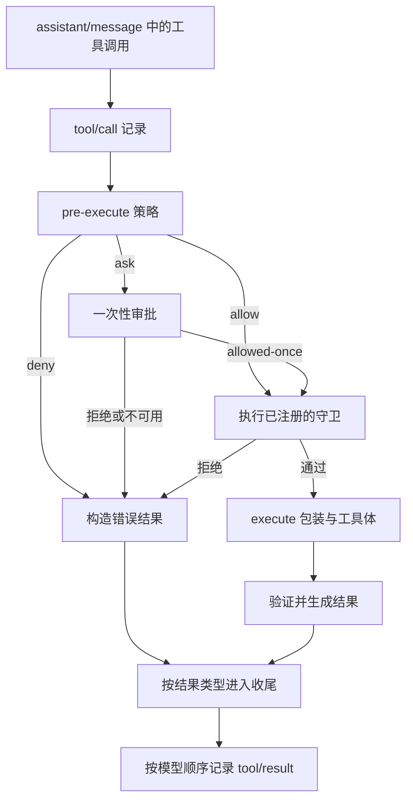

# 06｜Function Calling 与原生工具流水线

> 源码基线为 DeepSeek Harness `dsh-v0.2.3-alpha.2`，提交 `4b399c39a6d1479cd84ca591b4d7c88e24d38a96`。[系列目录](../README.md) · [上一篇](05-system-prompt-and-context.md) · [上游仓库](https://github.com/deepseek-ai/deepseek-harness)

模型在一个 step 里返回四个调用，先读两个文件，再写一个文件，最后读回检查。两个读可以同时执行吗？排在第二个的读先返回时，日志先写谁？写文件需要用户批准时，最后的读能不能先跑？这些问题由工具执行器和策略决定。模型提供调用名、参数和 ID，Harness 负责把这些提议变成可执行、可取消和可回放的结果。[工具流水线](../deepseek-harness/docs/tool-execution-pipeline.zh.md) · [DeepSeek Tool Calls 接口](https://api-docs.deepseek.com/api/create-chat-completion/)

## 1. 从模型看到的 Schema 到本地调用

原生模式下，Agent Loop 在准备 step 时通过 `ctx.tools.resolve()` 得到可见且符合条件的工具定义。`NativeToolExecutor.describe()` 将定义投影为 `{name, description, parameters, deferLoading?}`。执行函数、运行时超时、并发声明以及界面回调由 Harness 保存。DeepSeek Messages 适配器把 `parameters` 序列化为 `input_schema`，将完成的 `tool_use` 响应统一成 `tool-call` 内容块。[工具准入](../deepseek-harness/packages/core/tools/src/index.ts#L257) · [Native Executor](../deepseek-harness/packages/core/tool-executor-native/src/index.ts#L7) · [Schema 投影](../deepseek-harness/packages/core/tools/src/schema.ts#L635) · [Messages 序列化](../deepseek-harness/packages/llm/llm-deepseek/src/serialize.ts#L160)

模型流结算且有完整的工具块时，Agent Loop 保存 `assistant/message`，再把其中的工具调用交给 `ctx.tools.execute()`。Registry 按 Agent 作用域选择执行器，该批调用由选中的执行器结算。Native 执行器直接把调用交给 `executeToolBatch()`。准备时已准入的工具仍需在使用时通过身份检查，原插件卸载后，同名的新实现不会沿用旧 step 的准入资格。[Agent 派发](../deepseek-harness/packages/core/agent-loop/src/agent.ts#L556) · [执行器选择](../deepseek-harness/packages/core/tools/src/index.ts#L324) · [准入身份检查](../deepseek-harness/packages/core/tools/src/index.ts#L281)

`tool-fs` 的 `read` 提供了一个完整样例。输入声明要求字符串 `file_path`，还可接收 `offset` 和 `limit`。执行函数返回规范值，包含 `path`、`offset`、带编号的 `lines` 与 `totalLines`。`output.render()` 生成模型能读的文本，`output.presentationMeta()` 生成界面可复用的结构化元数据。把这三种表示分开，模型反馈和 UI 卡片都能直接使用自己的数据。[`read` 工具定义](../deepseek-harness/packages/fs/tool-fs/src/read.ts#L78)

| 接口 | 数据来自哪里 | 用在哪一步 |
| --- | --- | --- |
| 模型可见的 Schema | 工具定义中的名字、说明与参数 Schema | 帮模型选择工具和构造参数。 |
| `ToolExecution` | 调度器按原始调用构造，含 `callId`、Agent、内部执行 token 和取消信号 | 供权限、审批、工具体和钩子关联同一次执行。 |
| 规范结果 `value` | 工具体成功返回，并通过输出 Schema 验证 | 供工具渲染与流水线处理。 |
| 结果内容 `content` 与 `meta` | 从规范结果渲染，随后经过结果处理 | 内容进入模型历史，元数据可随结果保存并供界面使用。 |

## 2. 参数、权限与执行分别在哪里检查

批调度器解析模型给出的参数字符串。空串变为 `{}`，`JSON.parse()` 失败时保留原始字符串，让后面的执行校验给出诊断。流水线初始化执行对象时，对参数做可无损表示的 JSON 快照并冻结。`defineTool()` 将参数定义编译为 JSON Schema，再在调用工具作者的 `execute` 前验证实际参数。模型发出了一个合法 JSON 对象，仍可能缺字段、把整数写成字符串或传出越界参数。[原始参数解析](../deepseek-harness/packages/core/tools/src/batch.ts#L98) · [执行参数快照](../deepseek-harness/packages/core/tools/src/pipeline.ts#L148) · [定义与运行时校验](../deepseek-harness/packages/core/tools/src/schema.ts#L555)

调度器把接手的调用记录为 `tool/call`，随后才进入前置策略。因为审批或拒绝都发生在它之后，`tool/call` 可以作为追踪入口，实际工具体是否开始还要结合后续结果和执行层证据。[调用开始记录](../deepseek-harness/packages/core/tools/src/batch.ts#L154) · [记录字段](../deepseek-harness/packages/core/tools/src/batch.ts#L243)



### 审批通过之后还会检查什么

`tools/pre-execute` 是 Waterfall。策略可以允许、拒绝、取消或提出 `ask`。流水线把 `ask` 交给 `ctx.approval`，只有 `allowed-once` 才继续。缺审批服务或没有可路由的 Agent 时会拒绝，并给出结构化错误。审批请求处于等待状态时仍接收调用方取消信号。[前置策略](../deepseek-harness/packages/core/tools/src/pipeline.ts#L191) · [审批映射](../deepseek-harness/packages/core/tools/src/pipeline.ts#L441)

允许后还会运行全局和 Agent 继承作用域中的守卫，首个拒绝即结束检查。守卫只能拒绝或弃权，前面通用策略的放行与一次性审批都不能消除该拒绝。实际写文件等操作仍可检查自己的资源约束。比如文件工具可在执行体内通过文件系统事件检查先读后改，这项约束位于通用调用检查之后。[守卫实现](../deepseek-harness/packages/core/tools/src/index.ts#L380) · [文件修改约束](../deepseek-harness/docs/tool-execution-pipeline.zh.md)

通过前置检查后，`tools/execute` 包住工具派发。基础配置中的会话检查点可以先刷盘顶层调用记录，超时插件可以为声明 `timeoutMs` 的工具传递派生信号。真正派发时会再查当前可用定义，拿不到时形成 `UNKNOWN_TOOL`。`timeout-policy` 发送的是协作式取消信号，并等待下游结算。工具若忽略信号，单凭 `AbortController` 不会把它强制停下来。[围绕派发](../deepseek-harness/packages/core/tools/src/pipeline.ts#L263) · [调用前检查点](../deepseek-harness/packages/session/session-checkpoint-policy/src/index.ts) · [协作超时](../deepseek-harness/packages/guard/timeout-policy/src/index.ts#L50)

## 3. 两个读可以同时跑，为什么结果还要排队

`isConcurrencySafe(args)` 对每次调用分类。只有返回严格的 `true` 才并行。工具未知、隐藏、没声明并行能力、分类异常或 `defineTool()` 的参数校验未通过时，分类为独占。独占调用在当前批内形成屏障，等它之前的调用结算后开始，也要等它结算后才启动后面的调用。跨批次、跨 Agent 共享的文件和远端资源仍由各自的服务协调。[分类实现](../deepseek-harness/packages/core/tools/src/pipeline.ts#L99) · [参数与分类](../deepseek-harness/packages/core/tools/src/schema.ts#L626) · [独占屏障测试](../deepseek-harness/packages/core/agent-loop/tests/tool-calls.spec.ts#L140)

调度器有两组状态。`inFlight` 保存已派发的工具体，数量受 `maxParallelToolCalls` 限制；`slots` 存已完成但可能还在等结果提交的结算。它用 `Promise.race()` 收割先完成的调用并尝试补位。`commitReady()` 只从模型顺序中连续可提交的位置推进，所以后完成的第一个工具仍先写结果。前置策略依次等待，后置处理也随结果按序执行。审批等待发生在前置准备里，已派发的兄弟调用可以继续跑，之后尚未准备的调用要等调度器从该审批返回。[滚动池与提交](../deepseek-harness/packages/core/tools/src/batch.ts#L117) · [前后置顺序测试](../deepseek-harness/packages/core/agent-loop/tests/tool-calls.spec.ts#L410)

以 `read A → read B → write C → read C` 为例，B 可以先返回，但 B 的结果要等 A 才能按模型顺序提交。`write C` 是独占屏障，其审批从轮到它时才开始。最后的 `read C` 等写入这一组结算后才开始。并行改善了工具体耗时，按序提交仍可能出现队首阻塞。实际调优时可分别记录排队、审批等待、工具体耗时和结果等待时长。[批次划分](../deepseek-harness/packages/core/tools/src/batch.ts#L74) · [乱序完成测试](../deepseek-harness/packages/core/agent-loop/tests/tool-calls.spec.ts#L238)

当 Agent 取消批次时，执行器停止补位，等待已启动的调用到达结算。尚未派发的模型调用可以得到带 `ABORTED_BEFORE_DISPATCH` 的合成结果。若调度器自身失败，源码会先等待已开始的派发收尾，再让 Loop 处理错误。第 03 篇的 `TOOL_OUTCOME_UNKNOWN` 则来自结果缺失后的恢复，适合跟这里的主动取消一起比较。[停止补位与结算](../deepseek-harness/packages/core/tools/src/batch.ts#L203) · [合成结果](../deepseek-harness/packages/core/tools/src/batch.ts#L271) · [第 03 篇](03-agent-loop-state-machine.md)

## 4. 工具体返回之后，结果还会过几道检查

1. `createSuccessResult()` 对返回值做无损快照并验证输出 Schema，再从冻结后的规范值生成模型内容和可选的 `meta`。返回值无法序列化、结构不匹配或渲染出错时，流水线形成错误结果。[结果验证与投影](../deepseek-harness/packages/core/tools/src/pipeline.ts#L557)
2. 在需要运行后置策略的路径中，`projectContent` 可以先调整正文。`tools/post-execute` 能接受、替换模型正文、用新规范值重新验证和渲染，或给出 `block` 和纠正反馈。`block` 发生在工具体之后，外部系统已经发生的写入仍需要调用方按业务语义确认。[投影与后置入口](../deepseek-harness/packages/core/tools/src/pipeline.ts#L356) · [后置决定](../deepseek-harness/packages/core/tools/src/pipeline.ts#L496)
3. `finalizeContent` 应用工具定义中的最终内容约束。流水线冻结结果并通知 `tools/result` 观察者。观察者可以做跟踪与状态投影，其异常按观察者处理。批执行器接到最终结果后再写 `tool/result` 并关联 `callId` 和调用事件序号。[最终结果](../deepseek-harness/packages/core/tools/src/pipeline.ts#L386) · [Session 回填](../deepseek-harness/packages/core/tools/src/batch.ts#L252)

`tools/result` 是进程内通知，`tool/result` 是可写入 Session 的事件。工具或钩子返回的 `additionalContexts` 由批次按序收集，再由 Agent Loop 排到 `next-step`。到下一步接纳时才可能成为新的消息。这保持了工具调用和对应结果的历史结构，也让模型能够继续调整动作。工具可以通过结果声明当前 turn 已有结论。[上下文和停止标记](../deepseek-harness/packages/core/tools/src/batch.ts#L252) · [Agent 消费批结果](../deepseek-harness/packages/core/agent-loop/src/agent.ts#L580)

## 5. 界面如何区分生成参数、运行和结束

Web 的工具节点按 `callId` 关联三种事件。assistant 的工具增量先填出 `preparing` 卡片，`tool/call` 建立可回放的调用，`tool/result` 填入结果正文、`isError`、结构化错误和 `meta`。`read` 保存的行号等元数据可供显示读取窗口。旧日志中的参数若不满足当前 Schema，`defineTool()` 的可选 Presenter 包装会退回通用表现。这些显示规则在回放时不会重新调用工具。[工具节点](../deepseek-harness/packages/client/ui-chat/src/client/conversation-nodes/tool.ts#L291) · [结果卡片的数据](../deepseek-harness/packages/client/ui-chat/src/client/conversation-nodes/tool.ts#L100) · [Presenter 校验](../deepseek-harness/packages/core/tools/src/schema.ts#L610)

实际仓库快照里能看见三条不同轨迹。`parallel-tool-calls` 连续记录读 A、读 B 的调用，再以 A、B 顺序记录结果。`hook-cc-pretool-deny` 的结果为 `HOOK_DENIED`，而 `hook-cc-posttool-block` 首次返回 `HOOK_BLOCKED`，后续 step 又有新的调用。快照能验证会话中的记录次序。要验证 B 的工具体确实先完成，需要控制执行时序的测试。[并行快照](../deepseek-harness/snapshots/session/parallel-tool-calls/session.v4.jsonl#L16) · [前置拒绝快照](../deepseek-harness/snapshots/session/hook-cc-pretool-deny/session.v4.jsonl#L16) · [后置阻断快照](../deepseek-harness/snapshots/session/hook-cc-posttool-block/session.v4.jsonl#L16)

## 6. 实验：让第二个读先返回

在学习仓库根目录用 Node 24 运行下列脚本。实验使用源码的 `executeToolBatch()`，通过一个内存流水线替身控制工具体与前后置处理。前两个读可并行，B 返回时释放仍在等候的 A。断言工具体以 B、A 顺序返回，最终结果仍按 A、B 排列，写入与最后一个读各在独占屏障的两侧。脚本没有文件写操作。[调度源码](../deepseek-harness/packages/core/tools/src/batch.ts#L50)

```bash
node --experimental-transform-types --input-type=module <<'JS'
import assert from 'node:assert/strict'
import { registerHooks } from 'node:module'

const root = new URL('./deepseek-harness/packages/', import.meta.url)
const llmExports = [
  `export { HarnessError } from '${new URL('util/error/src/index.ts', root).href}'`,
  `export { createToolResultMessage } from '${new URL('llm/llm/src/message.ts', root).href}'`,
].join('\n')
const sources = new Map([
  ['@deepseek-ai/dsh-brand', new URL('util/brand/src/index.ts', root).href],
  ['@deepseek-ai/dsh-error', new URL('util/error/src/index.ts', root).href],
  ['@deepseek-ai/dsh-util-crypto', new URL('util/crypto/src/index.ts', root).href],
  ['@deepseek-ai/dsh-util-values', new URL('util/values/src/index.ts', root).href],
  ['@deepseek-ai/dsh-llm', `data:text/javascript,${encodeURIComponent(llmExports)}`],
])
const hooks = registerHooks({
  resolve(specifier, context, next) {
    return next(sources.get(specifier) ?? specifier, context)
  },
})

try {
  const { executeToolBatch } = await import(new URL('core/tools/src/batch.ts', root))
  const aCanFinish = Promise.withResolvers()
  const trace = []
  const calls = [['A', 'read'], ['B', 'read'], ['W', 'write'], ['C', 'read']]
    .map(([id, name]) => ({ id, name, type: 'tool-call', arguments: '{}' }))
  const pipeline = {
    executionMode: exec => ({ kind: exec.name === 'write' ? 'exclusive' : 'parallel' }),
    async prepare(exec) {
      trace.push(`pre:${exec.callId}`)
      return { kind: 'dispatch', exec }
    },
    async dispatch(exec) {
      if (exec.callId === 'A') await aCanFinish.promise
      trace.push(`body:${exec.callId}`)
      if (exec.callId === 'B') aCanFinish.resolve()
      return { kind: 'post-result', result: { isError: false, value: exec.callId, content: [] } }
    },
    async complete(exec, outcome) {
      trace.push(`post:${exec.callId}`)
      return outcome.result
    },
  }
  const result = await executeToolBatch({ calls, signal: new AbortController().signal }, pipeline, () => 2)
  assert.deepEqual(result.results.map(item => item.callId), ['A', 'B', 'W', 'C'])
  assert.deepEqual(trace, [
    'pre:A', 'pre:B', 'body:B', 'body:A', 'post:A', 'post:B',
    'pre:W', 'body:W', 'post:W', 'pre:C', 'body:C', 'post:C',
  ])
  console.log(trace.join(' → '))
} finally {
  hooks.deregister()
}
JS
```

实验运行了调度源码和可控替身。真正的 Cordis 审批、工具实现、会话写入和 UI 另有验证入口。安装工作区依赖后，可在 `deepseek-harness/` 运行 `pnpm exec vitest run packages/core/agent-loop/tests/tool-calls.spec.ts packages/core/tools/tests/tools.spec.ts` 检查批调用与流水线。[批调用测试](../deepseek-harness/packages/core/agent-loop/tests/tool-calls.spec.ts) · [流水线测试](../deepseek-harness/packages/core/tools/tests/tools.spec.ts)

## 7. 面试官会怎么追问

### 模型调用的是现成函数，为什么还要做参数和输出校验？

先说清模型端 Schema、协议层 JSON 解析、执行前参数校验和工具输出 Schema 四处各自检查什么。正确的字段类型只能说明结构合规，还要由负责资源的工具校验路径、权限或业务状态。输出为成功值时也可能无法持久化或与宣称类型不符。继续追问可以要求候选人用「必填键缺失」「旧日志格式不兼容」「输出渲染抛错」三个输入分别定位失败点。

### 一个审批中的调用会占着执行槽吗？怎样设置超时？

要分开讨论前置准备和工具体。审批等待出现在有序 `prepare()` 中，工具体尚未进入并行池，但该等待可能挡住后续调用的准备。已经开始的调用仍可在后台完成。系统设计可以分别为排队、审批、工具执行和整个 turn 设置取消与期限，记录每段耗时。追问可要求说明审批获准与用户取消同时到达时，工具体启动前怎样再检查信号。

### 两读一写的屏障，能解决两个 Agent 同时改一个文件吗？

批内的独占分类保护这一批的工具顺序。跨 Agent 修改需要在文件系统或共享资源服务上明确互斥、版本检查和提交条件。可以让候选人设计一个测试，让两个 Agent 先读同一版本，分别尝试写入，再通过工具错误给模型返回冲突信息。回答需要交代哪个写入发生、历史里记录了什么，以及失败方怎样恢复。

### `tool/result.isError` 为真，外部写操作还能成功过吗？

可能。后置钩子阻断、超时取消、结果写入失败，都可能出现在工具体开始之后。应读取错误来源和已落盘证据，涉及远端变更时还要查询幂等记录或外部回执。面试进阶题可以要求候选人设计面向用户的三种结果：确认成功、确认未执行、结果待核实，并说明每种状态下的可重试条件。

下一篇进入 PTC。同一套工具会经由 `run_code` 暴露给受控程序，工具批次的表达和执行边界也随之改变。
