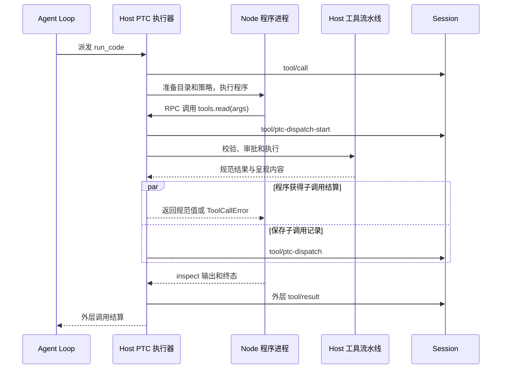

# 07｜PTC：让模型写程序调用工具

> 源码基线为 DeepSeek Harness `dsh-v0.2.3-alpha.2`，提交 `4b399c39a6d1479cd84ca591b4d7c88e24d38a96`。[系列目录](../README.md) · [上一篇](06-function-calling-tool-pipeline.md) · [上游仓库](https://github.com/deepseek-ai/deepseek-harness)

要检查 50 份日志里哪些出现了同一条错误，模型可以直接发出一批 `read` 调用，再读取结果。也可以生成一段程序，让它逐份读、在程序里筛选，最后只展示命中的文件名和行号。第二种做法就是 Programmatic Tool Calling（PTC）。它把筛选、循环和聚合交给程序执行，模型仍负责确定要分析什么，以及怎样解读返回的证据。[DSH PTC 执行器](../deepseek-harness/packages/core/tool-executor-ptc/README.zh.md) · [Programmatic Tool Calling 原理](https://platform.claude.com/docs/en/agents-and-tools/tool-use/programmatic-tool-calling)

## 1. 模型在 PTC 模式下看到什么

执行模式由 Agent 所在作用域选定。基础 Bundle 默认激活原生执行器，已装配 Node PTC Runtime，同时把基础层的 PTC 执行器条目标为停用。Web 的 PTC Preset 可在自己的作用域挂载 PTC 执行器，仓库也提供用于 headless 的示例补丁。同一作用域只能选一个执行器，这个选择决定工具声明和调用分派的方式。[基础 Runtime](../deepseek-harness/packages/bundle/base/cordis.patch.yml#L418) · [基础执行器](../deepseek-harness/packages/bundle/base/cordis.patch.yml#L526) · [Web PTC Preset](../deepseek-harness/packages/bundle/web-app/presets/ptc.patch.yml#L130) · [Headless PTC 示例](../deepseek-harness/apps/cli/config/examples/ptc.yml)

| 关心什么 | Native | PTC 模式 |
| --- | --- | --- |
| 请求里可直接调用的 Schema | step 准入的原生工具声明 | 保留的 `run_code` 声明。 |
| 模型如何组合工具 | 输出一批调用，Harness 执行后再回填 | 输出一段程序，程序内调用 `tools.*`，按需要使用分支和循环。 |
| 结果如何回到模型 | 每个顶层调用各有 `tool/result` | 普通中间值留在运行中，子调用有派发记录，模型主要消费外层 `run_code` 的结果。 |
| 如何控制并发 | 原生批次的并行上限和独占屏障 | 外层程序独占，程序内另有子调用额度和并行池，也遵循工具的独占分类。 |

在纯 PTC 下，模型直接输出同一个 `read` 工具名会得到 `UNKNOWN_TOOL`。`PtcExecutor` 的 `describe()` 仅曝光 `run_code`，另外通过系统段提供 `tools:ptc-only` 和 `tools:sdk`。执行期用同一个 Agent 的 step 准入集合构建绑定，仍会检查定义是否有效。还有一种独立的扩展形态，Native Preset 中的插件可以通过 `createRunCodeTool()` 注册有名字的程序工具，并只向该程序交付自己声明的一组私有绑定。[PTC 模型表面与拒绝路径](../deepseek-harness/packages/core/tool-executor-ptc/src/index.ts#L24) · [具名程序工具](../deepseek-harness/packages/core/tool-executor-ptc/src/run-code.ts#L37)

## 2. SDK 从哪里来，TypeScript 在运行时起什么作用

`PtcExecutor.renderSdk()` 读取准入定义中的工具名、说明、输入 Schema 和输出 Schema，交给 `renderToolsSdk()`。后者按名称排序，生成 `ToolArgsMap`、`ToolOutputMap` 和 `tools` 的泛型映射，也说明 `ToolCallError`、`inspect()` 和 `Image` 的用法。相同定义集合生成相同文本，有利于保持请求前缀稳定。运行时报告自己接受的程序语法，执行器按语法提供对应说明。[SDK 输入](../deepseek-harness/packages/core/tool-executor-ptc/src/index.ts#L40) · [TypeScript SDK 生成](../deepseek-harness/packages/core/tool-executor-ptc/src/ts-types.ts#L308)

这些声明帮助模型写对参数、返回值访问和 `await`。Node Runtime 会擦除 TypeScript 类型再求值。真正的参数、输出及权限校验仍在 Host 的工具流水线执行。下面是一段可表示在 `run_code.code` 里的示例，程序把普通文件读取结果缩成两份计数。[运行方式](../deepseek-harness/packages/ptc-runtime/ptc-runtime-node/src/execution.ts#L130) · [`read` 的结构化返回](../deepseek-harness/packages/fs/tool-fs/src/read.ts#L78)

```ts
const files = await Promise.all([
  tools.read({ file_path: 'a.txt', limit: 100 }),
  tools.read({ file_path: 'b.txt', limit: 100 }),
])

inspect(files.map(file => ({
  path: file.path,
  readLines: file.lines.length,
  matches: file.lines.filter(line => line.text.includes('ERROR')).map(line => line.number),
})))
```

`run_code` 要求 `code` 和 `description`，另外可按运行时能力提供超时等选项。这里的筛选只覆盖读到的窗口。若任务要求扫描整份文件，程序还要处理分页、截断和单文件错误。`inspect` 哪些字段，也就决定后续模型能依据哪些证据。[程序 Schema 与提示词](../deepseek-harness/packages/core/tool-executor-ptc/src/ts-types.ts#L250) · [运行参数与呈现](../deepseek-harness/packages/core/tool-executor-ptc/src/ptc.ts#L217)

## 3. 从 `run_code` 到 Node 子进程和工具回调



Host 为此次执行构建一份 `tools` 绑定表，把代码、目录、沙箱策略、截止时间和信号交给 `runtime.resolve()`。运行时把请求解析为完整 `PtcRunSpec`，补默认值并限制超时，再由 `runtime.run()` 执行。解析出的目录与策略用于启动受管 Node 进程。Node Runtime 通过文件系统、子进程和沙箱服务取得执行环境，沙箱保障来自选中的平台后端。[绑定与执行规格](../deepseek-harness/packages/core/tool-executor-ptc/src/ptc.ts#L638) · [运行时解析](../deepseek-harness/packages/ptc-runtime/ptc-runtime-node/src/execution.ts#L68) · [子进程启动](../deepseek-harness/packages/ptc-runtime/ptc-runtime-node/src/worker.ts#L298)

私有控制管道由 `birpc` 在换行分隔的 JSON 消息上实现，stdout 和 stderr 是独立的输出流。启动时 Host 校验 bootstrap 协议版本。程序调用 `tools.read()` 时，把调用名和参数发到绑定 RPC。Host 检查当前执行、绑定身份和消息预算，调用对应的 Host 工具流水线，再把成功值或失败交还程序。普通工具失败在程序侧表现为 `ToolCallError`，包含工具名及诊断，可以据此跳过单条失败或停止。[控制协议](../deepseek-harness/packages/ptc-runtime/ptc-runtime-node/src/rpc.ts#L19) · [握手和绑定处理](../deepseek-harness/packages/ptc-runtime/ptc-runtime-node/src/worker.ts#L327) · [绑定返回](../deepseek-harness/packages/core/tool-executor-ptc/src/ptc.ts#L611)

运行时支持每次创建进程、保留在内存中的 REPL，以及可选复用的 Script。默认是 `persistent-in-memory`，常规 Agent 调用可按所有者复用环境，同一所有者的并发执行由运行时拒绝。保留的变量属于活进程，Session 保存程序调用和结果，重启后程序可能要重建变量。权限模式变化时，相关进程会失效，下一次执行等清理后使用新状态。只有在停止得到确认并且进程可复用的路径，变量才可能继续保留。[运行模式](../deepseek-harness/packages/ptc-runtime/ptc-runtime-node/README.zh.md#use-this-package) · [状态所有者](../deepseek-harness/packages/ptc-runtime/ptc-runtime-node/src/execution.ts#L86) · [策略变化](../deepseek-harness/packages/ptc-runtime/ptc-runtime-node/src/policy-processes.ts)

## 4. 每个子调用如何调度、取消和记账

子调用仍过第 06 篇的 `prepare → dispatch → complete` 流水线。PTC 将待启动任务放入 FIFO，独立维护在途集合与待结算队列。前置策略与后置结算在同一条有序通道运行，只有安全的工具体可以重叠。独占调用要等在途调用排空，它自己的后置阶段完成后才释放屏障。所以 `Promise.all()` 表达并发提交，实际并行度仍由 Host 决定。[PTC 子调用调度](../deepseek-harness/packages/core/tool-executor-ptc/src/ptc.ts#L342) · [第 06 篇](06-function-calling-tool-pipeline.md)

PTC 会把顶层 ID 与 `<parent>:ptc:<n>` 形式的子 ID 关联。开始事件 `tool/ptc-dispatch-start` 保存调用身份和参数，`tool/ptc-dispatch` 保存结果、错误与可选展示元数据。程序可以先拿到结算值，日志副本随后走异步处理，例如替换成预览和定位信息。调度器限制积压的日志工作量。外层 `run_code` 完成时，执行器等待在途子调用、已开始的日志工作和结算清理，再回填顶层结果。界面可以用根调用 ID 展开子调用轨迹。[派发日志](../deepseek-harness/packages/core/tool-executor-ptc/src/ptc.ts#L494) · [日志背压](../deepseek-harness/packages/core/tool-executor-ptc/src/ptc.ts#L598) · [清理与收尾](../deepseek-harness/packages/core/tool-executor-ptc/src/ptc.ts#L685)

| 限制 | DSH 计算或执行的位置 |
| --- | --- |
| 单程序尝试总额度 | `floor(最终 timeoutMs / 60000 × maxSubCallsPerMinute)`。这是按该次运行的有效截止时间算出的总数。 |
| 安全工具的并行数 | `maxParallelSubCalls` 默认 10。独占调用单独执行，设置为 1 时串行。 |
| Node 程序截止 | 默认 120 秒，上限 600 秒，覆盖运行准备和执行，也包括嵌套批准的等待时间。 |
| 绑定与传输 | 控制消息有字节上限，Host 也限制未完成绑定的数量和参数占用。 |
| 输出保留 | `maxOutputBytes` 限制被保留的展示输出及运行结果或诊断的计量。 |

默认 `maxSubCallsPerMinute` 为 1024，按 120 秒得到 2048 次额度。计数在验证参数和入队前发生，失败尝试也计入。当下一次尝试超额时，执行器取消整段程序，停止尚未派发的工作并结算已启动的调用。普通子调用错误可以在程序内处理，超过整段额度会触发运行取消。已经完成的外部副作用依然可能存在，下一次程序重新计算额度。[配额配置](../deepseek-harness/packages/core/tool-executor-ptc/src/config.ts#L12) · [计数与拒绝](../deepseek-harness/packages/core/tool-executor-ptc/src/ptc.ts#L466) · [最终截止与额度](../deepseek-harness/packages/core/tool-executor-ptc/src/ptc.ts#L671)

## 5. 怎么处理大输出和程序失败

`inspect(...)` 允许程序只发布需要展示的值。直接展示未修改的工具对象或数组时，运行时可复用绑定附带的已呈现文本。选字段、复制对象或查看修改结果时，则用普通 Node 格式。图片可以随展示和外层结果回填，部分工具还会向后续 step 附带自己的额外上下文。因此判断模型看到了什么，应该查看外层结果、被纳入的额外上下文和 Provider 请求。[绑定展示](../deepseek-harness/packages/core/tool-executor-ptc/src/ptc.ts#L620) · [输出展示规则](../deepseek-harness/packages/ptc-runtime/ptc-runtime-node/README.zh.md#use-this-package)

Node 的输出账本按序保留内容。文本超限时截取能容纳的 Unicode 前缀，并标记 `outputTruncated`。正常结束的程序仍可以成功，失败路径优先保留原始诊断类型，并在为诊断留出空间后保留输出前缀。输出上限主要限制可交付结果。程序内部的中间绑定值、对象格式化时的临时分配和整个进程树内存需要另外考虑。[输出账本](../deepseek-harness/packages/ptc-runtime/ptc-runtime-node/src/output-ledger.ts) · [截断与失败呈现](../deepseek-harness/packages/core/tool-executor-ptc/src/ptc.ts#L701)

运行超时或被取消后，保留模式先请求协作停止，并等待确认。进程无法确认停止时，走终止和清理路径，保留变量可能丢失。程序完成、超时、工具副作用和日志持久化是四个可独立观察的状态。需要对 50 次操作报告部分成功时，可以让程序记录每个输入的结果，再用一份小摘要汇总成功、失败与待核实项。[终止与清理](../deepseek-harness/packages/ptc-runtime/ptc-runtime-node/src/worker.ts#L214) · [取消语义](../deepseek-harness/packages/ptc-runtime/ptc-runtime-node/README.zh.md)

## 6. 面试官会怎么追问

### 50 个独立的读操作，PTC 一定少一次模型请求吗？

先区分模型调用次数与回传数据量。Native 也能在一个模型响应里发一批独立读请求，两种模式都可能只需要一个动作 step 和一个总结 step。差异来自中间结果是否要全部进模型，以及工具间的数据依赖能否用程序确定性处理。PTC 还会产生 SDK 前缀和程序运行开销。可以让候选人从每次回填字节数、外层摘要大小和程序启动时延出发，解释如何做对照压测。

### 让模型写 `Promise.all()`，怎样防止把工具服务打满？

区分同一程序的并发数、总尝试数、RPC 排队量，以及多个 Agent 合用资源的全局限流。每程序的并发上限限制重叠执行，固定总额度抑制循环和重复失败。Host 还要对底层读写或远端服务单独限流。追问时可以把第一个独占写放到批次中间，再问慢审批与快读如何排队，以及取消后还会等待哪些活动。

### 程序超时，已经完成的十个写操作要重跑吗？

先用子调用事件和外部回执确认哪些已知完成。缺少结果的写入按结果未知处理，可用业务幂等键或对账。程序内普通读错误可以捕获并继续，整段超时或超额要清理在途工作。下一次程序应从确认过的进度继续，补做未完成项。好的回答会交代状态存储、重复提交以及可见摘要如何对应。

### 如果要把 PTC 放进云端 Agent，你会怎样设计可验证的运行环境？

可以从隔离进程、最小绑定、身份与策略快照、墙钟与资源限制、关闭确认以及结构化日志出发，说明谁拥有程序和连接。让候选人推演两种故障：后台程序结束后还有未收尾的绑定，或者权限撤回时仍存在一个持久进程。结合 Host 的观测判断什么时候允许新执行，并说明在哪些情形下需要拒绝接续、重建环境或核对外部状态。

下一篇进入 Session Event Log，进一步区分事件、模型历史、界面投影与真正的恢复输入。
