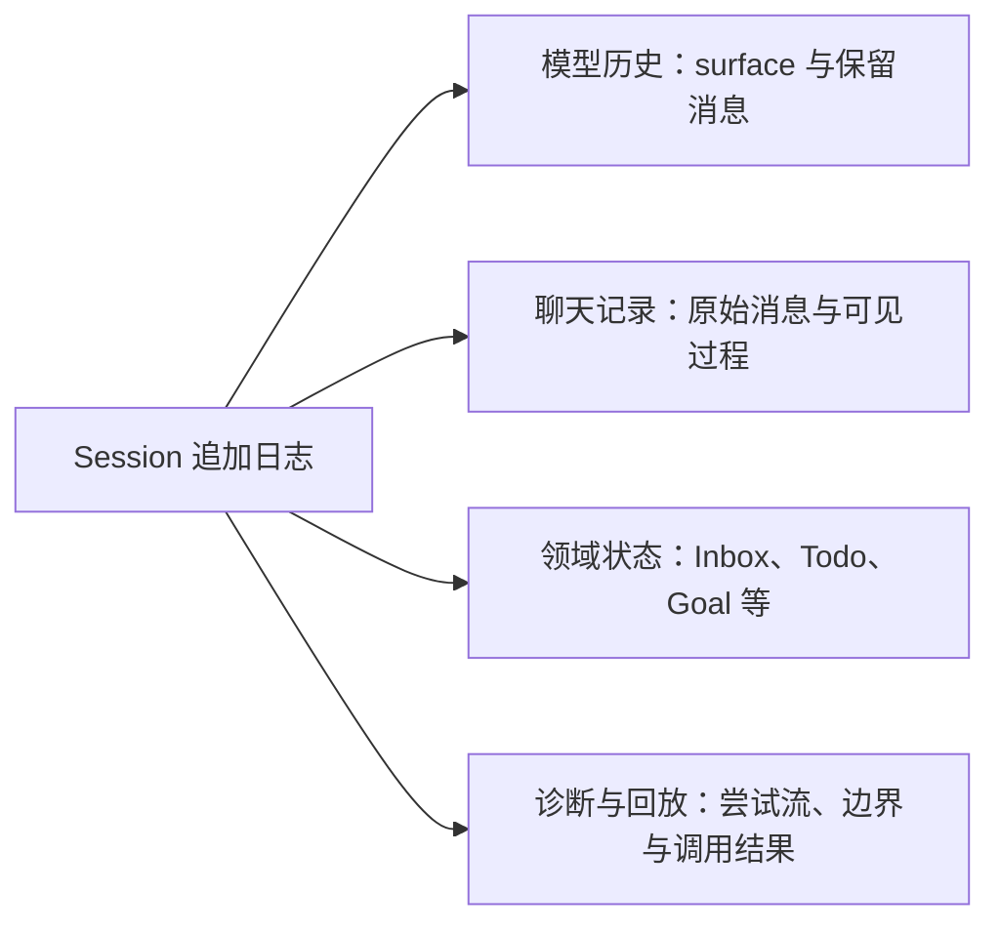

# 08｜Session Event Log、投影与回放

> 源码基线为 DeepSeek Harness `dsh-v0.2.3-alpha.2`，提交 `4b399c39a6d1479cd84ca591b4d7c88e24d38a96`。[系列目录](../README.md) · [上一篇](07-programmatic-tool-calling.md) · [上游仓库](https://github.com/deepseek-ai/deepseek-harness)

会话压缩后，用户仍能在聊天里翻到原来的问题，模型下一次请求却可能只带摘要。后来你从压缩前的位置分支，子会话又可以获得当时的原消息。三个观察结果来自同一份追加日志，在各自的事件切点上使用了不同读法。[Session 实现](../deepseek-harness/packages/core/session/src/index.ts) · [事件溯源模式](https://learn.microsoft.com/en-us/azure/architecture/patterns/event-sourcing)

## 1. Session 保存哪些事实

`SessionEvent` 包含 `type`、会话内连续的 `seq`、时间和类型对应的 `data`。`SessionEventMap` 是可扩展的 TypeScript 事件词汇表。核心记录轮次、步骤、请求与消息，插件可添加相应的领域事件。持久化格式区分必要事件与 `ignorable: true` 的提示性记录。一个会改变恢复结果的事件需要由读取器理解，写入方不能把它当作可忽略的遥测。[事件定义](../deepseek-harness/packages/core/session/src/types.ts#L500) · [插件日志事件](../deepseek-harness/docs/subsystems/session.zh.md#L790)

| 事实 | 事件示例 | 常见用途 |
| --- | --- | --- |
| 执行边界 | `turn/start`、`step/end`、`turn/end` | 划分过程、定位异常和判断结算。 |
| 模型输入与输出 | `user/message`、`system/message`、`assistant/message`、`tool/result` | 按保留节点投影成会话消息。 |
| 请求配置 | `request/header`、`request/context` | 重建某次请求的路由、参数、工具 Schema 及相关能力事实。 |
| 只记日志的尝试或过程 | `assistant/attempt`、`llm/retry`、`tool/call` | 回放响应、统计失败尝试或关联工具结果。 |
| 领域状态 | Inbox splice、工作目录变更、Todo 等事件 | 由相应领域折叠出最新状态。 |

`Session.append()` 对输入做 JSON 快照，在下一可用位置分配序号，校验并冻结事件，随后把它纳入日志和 surface。批量追加会先校验并准备整个批次，观察者收到逐条通知前，已经能读到完整批次。这里建立的是进程内的提交语义。写入后端的耐久性需要看存储句柄和 `flush()` 有效到哪里。[追加与批次](../deepseek-harness/packages/core/session/src/index.ts#L557) · [事件快照](../deepseek-harness/packages/core/session/src/index.ts#L269) · [刷盘入口](../deepseek-harness/packages/core/session/src/index.ts#L1075)

`SessionSeq` 指一个已存在的事件，`SessionLogOffset` 可以指事件之间的间隙或已读前缀长度，`SessionSeqCursor` 还能用 `-1` 表示尚未读到事件。例如已看到 `seq = 42` 后，增量读取的 offset 是 `43`，相同位置作为投影水位则是 `42`。在分页、分叉和检查点续读中，这个区别会直接影响是否漏读或重复处理一条事件。[序号类型](../deepseek-harness/packages/core/session/src/types.ts#L32)

## 2. 原始日志和模型历史怎样对应

`surface` 是按模型可见顺序排列的事件序号列表。只有 `system/message`、`developer/message`、`user/message`、`assistant/message`、`tool/result` 具备进入 surface 的资格。`surfaceOp: 'append'` 表示新节点进尾部。`replace` 的两个端点必须都位于当时的 surface 上，按列表位置取闭区间，换成新事件的序号。这个替换事件也照常追加到原始日志末尾，原事件保留。[Surface 类型和逐节点投影](../deepseek-harness/packages/core/session/src/surface.ts#L52) · [替换端点检查](../deepseek-harness/packages/core/session/src/surface.ts#L423)

`sourceEventSeqs` 为替换提供来源。引用只能指向更早的事件，并且必须覆盖被替换的所有 surface 节点。替换范围中可能夹着不产生消息的过程事件，也可能夹着先前替换生成的高序号节点。因此重建要在有序 surface 上操作，单纯在日志里按数值区间删事件会得到不同结果。[来源验证](../deepseek-harness/packages/core/session/src/surface.ts#L338) · [替换应用](../deepseek-harness/packages/core/session/src/surface.ts#L577)

`deriveMessages()` 遍历当前 surface，用逐节点规则得到 `Message[]`。普通追加只处理新增节点，替换或插件消息投影改变内容时按 generation 重建缓存。函数返回新数组，消息共享冻结过的数据。空 assistant 或空 system 等节点在日志中仍可保存用量和位置，模型消息投影会跳过这些空内容。[实时派生缓存](../deepseek-harness/packages/core/session/src/index.ts#L760) · [事件到消息](../deepseek-harness/packages/core/session/src/surface.ts#L120)

部分插件通过声明专用日志事件，登记纯函数以改变保留消息的内容。它们沿用消息原身份，将新内容放在 `projectedMessages` 里。理解这种事件的离线读者需要提供相同的投影定义。`foldSurface()` 遇到声明为必需消息投影的事件却找不到解释器，会报错。它避免继续产生一份悄悄缺少插件决策的模型历史。[消息投影契约](../deepseek-harness/packages/core/session/src/surface.ts#L32) · [解释器查找](../deepseek-harness/packages/core/session/src/surface.ts#L528)

## 3. 用一次压缩看清不同读法

`compaction-recovery` 快照里，第二个 step 的首次请求失败，日志记下 `assistant/attempt`，随后才进行压缩与同一步内的恢复。下面的数字是会话事件的 `seq`。该测试快照第一行是 header，物理行号比逻辑序号大 2。[原始记录](../deepseek-harness/snapshots/session/compaction-recovery/session.v4.jsonl)

| 截点 | 日志发生了什么 | `foldSurface().nodes` |
| --- | --- | --- |
| `seq = 22` | 已记录 `compaction/summary`，尚未提交替换消息。 | `[7, 8, 9, 13, 17]` |
| `seq = 23` | `compact-checkpoint` 替换用户和运行时上下文的两个节点 `8`、`9`。 | `[7, 23, 13, 17]` |
| `seq = 27` | 系统头 `7` 已由 `25` 替换，追加了新的运行时上下文 `26`，并写入新的请求 series。 | `[25, 23, 13, 17, 26]` |

**模型历史**关注某次请求应该保留的消息。**聊天记录**关注用户实际经历的对话。Web 的输入消息节点会检查 `isAppendSurfaceEvent()` 并过滤压缩检查点，所以摘要替换能改变模型输入，原来的用户消息仍可显示。**诊断历史**还可以读取失败尝试、token usage 与工具调用。`assistant/message` 内嵌产生它的紧凑流，`assistant/attempt` 保留达到结算点却没有正式消息的尝试。一次失败尝试的可计费用量可以存在，模型历史里仍没有相应 assistant 消息。[聊天节点](../deepseek-harness/packages/client/ui-chat/src/client/conversation-nodes/message.ts#L81) · [流与尝试字段](../deepseek-harness/packages/core/session/src/types.ts#L346)

### 恢复前后，怎么证明模型输入相同？

选定同一个请求切点，先验证 `foldSurface(prefix)` 与该切点的 live `deriveMessages()` 内容相同。再从前缀选出有效 `request/header`、`request/context` 与工具历史，核对 provider、model、参数、工具 Schema 顺序和消息内容。最后使用相同 adapter 与已固定的附件版本验证 wire 序列化。测试快照可能把工具 Schema 和部分系统提示词归一化为占位符，模型 surface 可以用这些记录重建，核对完整请求还要结合对应 sidecar 或捕获的真实请求。[请求头折叠](../deepseek-harness/packages/core/session/src/request-header.ts#L56) · [Request 重建测试](../deepseek-harness/packages/core/agent-loop/tests/request-reconstruction.spec.ts#L499) · [快照归一化约定](../deepseek-harness/snapshots/AGENTS.md)

## 4. `SessionProjection` 如何给客户端提供当前状态

工具结果是事件，Todo 列表是读取时的状态。`ctx.sessionProjections.register()` 接受一个领域定义，包含 `key`、`stateSchema`、`init()`、同步的 `apply(state, event)`、`stateVersion`，以及可选的 `wire` 视图。Host 可通过句柄读状态，客户端只取得声明并验证过的 `wire` 值。与该领域无关的事件可以返回原状态引用，注册表据此跳过后续视图工作。[投影注册约定](../deepseek-harness/packages/session/session-projection/README.zh.md#use-this-package)

`snapshot()` 同步返回 `{ asOfSeq, values }`，所选的客户端状态来自同一个日志切点。客户端可以拿该水位和后续事件帧对齐，避免先收到新变更再被旧快照覆盖。事件级监听可把由同一事件改变的多项视图一起发布。会话列表还能显示持久化缓存提供的值，但这些提示有单独的 `cached` 身份，不能只比较数字水位就当作已连接会话的当前状态。[快照实现](../deepseek-harness/packages/session/session-projection/src/index.ts#L503) · [客户端投影合并](../deepseek-harness/packages/api/session-controller/src/client/sessions/projection-store.ts) · [水位身份](../deepseek-harness/packages/api/session-controller/src/types.ts#L34)

持久检查点保存每个单元的 `{ver, seq, val}`，用于从某个已计算位置继续折叠。校验包括单元版本、状态 Schema、会话生命周期身份和继承切点。正常写入先确保对应日志已刷盘，再保存缓存，所以崩溃可以让缓存落后。读者还会检查水位是否超过当前日志尾部，必要时回到全量回放。第 11 篇会具体讨论缓存存储和恢复。[检查点读起点](../deepseek-harness/packages/session/session-projection/src/index.ts#L621) · [检查点缓存](../deepseek-harness/packages/session/session-projection-cache/README.zh.md)

## 5. 分叉、恢复、测试回放分别会重做什么

| 操作 | 起点与产物 |
| --- | --- |
| 恢复原会话 | 在取得 Session 写句柄后读取存储前缀，必要时追加 `interrupted` 收尾，再驱动该 Session。 |
| 分叉 | 继承到指定父序号为止的事件，建立独立子会话，按切点决定是否补 `forked` 收尾。 |
| 事件投影回放 | 从一次已记录的历史前缀，重建消息或领域状态。 |
| 测试中的模型回放 | 从记录提取模型响应脚本，把这些响应喂给真实入口，再观测新运行产生的日志和工具行为。 |

`buildForkSeed()` 复制 `0..boundary` 的前缀，在紧接位置追加 `session/end-seed { inherited: true }`，再运行 `openTurnClosers()`。若切在开放轮次，子会话可补工具缺失结果、`step/end` 和 `turn/end(forked)`。`inheritedEventCount` 只计父会话复制来的事件，标记与合成收尾归子会话所有。拿同一父历史在 `seq = 22` 和 `seq = 23` 分叉，子会话的模型 surface 分别保留原输入与替换摘要。父会话之后继续写，不改变子会话已选的切点。[分叉种子](../deepseek-harness/packages/core/session/src/fork.ts#L9) · [SessionStore 分叉实现](../deepseek-harness/packages/core/session/src/index.ts#L1133) · [开放轮次分叉测试](../deepseek-harness/packages/core/session/tests/fork.spec.ts#L285)

`llm-replay` 会读取 `assistant/message` 和 `assistant/attempt` 内嵌的流，按会话和模型调用顺序产生脚本。明确记录了真实模型摘要调用的 `compaction/summary` 也可在对应位置生成一段回放响应。响应异常中断且缺结束标记时，场景可以提供显式 override 描述失败。测试走实际 `dsh` Profile，受控工具可以在场景工作区再次执行，最后比较新落盘的事件与独立的预期工作区。生产恢复沿用已记录的工具结果。若调用结果未知，需要另查外部回执再决定能否重试。[响应脚本提取](../deepseek-harness/packages/test-support/llm-replay/src/index.ts#L457) · [按会话注入回放](../deepseek-harness/packages/test-support/llm-replay/src/index.ts#L1008) · [工作区结果断言](../deepseek-harness/snapshots/session/headless.snapshot.ts#L1675) · [生产恢复](../deepseek-harness/packages/core/agent-loop/src/index.ts#L794)

## 6. 面试官会怎么追问

### 已有消息表，为什么系统还要存事件？

可以从一个具体问题答起。用户在第几次尝试看到文字，工具是已完成还是结果未知，哪一次压缩替换了哪段上下文，这些都需要保留时序和来源。再说明模型历史、UI、冷读状态分别怎样从同一份事实派生。追问候选人会怎样给读路径提速，以及怎样保证重建失败被尽早发现。

### 压缩改变了模型输入，为什么 UI 还显示原历史？

说明原始事件追加、surface 替换和聊天节点的取数不同。可以给一个父日志的两个截点，让候选人手算 `nodes`，再说明 `sourceEventSeqs` 的验证。进一步要求对照同一切点的 live 和冷启动数据，验证保留历史、工具顺序、请求配置是否一致。

### 客户端先收到 `seq = 101` 的 Todo 更新，后收到 `asOfSeq = 100` 的状态怎么办？

先核对两个水位是否来自同一会话和同一种可比较的序列，再按先基线、再应用更新的规则合并。在同一序列中可保留更新到 `101` 的事实，避免旧基线覆盖。对于只供列表显示的缓存，应允许真实连接的状态取代它。追问可以让候选人处理漏帧、重复帧和重连后快照来自新生命周期三个情况。

### 回放是重新执行每个 tool call 吗？

先问此处回放指哪一种。事件投影恢复以已有结果为事实，模型回放测试则把录制响应输入真实入口，场景工具可能再执行。生产上如果切点只有调用记录，工具结果仍有不确定性。面试里可以用创建工单作例子，让候选人交代如何用请求标识或外部回执核实，再判断是否补记、重试或提示人工处理。

下一篇进入 JSONL 持久化，具体看这些逻辑事件如何写入压缩帧，进程中断后从哪里恢复。
