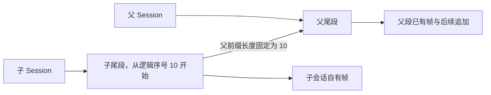

# 10｜SQLite 会话库：WAL、事务与单写者

> 源码基线为 DeepSeek Harness `dsh-v0.2.3-alpha.2`，提交 `4b399c39a6d1479cd84ca591b4d7c88e24d38a96`。[系列目录](../README.md) · [上一篇](09-jsonl-session-persistence.md) · [上游仓库](https://github.com/deepseek-ai/deepseek-harness)

假设用户在一段长会话上创建三个分支，父会话和每个分支还会继续运行。每次分叉都复制完整历史，事件越多，存储和写入成本越高。DSH 的 SQLite 后端用 Segment 引用父前缀，把新事件写到子会话自己的尾段。多段会话可以同时准备写入，同一个 Session 的逻辑历史仍由单一写句柄推进。[SQLite 会话后端](../deepseek-harness/packages/session/session-persistence-sqlite/README.zh.md)

## 1. 切换到 SQLite 后，Agent Loop 怎样访问历史

随附 Profile 默认使用 JSONL。需要 SQLite 会话存储时，在配置中替换持久化提供者。新后端仍提供 `ctx.sessionPersistence` 和 `SessionHandle`，所以 Agent Loop 继续通过 `create()`、`open()`、`append()`、`read()`、`flush()` 与 `close()` 工作。Segment ID 和帧编码都留在后端内部。数据库位于 `<root>/.segments/sessions.sqlite`。[默认配置](../deepseek-harness/packages/bundle/base/cordis.patch.yml#L142) · [SQLite 插件装配](../deepseek-harness/packages/session/session-persistence-sqlite/src/index.ts#L36) · [数据库路径](../deepseek-harness/packages/session/session-persistence-sqlite/src/persistence.ts#L33)

这一篇分析的是 **Session 事件的权威存储**。DSH 还用 SQLite 实现文档型业务 KV 与独立的会话全文索引，两者会分别在后续篇目展开。当前后端的 `SCHEMA_VERSION` 是 `1`，用 SQLite 的 `PRAGMA user_version` 记录，并用 `application_id` 检查数据库归属。Session 事件格式在同一基线中是 V4。首次打开空库会创建 schema，遇到不兼容 schema 或无关数据库时拒绝接管。版本识别让数据库结构、逻辑事件以及旧文件导入各自有明确的升级入口。[数据库初始化](../deepseek-harness/packages/session/session-persistence-sqlite/src/sqlite.ts#L208) · [Session 格式](../deepseek-harness/docs/session-format-status.md)

## 2. `traces`、`segments` 和 `frames` 各存什么

| 表 | 保存的数据 | 起到的作用 |
| --- | --- | --- |
| `traces` | Session ID、header、尾段 ID、继承事件数 | 根据一个 Session 找到其可追加的尾段。唯一索引保证每个尾段只由一个 Trace 持有。 |
| `segments` | 段 ID、父段 ID、对父段的可见前缀长度、`base_seq` | 定位每段在逻辑会话里的起点，限制子分支读取到哪个位置。 |
| `frames` | 段 ID、局部 `[start_seq, end_seq)`、codec、BLOB | 一帧承载多条 JSON 行，以段 ID 和起始序号为主键。 |
| `segment_ancestors` | 当前段到各祖先段的索引与可见终点 | 成批定位祖先段，与新段在同一事务中建立。 |

表定义使用 `STRICT`、主外键和约束检查数据。触发器拒绝更新或删除既有 frame，以及改写已建段的父引用和基序号。一个 Segment 当前含多少事件，可从该段最后一个 frame 的 `end_seq` 得到。默认每帧至多 64 条事件。`compression: 'zstd'` 时，压缩结果更小才用 Zstd codec，否则以 UTF-8 保存。每帧记录自己的 codec，读者据此解码。[建表与触发器](../deepseek-harness/packages/session/session-persistence-sqlite/src/sqlite.ts#L287) · [帧写入与计数](../deepseek-harness/packages/session/session-persistence-sqlite/src/sqlite.ts#L386) · [帧编码](../deepseek-harness/packages/session/session-persistence-sqlite/src/frame.ts#L36)

这里的 Frame 是 DSH 存在 BLOB 中的事件批次，也是应用的压缩与解码单位。SQLite WAL 自己也使用 frame 一词，存放的是事务写入的数据库页版本。弄清这两个层次，才能分别讨论 `frameEvents` 对读取成本的影响，以及 WAL checkpoint 对数据库文件的影响。[DSH 帧编码](../deepseek-harness/packages/session/session-persistence-sqlite/src/frame.ts) · [SQLite WAL 文件格式](https://sqlite.org/fileformat2.html#the_write_ahead_log)

## 3. 分叉怎样引用父会话，又挡住父会话未来的写入

假设父会话有 20 个事件，子会话要共享前 10 个，即逻辑序号 `[0, 10)`。子段把 `base_seq` 设为 10，并记下父段能被读取的终点。子会话自己的种子标记、必要的修复事件和后续对话进入它的独立尾段，逻辑序号从 10 继续。父会话以后再写入，子会话只沿用创建时固定好的前缀。

`createFork()` 先等待本进程中的父写者刷盘或完成关闭，编码子会话的后缀，取得子会话写入权。事务里再次核对父库实际持久化的事件数，确认请求的前缀确实存在。`cut()` 根据逻辑切点确定接在哪个 Segment 上，随后在同一事务里插入子 Segment、Trace 和后缀帧。如果切点落在父会话所继承的更早历史，还可通过祖先索引定位到对应段。仓库测试验证了分叉既能共享前缀，又能分别追加各自的事件。[分叉定位](../deepseek-harness/packages/session/session-persistence-sqlite/src/sqlite.ts#L437) · [分叉事务](../deepseek-harness/packages/session/session-persistence-sqlite/src/sqlite.ts#L503) · [父子独立追加测试](../deepseek-harness/packages/session/session-persistence-sqlite/tests/structure.spec.ts#L40)

读取时，后端在 `BEGIN DEFERRED` 事务中确定各 Segment 的可见区间，只查询与所需区间相交的 frame。映射到段内坐标后，查找条件是 `end_seq > start AND start_seq < finish`。取出字节后结束读事务，再以每组最多八帧的节奏解压和解析。即使只读一条事件，也可能需要解码它所在的整帧。这解释了帧变大时，压缩率和短范围读取的开销为什么会一起变化。读取过程中还会核对帧覆盖、解码后的记录数和事件连续性。[范围查询与解码](../deepseek-harness/packages/session/session-persistence-sqlite/src/sqlite.ts#L685)

## 4. WAL 和 Session 单写者分别保护什么

DSH 使用 Node 的 `DatabaseSync`，初始化时启用外键与 `synchronous = FULL`，先切到 WAL 再创建或确认 schema。WAL 允许读者从各自的快照读取，同时让写事务把新页版本提交到 WAL。SQLite 同时最多允许一个写事务，`BEGIN IMMEDIATE` 会先取得写入资格，竞争时可能收到 `SQLITE_BUSY`。源码还为初次启用 WAL 的锁竞争处理了有界重试。[初始化与 WAL](../deepseek-harness/packages/session/session-persistence-sqlite/src/sqlite.ts#L208) · [SQLite WAL 并发](https://sqlite.org/wal.html#concurrency) · [SQLite 事务](https://sqlite.org/lang_transaction.html)

| 并发问题 | DSH 用什么保护 |
| --- | --- |
| 两个写事务在同一个数据库争用写入权 | SQLite 的事务锁协调，各 Session 的批次也能在同一进程内合成一次写事务。 |
| 两个 Agent 或进程尝试同时续写同一个 Session | Provider 维护进程内占用，并获取按数据库真实路径与 Session ID 定位的跨进程写锁。锁随写句柄持有。 |
| 旧 JSONL 写者还在工作，另一个进程想导入它 | SQLite 写句柄或导入流程还要协调原 Session 产物目录上的锁，避免从仍在变化的旧历史接手。 |

即使两个 Agent 的写入事务可以串行提交，它们若各自基于同一个旧尾部构造下一条事件，仍可能同时认为自己拥有相同的下一序号。Session 写入权把这种冲突挡在逻辑历史的所有权层。真正落库时还会用已读到的尾部事件数检查批次的 `seq` 是否连续。只读句柄可以在 SQLite 写者活跃时打开。[双层写锁](../deepseek-harness/packages/session/session-persistence-sqlite/src/sqlite.ts#L618) · [连续性检查](../deepseek-harness/packages/session/session-persistence-sqlite/src/sqlite.ts#L818) · [读写并发与所有权测试](../deepseek-harness/packages/session/session-persistence-sqlite/tests/normal-fork-concurrency-validation.spec.ts#L328)

SQLite 的 WAL checkpoint 会把 WAL 中合适的页版本推进主数据库，长期读快照可能推迟这项工作。DSH 的 `SessionHandle.flush()` 则等待该句柄的缓冲数据完成持久提交，并处理需要实体化的空 Session。运维观察 WAL 文件增大时，要查 SQLite 读事务和 checkpoint 进度。调用方等待会话刷盘时，要查对应 append、提交和路由状态。[WAL Checkpoint](https://sqlite.org/wal.html#checkpointing) · [Session flush](../deepseek-harness/packages/session/session-persistence-sqlite/src/sqlite.ts#L1145)

## 5. Group commit 怎么提速，单批失败会影响谁

实时事件先在各自句柄缓冲。积累到 256 条、200 毫秒的批处理定时器触发或调用方显式刷新时，都可以开始排空。后端把批次编码成帧再入共享队列，减少事务内的同步工作。`drainCommits()` 在取组前先让出一次事件循环，已准备好的多个 Session 批次可以共用一笔事务。分组以 1024 条事件为阈值，首批本身超过时仍完整纳入。这样可以摊薄每次提交与同步的固定开销，也要权衡排队时延和同步事务占用时间。[调度常量](../deepseek-harness/packages/session/session-persistence-sqlite/src/sqlite.ts#L36) · [入队与提交](../deepseek-harness/packages/session/session-persistence-sqlite/src/sqlite.ts#L786) · [分组规则](../deepseek-harness/packages/session/session-persistence-sqlite/src/sqlite.ts#L846)

每个批次在同一事务里有自己的 `SAVEPOINT`。如果 Session B 的事件序号不连续，且事务仍可用，回滚 B 的保存点即可，A 的有效批次仍可提交。若错误导致整笔事务不能继续，整组都失败。测试覆盖了 16 个写句柄共用一次提交、单批序号失败时同组正常批次成功，以及整个事务失败的处理。[保存点](../deepseek-harness/packages/session/session-persistence-sqlite/src/sqlite.ts#L812) · [Group commit 测试](../deepseek-harness/packages/session/session-persistence-sqlite/tests/group-commit.spec.ts#L34)

| 故障位置 | 调用方看到什么 | 怎样继续 |
| --- | --- | --- |
| 单批保存点回滚成功 | 该批拒绝，同组其它有效批次可以确认提交。 | 修正该批输入或解决原因后再提交。 |
| `COMMIT` 报错，或操作失败且事务也无法确认回滚 | `SESSION_STORAGE_UNKNOWN`。该提供者记录故障并阻止后续存储操作。 | 重启持久化提供者，再从权威库读取实际尾部和已有事件，确认需要补写的范围。 |
| SQLite 已提交，路由发布失败 | `SESSION_STORAGE_PUBLICATION`，异常表明历史已入库。 | 关闭并重开 Session，按数据库已有数据恢复访问。 |

`COMMIT` 报错时，后端会在事务仍活跃的情况下尝试回滚，同时保持“结果未知”的判断。因为失败可能发生在提交已经改变数据库状态之后，直接重发旧批次会冒重复提交的风险。路由发布失败则发生在已确认提交之后。后端读取时即使没有路由记录，也会查询 SQLite，按实际已存在的行选择历史。[事务错误处理](../deepseek-harness/packages/session/session-persistence-sqlite/src/sqlite.ts#L332) · [提交后发布](../deepseek-harness/packages/session/session-persistence-sqlite/src/sqlite.ts#L609) · [路由选择](../deepseek-harness/packages/session/session-persistence-sqlite/src/persistence.ts#L97) · [提交结果未知测试](../deepseek-harness/packages/session/session-persistence-sqlite/tests/recovery-regressions.spec.ts#L174)

## 6. 首次打开旧 JSONL 怎样完成接手

SQLite Provider 在隔离的服务上下文中保留一个旧 JSONL 读取者。`stat()` 和 `list()` 可以展示旧元数据，首次真正 `open()` 旧会话时才导入正文。包括 `open(id, 'read')` 在内的首次打开都可能写 SQLite。若旧 JSONL 仍被一个写者占有，读打开可等待写者退出，竞争写打开会报告占用。取得锁后重新检查是否已有别的进程完成导入；写打开成功时把原产物锁移交到新写句柄持有。[旧提供者装配](../deepseek-harness/packages/session/session-persistence-sqlite/src/index.ts#L42) · [首次导入与锁交接](../deepseek-harness/packages/session/session-persistence-sqlite/src/migration.ts#L39) · [列表处理](../deepseek-harness/packages/session/session-persistence-sqlite/src/persistence.ts#L172)

旧记录先通过版本链解码为当前逻辑格式，再在数据库事务中创建独立根段和帧。事务提交后发布路由记录，记录 Session ID 与数据库位置。它能让后端发现已记录的数据库位置发生变化或数据库丢失。源 JSONL 文件仍保留导入前的字节，新的 SQLite 追加只在数据库里。因此备份和恢复要围绕当前权威库和它的 WAL 状态设计，已导入 Session 的写入进程也要采用一致的后端。[导入事务](../deepseek-harness/packages/session/session-persistence-sqlite/src/sqlite.ts#L586) · [路由身份与发布](../deepseek-harness/packages/session/session-persistence-sqlite/src/persistence.ts#L81) · [导入后继续写入测试](../deepseek-harness/packages/session/session-persistence-sqlite/tests/legacy-import.spec.ts#L102) · [SQLite WAL 文件与持久状态](https://sqlite.org/wal.html#the_wal_file)

## 7. 面试官会怎么追问

### SQLite 开了 WAL，两个 Session 能同时写吗？

先解释两个层面的并发。A、B 可以同时组装和编码批次，随后在同一进程共享一次写事务或依次提交。同一数据库的写事务仍互斥。同一个 Session 的两个写者则在更早的所有权校验处产生冲突。继续追问可要求候选人说明为什么仅靠 `BEGIN IMMEDIATE` 保护不了长期持有旧模型历史的两个 Agent。

### 父会话已有一万条事件，分叉为什么不用再写一万行？

说明子尾段记录父段身份和固定前缀，继承通过读路径拼接，新写入只保存子后缀。让候选人画出分叉落在父帧中间时的序号换算，再追问分支重复分叉时祖先索引的作用，以及如何证明父会话后续追加不会被子会话读到。

### 一个保存点回滚、事务被回滚、`COMMIT` 报错，恢复策略有什么区别？

保存点回滚只排除了该批，事务回滚影响整组。遇到无法确认结果的提交，先冻结当前提供者的写入，重开后按库中实际状态核对批次。追问可以设置成“SQL 已提交，但路由写入失败”，要求候选人从数据库行和路由文件中找出决定恢复的证据，并说明什么场景适合幂等补写。

### 代码只调用 `open(read)`，为什么部署还是需要写权限？

SQLite 后端把第一次旧历史打开设计成接手操作。它需要协调正在运行的 JSONL 写者，导入当前逻辑事件，再用 SQLite 返回指定访问模式的句柄。可以追问如何设计只读预览、正式迁移与迁移后备份三条路径，要求候选人给出每条路径的权威数据和责任边界。

下一篇继续看业务存储，区分 Session 事件数据库、JSON 或 SQLite KV，以及可以从日志重建的投影缓存。
