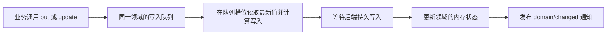

# 11｜业务存储：JSON、SQLite KV 与投影缓存

> 源码基线为 DeepSeek Harness `dsh-v0.2.3-alpha.2`，提交 `4b399c39a6d1479cd84ca591b4d7c88e24d38a96`。[系列目录](../README.md) · [上一篇](10-sqlite-session-persistence.md) · [上游仓库](https://github.com/deepseek-ai/deepseek-harness)

Agent 会话重启后，用户期待看到原对话、自己排好的工作区顺序和会话列表里的标题。这三类数据有不同的恢复方式。会话日志保留已经发生的事件。Workspace 领域保存用户设置的业务状态。投影缓存保存从日志计算出的状态，可以丢弃后重建。DSH 用两套持久化入口表达这些差别。[会话持久化](../deepseek-harness/packages/session/session-persistence/) · [领域存储](../deepseek-harness/packages/storage/storage-domain/) · [投影缓存](../deepseek-harness/packages/session/session-projection-cache/)

## 1. 从后端注册到业务领域

| 层 | 职责 | 典型接口 |
| --- | --- | --- |
| Storage Registry | 按名称登记后端，处理重名和卸载时的注销。 | `ctx.storage.backend` |
| Backend KV | 按单元打开介质，读写表内记录与可选的全局单例。 | `backend.kv.open()`、`loadAll()`、`putRecord()` |
| Storage Domain | 解析领域路由和 schema，持有校验后的内存状态，串行写入并发布变更。 | `ctx.storageDomain.open(spec)`、`table().update()`、`global.set()` |
| 业务包 | 确定记录字段和版本，负责跨记录的业务不变式。 | `WorkspaceRegistry`、`SessionProjectionCache` |

Storage Registry 不替业务包挑默认后端。`DomainFacility` 先查 `routes[spec.name]`，没有单独配置时再用 `backend`。基础 Bundle 把默认后端设为 `json`，根目录是 `$DSH_HOME/storages`；Web 挂载 Workspace 服务后沿用这条路由。需要 SQLite 业务库时，可挂载 `storage-sqlite` 并按领域路由。例如仅把 `workspace` 送往新库，投影缓存仍走 JSON。换路由会打开目标介质，已有数据的复制与校验要单独安排。[后端注册表](../deepseek-harness/packages/storage/storage/src/registry.ts#L14) · [领域路由](../deepseek-harness/packages/storage/storage-domain/src/index.ts#L106) · [基础配置](../deepseek-harness/packages/bundle/base/cordis.patch.yml#L180) · [Web Workspace 配置](../deepseek-harness/packages/bundle/web-app/cordis.patch.yml#L87)

`defineDomain()` 描述领域名、版本、表、记录 Zod schema 及可选的 `global` 单例。打开时检查名称是否已占用、后端是否支持 `kv`，然后调用 `loadAll()`，逐条校验已存记录。全局单例从未写入时使用 spec 提供的初值。打开后的 `get()` 直接返回内存中的记录引用，调用方按不可变数据对待它，修改应走领域写入接口。`put()` 和 `update()` 接收业务包的类型化值，核心写路径没有对每次写入重新执行 Zod parse。面对 RPC 等外部输入，拥有领域的服务仍需在入口把值校验成可信的业务记录。[领域声明](../deepseek-harness/packages/storage/storage-domain/src/spec.ts#L107) · [加载与 schema 校验](../deepseek-harness/packages/storage/storage-domain/src/index.ts#L117) · [记录读写](../deepseek-harness/packages/storage/storage-domain/src/domain.ts#L314)

## 2. 一次领域写入什么时候算完成

`update(key, fn)` 把读取、计算和提交都放在同一个队列槽位里。例如两个调用都为计数加一，第二个在执行时会读到第一个已提交的值。若改成在队列外 `get()` 并调用 `put()`，两个调用仍可能各自拿着相同旧值覆盖。这个队列约束已打开领域内的写入顺序；多个进程各自持有内存视图时，还需要存储层的版本检查或独立协调。[队列与失败处理](../deepseek-harness/packages/storage/storage-domain/src/domain.ts#L283) · [更新操作](../deepseek-harness/packages/storage/storage-domain/src/domain.ts#L375) · [并发更新测试](../deepseek-harness/packages/storage/storage-domain/tests/domain.spec.ts#L262)

写入先等后端确认持久化，再更新内存和通知观察者。`domain/changed` 是提交后的通知，监听器抛出的同步异常会被记录，已经提交的写入仍然成立。若后端明确报告 `unknown-state`，Domain 会记住该状态并拒绝后续读写，直到关闭后重新打开。它避免继续以旧内存值作为事实。通用 API 提供单记录操作与批量删除，Workspace 这样的跨记录变更还需要业务级恢复协议。[通知与隔离](../deepseek-harness/packages/storage/storage-domain/src/domain.ts#L266) · [KV 操作约定](../deepseek-harness/packages/storage/storage/src/backend.ts#L78)

## 3. JSON 两种布局和 SQLite 行存储怎样取舍

| 后端与布局 | 一次更新涉及的数据 | 适合的访问模式 |
| --- | --- | --- |
| JSON `single` | 原子替换整个 `<unit>.json`，文档包含全局状态与所有表。 | 记录总量小、更新频率低、需要人工查看整份数据。 |
| JSON `per-record` | 原子替换一个 `<unit>/<table>/<key>.json`，每份文档带版本戳。 | 经常修改某个独立键，记录可独立丢弃或重建。 |
| SQLite KV | 按主键更新 `u_<unit>_<table>` 的一行，值保存在 `value TEXT` 中。 | 频繁定点更新、希望把多个领域放在一个数据库文件里。 |

JSON 后端的 `writeAtomic()` 先在目标目录创建临时文件，写入并同步，再 `rename()` 替换目标，在 POSIX 上同步父目录。原子替换解决读者看到半份文档的问题。机器掉电时，目录项的耐久性要靠目录同步。若 `rename()` 已成功而目录同步失败，调用方可能看到写入拒绝，文件却已被替换，需要重新打开介质核实。`per-record` 的批量删除通过逐份改名移出可读集合，随后同步目录；进程若在整批完成前中断，可能留下部分删除。恢复这些文件的补偿若失败，后端会报告 `unknown-state`。[原子写入](../deepseek-harness/packages/storage/storage-json/src/atomic.ts#L18) · [整单元发布](../deepseek-harness/packages/storage/storage-json/src/single-unit.ts#L145) · [逐记录批量删除](../deepseek-harness/packages/storage/storage-json/src/per-record-unit.ts#L229) · [Linux rename 语义](https://man7.org/linux/man-pages/man2/rename.2.html)

SQLite KV 用 `node:sqlite` 同步连接，默认 journal mode 为 WAL。当前领域单记录更新由一条预处理语句完成，非空批量删除以及兼容旧版本的首次有效修改会使用事务。后者把数据变更和领域版本戳一起提交。库的物理 schema 由 `PRAGMA user_version` 管理，领域版本则存在 `units` 表；`compatibleVersions` 表示业务 schema 能读相应旧记录，未改动的值仍可能保持旧形态。同步 SQL 与领域打开时的全量加载仍有成本，定点更新的收益来自写入和存储布局，业务 `get()` 继续读内存。[SQLite 配置与版本约定](../deepseek-harness/packages/storage/storage-sqlite/README.zh.md#use-this-package) · [SQLite 元数据](../deepseek-harness/packages/storage/storage-sqlite/src/schema.ts#L75) · [单条写入与事务分支](../deepseek-harness/packages/storage/storage-sqlite/src/unit.ts#L108) · [SQLite 事务](https://sqlite.org/lang_transaction.html)

逐记录布局还可以为可重建领域提供特定的恢复策略。介质解码会过滤版本不可接受的记录。若一条已读入的记录在领域打开时不符合 Zod schema，`backup-and-skip` 可以让支持 `backupRecord()` 的后端把它移出可读集合。换到缺少这个能力的后端时，领域打开会传播校验错误。后端选择会影响损坏处理，因此同一份业务接口也需要明确依赖哪种介质能力。[领域打开分支](../deepseek-harness/packages/storage/storage-domain/src/index.ts#L121) · [可选备份接口](../deepseek-harness/packages/storage/storage/src/backend.ts#L142)

## 4. Workspace 怎样保证记录和列表顺序一致

`workspace` 是一个 V2 领域，默认 JSON `single`。`workspaces` 表保存路径、标题、有序 `sessionIds` 和时间戳。全局单例保存 Workspace 显示顺序、初始化状态及归档、置顶等集合。创建工作区时，服务先通过 `realpath` 规范路径，切到自己的业务写入队列，再查找是否已有同一路径的实体。不同请求输入的路径写法可以不同，同一真实目录会复用工作区。[Workspace schema](../deepseek-harness/packages/workspace/workspace/src/spec.ts#L19) · [初始化和创建](../deepseek-harness/packages/workspace/workspace/src/index.ts#L223) · [同路径并发测试](../deepseek-harness/packages/workspace/workspace/tests/workspace.spec.ts#L401)

一次创建同时涉及 `workspaces[id]` 和全局 `workspaceIds`。每次 Domain 写自身持久，整个业务操作跨多个调用。Workspace 在全局状态里保存 `pendingMutation` 来指明允许恢复的中间状态。[创建流程](../deepseek-harness/packages/workspace/workspace/src/index.ts#L541) · [删除流程](../deepseek-harness/packages/workspace/workspace/src/index.ts#L616)

| 操作 | 写入顺序 | 重启时看到标记怎样处理 |
| --- | --- | --- |
| 创建 | 写入 `create` 标记 → 写记录 → 发布新顺序并清标记。 | 如果尚未发布到顺序，清理遗留记录和标记。 |
| 删除 | 在全局状态里移出顺序并写 `delete` 标记 → 删除记录 → 清标记。 | 完成该记录的删除，再清标记。 |

两条路径分别把最后确认的业务方向记录在顺序和标记上。启动先恢复明确标记的操作，再校验表与全局顺序。有标记但该 ID 仍在顺序里，或恢复后还有未能解释的差异，会报告不一致。首次创建 Workspace Registry 时可从会话 header 初始化归属，之后标题、归档、置顶和用户排序依赖领域数据保留。这些状态无法仅靠重放 Session 消息还原。[启动恢复](../deepseek-harness/packages/workspace/workspace/src/index.ts#L223) · [检查与清理标记](../deepseek-harness/packages/workspace/workspace/src/index.ts#L662) · [仅恢复已标记操作的测试](../deepseek-harness/packages/workspace/workspace/tests/workspace.spec.ts#L1003)

## 5. 投影缓存怎样做到可以过期、可以丢弃

`session_projcache` 使用 `per-record`，默认一个 Session 对应 `<root>/session_projcache/sessions/<id>.json` 中的一份文档。里面保存日志身份和每个投影的 `{ver, seq, val}`。`ver` 对应投影的 `stateVersion`，`seq` 是已应用的最后一个事件，`val` 是该位置的领域折叠状态。例如会话标题和统计值可以从较新的检查点继续折叠，避免重复处理全部记录。[检查点 schema](../deepseek-harness/packages/session/session-projection-cache/src/spec.ts#L20) · [按会话存储](../deepseek-harness/packages/session/session-projection-cache/src/spec.ts#L100)

默认装配会在会话创建、`turn/end`、释放这三个时点尝试写检查点。轮内还按累计 200 条事件或 5 秒批处理定时器触发。活跃会话先取投影切面，再刷事件日志，然后才保存缓存；释放路径依赖持久化后端的收尾排空。缓存写失败会记录警告，之后的读取或更新仍可修复陈旧记录。读取时会核对缓存水位与实际日志长度，避免使用落在已存历史之外的状态。[默认批处理配置](../deepseek-harness/packages/bundle/base/cordis.patch.yml#L193) · [日志先于缓存](../deepseek-harness/packages/session/session-projection-cache/src/index.ts#L248) · [写入时点](../deepseek-harness/packages/session/session-projection-cache/src/index.ts#L310) · [Log 水位检查](../deepseek-harness/packages/session/session-projection/src/index.ts#L621)

| 读取路径 | 已知条件 | 怎样使用缓存 |
| --- | --- | --- |
| 会话列表 `cachedSnapshot()` | 只有 Session header 等列表信息。 | 校验生命周期与投影版本等条件，返回最后保存的可用值，标记为 `cached`。它可以落后于已连接会话。 |
| 冷读 `coldSnapshot()` | 调用方提供完整已保存的日志和继承切点。 | 匹配的行用于跳过已折叠前缀，从其后续事件计算当前状态，并尝试回写新检查点。 |
| 预备会话 `hydratePrepared()` | 已经取得精确的逻辑事件前缀。 | 校验后用于初始化投影，失败则从给定日志重算。逻辑事件可能含未落盘的修复，因此这个路径只做内存 hydration。 |

同一个 Session ID 可能在另一次生命周期重用。只比 ID 或 `seq` 会把旧会话的状态混进新日志。用来恢复的检查点还要匹配格式版本、创建时间、原目录、是否为种子会话和精确继承切点，并校验每个单元的版本与 schema。列表拿到的 `cached` 值应让真实连接的投影覆盖。缓存版本或内容不合格时，权威日志仍可用于重建；Workspace 丢失时则需要有效业务备份，或者重新让用户设置。[列表快照](../deepseek-harness/packages/session/session-projection-cache/src/index.ts#L125) · [预备与冷读](../deepseek-harness/packages/session/session-projection-cache/src/index.ts#L214) · [列表使用缓存](../deepseek-harness/packages/api/session-controller/src/list.ts#L283)

## 6. 面试官会怎么追问

### `table.update()` 已经串行，为什么 Workspace 还需要 `pendingMutation`？

队列保证一个更新在正确顺序读写同一个领域。一次创建则涉及工作区记录和全局顺序两次写入，中间可以断电。让候选人分别推演标记落盘后、记录落盘后、顺序发布后的重启状态，并说明每个状态怎样恢复。再问底层换成 SQLite 后能否沿用当前 Domain API 把两次调用放进同一事务。

### 频繁更新一条记录，换 SQLite 还要考虑什么？

把读密度、总数据大小和写放大分开。JSON `single` 每次发布整单元，`per-record` 限定在一个文档，SQLite 更新数据行并能对批量删除做事务。但 Domain 打开仍加载已声明记录，同步 `node:sqlite` 写入也会占用事件循环。可以要求候选人给出冷启动时延、单次更新字节数、P95 写延迟以及切换后核对数据的方法。

### 用户删除了投影缓存文件，哪些体验会受影响？

先问删除的是检查点还是业务记录。检查点缺失会增加冷读取的折叠成本，列表可能暂时缺少相关提示，重新读日志后可以生成新的缓存。继续给出一个同 ID、不同创建时间的会话，要求候选人解释为什么较大的缓存 `seq` 也不能证明它来自这份日志。

### 用户看到保存失败，能直接重试吗？

检查失败发生在提交前、文件替换之后的同步阶段，还是回滚无法确认时。已知未应用的操作可以在修正后重试。结果未知的操作需要先重新打开并读取存储状态，再按幂等条件补做。让候选人将同一判断分别应用于 Workspace 排序、可丢弃的标题缓存与会话事件写入。

下一篇进入 SQLite FTS5，追踪 Session 事件怎样成为可搜索的派生索引，以及查询为何可能落后于主日志。
