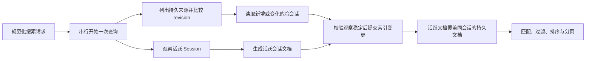

# 12｜会话全文检索：FTS5、实时与历史索引

> 源码基线为 DeepSeek Harness `dsh-v0.2.3-alpha.2`，提交 `4b399c39a6d1479cd84ca591b4d7c88e24d38a96`。[系列目录](../README.md) · [上一篇](11-domain-storage-and-projection-cache.md) · [上游仓库](https://github.com/deepseek-ai/deepseek-harness)

用户记得曾在一段对话里调过 `searchSessions`，却忘了标题。要找到这段会话，系统需要从原日志提取可搜索文本，把命中的事件定位回来。如果会话还在运行，最新消息可能只存在于内存中。DSH 为这个场景准备了独立的 SQLite FTS5 索引，将活跃历史与已存历史在一次查询中合起来。[全文搜索后端](../deepseek-harness/packages/session-query/session-query-sqlite/README.zh.md)

## 1. 搜索入口与默认装配

`ctx.sessionQuery` 支持精确读取、过滤、追踪和全文搜索。`searchSessions()` 跨会话查找，每个会话取排名最高的命中事件。`searchEvents()` 只查指定 Session，按事件返回命中。两者都是给定文本的召回；按 `sessionId` 和 `seq` 读取原事件时，走相应的读取接口。[查询服务接口](../deepseek-harness/packages/session-query/session-query/src/index.ts) · [跨会话搜索](../deepseek-harness/packages/session-query/session-query-sqlite/src/index.ts#L269) · [会话内搜索](../deepseek-harness/packages/session-query/session-query-sqlite/src/index.ts#L297)

| `openAt` | FTS5 索引何时打开 |
| --- | --- |
| `startup` | 服务激活时打开和检查，是插件的配置默认值。 |
| `first-search` | 首次全文搜索时打开。多个并发的首次请求共用打开状态。 |
| `never` | 全文接口返回 `SESSION_QUERY_SEARCH_DISABLED`，精确读取、过滤与追踪仍可用。 |

随附的基础和 Web 配置显式选择 `never`。因此，默认 Web 侧栏可以匹配标题与工作区名称，正文全文检索需要启用。启用后的 Web 正文搜索会过滤到 `current` 表层的 `user/message` 和 `assistant/message`，并检查候选会话是否属于当前可见集合。后端通用全文接口默认搜索所有表层，两处的产品结果可能不同。[基础装配](../deepseek-harness/packages/bundle/base/cordis.patch.yml#L153) · [Web 关闭配置](../deepseek-harness/packages/bundle/web-app/cordis.patch.yml#L22) · [Web 内容过滤](../deepseek-harness/packages/api/session-controller/src/list.ts#L168)

## 2. Session 事件怎样成为搜索文档

后端将一个有可检索文本的事件投影为文档，附上 `sessionId`、`seq`、`type`、`time` 和 `surface`。文本提取是明确列举的。它会提取用户消息、助手答复、工具名及参数、工具结果与错误码、Todo 和部分结束原因。助手推理块、原始模型流、`assistant/attempt` 与请求头没有直接进入索引。这样可以解释某个字符串为何存在于原日志，却不落入全文搜索范围。[文本提取](../deepseek-harness/packages/session-query/session-query/src/extraction.ts#L15) · [文档构造](../deepseek-harness/packages/session-query/session-query/src/documents.ts#L30)

在提取之前，`foldSurface()` 将当前保留节点和被替换节点分开。构造器把事件分别标作 `current`、`shadowed` 或 `log-only`。例如一段原用户消息被压缩摘要替换后，原消息仍可作为 `shadowed` 文档命中通用搜索，限制为 `current` 的请求则会在排序前过滤掉它。这里的 `surface` 决定文档归类，索引中的文本来自原事件的语义提取。[表层分类](../deepseek-harness/packages/session-query/session-query/src/documents.ts#L57) · [表层过滤测试](../deepseek-harness/packages/session-query/session-query-sqlite/tests/sqlite.spec.ts#L400)

SQLite 里有两套关联数据。`persisted_sessions` 存元数据和持久来源修订，`persisted_docs` 存 FTS5 文档。活跃会话使用连接内的 `temp.live_sessions` 和 `temp.live_docs`，连接关闭后 TEMP 数据消失。两套 FTS 表都只有 `text` 进入倒排索引，其它列通过 `UNINDEXED` 保留定位和过滤信息。索引库有自己的 `application_id` 和 schema 版本，能重建已识别的旧派生库，也会拒绝打开包含异类应用标记或不明表的数据库。[打开与库归属检查](../deepseek-harness/packages/session-query/session-query-sqlite/src/schema.ts#L40) · [持久表与 TEMP 表](../deepseek-harness/packages/session-query/session-query-sqlite/src/schema.ts#L103)

## 3. 新消息怎样进入本次搜索

索引按搜索请求对账。`_serialized()` 将一次对账和查询放进同一个服务队列。对账先列出持久化快照，与索引里保存的 `revision` 比较。来源和修订未变时复用已有索引，新增或发生变化的冷会话才通过短生命周期读句柄读取正文。对已经有活跃所有者的会话，当前查询可以跳过它的冷历史读取。取出的冷日志可在内存补齐未关闭的轮次，查询服务不追加这些收尾事件。底层 SQLite 持久化 Provider 打开旧 JSONL 时的导入，仍遵守第 10 篇的后端行为。[对账入口](../deepseek-harness/packages/session-query/session-query-sqlite/src/index.ts#L384) · [观察历史来源](../deepseek-harness/packages/session-query/session-query-sqlite/src/index.ts#L496) · [冷读与内存收尾](../deepseek-harness/packages/session-query/session-query/src/cold-read.ts#L36) · [第 10 篇](10-sqlite-session-persistence.md)

随后再次列出持久快照，核对成员、header、revision 和持久化服务绑定。活跃会话从内存取完整日志，提取文档、生成历史指纹，再用指纹决定是否重写 TEMP 表。不变的活跃历史仍有复制和计算成本。观察途中来源改变时，代码允许再尝试一次，仍不稳定就返回 `SESSION_QUERY_PERSISTENCE_FAILED`。对账得到的删除和替换在一个索引事务中提交，再执行查询。一个搜索请求得到的是它成功观察并对账的历史。更晚接纳的消息由下一次搜索补上，尚在流式生成且未进入 Session 的内容也不在这份索引视图里。[稳定观察](../deepseek-harness/packages/session-query/session-query-sqlite/src/index.ts#L496) · [索引事务](../deepseek-harness/packages/session-query/session-query-sqlite/src/index.ts#L419) · [活跃会话指纹](../deepseek-harness/packages/session-query/session-query-sqlite/src/index.ts#L872)

同一 Session 同时有活跃和持久数据时，SQL 用 TEMP 中的 Session ID 屏蔽对应的持久文档。屏蔽以整个会话为单位，即使某个词只在旧持久索引命中，也不会把旧文档混到当前活跃结果里。活跃所有者脱离后，后续对账会移除 TEMP 数据，并按存储修订重新使用持久历史。测试覆盖了活跃时跳过冷读、来源在观察期间变化、以及出错后下一次搜索恢复。[覆盖查询](../deepseek-harness/packages/session-query/session-query-sqlite/src/index.ts#L798) · [活跃会话优先测试](../deepseek-harness/packages/session-query/session-query-sqlite/tests/sqlite.spec.ts#L804) · [来源失稳测试](../deepseek-harness/packages/session-query/session-query-sqlite/tests/sqlite.spec.ts#L1028)

## 4. 用户输入怎样匹配、排名和分页

### `MATCH` 收到的是一个字面短语

输入先去首尾空白、归一化内部空白，再由 `quoteFtsData()` 包成一个短语，内部双引号加倍转义，最后作为 SQL 参数传给 `MATCH ?`。SQL 绑定表达数据，短语转义另外决定了 FTS 查询语义。这样，`needle OR absent` 会按词序匹配短语，其中的 `OR` 也参与匹配。会话 ID、目录、事件类型、时间、序号和表层等条件由参数化谓词表达，在决定排名之前缩小候选范围。[查询规范化](../deepseek-harness/packages/session-query/session-query-sqlite/src/query.ts#L318) · [短语转义](../deepseek-harness/packages/session-query/session-query-sqlite/src/query.ts#L218) · [SQL 过滤与排序](../deepseek-harness/packages/session-query/session-query-sqlite/src/index.ts#L648)

### DSH 如何给两个来源的命中排同一份榜

当前实现用 FTS5 `highlight()` 得到实际匹配片段，再按每篇文档的高亮片段数降序、文档长度升序排序。事件时间和序号参与打破平局，跨会话排序还使用会话 ID。跨会话查询用 `ROW_NUMBER()` 先为每个 Session 保留最佳事件，再对这些事件作全局排序。摘录围绕命中位置按 Unicode 码点裁剪，配置默认最多 240 个码点。结果返回可定位的事件与摘录。[匹配片段计数](../deepseek-harness/packages/session-query/session-query-sqlite/src/index.ts#L798) · [窗口函数分组](../deepseek-harness/packages/session-query/session-query-sqlite/src/index.ts#L666) · [摘录算法](../deepseek-harness/packages/session-query/session-query-sqlite/src/query.ts#L269)

FTS5 的 `bm25()` 是另一种评分方式，会考虑词在语料中的稀有度、文档内词频和长度。若活跃层与持久层各自基于不同语料统计，直接比较各自的 BM25 分值要解决口径问题。DSH 当前排序用相同的匹配片段和长度规则比较两类文档。讨论做产品改造时，可以选择在统一语料下评分，或分别召回后按名次合并。[跨来源排名测试](../deepseek-harness/packages/session-query/session-query-sqlite/tests/sqlite.spec.ts#L534) · [FTS5 BM25](https://sqlite.org/fts5.html#the_bm25_function)

### 为什么下一页可能返回 `STALE_CURSOR`

游标携带服务实例、查询范围、规范化请求指纹、相关语料代际和 offset，页面以 `limit + 1` 判断是否还有下一页。改变查询、过滤器或页面大小会导致游标不属于该请求。语料代际改变时返回 `SESSION_QUERY_STALE_CURSOR`，由调用方从第一页开始。跨会话游标绑定全局代际，会话内游标绑定目标会话的来源与代际，其它无关会话发生变化时可以继续翻页。这使分页不会悄悄按更新后的榜单复用旧位置。[游标编码与校验](../deepseek-harness/packages/session-query/session-query-sqlite/src/index.ts#L962) · [请求指纹](../deepseek-harness/packages/session-query/session-query-sqlite/src/query.ts#L239) · [分页隔离测试](../deepseek-harness/packages/session-query/session-query-sqlite/tests/sqlite.spec.ts#L572)

## 5. 中文搜索、BM25 和向量检索怎么扩展

两个索引使用 `unicode61`。它按 Unicode 字符类别切词，支持词和短语匹配。英文 `AI` 不会命中 `BRAID`，连续的中文也不一定按人理解的词划分。以“恢复会话日志”为例，搜索“会话”能否命中，取决于该段是否被切成包含“会话”的独立 token。需在已知范围内查字面子串时，DSH 还有带 `text` 条件的 `filterEvents()`。该路径扫描相应会话并应用文字谓词，成本与全文索引的倒排查询不同。[FTS5 Tokenizer](https://sqlite.org/fts5.html#unicode61_tokenizer) · [文字过滤](../deepseek-harness/packages/session-query/session-query/src/filters.ts#L101) · [Unicode 词匹配测试](../deepseek-harness/packages/session-query/session-query-sqlite/tests/sqlite.spec.ts#L513)

扩展成企业会话搜索时，可以按查询目标选择索引。中文词搜索可加入分词和用户词典。代码符号、中文片段等位置敏感的需求可考虑字符 n-gram，并权衡索引大小和短查询召回。相似问题和不同表述可由向量召回覆盖。混合检索可以分别取词法与向量候选，再融合名次或重排，保留 `sessionId + seq` 用于定位。会话可见性与表层约束应进入候选筛选和最终返回校验。版本化的分词器、向量模型与内容提取规则需要对应可重建的索引代际。[FTS5 Trigram 说明](https://sqlite.org/fts5.html#the_trigram_tokenizer) · [派生索引的生命周期约束](../deepseek-harness/packages/session-query/session-query-sqlite/README.zh.md)

## 6. 面试官会怎么追问

### 怎么证明搜索没吞掉最新一条已提交消息？

先确认消息已被 Session 接纳、能提取出可索引文本，并符合查询的表层和类型过滤。然后分别验活跃与冷会话，查看本次对账使用的 Session 观察、持久 revision 和已提交索引代际。可以让候选人推演最新消息还没刷盘、活跃会话刚脱离、冷日志来源在读取时变化三个分支，说清各自能承诺的可见性。

### 删除会话、压缩消息、卸载存储，结果有什么区别？

删除会话后，对账会移除它在对应索引里的候选。压缩调整表层，旧文档可能仍以 `shadowed` 被通用接口命中。持久来源卸载时，查询根据当前绑定隐藏那一部分候选。继续追问 Web 搜索为何仍需要可见集合检查，以及产品怎样区分“当前上下文”与“完整审计历史”。

### 语料持续变化时，为什么不直接用 offset 翻页？

第一个问题是新命中可能插到旧页面前面，旧 offset 随即指向其它事件。DSH 用请求指纹和语料代际约束 offset。进一步可讨论可重复读快照、基于稳定排序字段的 keyset 分页及重新发起搜索之间的取舍，并交代各自需要保留多少服务状态、如何处理新增与删除。

### 中文检索要升级成语义搜索，你会怎么选方案？

先按精确符号、中文词、子串和语义相似准备代表性查询，定义相关性标注、召回率和返回时延，再选择词法、字符索引和向量的组合。让候选人说明会话变更如何重建文档、结果如何回查权威历史，以及删除会话或修改访问权限后各条召回路径怎样同步生效。

下一篇进入长上下文，具体看 token 预算、工具结果裁剪、摘要和图片卸载怎样改变下一次模型请求。
