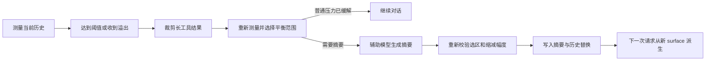

# 13｜长上下文：Token 预算、裁剪、摘要与缓存

> 源码基线为 DeepSeek Harness `dsh-v0.2.3-alpha.2`，提交 `4b399c39a6d1479cd84ca591b4d7c88e24d38a96`。[系列目录](../README.md) · [上一篇](12-session-full-text-search-fts5.md) · [上游仓库](https://github.com/deepseek-ai/deepseek-harness)

Coding Agent 连续读了几十个文件，下一步只需改一个函数，却可能因为前面的长工具结果、截图和消息用完窗口。DSH 会测量当前历史，按触发条件裁剪工具输出或生成摘要，部分图片超额也有独立恢复路径。各条路径都要把变更写进 Session，才能让后续请求和恢复得到一致的历史。[压缩组件](../deepseek-harness/packages/compaction/) · [Token Meter](../deepseek-harness/packages/llm/token-meter/README.zh.md)

## 1. DSH 怎么估算上下文压力

| 指标或配置 | 代表什么 |
| --- | --- |
| `contextWindow` | 路由模型声明的总窗口容量。 |
| 生效的 `maxTokens` | 一次对话请求给输出保留的上限，影响留给历史的预算。 |
| `surfaceTokens` | 当前可见历史各节点估算值之和。支持的路由会应用图片价格和请求中的文件句柄表示。 |
| `measure().totalTokens` | 压缩所用的总压力，结合历史、工具 Schema、可复用的 Provider 用量与后续变化估算。 |
| `tokenUsage` | 已记录的使用量汇总，包括未缓存输入、输出、缓存读写等分项。 |

`TokenMeter.measure()` 从同一个日志位置取得当前 surface、请求头和最近一次成功调用的用量锚点。若当前请求头与锚点的有效配置和工具集合一致，且上次报告的用量至少达到锚点的完整估算值，可以复用该用量。计算时再加上当前 surface 相对锚点的带符号差额。新增消息会提高压力，裁剪和替换可以降低压力。换模型或工具 Schema 后，旧锚点可能无法对应新请求，此时回到完整估算。[测量算法](../deepseek-harness/packages/llm/token-meter/src/index.ts#L151) · [请求头比较](../deepseek-harness/packages/core/session/src/request-header.ts#L33)

文本启发式大致按每四个字符估算一个 token，并加上消息、内容块和工具声明的结构开销。中文、密集 JSON 或模型专有序列化都可能偏离这个比例。一个 Provider 已报告的用量可以进入统计，却未必能作为下一次请求的预算锚点。界面展示的 `contextBreakdown` 也有自己的启发式口径。面试时先确认要回答的是计费、构成还是下一次请求的压力。[文本定价](../deepseek-harness/packages/llm/token-meter/src/estimate.ts#L12) · [用量投影](../deepseek-harness/packages/llm/token-meter/src/usage-projection.ts#L78)

## 2. 从窗口容量推导触发阈值与保留量

`resolveCompactSpec()` 将路由配置归成三个量。`W` 为上下文窗口，`O` 为当前请求的 `maxTokens` 或 adapter 的默认输出上限，`B` 为压缩策略预留的额外余量。若两种输出上限都缺失，`O` 按零处理。[输出预留](../deepseek-harness/packages/compaction/compaction-basic/src/index.ts#L64) · [阈值计算](../deepseek-harness/packages/compaction/compaction-basic/src/config.ts#L145)

| 项目 | 当前默认公式或配置 |
| --- | --- |
| 历史消息预算 | `W - O` |
| 自动触发阈值 | `floor(min(W × 0.8, W - O - B))`，`B` 默认 `65,536`。 |
| 最近历史保留量 | `floor((W - O) × 0.16)`，也可显式指定 `retainTokens`。 |
| 摘要输出上限 | 压缩策略自己的 `maxTokens`，省略时通常取该策略的 `headroomTokens`。 |

假设某路由配置 `W = 128,000`、`O = 16,000`、`B = 32,000`，则触发阈值为 `80,000`，近期历史的定价目标为 `17,920`。这个目标还要经过消息节点和工具配对边界的调整。只把上下文上限设好还不够，若输出预留与额外余量已经用光窗口，或者保留量不低于阈值，配置在解析该路由的预算时会报错。DSH 允许为精确的 `provider/model` 配置覆盖策略。[预算校验](../deepseek-harness/packages/compaction/compaction-basic/src/config.ts#L153) · [配置字段](../deepseek-harness/packages/compaction/compaction-basic/README.zh.md#use-this-package)

## 3. 自动压缩、模型切换与溢出恢复

| 触发点 | 执行逻辑 |
| --- | --- |
| `agent/pre-step` 的常规压力检查 | 读取已记录的请求头和当前历史。达到阈值后先运行工具结果裁剪，再测量；已经低于阈值即可继续。 |
| `agent/request` 中发现路由切换 | 用拟切换到的模型容量和请求配置检查压力。压缩仍无法满足目标时，报告 `MODEL_SWITCH_COMPACTION_FAILED`。 |
| Provider 返回 `CONTEXT_WINDOW_EXCEEDED` | 进入 `agent/request-error`。跳过普通阈值与保留比例，只在有预算且 surface 替换已经推进时同一步重试。 |
| 用户调用 `/compact` | 空闲 Agent 通过维护阶段预留执行权，可在低于阈值时主动压缩，并对结束后的记录做刷盘。 |

常规检查发生在下一次请求派生前，计量使用已经进入 surface 的内容。刚刚认领但尚未追加的用户输入仍可能使真正的请求超窗。Provider 明确溢出时，恢复逻辑会先裁剪，再尝试从历史头部找到可安全压缩的范围，超时或用户取消可中止执行。若裁剪已写入替换事件，后续摘要失败也可能允许一次重试，因为输入已经实际缩小。失败但无替换进展时，保留原请求错误，由其它匹配策略继续处理。[自动检查与模型切换](../deepseek-harness/packages/compaction/compaction-basic/src/index.ts#L157) · [溢出重试条件](../deepseek-harness/packages/compaction/compaction-basic/src/index.ts#L220) · [溢出选区](../deepseek-harness/packages/compaction/compaction-basic/src/index.ts#L310) · [手动压缩](../deepseek-harness/packages/compaction/compaction-basic/src/index.ts#L417)

基础 Bundle 挂载 token meter、基础压缩和工具结果裁剪。Web 将基础层的全局压缩和裁剪行停用，再由 Standard 等 Preset 在自己的作用域装配。定位行为时应看当前 Profile 和选定 Agent 的 Preset 中是否有对应插件。[基础压缩](../deepseek-harness/packages/bundle/base/cordis.patch.yml#L363) · [基础裁剪与图片卸载](../deepseek-harness/packages/bundle/base/cordis.patch.yml#L444) · [Web 覆盖](../deepseek-harness/packages/bundle/web-app/cordis.patch.yml#L613) · [Standard Preset](../deepseek-harness/packages/bundle/web-app/presets/standard.patch.yml#L77)

## 4. 先裁剪工具结果，再选择摘要范围

工具输出裁剪按 Unicode 码点计量 `text` 块。默认合计文本超过 `8,192` 个码点时，留下开头 `4,096`、结尾 `1,024` 和中间删除标记。图片等非文本块保持其相对顺序。触发后代码先记录 `compaction/prune`，描述被遮蔽节点和估算值，再追加新的 `tool/result` 替换旧节点。旧事件仍在日志中，新的模型历史使用短版本，并保留对应工具调用的身份。这项操作不需要调用摘要模型。[裁剪算法](../deepseek-harness/packages/compaction/compaction-tool-result-pruner/src/index.ts#L78) · [裁剪事件与替换](../deepseek-harness/packages/compaction/compaction-tool-result-pruner/src/index.ts#L136)

如果还需要摘要，`selectCompactableRange()` 从 surface 尾部向前累计价格，定位需要原样保留的近期消息，再将截点向前调整到工具调用与结果配对完整的位置。自动选区从较早的保留节点开始，绕过初始系统头。将调用留在原文而只摘要它的工具结果，会让下次请求留下悬空的 Function Calling 历史。找不到安全的平衡范围时，压缩只能保留当前结构并走相应失败或退出分支。[近期尾部与配对检查](../deepseek-harness/packages/compaction/compaction-basic/src/region.ts#L118)

## 5. 摘要写回的是什么，丢了细节怎么补

辅助摘要直接调用 `ctx.llm.stream()`，`purpose` 标为 `compaction`。输入由保存的系统头、已选历史、最新请求头的工具声明与末尾的摘要指令构成。默认优先取最近一次产生助手答复的路由作为摘要目标，再看最近请求头和 Agent 选项。也可以显式配置独立的摘要 Provider 与模型。把摘要任务发给已经处理过这段历史的路由，可能复用已有请求前缀。[摘要路由](../deepseek-harness/packages/compaction/compaction-basic/src/index.ts#L72) · [选区到摘要输入](../deepseek-harness/packages/compaction/compaction-basic/src/region.ts#L538) · [辅助调用](../deepseek-harness/packages/compaction/compaction-basic/src/summarizer.ts#L124)

区域事务先追加 `compaction/start`。摘要返回后，重新核对选区或整个 surface 的稳定性，并验证带包装的摘要估算量低于原范围。通过后追加 `compaction/summary` 和 `surfaceOp: replace` 的 `compact-checkpoint` 用户消息，最后记录 `compaction/end`。摘要事件可保留原始输出、计费样本和被遮蔽序号。下一次对话请求会根据当前系统来源重建相应系统头，并从新 surface 组装历史。实际快照显示，step 2 的失败尝试后发生了压缩，仍在 step 2 重新请求，`request/header` 开启了新的 series。[选区校验与缩减](../deepseek-harness/packages/compaction/compaction-basic/src/region.ts#L391) · [摘要与替换写入](../deepseek-harness/packages/compaction/compaction-basic/src/region.ts#L476) · [压缩恢复快照](../deepseek-harness/snapshots/session/compaction-recovery/session.v4.jsonl#L22)

缩短只能证明摘要在估算上更省空间。若对话中曾有「只能修改测试文件」「输出必须兼容 v2」等关键约束，应保留可追溯的原消息，必要时用指令来源或已记录事件再次核对。设计面试中可以把关键约束、未完成事项和外部操作回执存为有来源的结构化状态，摘要引用它们。校验时既看释放了多少预算，也看下一轮是否延续了不可变的任务要求。[摘要定价校验](../deepseek-harness/packages/compaction/compaction-basic/src/region.ts#L416) · [Session 原始日志与分叉](08-session-event-log-projection-replay.md)

## 6. 图片超额与前缀缓存是两条不同的问题

支持图片的路由可能因图像数量或请求尺寸返回 `IMAGE_OFFLOAD_REQUIRED`，并说明需要减少的出现次数。`compaction-image-offload` 从较早的用户消息和工具结果中选图，按消息序号和图片位置写 `image/offload`。消息身份与附件仍可追溯，后续模型输入会用带附件说明与可用只读路径的占位文本替代这些出现位置。摘要请求遇到同类失败时，卸载范围只限当前摘要选区。选择落盘后会继续生效，新的模型路由容量变大时旧位置也不会自动变回图片。[卸载触发](../deepseek-harness/packages/compaction/compaction-image-offload/src/index.ts#L25) · [选图与记录](../deepseek-harness/packages/compaction/compaction-image-offload/src/image-offload.ts#L16) · [卸载语义](../deepseek-harness/packages/compaction/compaction-image-offload/README.zh.md)

Provider 的前缀缓存可以复用重复输入的计算，并通过缓存读写用量体现部分成本。缓存命中的 token 仍属于模型输入，仍然消耗窗口容量。对话只在尾部追加时，较早前缀更容易保持相同；工具声明、系统头、被剪掉的早期输出或卸载图片发生变化后，可复用范围可能在第一个变化位置结束。DSH 的请求 series 记录历史变化，并不能指定 Provider 一定命中。核对压缩收益时要把辅助摘要成本、后续未缓存的输入成本和新增回合延迟一起看。[请求 series](../deepseek-harness/packages/core/agent-loop/src/agent.ts#L654) · [缓存用量字段](../deepseek-harness/packages/llm/llm-deepseek/src/translate.ts#L35) · [DeepSeek 上下文缓存](https://api-docs.deepseek.com/guides/kv_cache/)

## 7. 面试官会怎么追问

### 明明还差几万 token 才满，为什么提前压缩？

先写出 `W - O - B` 和比例阈值。再区分即将生成的输出、摘要余量与需要原样保留的尾部。追加的输入尚未计入当前 surface 时，Provider 仍可能报溢出。继续追问可以把 `maxTokens` 调高或换成小窗口模型，让候选人说明为什么同一段历史会得到不同触发点。

### 为什么遇到超长历史，先裁剪工具输出而不是直接摘要？

裁剪可确定地减少冗长文本，并保留工具调用身份，成本不包含一次额外模型请求。若裁剪后压力仍高，再用摘要压缩较早的平衡范围。要求候选人画出一个范围刚好切断工具配对的例子，并说明怎样移动截点，以及为什么不能混写失败结果。

### 摘要忘了用户明确给定的约束，后续怎么发现和恢复？

可以把用户约束、打开的文件版本、测试失败和待办项保留为有来源的状态，再在摘要后比较当前约束与原事件。遗漏时按来源精确补回，并记录补回的原因，避免把整段历史再次发送。继续追问时可以让候选人对照不同压缩预算，解释如何判断压缩节省了成本、同时保留了任务成功所需的信息。

### 输入缓存命中率变低，压缩是否一定有问题？

先查是哪部分输入发生变化，以及变化前后的首个不相同位置。压缩可能减少总输入，却让原有前缀更早失效。需要同时观察摘要成本、后续每次请求的缓存读写量和总时延。可以让候选人比较长而稳定的历史与短而频繁重写的历史，说明一个明确的会话长度和迭代次数下如何取舍。

下一篇进入附件与跨会话记忆，追踪日志引用如何找到真实文件，以及历史会话内容怎样被有界地纳入当前请求。
