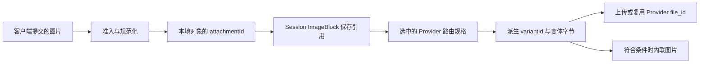

# 14｜附件与跨会话记忆

> 源码基线为 DeepSeek Harness `dsh-v0.2.3-alpha.2`，提交 `4b399c39a6d1479cd84ca591b4d7c88e24d38a96`。[系列目录](../README.md) · [上一篇](13-context-compaction-and-cache.md) · [上游仓库](https://github.com/deepseek-ai/deepseek-harness)

用户把一张截图和一份 CSV 交给 Agent，又引用了上周排查故障的对话。请求里可能同时出现三类东西：可供模型识别的图片变体、指向本地文件的句柄，以及从旧会话某个截点捕获的文本。把这些内容都塞进一次请求，恢复、控制大小和授权都会变难。DSH 分别存储字节、会话引用和已捕获的文本，让请求根据需要读取。[附件服务](../deepseek-harness/packages/attachment/attachment/README.zh.md) · [会话引用服务](../deepseek-harness/packages/context/session-reference/README.zh.md)

## 1. 附件、请求变体和跨会话快照分别是什么

| 对象 | 存在哪里 | 什么时候进入模型请求 |
| --- | --- | --- |
| 规范化图片或原样文件 | Harness home 下的本地附件对象存储 | Session 保存引用，组装请求时解析图片或生成文件句柄文本。 |
| 路由专用的请求图片 | 本地派生缓存，或已存在的规范化字节 | 在有图像能力的路由上按请求规格生成，需要时上传到 Provider。 |
| 跨会话文本快照 | 目标 Session 的一条带来源的用户上下文消息 | 用户引用源会话后，在本次 step 准备期间捕获并追加。 |
| Spill 产物 | 后端为目标 Session 保存的文本文件 | 请求只携带预览和读取提示，内容取回时才进入后续模型输入。 |

可以先用两个问题定位一块数据：它的字节由谁保存？它何时进入某次模型实际可见的输入？例如 JSONL 日志能记住一张图片的引用。要在新机器上完整还原这段会话，还需要让附件引用能解析到有效字节。相反，请求尺寸的派生变体通常可从已保存的对象重建。[本地对象生命周期](../deepseek-harness/packages/attachment/attachment-local/README.zh.md) · [请求变体生成](../deepseek-harness/packages/attachment/attachment-local/src/request-image.ts#L221)

## 2. 内容寻址怎样保证恢复能找到同一份附件

基础 Bundle 挂载 `attachment-local`。图片进入提示词前要校验实际媒体类型、编码大小、尺寸和像素，必要时做 EXIF 方向处理、去元数据、缩放及重新编码。满足条件的干净 PNG、JPEG 或 WebP 可以原字节通过。存储时对**规范化完成后的字节**计算 SHA-256，输出 `sha256:<digest>` 的引用，另记实际 MIME、尺寸和字节数。哈希对应真正保存的对象，上传时的文件名可作为显示信息独立保留。[基础配置](../deepseek-harness/packages/bundle/base/cordis.patch.yml#L146) · [预处理与摘要](../deepseek-harness/packages/attachment/attachment-local/src/store.ts#L98) · [规范化规则](../deepseek-harness/packages/attachment/attachment-local/README.zh.md#use-this-package)

图片对象位于 `<DSH_HOME>/attachments/v1/objects/<摘要前缀>/<摘要>`。写入先暂存和同步，再以排他的硬链接发布，处理已经存在的对象时也会核对内容摘要。读取从引用推导对象路径，再验证摘要和实际图像头。原样文件则流式保存精确字节，记录文件名、长度和摘要。内容相同的文件可共享一个规范对象，不同名称通过各自的只读路径引用它。对整个消息而言，先接纳并准备附件，再发布消息内容，避免事件提前引用只完成一部分的对象。[不可变对象发布](../deepseek-harness/packages/attachment/attachment-local/src/store.ts#L349) · [读取验证](../deepseek-harness/packages/attachment/attachment-local/src/store.ts#L430) · [原样文件存储](../deepseek-harness/packages/attachment/attachment-local/src/file-store.ts) · [附件接纳约定](../deepseek-harness/packages/attachment/attachment/README.zh.md)

摘要校验回答的是「这是不是引用约定的字节」。访问控制要回答「当前请求者能不能读取这个对象」。本地附件存储根据完整引用读取和校验对象，宿主接口负责请求授权，工具访问还受文件系统和沙箱策略约束。系统扩展到多租户时，应把对象身份与授权记录分别管理，再基于用户、工作区及所属会话校验该次读取。[附件读取约定](../deepseek-harness/packages/attachment/attachment/README.zh.md) · [授权后读取的宿主入口](../deepseek-harness/packages/api/session-controller/src/index.ts#L469)

## 3. 同一张图为什么有三个 ID

`attachmentId` 标识本地长期保存的规范化对象。`variantId` 则对附件 ID、变换版本、目标宽高、字节限制、缩放参数和编码配置做摘要。它表达一次确定的请求变换，同一图在不同路由规格下可以产生不同变体。模型工具需要路径时，文件系统服务会把可映射的宿主位置转换为执行环境中的只读路径；路径属于本次请求的表示。[变体身份](../deepseek-harness/packages/attachment/attachment-local/src/request-image.ts#L70) · [请求读取及缓存](../deepseek-harness/packages/attachment/attachment-local/src/request-image.ts#L221)

DeepSeek Messages 能上传符合条件的图片变体，并在请求的 `image.source` 中使用返回的 `file_id`。本地上传索引按**端点、鉴权头摘要和 `variantId`**来查找可复用上传，并检查是否接近过期。这样两个账号或部署的远端引用留在各自命名空间中。多个同进程请求也可以共享一次在途上传。部分 Files 解析失败会走受限制的 inline 路径，使用实际图片字节；原 Session 继续以本地附件引用定位对象。通用文件块则在各路由上投影成文件句柄说明，由文件工具按需取内容。[上传复用](../deepseek-harness/packages/llm/llm-deepseek/src/file-store.ts#L182) · [索引作用域](../deepseek-harness/packages/llm/llm-deepseek/src/upload-index.ts#L38) · [Files 降级与请求](../deepseek-harness/packages/llm/llm-deepseek/src/adapter.ts#L96) · [通用文件投影](../deepseek-harness/packages/llm/llm/src/index.ts#L1082) · [DeepSeek Files API](https://api-docs.deepseek.com/guides/files_api/)

## 4. 跨会话引用捕获的是哪个时点

Web Bundle 挂载了 `session-reference`。用户可以先从候选列表选会话，候选主要来自标题、ID 和目录等元数据，再用规范的 `dsh-session:` mention 引用。候选补全和第 12 篇的正文全文检索是两条入口。真正读取发生在 `agent/pre-step`。监听器处理直接用户消息，调用 `ctx.sessionQuery.readSurface()` 读取引用来源，再把一条带来源的文本快照放到那条用户消息后面。[Web 装配](../deepseek-harness/packages/bundle/web-app/cordis.patch.yml#L87) · [消息接纳](../deepseek-harness/packages/context/session-reference/src/index.ts#L149) · [读取源会话](../deepseek-harness/packages/context/session-reference/src/index.ts#L334) · [第 12 篇](12-session-full-text-search-fts5.md)

快照取源会话当前 surface 的直接用户文本、助手文本和压缩检查点。工具结果、推理、系统消息和其它注入上下文不进入这个文本投影，所以已经召回的旧会话背景不会沿引用递归扩散。目标 Session 记录源会话 ID、`capturedFormatVersion`、`capturedThroughSeq` 和保留统计。后续源会话继续运行时，目标历史中的这条引用仍指向当初捕获的版本。提示词把来源内容标为背景资料，工具授权依据当前会话的实际权限。[文本投影](../deepseek-harness/packages/context/session-reference/src/projection.ts#L39) · [捕获元数据](../deepseek-harness/packages/context/session-reference/src/index.ts#L366) · [背景提示与受信任调用边界](../deepseek-harness/packages/context/session-reference/README.zh.md)

默认每条用户消息最多引用三个不同会话。每个来源预览有独立的序列化字节预算，未配置固定值时由当前 step 的模型容量估算，具备 64 KiB 下限。超预算先移除较早的非检查点消息，再缩短剩余文本。省略通知报告丢弃的整条消息数和 UTF-8 字节数。仓库的 `session-reference-spill` 快照中，来源截至 `seq = 2`，两条原始文本只保留了一条，省略通知与预览一起写入了目标会话。[预算解析](../deepseek-harness/packages/context/session-reference/src/index.ts#L396) · [保留策略](../deepseek-harness/packages/context/session-reference/src/projection.ts#L75) · [截断记录](../deepseek-harness/snapshots/session/session-reference-spill/session.v4.jsonl#L11)

## 5. Spill 省下哪些输入，保存多久

跨会话预览截断时，Spill Store 可以保存同一捕获点的完整**文本投影**。文件归目标 Session，元数据保留源会话。预览携带 locator 与读取说明，模型后来可以用 `read` 分页取回。若未装配存储或保存失败，标记完整快照不可用，已经生成的预览仍可使用。[引用 Spill](../deepseek-harness/packages/context/session-reference/src/spill.ts#L15) · [文本保存接口](../deepseek-harness/packages/spill/spill/README.zh.md)

工具结果也能溢出到文本文件。基础装配把 `maxInlineTokens` 设为 `12,500`。策略在后置工具处理后按估算预算保留首尾，存完整的已接受文本，并附省略提示和按需读取路径。混合输出里的图片在文件中用附件路径说明。对于纯文本 PTC 子调用，可以只压缩派发日志副本，程序仍可使用它得到的规范返回值。这与第 13 篇在历史压力升高后再裁剪已有工具节点的时机不同。[基础额度](../deepseek-harness/packages/bundle/base/cordis.patch.yml#L432) · [结果保留](../deepseek-harness/packages/spill/spill-policy/src/index.ts#L91) · [普通结果与 PTC 日志接入](../deepseek-harness/packages/spill/spill-policy/src/index.ts#L134)

本地 Spill 默认在启动时扫描并清理超过 30 天的旧文件。只依赖一个 locator 的会话，未来可能遇到产物过期。本地附件对象有独立的保留策略，当前实现没有引用感知的自动垃圾回收。每次恢复都应分清 Session 里仍可依赖的文本、可重建的图片变体，以及要核实存在性的外部文件。[Spill 启动清理](../deepseek-harness/packages/spill/spill-local/README.zh.md#startup-cleanup) · [附件保留约定](../deepseek-harness/packages/attachment/attachment/README.zh.md)

## 6. 从显式引用扩展到长期记忆

DSH 的这条实现由用户显式引用旧会话。若要设计能主动召回的企业 Agent，可以在已捕获记录之外维护可查询的记忆条目。设计时先定义来源、所有者、适用范围和过期机制，再决定如何分词、嵌入或重排。下面是系统设计扩展，DSH 的实现证据见前几节。

| 环节 | 可落地的设计 |
| --- | --- |
| 写入 | 区分候选观察与已确认的偏好、约束或事实。保留源会话、事件范围、时间、适用项目与提取版本，允许修正或过期。 |
| 召回 | 先按用户、租户和工作区取得授权候选，再做词法或向量召回。用相关性、时效、置信信息和 token 预算选取内容。 |
| 接纳 | 将当前用户指令与检索到的背景分开，记录最终注入的条目、来源版本和内容。需要外部写操作时，由当前用户意图和工具策略决定。 |
| 权限撤回与删除 | 维护从源会话到目标快照、索引文档、spill 副本和附件引用的反向关系。先让读取及召回失效，再按保留策略清理派生物。共享附件应在合法引用全部解除后由 GC 回收。 |

一条已经追加到目标 Session 的快照有自己的持久身份。因此，如果产品承诺撤销源权限后马上隐藏历史副本，权限变化必须到达目标历史的读取和投影路径，还要处理缓存、导出和备份中的副本。如果产品允许保留历史审计，同时禁止投入新的模型请求，则应把这两项读权限分别定义。明确可见性后，才能设计删除完成条件和对账指标。

## 7. 面试官会怎么追问

### 同一张图换模型后，为什么不能只复用旧的远端 `file_id`？

先说清 `attachmentId`、`variantId` 和 `file_id` 各自归哪一层所有。目标尺寸和字节限制变化会生成不同的请求变体。远端文件还受端点、账号和过期时间约束。继续追问可要求候选人画出「附件存在、变体缓存被清空、远端上传已过期」的恢复顺序。

### 引用上周的会话后，上周那段历史又被压缩了，模型会看到哪个版本？

指出目标 Session 保存的是当时捕获的文本及版本和序号。新引用才会读取当前表层。进一步可让候选人解释，为什么预览和完整 spill 副本必须由同一捕获点产生，以及在来源失效时怎样给用户可解释的反馈。

### 十万行工具输出怎样保留证据，同时避免撑满上下文？

先保留有用的头尾和定位信息，把已接受的大输出交给有界存储，再根据需要分页读取或按关键词筛选。继续追问可以加上文件过期、原工具已裁剪和图片只能按附件路径读取的条件，让候选人说明哪些证据还能重建。

### 使用内容哈希去重后，怎样删除一份共享附件？

要区分用户撤销自己的引用和物理对象回收。先记录引用归属与访问权限，解除当前会话的有效读取路径，再检查其它会话、分叉、引用快照和备份的保留要求。面试加深时可以让候选人处理删除与新引用竞态，交代反向索引、延迟回收、幂等与审计。

下一篇进入 Skill，从一份 `SKILL.md` 追踪它如何被发现、合并进目录，并在需要时读入正文。
