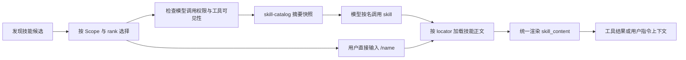

# 15｜Skill 从 `SKILL.md` 到模型上下文

> 源码基线为 DeepSeek Harness `dsh-v0.2.3-alpha.2`，提交 `4b399c39a6d1479cd84ca591b4d7c88e24d38a96`。[系列目录](../README.md) · [上一篇](14-attachments-and-cross-session-memory.md) · [上游仓库](https://github.com/deepseek-ai/deepseek-harness)

同一个 `review-notes` 技能在仓库和用户目录各有一份。模型看到目录中的名称，调用 `skill` 时该读哪一份？如果用户手动输入 `/review-notes`，会走同一条调用链吗？DSH 把问题拆成发现、选中、可见性和正文加载。目录描述帮助模型决定是否加载，实际指令在调用时进入会话。[Skill Registry](../deepseek-harness/packages/skill/skill/README.zh.md) · [模型技能工具](../deepseek-harness/packages/skill/tool-skill/README.zh.md)

## 1. 三个插件分别管什么

| 插件 | 职责 | 主要数据 |
| --- | --- | --- |
| `dsh-skill` | 提供 `ctx.skills`，注册 Provider、合并作用域并选出同名候选。 | 摘要、候选定位符、完整定义。 |
| `dsh-skill-filesystem` | 根据当前目录发现本地技能，解析 frontmatter，处理目录观察，并从候选定位符加载正文。 | `SKILL.md`、平铺 Markdown 文件、资源目录。 |
| `dsh-tool-skill` | 注册模型可调用的 `skill`，维护 Session 目录，处理用户的 `/name`。 | `skill-catalog`、`skill-invocation`、工具结果。 |

基础 Bundle 装配这三个插件。Web 保留全局技能注册表，让 Preset 负责挂载作用域内的文件系统 Provider 和加载工具，Office 等插件也可以向全局提供技能。因而同一进程里的两个 Agent，能共享全局技能，同时看到各自的 Preset 目录和排除配置。[基础装配](../deepseek-harness/packages/bundle/base/cordis.patch.yml#L318) · [Web 的全局与 Preset 关系](../deepseek-harness/packages/bundle/web-app/cordis.patch.yml#L581) · [Preset 技能装配](../deepseek-harness/packages/bundle/web-app/presets/cordis.patch.yml#L126)

## 2. 文件系统 Provider 如何发现技能

Agent Skills 的目录约定以 `SKILL.md` 为入口。DSH 本地 Provider 支持根目录下一层的 `<目录>/SKILL.md`，也支持根目录中的 `<名称>.md` 文件。源码枚举配置根目录下的直接条目，按条目类型找到指令文件。YAML frontmatter 需要 `name` 和 `description`，其中 `name` 是后续按名加载用的标识。格式错误、缺字段或调用策略无法解析的定义会带诊断被跳过。[Agent Skills 格式规范](https://agentskills.io/specification) · [文件枚举](../deepseek-harness/packages/skill/skill-filesystem/src/index.ts#L738) · [frontmatter 解析](../deepseek-harness/packages/skill/skill-filesystem/src/index.ts#L812)

例如，一个只由用户显式触发的审阅技能，可以把描述与工作要求分开写。

```markdown
---
name: review-notes
description: 检查技术笔记是否清楚说明了结论、证据和适用范围。
disable-model-invocation: true
---

按实现结论、源码证据和适用边界三个方面审阅笔记。
指出缺失的信息，并保留原文中的技术术语。
```

`disable-model-invocation: true` 关闭模型侧展示和加载。`user-invocable: false` 关闭用户侧候选和显式加载。两项省略时，各自默认允许。也可以额外提供 `whenToUse` 和 `metadata`。发现时 Provider 读取文件并解析 frontmatter，交给 Registry 的候选只带摘要和定位符。真正要加载时，`get()` 会从定位符重新读取并返回正文，所以渐进加载主要节省的是进入模型请求的正文，而文件系统上的发现仍有读取开销。[调用字段解析](../deepseek-harness/packages/skill/skill-filesystem/src/index.ts#L1015) · [候选构造](../deepseek-harness/packages/skill/skill-filesystem/src/index.ts#L738) · [按定位符加载](../deepseek-harness/packages/skill/skill-filesystem/src/index.ts#L211)

## 3. 同名技能怎样选中，目录什么时候失效

查找同时带上当前 `cwd` 和 Agent Scope。文件系统 Provider 在默认配置下从 `cwd` 找最近的 `.git` 项目根，找不到时使用 `cwd`。同一个 Registry 内，先确定每一层的同名胜者，再由近作用域覆盖远作用域。例如同名技能在 Agent 的 Preset 层和全局都有，Preset 层胜出；在同一作用域内，才比较候选的 rank。rank 相同再看 Provider 注册顺序和该 Provider 返回顺序。[发现根目录](../deepseek-harness/packages/skill/skill-filesystem/src/index.ts#L252) · [项目根发现](../deepseek-harness/packages/skill/skill-filesystem/src/index.ts#L960) · [Scope 合并](../deepseek-harness/packages/skill/skill/src/index.ts#L554) · [同层排序](../deepseek-harness/packages/skill/skill/src/index.ts#L810)

| 在同一作用域内 | rank |
| --- | --- |
| 项目 `.dsh/skills` | 100 |
| 项目 `.agents/skills` | 200 |
| `ctx.skills.register()` 的运行时技能 | 250 |
| `customSkillDirs` | 300 |
| 用户 `$DSH_HOME/skills` | 400 |
| 共享 agents home 的 `skills` | 500 |
| 装配的 bundled 技能源 | 600 |

例如同一层的项目版本命中后，模型和用户侧才检查该版本各自的调用权限。若项目版本禁止模型调用，模型侧会隐藏它，而不是去选择用户目录的同名版本。Registry 的基础 `list()` 返回已选中的摘要，调用方负责根据自身的入口做过滤。[rank 常量](../deepseek-harness/packages/skill/skill-filesystem/src/index.ts#L36) · [运行时 rank](../deepseek-harness/packages/skill/skill/src/index.ts#L25) · [调用中立的摘要](../deepseek-harness/packages/skill/skill/src/index.ts#L467)

缓存键含 `cwd`、作用域链与 Registry revision，保存的是已完成的目录发现。注册、卸载或 Provider 主动失效时推进 revision，清掉旧缓存。文件系统 Provider 在可观察的本地根上管理 watcher。根目录读取出错时，可返回其它根已经确认的条目，将发现标为不完整。Registry 不缓存不完整结果，后续查找可重新发现。正文始终在加载时读取。只改正文且摘要不变时，前后两轮可以看到同一份目录，下一次加载则得到新的指令。[缓存与重试](../deepseek-harness/packages/skill/skill/src/index.ts#L522) · [失效键](../deepseek-harness/packages/skill/skill/src/index.ts#L624) · [局部发现失败](../deepseek-harness/packages/skill/skill-filesystem/src/index.ts#L180) · [仅改正文的测试](../deepseek-harness/packages/skill/tool-skill/tests/tool-skill.spec.ts#L718)

## 4. 技能目录怎样写进 Session



`tool-skill` 在 `agent/pre-step` 的接纳分支上检查自己注册的**确切工具定义**是否对 Agent 可见。单凭作用域里有个同名 `skill` 工具并不够，原定义被遮蔽时它也不应继续提供这份目录。可见时，它获取当前目录快照，只保留允许模型调用且未被配置排除的条目。会话目录含技能名、归一化后的描述和完整性状态，描述默认最多 500 字符。[目录接纳](../deepseek-harness/packages/skill/tool-skill/src/index.ts#L219) · [长度配置](../deepseek-harness/packages/skill/tool-skill/src/index.ts#L65)

目录以来源 `skill-catalog` 的用户角色消息写进 Session，结构化 `entries` 让消费者可以检查它发布过哪些技能。工具对排序后的名称、目录描述和不完整状态计算 digest，并与当前 surface 上仍可见的旧目录比较。成员或完整性变化时追加新目录，提示模型以后使用这份列表。目录曾发布而后全部不可见时，可以追加空更新；第一次发现完整但确实没有技能，则可省略目录。若发现不完整，空目录也会带警告，保留「暂时无法确认」的语义。[摘要与完整性 digest](../deepseek-harness/packages/skill/tool-skill/src/index.ts#L348) · [追加新目录](../deepseek-harness/packages/skill/tool-skill/src/index.ts#L255) · [历史可见性](../deepseek-harness/packages/skill/tool-skill/src/index.ts#L390)

`skill-load` 快照先记录 `skill-catalog`，然后记录 `skill` 的工具调用和带 `<skill_content>` 的结果。`skill-root-isolation` 快照的目录显示 `incomplete: true`，仍列出的技能可以成功加载。这两条记录把「知道有这个技能」和「正文确实加载成功」分成了可核对的事件。[正常加载快照](../deepseek-harness/snapshots/session/skill-load/session.v4.jsonl#L12) · [部分可用快照](../deepseek-harness/snapshots/session/skill-root-isolation/session.v4.jsonl#L12)

## 5. 模型调用与用户 `/name` 怎样得到正文

| 路径 | 什么时候加载 | 正文进历史的方式 |
| --- | --- | --- |
| 模型调用 `skill({name})` | 执行工具时按当前 Scope 和 `cwd` 找技能。先检查已发现候选的模型调用策略，再加载，并复查返回定义。 | 普通 `tool/result`，模型下一步从工具结果读指令。 |
| 用户输入 `/name` | `agent/pre-step` 扫描已认领的直接用户文本。合法 token 指名一个用户可调用技能时直接加载。 | 独立的 `skill-invocation` 用户上下文消息，保留原用户表达。 |

`/name` 手势匹配以空白为界的 token，句子中间也可出现。目录路径、多段斜杠或分数有其它边界，保持为普通文本。从工具或外部资料注入的内容不作为直接用户手势扫描。未知或不允许用户调用的名称保持普通行文。UI 的用户侧候选也按 Session 的工作目录和 Preset 过滤，读取摘要即可提供补全。[手势匹配](../deepseek-harness/packages/skill/tool-skill/src/index.ts#L431) · [用户显式加载](../deepseek-harness/packages/skill/tool-skill/src/index.ts#L190) · [补全接口](../deepseek-harness/packages/api/session-controller/src/skill-catalog.ts#L28)

两条加载路径复用 `renderSkillContent()`，都生成 `<skill_content>`。其中 `<skill_resources>` 说明相对资源应基于哪个目录、URL 或 Provider 解释，`<skill_instructions>` 携带正文。读取资源或执行脚本仍走相应工具与权限流程。若目录中的候选在稍后加载时已消失，Registry 返回缺失。若 Provider 返回一个改名后的定义，Registry 会对其启动失效处理，避免把旧名称当成新技能交给模型。[工具侧检查](../deepseek-harness/packages/skill/tool-skill/src/index.ts#L139) · [统一渲染](../deepseek-harness/packages/skill/skill/src/index.ts#L164) · [加载与身份校验](../deepseek-harness/packages/skill/skill/src/index.ts#L494)

## 6. 面试官会怎么追问

### 同名技能的项目版本、用户版本和 Preset 版本都存在，谁胜出？

先画出全局、祖先和当前 Agent 的作用域合并顺序，再在每层里比较 rank、Provider 注册顺序和本地顺序。进阶追问可以给最近层的版本加上 `disable-model-invocation: true`，要求候选人分别说出模型目录、用户补全和实际加载会得到什么。

### 技能出现在目录里，为什么按名称加载却失败了？

目录和正文有不同的读取时点。检查查找时的 `cwd` 与 Scope、候选来源、是否被排除、Provider 是否仍在，以及正文文件是否删除、改名或改变调用权限。可以要求候选人结合 `skill-catalog` 和 `tool/result` 区分「旧目录已失效」和「技能在本入口不可调用」，并给出相应的用户反馈。

### 一份工具结果里带着 `/review-notes`，会自动加载技能吗？

解释 `/name` 识别只扫描已认领的直接用户文本，模型加载要走注册工具和权限检查。然后追问用户明确调用技能后，正文里提到的脚本、资源和写操作如何分别批准。好的回答能指出指令注入、工具资格和外部动作授权三处检查各自的职责。

### 目录一直更新，怎样避免它占用太多上下文？

先介绍元数据与正文分开的设计、描述长度限制、同样的目录只发布一次，以及状态变化时新目录如何替代旧列表。进一步可以给定 1 万个技能和窄上下文，要求候选人设计召回前的权限过滤、选候选方式、落日志的版本身份及召回质量指标。

下一篇会从这个问题继续，分析 DSH 的目录管理机制以及生产环境中如何管理成千上万的 Skill。
