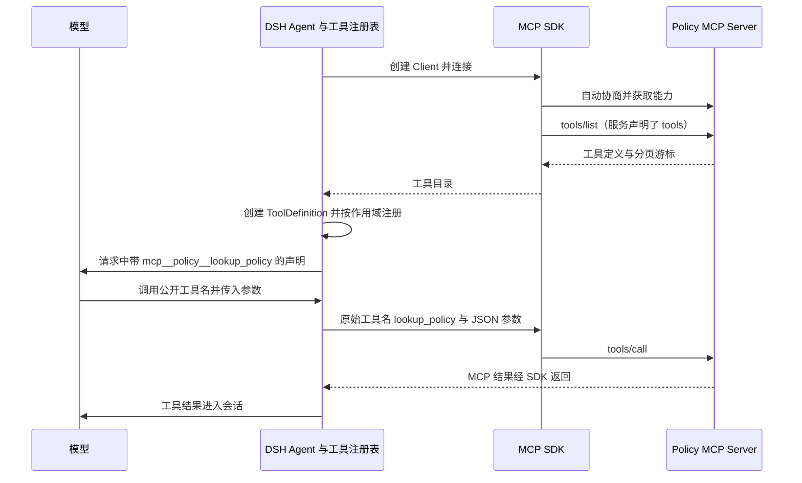

# 18｜MCP 接入实战：传输、发现与调用

> 源码基线为 DeepSeek Harness `dsh-v0.2.3-alpha.2`，提交 `4b399c39a6d1479cd84ca591b4d7c88e24d38a96`。[系列目录](../README.md) · [上一篇](17-plugin-market-and-preset-lifecycle.md) · [上游仓库](https://github.com/deepseek-ai/deepseek-harness)

给 Agent 接一套只读的内部政策库。服务提供 `lookup_policy` 查制度，也提供 URI 供 Agent 读取某一版原文。用户问「这条报销政策是什么时候生效的」，模型首先要拿到工具声明。服务能连通后，DSH 还要做能力发现、注册工具、为当前 Agent 解析可见的工具，再把调用结果转成模型能接收的内容。只开放资源的服务则会走共享资源工具。

## 1. 一个只读服务怎么接进 DSH

在支持组合补丁的 Profile 中，可为一台 MCP Server 添加一条 `@deepseek-ai/dsh-mcp-client` 配置。下面的 `policy` 是示例服务，URL 指向你实际部署的 MCP 端点。该服务应自行只暴露读权限。`serverName` 会进入模型侧工具名称，便于同一个 Agent 同时访问多个来源。[客户端配置示例](../deepseek-harness/packages/mcp/mcp-client/README.zh.md#use-this-package) · [配置 Schema](../deepseek-harness/packages/mcp/mcp-client/src/config.ts#L53)

```yaml
- insert:
    - id: mcp-policy
      name: '@deepseek-ai/dsh-mcp-client'
      config:
        transport: streamable-http
        serverName: policy
        url: 'http://127.0.0.1:3110/mcp'
        startupTimeoutMs: 10000
        toolCallTimeoutMs: 5000
```

如果服务随宿主机器运行，可以把同一行的传输改成 `stdio`，用 `command`、`args` 指向已安装的可执行程序，按需配 `cwd` 和 `env`。DSH 用 Schemastery 区分两套配置。`apply()` 先在当前注册作用域预留 `serverName`，同一作用域中的重名在加载时失败。随后启动连接监督器，等待首次连接和工具同步。启动超时是覆盖模板解析、连接协商与初次发现的预算，默认未设置。工具调用超时默认 60 秒。首次失败时，`failOnStartupError` 决定是否让当前插件激活失败，默认由监督器处理后续重连或等待凭据。[传输配置](../deepseek-harness/packages/mcp/mcp-client/src/config.ts#L53) · [实例装载](../deepseek-harness/packages/mcp/mcp-client/src/index.ts#L151) · [启动预算](../deepseek-harness/packages/mcp/mcp-client/src/connection.ts#L354)

## 2. 两种传输与两代协议

| 传输 | 协议消息怎样走 | DSH 接入点 |
| --- | --- | --- |
| `stdio` | 宿主启动子进程，按行交换 JSON-RPC。服务从 stdin 读取，向 stdout 写协议消息，诊断日志写 stderr。 | 用 SDK 的 `StdioClientTransport` 启动。参数来自配置，显式环境变量覆写清洗后的父环境。 |
| Streamable HTTP | 客户端向 MCP 端点发 POST，响应可以是 JSON 或 SSE。现代版的 SSE 与该请求关联，长期通知由订阅请求承载。 | 用 SDK 的 `StreamableHTTPClientTransport`，传入端点、请求头及可选授权适配。 |

传输只决定消息怎样走，协议版本则决定先发什么、哪些元数据要随请求带上。这个源码基线锁定 `@modelcontextprotocol/client` `2.2.0`，DSH 创建 `Client` 时使用自动协商，由 SDK 处理两代协议。[传输工厂](../deepseek-harness/packages/mcp/mcp-client/src/transport.ts#L33) · [SDK 版本](../deepseek-harness/packages/mcp/mcp-client/package.json#L58) · [客户端选项](../deepseek-harness/packages/mcp/mcp-client/src/connection.ts#L320) · [stdio 规范](https://modelcontextprotocol.io/specification/2026-07-28/basic/transports/stdio) · [现代 Streamable HTTP 规范](https://modelcontextprotocol.io/specification/2026-07-28/basic/transports/streamable-http)

- **现代协议 `2026-07-28`。** 客户端可以先用 `server/discover` 了解服务能力和版本。版本随每个请求声明，在请求 `_meta` 中携带，HTTP 还使用 `MCP-Protocol-Version` 请求头。服务器对不支持的版本可以返回它支持的版本列表。现代 HTTP 取消了协议级 Session 和独立的 GET 事件流端点。[版本协商规范](https://modelcontextprotocol.io/specification/2026-07-28/basic/versioning) · [现代 Streamable HTTP 规范](https://modelcontextprotocol.io/specification/2026-07-28/basic/transports/streamable-http)
- **兼容旧版 `2025-11-25` 等。** SDK 可回退到 `initialize` 请求，交换协议版本、能力和实现信息，成功后发送 `notifications/initialized`，再进入正常请求阶段。旧版 Streamable HTTP 可以分配 `MCP-Session-Id`，也有自己的 GET 流约定。排查兼容性先看协商版本，才知道应该观察哪一套消息和 Header。[DSH 自动协商说明](../deepseek-harness/packages/mcp/mcp-client/README.zh.md#use-this-package) · [旧版生命周期](https://modelcontextprotocol.io/specification/2025-11-25/basic/lifecycle) · [旧版传输规范](https://modelcontextprotocol.io/specification/2025-11-25/basic/transports)

源码中的 stdio 兼容用例让临时子进程收到 `server/discover` 时返回方法不存在，随后观察到 SDK 回收探测进程，再启动实际服务进程。这也解释了调试旧版 stdio 服务时为什么可能看到两次启动。第二次启动前第一个进程已退出，卸载后服务进程也被清理。[旧版服务夹具](../deepseek-harness/packages/mcp/mcp-client/tests/fixtures/negotiation-lifecycle.mjs#L23) · [进程生命周期用例](../deepseek-harness/packages/mcp/mcp-client/tests/negotiation-lifecycle.spec.ts#L71)

## 3. 从 tools/list 到模型看到的 schema



`connection.ts` 在连接后调用 `syncTools()`。只有服务声明 `tools` 能力时才查询 `tools/list`。SDK 处理分页及页数上限，桥接层拿到目录后建立下一组定义。同一列表里的重复名称会使这次发现失败。已有连接收到工具列表变更时，发现和构建阶段失败会保留之前的注册。到提交替换阶段，若注册与外部条目冲突，则清理本次已经注册的条目，整组发布失败，连接监督器按重连策略处理。[同步队列](../deepseek-harness/packages/mcp/mcp-client/src/connection.ts#L212) · [发现与注册](../deepseek-harness/packages/mcp/mcp-client/src/tools.ts#L144) · [变更后的失败处理](../deepseek-harness/packages/mcp/mcp-client/src/connection.ts#L341) · [分页用例](../deepseek-harness/packages/mcp/mcp-client/tests/mcp-client.spec.ts#L298)

DSH 把原始名称 `lookup_policy` 映射成 `mcp__policy__lookup_policy`，把描述和 `inputSchema` 传入 `ToolDefinition`，其中 `inputSchema` 成为 `parameters`。超过 DeepSeek 的 64 字符限制或出现不允许的字符时，公开名称会规范化并加上由服务器名及原始名计算的短哈希。真实调用使用原始名。默认 `eager` 直接在服务器所属作用域注册整套工具。Agent 每步通过 `tools.resolve()` 得到当前作用域的工具集，Native 执行器投影成模型请求使用的 schema。`on-demand` 则先发布目录及加载器，具体工具由 Agent 选中后加载。[公开名计算](../deepseek-harness/packages/mcp/mcp-client/src/tools.ts#L106) · [ToolDefinition 适配](../deepseek-harness/packages/mcp/mcp-client/src/tools.ts#L340) · [Agent 解析工具集](../deepseek-harness/packages/core/agent-loop/src/agent.ts#L286) · [Native schema 投影](../deepseek-harness/packages/core/tool-executor-native/src/index.ts#L12) · [按需加载约定](../deepseek-harness/packages/mcp/mcp-client/README.zh.md#on-demand-tool-loading)

## 4. 调用结果怎样进入会话

桥接器向 SDK 传入原始工具名、JSON 参数和调用选项。请求同时受当前工具调用及连接代际的取消信号约束，并带单次超时。读取政策的服务可以返回描述性的文本块，同时在 `structuredContent` 里返回机器可读的政策 ID、版本与生效日期。DSH 校验 MCP 结果结构，并在成功响应有声明的 `outputSchema` 时用 Ajv 校验结构化值。仓库中有一个用例把应为数字的 `size` 返回成字符串，桥接器报告 `MCP_INVALID_RESULT`。[SDK 调用](../deepseek-harness/packages/mcp/mcp-client/src/tools.ts#L168) · [结果验证与执行适配](../deepseek-harness/packages/mcp/mcp-client/src/tools.ts#L387) · [结构化结果用例](../deepseek-harness/packages/mcp/mcp-client/tests/protocol.spec.ts#L53)

程序化调用保留 `{ content, structuredContent? }`。Native 对话把可用的文本和图片转换成上下文块。图片要经过附件系统校验并确认当前模型路由支持图片输入，持久会话存附件引用。资源链接保留名称与 URI，音频和嵌入资源会以诊断文字呈现。服务在合法响应中返回 `isError: true` 时，桥接器把它转换为失败的工具结果。[结果规范值与投影](../deepseek-harness/packages/mcp/mcp-client/src/tools.ts#L387) · [图片准入](../deepseek-harness/packages/mcp/mcp-client/src/tools.ts#L473) · [结果与历史说明](../deepseek-harness/packages/mcp/mcp-client/README.zh.md#model-experience)

| 结果 | DSH 给调用方的含义 |
| --- | --- |
| `MCP_TOOL_ERROR` | 服务返回工具失败。根据失败原因修正参数或业务前置条件。 |
| `MCP_INVALID_RESULT` | 返回值违反 MCP 结果结构或工具的输出约定，也可能是工具声明的输出 schema 无法编译。 |
| `MCP_SERVER_UNAVAILABLE` | 此时没有可用连接，请求未发出。 |
| `MCP_TIMEOUT` / `MCP_CONNECTION_CLOSED` | 调用方等不到结果，服务侧执行结果未知。 |
| `MCP_REQUEST_FAILED` | 其他协议或 SDK 调用失败，诊断可携带相应错误码。 |

对只读查询，可以在重新确认连接后按调用预算重试。对有副作用的工具，第一次超时后要用幂等键或远端操作状态查询确认是否已执行。JSON-RPC 的 `id` 用来匹配请求与响应，业务去重需要独立约定。[DSH 错误分类](../deepseek-harness/packages/mcp/mcp-client/src/diagnostic.ts#L51)

## 5. Tools、Resources 和 Prompts 在哪里分开

| MCP 能力 | 请求入口 | 这个 DSH 基线的接法 |
| --- | --- | --- |
| Tools | `tools/list`、`tools/call` | 将每个工具适配为带服务器名前缀的 DSH 工具。 |
| Resources | `resources/list`、`resources/templates/list`、`resources/read` | 通过 `list_mcp_resources`、`list_mcp_resource_templates`、`read_mcp_resource` 三个共享工具，指定 `server`，读取时指定 `uri`。 |
| Prompts | `prompts/list`、`prompts/get` | 此基线未接入服务端 Prompt Templates 的发现和调用。 |

资源接口支持显式游标。资源 Provider 按当前 Agent 的作用域查找服务器，读取通过当前连接发送。对于没有声明 `resources` 的服务，资源或模板列举返回空页。仓库里的 `mcp-resources` 快照先列出 `memo://text` 和模板，再读取 URI。原文作为工具结果进入会话，二进制内容在模型文本里只显示载荷说明。[资源工具映射](../deepseek-harness/packages/mcp/mcp-resources/src/tools.ts#L31) · [按作用域解析](../deepseek-harness/packages/mcp/mcp-resources/src/index.ts#L124) · [能力检查](../deepseek-harness/packages/mcp/mcp-client/src/connection.ts#L412) · [资源列举快照](../deepseek-harness/snapshots/session/mcp-resources/session.v4.jsonl#L18) · [资源读取快照](../deepseek-harness/snapshots/session/mcp-resources/session.v4.jsonl#L25)

还会看到一个字段叫服务器 `instructions`。连接建立后 DSH 从 SDK 读取它，附上服务名，再作为字面系统提示词段落注册，并设定字节上限。`instructions`、参数化资源 URI 模板、通过 `prompts/get` 获取的提示词模板是三种不同的接口。排查时应分别查看服务器能力、资源工具和系统提示词段落。[服务器指令](../deepseek-harness/packages/mcp/mcp-client/src/connection.ts#L368) · [字面提示词段落](../deepseek-harness/packages/mcp/mcp-client/src/server-context.ts#L36) · [支持范围](../deepseek-harness/packages/mcp/mcp-client/README.zh.md#known-limitations-and-deferred-work) · [MCP Prompts 规范](https://modelcontextprotocol.io/specification/2026-07-28/server/prompts)

## 6. 面试官怎么逐层追问

### 服务已连接，为什么模型还是看不到工具？

先查当前服务的连接及协议版本，再看是否声明 `tools`、`tools/list` 是否有结果，随后确认注册是否成功及公开名是什么。最后检查 Agent 当前作用域、工具是否按需加载，并查看发给模型的实际工具声明。资源型服务可以正常连接却没有远端工具定义。配置了 `on-demand` 的服务则可能有目录内容，模型当前只看得到加载器。[资源型服务用例](../deepseek-harness/packages/mcp/mcp-client/tests/protocol.spec.ts#L74)

### 面试官问初始化必须先发 initialize 吗？

先确认面试官问的是哪版协议。旧版按 `initialize`、响应、`notifications/initialized` 的顺序走。现代版把版本声明放在每个请求里，可用 `server/discover` 先发现能力。DSH 用 SDK 的自动模式适配两者。继续追问 stdio 日志为什么不能写 stdout，因为 SDK 需要逐行从那里读取有效的 JSON-RPC 消息。[旧版生命周期](https://modelcontextprotocol.io/specification/2025-11-25/basic/lifecycle) · [现代版本协商](https://modelcontextprotocol.io/specification/2026-07-28/basic/versioning) · [stdio 规范](https://modelcontextprotocol.io/specification/2026-07-28/basic/transports/stdio)

### 为什么维护公开名和原始名两套身份？

公开名适应模型 API 的长度和字符限制，也让两个服务里的同名工具可以共存。原始名对应服务端 `tools/call` 的契约。继续追问列表刷新失败时怎么办，解释发现阶段与注册提交阶段的区别，以及为什么提交失败要清理本次所有注册，避免模型看到半套工具。

### 工具调用超时，要不要自动重试？

先问这个操作是否有副作用，以及有没有幂等键或状态查询。再区分请求未发出、服务明确返回失败、发送后结果未知的三种情况。对于自动重试，需要明确次数、总预算和去重语义。只记录 SDK 错误码还不够，链路日志应能把 Agent 的工具调用、MCP 服务和实际业务操作关联起来。

下一篇继续看工具按需加载、连接代际、重连、OAuth 与权限怎么协调。
