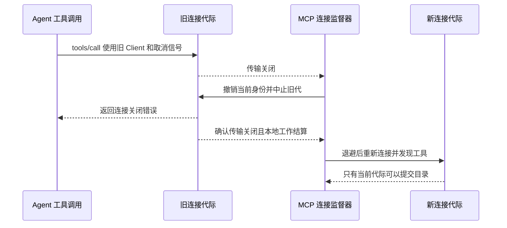

# 19｜MCP 动态管理：按需加载、重连、OAuth 与权限

> 源码基线为 DeepSeek Harness `dsh-v0.2.3-alpha.2`，提交 `4b399c39a6d1479cd84ca591b4d7c88e24d38a96`。[系列目录](../README.md) · [上一篇](18-mcp-transport-discovery-and-invocation.md) · [上游仓库](https://github.com/deepseek-ai/deepseek-harness)

上一篇从配置一路追到 `tools/call`。这次考虑一个运行中的 Agent。它已经加载某个 MCP 工具，旧连接正在查询，管理员同时修改服务端点，或者用户刚完成重新授权。工具的公开名可能保持不变，调用依赖的连接、目录和账号授权却在变化。DSH 用不同的生命周期处理这三种状态。

## 1. 管理器怎样发现配置变化

Web Bundle 在 Host 上挂载一个 `McpServerManager`。它合并两路条目。一路来自 volatile `config.servers`，由 Bundle 或 Profile 提供基础配置，用户通过 Settings 修改，写入检查 revision。另一路是插件调用 `mcpManager.register(name, entry)` 提供的注册项，随调用方插件销毁，Settings 无法改写。两路名字必须唯一。只属于某个 Preset 的服务器仍可用普通 `mcp-client` 行挂载，它由自己的作用域管理。管理器通过 `McpClientHost` 校验、挂载和探测受管实例。[Web 装配](../deepseek-harness/packages/bundle/web-app/cordis.patch.yml#L155) · [配置来源](../deepseek-harness/packages/mcp/mcp-manager/README.zh.md#understand-the-implementation) · [Settings revision](../deepseek-harness/packages/settings/settings/src/index.ts#L394) · [插件注册](../deepseek-harness/packages/mcp/mcp-manager/src/index.ts#L242)

Loader 发出 `loader/volatile-update` 后，管理器比较每个实例持有的条目快照与新配置。发生变化的记录先标记为 `retired`，停止转发其状态并取消探测，随后进入串行对账队列。相同条目的实例继续运行。停用条目卸载实例但保留配置，改过的启用条目先关闭再重挂，等新实例完成首次发现后才有新工具。若关闭未确认或清理失败，管理器保留带诊断的记录，阻止该服务器重挂和后续探测。[变更检测](../deepseek-harness/packages/mcp/mcp-manager/src/index.ts#L426) · [串行对账](../deepseek-harness/packages/mcp/mcp-manager/src/index.ts#L468) · [清理边界](../deepseek-harness/packages/mcp/mcp-manager/src/index.ts#L555) · [探测准入](../deepseek-harness/packages/mcp/mcp-manager/src/index.ts#L412)

| 操作 | 实际工作 | 适合回答的问题 |
| --- | --- | --- |
| `list()` / `watch()` | 读取配置及实时状态。订阅先推全量列表，再合并尚未消费的变更。 | 当前在连接、等待凭据、重试，还是已经停用？ |
| `probe()` | 临时解析配置并连接，取服务身份及工具名，然后关闭。默认最多追 16 页、返回 512 个工具名，不注册工具。禁用条目也能探测。 | 这份配置现在能否连通并列举工具？临时连接有没有清理完？ |
| `restart()` | 在队列中替换一台服务器的实例并重置重连预算。 | 成功清理的旧实例退出后，能否按当前配置重新启动？ |

探测返回连接和列举的结果，也独立返回关闭状态，所以「探测成功」还要看 `closeConfirmed` 与 `cleanupError`。探测通过 OAuth 凭据连接时可以刷新已过期的授权。`watch()` 给 UI 的是服务器列表快照，若要审计每一次状态转移，需要额外记录事件。[状态流](../deepseek-harness/packages/mcp/mcp-manager/src/index.ts#L268) · [重启和探测](../deepseek-harness/packages/mcp/mcp-manager/src/index.ts#L302) · [探测范围及上限](../deepseek-harness/packages/mcp/mcp-client/src/probe.ts#L23) · [探测与关闭](../deepseek-harness/packages/mcp/mcp-client/src/probe.ts#L94)

## 2. on-demand 如何把工具加载到指定 Agent

`eager` 直接在服务器的工具作用域注册发现的全部定义。`on-demand` 仍然在连接后发现远端工具，但把原始名称和简短描述放进系统提示词，只先注册 `mcp__<serverName>__load_tools`。目录仅在当前调用方能看到同一个加载器定义时生成。描述取首行，默认最多 160 个字符。节省的是每步传给模型的完整 schema，服务端工具发现和提示词目录仍有成本。[同步分支](../deepseek-harness/packages/mcp/mcp-client/src/tools.ts#L216) · [目录渲染](../deepseek-harness/packages/mcp/mcp-client/src/tool-loading.ts#L101) · [描述上限](../deepseek-harness/packages/mcp/mcp-client/src/config.ts#L22)

模型调用加载器时传原始名称数组。加载器先验证所请求的每个名称是否在目录里，再把选中的定义注册到该 Agent 自己的 Scope。它按 Agent 对象记录已加载名称，重复加载会报告已存在。同一实例的重连或列表刷新会重新注册仍然存在的名称，移除已消失的名称。Agent 销毁时释放这些注册。新子 Agent、fork 或从磁盘恢复的 Agent 都从空的加载记录开始。PTC 在程序开始时绑定工具，在一次 `run_code` 内加载后要等到下一个程序才有新绑定。[加载逻辑](../deepseek-harness/packages/mcp/mcp-client/src/tool-loading.ts#L127) · [目录换代与恢复](../deepseek-harness/packages/mcp/mcp-client/src/tool-loading.ts#L75) · [Agent 生命周期与 PTC 约束](../deepseek-harness/packages/mcp/mcp-client/README.zh.md#on-demand-tool-loading)

仓库的 `mcp-tool-loading` 快照第 12 行以 `mcp__demo__load_tools` 暴露 `demo` 的加载器，第 16 行加载 `ping`，第 20 行的请求头出现 `mcp__demo__ping`，第 24 行返回 `pong`。管理器重建整个实例时也会重建加载器和它的内存记录，旧实例的按需选择需要重新加载。[首次请求](../deepseek-harness/snapshots/session/mcp-tool-loading/session.v4.jsonl#L12) · [加载调用](../deepseek-harness/snapshots/session/mcp-tool-loading/session.v4.jsonl#L16) · [新工具列表](../deepseek-harness/snapshots/session/mcp-tool-loading/session.v4.jsonl#L20) · [工具结果](../deepseek-harness/snapshots/session/mcp-tool-loading/session.v4.jsonl#L24) · [加载器的归属](../deepseek-harness/packages/mcp/mcp-client/src/connection.ts#L134)

## 3. 连接代际怎样处理晚到的目录和工具结果

一个受管实例可以在多次重连中持有不同的连接代际。每代有自己的 SDK Client、传输、取消信号和待结算工作。初次同步和通知触发的同步走同一串行队列。`isCurrent(record)` 用对象身份核对当前代际及取消状态。目录获取前检查一次，`tools/list` 返回后、触碰注册表前再次检查。旧通知因此不能开启刷新，就算旧请求已经发出，它返回的目录也没有发布资格。[当前代际定义](../deepseek-harness/packages/mcp/mcp-client/src/connection.ts#L134) · [同步队列](../deepseek-harness/packages/mcp/mcp-client/src/connection.ts#L212) · [目录提交检查](../deepseek-harness/packages/mcp/mcp-client/src/tools.ts#L216) · [旧通知用例](../deepseek-harness/packages/mcp/mcp-client/tests/reconnect.spec.ts#L810)

读到旧目录和收到旧调用结果要分开判断。目录同步是宿主状态写入，提交前必须验证代际。`tools/call` 的执行闭包捕获当时的 Client 和取消信号，连接断开时不会把原请求转发到新 Client。尚未发出的调用返回 `MCP_SERVER_UNAVAILABLE`，已发出但被断开打断的调用返回 `MCP_CONNECTION_CLOSED`，用户取消则保留自己的取消原因。已经完成的结果属于发起它的原调用。断线错误表示客户端无法确定业务结果，下游可能已经执行了操作。[调用绑定与错误归因](../deepseek-harness/packages/mcp/mcp-client/src/tools.ts#L183) · [关闭原因](../deepseek-harness/packages/mcp/mcp-client/src/generation.ts#L91) · [调用中断与发送前拒绝的用例](../deepseek-harness/packages/mcp/mcp-client/tests/reconnect.spec.ts#L293)

普通断线时，最后一组 schema 可以暂时留在工具表，调用时仍检查连接状态。退避从 500 毫秒开始翻倍，上限 30 秒，默认允许 10 次重连尝试。稳定连接达到设定窗口后重置预算，短暂连上又崩溃会继续消耗同一次故障的预算。次数用完会撤下工具。开始重连之前还要确认上一代的传输关闭，并且代际拥有的本地工作已在关闭预算内结算。这两个条件分别检查，关闭成功但本地工作超时仍会阻止下一代启动。[退避和失败上限](../deepseek-harness/packages/mcp/mcp-client/src/connection.ts#L230) · [代际清理](../deepseek-harness/packages/mcp/mcp-client/src/generation.ts#L100) · [晚到的目录用例](../deepseek-harness/packages/mcp/mcp-client/tests/reconnect.spec.ts#L477)

做多租户 Agent 时，可以把 `agentId`、工具 `callId`、稳定服务名、连接代际和业务操作 ID 记入追踪。这样同名工具重连后仍可区分两次调用。查询类工具可以在预算内重新发起。对于有副作用的调用，由服务端用业务幂等键去重，或先查操作状态再重试。宿主能阻止旧目录发布，但服务端的提交结果仍由业务接口负责。

## 4. OAuth 怎样刷新令牌和更换授权

`McpOAuthAuthorization` 负责显式授权。浏览器里的插件账号页通过 `dsh-mcp-account` 调用与该账号绑定的服务器。Host 对 MCP 端点读取授权挑战并通过 SDK 发现发行方，使用预注册客户端或按需动态注册，随后把授权链接交给用户在浏览器打开。授权码流程保存 PKCE verifier。回调处理器核对请求是否发往预期的回调 origin 和路径，再检查一次性 `state` 及发行方，只接收一个有效回调。随后用授权码和 verifier 兑换令牌，把新授权写入 credentials provider。失败或取消会保留之前的有效授权，提交成功后才切换。[账号页入口](../deepseek-harness/packages/mcp/mcp-account/src/account.ts#L88) · [管理器授权入口](../deepseek-harness/packages/mcp/mcp-manager/src/index.ts#L356) · [回调校验](../deepseek-harness/packages/mcp/mcp-client/src/oauth.ts#L171) · [发现与授权链接](../deepseek-harness/packages/mcp/mcp-client/src/oauth.ts#L242) · [换令牌并提交](../deepseek-harness/packages/mcp/mcp-client/src/oauth.ts#L289) · [MCP 授权规范](https://modelcontextprotocol.io/specification/2026-07-28/basic/authorization) · [PKCE 规范](https://www.rfc-editor.org/rfc/rfc7636)

| 身份 | DSH 如何使用 |
| --- | --- |
| `oauth.credentialKey` | 标识条目当前授权的存储地址。管理器要求每个条目独占一个 key，重命名可以保留，复制条目要分配新的。 |
| OAuth 客户端注册记录 | 从服务器 URL、发行方、回调 URI、配置的 client ID 和 scope 派生 key，可以复用匹配的客户端注册。 |
| `grant.id` | 标识一次已提交的授权。普通刷新保留这个 ID，显式重新授权生成一个新 ID。读取授权时还检查服务器 URL、配置的 client ID 和 scope 是否匹配。 |

`McpOAuthCredentials` 负责被动使用已有授权。取 token 时发现已过期，或 SDK 收到未授权的响应时，可以按当前 grant 刷新。刷新通过 credentials provider 的 `modifyRecord()` 串行执行，持有记录后再比对 grant ID 和请求用过的 access token。如果另一次请求已经把 token 刷新了，当前请求可复用新记录。若显式重新授权改变了 grant ID，旧连接再次发请求时会被拒绝，凭据变更处理随后替换连接。源码分别有并发刷新只换一次 token，以及换授权时旧调用失败、新连接恢复的用例。[授权与客户端身份](../deepseek-harness/packages/mcp/mcp-client/src/oauth-credentials.ts#L109) · [刷新与请求绑定](../deepseek-harness/packages/mcp/mcp-client/src/oauth-credentials.ts#L153) · [变更触发换代](../deepseek-harness/packages/mcp/mcp-client/src/connection.ts#L271) · [并发刷新用例](../deepseek-harness/packages/mcp/mcp-client/tests/oauth.spec.ts#L447) · [重新授权用例](../deepseek-harness/packages/mcp/mcp-client/tests/oauth.spec.ts#L532)

## 5. 工具可见性、执行权限与凭据分别在哪里检查

- **谁看得到工具。** `serverName` 在注册作用域内预留，Agent 从可见作用域解析工具和资源 Provider。资源读取按调用者作用域重新查服务器。`tools.restrict()` 的掩码针对可限制的全局工具，Agent 自己按需加载的工具属于局部注册。需要约束此类调用时，在共享执行链使用 `tools.guard()`，可以按实际工具和目标资源拒绝执行，远端还要用当前身份检查资源权限。[名称预留](../deepseek-harness/packages/mcp/mcp-client/src/index.ts#L163) · [可见性限制](../deepseek-harness/packages/core/tools/src/index.ts#L155) · [执行守卫](../deepseek-harness/packages/core/tools/src/pipeline.ts#L204) · [资源作用域检查](../deepseek-harness/packages/mcp/mcp-resources/src/index.ts#L124)
- **密钥在哪里解析。** Settings 保存 `${credential:REF}` 之类的引用文本。连接时才通过 credentials provider 解析到传输参数中。缺少一个已经引用的值会进入 `waiting-credentials`，相关凭据更新后再比较解析结果。同值通知可以继续用原连接，实际绑定变化才重建。已解析凭据及其 URL 编码形式用于诊断脱敏。带 OAuth 的传输要求 HTTPS，允许回环 HTTP，拒绝重定向。诊断脱敏针对已知凭据和错误通道，业务输出仍需要应用自己的数据治理。[模板解析及脱敏](../deepseek-harness/packages/mcp/mcp-client/src/credentials.ts#L29) · [等待与重载](../deepseek-harness/packages/mcp/mcp-client/src/connection.ts#L271) · [等待凭据的状态](../deepseek-harness/packages/mcp/mcp-client/src/connection.ts#L383) · [OAuth URL 和请求约束](../deepseek-harness/packages/mcp/mcp-client/src/oauth-credentials.ts#L63)
- **退出时怎样撤回本地授权。** `signOut()` 先退役该条目，停止新授权和探测，等连接、探测与授权任务收尾。删除前再次检查条目归属，防止同时改名后误删另一个条目接手的 key。清理失败时退出操作报错并保留授权。成功时删除本地 grant，兼容的客户端注册记录可复用，远端 token 撤销属于另一项操作。[退出实现](../deepseek-harness/packages/mcp/mcp-manager/src/index.ts#L374) · [退出的产品语义](../deepseek-harness/packages/mcp/mcp-manager/README.zh.md#oauth-authorization)

## 6. 面试官怎么逐层追问

### probe 成功，为什么模型还看不到业务工具？

先区分探测和运行实例。探测不会注册工具。运行时接着查条目是否启用、初次同步状态、Agent 作用域，以及是否选择了 `on-demand`。再追问大量工具的接入成本。要算发现时间、目录 token 和额外加载步骤，并说明怎样从模型的实际请求头判断工具是否已进入可见集合。

### 旧连接的 tools/list 晚到，新连接已经可用，会发生什么？

先说串行同步队列，再指出发布前的 `isCurrent()` 检查。连通性只说明当时的连接可用，目录能否提交取决于当前所有者。顺着问旧连接上的 `tools/call`，要回答它始终关联原调用和旧 Client。如果断线使结果未知，重连完成只意味着后续请求可发送，业务状态需另查。

### 为什么刷新时保留 grant ID，重新授权时却要换？

刷新是同一授权身份内的令牌轮换，关键是保护并发读写和 refresh token 的更新。重新授权可能改变用户同意的授权，旧 Client 在换代前的窗口也要停止发请求。继续追问并发刷新两次，应该说明进入 `modifyRecord()` 后为何还要比对上一张 token。

### Agent 能看到并加载写工具，就可以执行写入吗？

把目录可见性、Agent 本地注册、执行授权、远端账号权限逐层说明。接着可以问怎样让同一租户只有某些项目可写。候选人应能把守卫落到实际工具及资源身份，再让服务端验证该账号是否对目标项目有权。对于迟到、重试以及已经执行但没收到结果的写入，还要说明审计与幂等策略。

下一篇用企业文档与报告交付场景，把 Skill、原生 Tool、MCP 和业务 Connector 放到同一条任务链路里比较。
