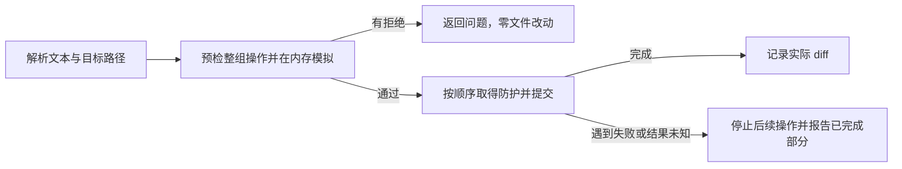

# 21｜Coding Agent 的代码感知与编辑

> 源码基线为 DeepSeek Harness `dsh-v0.2.3-alpha.2`，提交 `4b399c39a6d1479cd84ca591b4d7c88e24d38a96`。[系列目录](../README.md) · [上一篇](20-skill-tool-mcp-and-connector.md) · [上游仓库](https://github.com/deepseek-ai/deepseek-harness)

假设要给一个时间解析函数补上空输入处理。模型要先找到实现与调用方，读清楚函数约定，再改实现和测试。此时用户可能在 IDE 里同时改了这个文件。DSH 把搜索、读取、编辑与落盘分开做，其中只有启用了文件观察策略的编辑路径，才会把「模型读到的版本」带入修改检查。[文件系统工具](../deepseek-harness/packages/fs/tool-fs/README.zh.md) · [基础组合](../deepseek-harness/packages/bundle/base/cordis.patch.yml#L298)

## 1. 搜索、精读与语义导航怎样接起来

| 操作 | DSH 用到的机制 | 模型拿到什么 |
| --- | --- | --- |
| `glob` 定位文件 | ripgrep 的 `--files` 加 glob，按修改时间排序。 | 一组匹配路径。 |
| `grep` 搜索文本 | ripgrep 正则匹配，解析 `--json` 的逐行 JSON。 | 文件路径、行号和截断后的匹配预览。 |
| `read` 读取源码 | `ctx.fs` 解析文件，按行号取窗口，对长行和结果字节数设限。 | 带行号的正文。小窗口足以读单个函数，必要时翻页。 |
| `lsp` 查语义位置 | 通过 `ctx.lsp` 路由到语言服务器，按光标位置查询。 | 定义、引用、实现或悬停信息。 |

`dsh-tool-fs-search` 通过 `ctx.subprocess` 直接传 argv 给打包的 ripgrep。`grep` 采用固定参数和常规忽略规则，模型可用 `path` 和 `include` 缩小范围。`glob` 主动加入 `--no-ignore` 和 `--hidden`，同时排除版本控制系统的元数据。两者的搜索范围因此可能不同。运行层对原始 stdout 与 stderr 设字节上限，退出码 1 按「成功但没有匹配」处理。结果预览还有单独配额，输出裁剪与进程失败各有自己的语义。[grep 参数和结果解析](../deepseek-harness/packages/fs/tool-fs-search/src/grep.ts#L102) · [glob 参数](../deepseek-harness/packages/fs/tool-fs-search/src/glob.ts#L93) · [进程和退出码](../deepseek-harness/packages/fs/tool-fs-search/src/search-core.ts#L199) · [ripgrep 用户指南](https://github.com/BurntSushi/ripgrep/blob/master/GUIDE.md)

`read` 用当前 Session 的工作目录解析路径，再取文件类型、大小和版本。默认一次最多读出 2,000 行。文件大于等于 10 MiB 或后端没有报告大小时，使用流式读取。工具成功后发出 `fs/observed`，携带开始读时取得的版本。确认路径不存在时同样发送观察事件，但状态是 `absent`，工具仍返回找不到文件。搜索预览和 LSP 定位由各自的工具链生成，文件观察策略需要的版本信息来自明确的观察事件。[读取与窗口](../deepseek-harness/packages/fs/tool-fs/src/read.ts#L138) · [默认限制](../deepseek-harness/packages/fs/tool-fs/src/read.ts#L15) · [缺失路径的观察](../deepseek-harness/packages/fs/tool-fs/src/read-target.ts#L19)

## 2. LSP 为什么能定位到符号，源码里又支持到哪一步

这版把 LSP 拆成模型工具 `dsh-tool-lsp`、按扩展名选提供方的 `ctx.lsp`、以及配置本地语言服务器命令的 `dsh-lsp-stdio`。部署需要把这些部件和对应语言服务器装在一起。比如 `grep` 找到多个 `parseTime` 时，模型可传文件与光标位置，让服务器从语义上识别引用的是哪一个定义。工具接收从 1 开始的 UTF-16 行列坐标，发给服务端前换成从 0 开始，返回位置再转换回来。[LSP 组合](../deepseek-harness/packages/lsp/lsp/README.zh.md#use-this-package) · [模型参数](../deepseek-harness/packages/lsp/tool-lsp/src/index.ts#L111) · [坐标转换](../deepseek-harness/packages/lsp/tool-lsp/src/render.ts#L40)

stdio 提供方按工作区组织队列和服务器实例，请求入队后读文件当前内容，需要时才启动服务器。进程使用带 `Content-Length` 的 JSON-RPC 帧，初始化检查能力和位置编码，要求 UTF-16。每次查询临时发送 `didOpen`，执行导航请求并归一化结果，然后 `didClose`。这个模式的文档基线来自磁盘读取。工具还对返回位置条数和字符长度设上限，快照里定义查询就返回一个位置，并提示另一个结果因上限被省略。[工作区队列](../deepseek-harness/packages/lsp/lsp-stdio/src/index.ts#L276) · [握手与单次查询](../deepseek-harness/packages/lsp/lsp-stdio/src/instance.ts#L111) · [消息分帧](../deepseek-harness/packages/lsp/lsp-stdio/src/framing.ts#L21) · [LSP 3.17 基础协议](https://github.com/Microsoft/language-server-protocol/blob/gh-pages/_specifications/lsp/3.17/specification.md#base-protocol) · [导航快照](../deepseek-harness/snapshots/session/lsp-definition/session.v4.jsonl#L17)

当前 LSP 能力集中在定义、引用、实现和悬停。stdio 客户端忽略服务发来的诊断通知，重命名和 code action 也没有模型工具入口。要检查这次修改的编译或类型问题，当前闭环需要运行项目的类型检查、lint 或相关测试。如果将来接入实时诊断，需要把结果关联到文件版本，并处理编辑后晚到的旧结果。[导航能力范围](../deepseek-harness/packages/lsp/lsp/README.zh.md#use-this-package) · [忽略服务端通知](../deepseek-harness/packages/lsp/lsp-stdio/src/connection.ts#L259)

## 3. 字面替换怎样保护模型读到的版本

`edit` 用 `old_string` 和 `new_string` 做字面替换，通常要求旧片段恰好匹配一次，明确传 `replace_all` 才替换多处。`write` 用来创建或整文件写入。仓库还提供 `str_replace_editor`，以单个工具的 `view`、`create`、`str_replace` 与 `insert` 命令复用同一文件系统与修改策略。没有外部版本防护时，`str_replace_editor` 的替换和插入会以工具当次读取的版本做比较与交换。这能约束当次操作的并发窗口，模型更早读文件到开始编辑之间仍需要观察策略来保护。[编辑工具](../deepseek-harness/packages/fs/tool-fs/src/edit.ts#L76) · [字面匹配用例](../deepseek-harness/packages/fs/fs-local/tests/filesystem.spec.ts#L771) · [结构化编辑器](../deepseek-harness/packages/fs/tool-str-replace-editor/README.zh.md#use-this-package)

启用 `fs-observation-policy` 后，策略按 Session 对象和规范化 `targetKey` 存观察状态。修改前触发 `fs/edit-intent`、`fs/write-intent` 或 `fs/delete-intent`，由策略给出版本防护或拒绝。编辑和删除要求有来源文件的存在观察，未观察返回 `FS_NOT_OBSERVED`，确认过缺失则返回 `FS_NOT_FOUND`。写入有存在观察时使用 `replaceIfVersion`，否则走 `createIfAbsent`，同名文件并发出现也不会被覆盖。观察记录在内存，恢复会话或重载策略后要重读。窗口读取就能建立该文件的版本观察，因此版本新鲜不能证明模型看过整份文件。[观察状态](../deepseek-harness/packages/fs/fs-observation-policy/src/index.ts#L21) · [修改意图](../deepseek-harness/packages/fs/fs-observation-policy/src/index.ts#L61) · [编辑的版本传递](../deepseek-harness/packages/fs/tool-fs/src/edit.ts#L120) · [策略的视图边界](../deepseek-harness/packages/fs/fs-observation-policy/README.zh.md)

`fs-local` 用设备、inode、文件大小、纳秒级 mtime 和 ctime 组合版本。对同一目标的改动在提供方实例内加锁，移动则按固定顺序锁两端。带版本的编辑在锁内先检查版本，再匹配旧片段、还原文件行尾风格并写回。成功后记录新版本，下一次修改可以据此继续。写入先在同目录的暂存区写完整内容并同步，再以文件系统操作发布。需要保证目标不存在时走不替换已有文件的发布路径。[版本实现](../deepseek-harness/packages/fs/fs-local/src/fsio.ts#L77) · [锁与顺序](../deepseek-harness/packages/fs/fs-local/src/index.ts#L124) · [编辑流程](../deepseek-harness/packages/fs/fs-local/src/index.ts#L251) · [原子发布](../deepseek-harness/packages/fs/fs-local/src/fsio.ts#L635)

例如模型读到 `v1` 后，用户已把工作区文件改成 `v2`，且修改发生在比较版本之前。启用观察策略时，提交会因为版本不匹配而返回 `FS_STALE_VERSION`，即使 `old_string` 恰好还在。Agent 应重读相关代码并重新判断差异。基础组合默认关闭这项策略。关闭时，`edit` 会在当前内容上直接尝试字面匹配，并仍以原子方式写入。这里有两个不同的保证：暂存发布让读者看到完整文件，版本比较降低陈旧写入风险。进程内锁管不住 IDE 或另一个进程，外部写入仍可能发生在版本检查与发布之间。[默认配置](../deepseek-harness/packages/bundle/base/cordis.patch.yml#L298) · [先检查版本的用例](../deepseek-harness/packages/fs/fs-local/tests/filesystem.spec.ts#L724) · [进程范围与元数据限制](../deepseek-harness/packages/fs/fs-local/README.zh.md)

## 4. 多文件补丁怎样处理预检和部分提交

`apply_patch` 由 `tool-fs` 的 `applyPatch` 开关注册，基础组合和这份源码里的 Web Standard Preset 都将其关闭。启用后接收以 `*** Begin Patch` 和 `*** End Patch` 包围的文本，解析成新增、更新、删除或带有移动目标的更新，适合一次表达实现和测试的对应改动。hunk 匹配优先精确，再尝试空白与部分标点归一化。一次文件更新的多个 hunk 先在原文上定位，再从后向前拼接，避免前一个修改把后续下标推移。[开关](../deepseek-harness/packages/fs/tool-fs/src/index.ts#L48) · [Web Standard 配置](../deepseek-harness/packages/bundle/web-app/presets/standard.patch.yml#L24) · [补丁解析](../deepseek-harness/packages/fs/fs-patch/src/parse.ts#L140) · [hunk 匹配与替换](../deepseek-harness/packages/fs/fs-patch/src/apply.ts#L29)

预检按目标记录中间状态，让同一补丁内针对同一文件的后续操作看到前一步模拟结果。它收集版本、文件类型与 hunk 等能确定的拒绝。内部 `ctx.fs.readText()` 只为模拟读取内容，不会为模型补造「读过这个文件」的观察。若挂载 `fs-sandbox`，实际修改的目标约束仍由提供方在提交时检查。[执行阶段入口](../deepseek-harness/packages/fs/tool-fs/src/patch/index.ts#L22) · [模拟与观察边界](../deepseek-harness/packages/fs/tool-fs/src/patch/preflight.ts#L21) · [预检范围](../deepseek-harness/packages/fs/tool-fs/src/patch/preflight.ts#L136) · [写入约束](../deepseek-harness/packages/fs/fs-sandbox/src/index.ts#L80)

提交阶段逐项修改，第一个失败会停止后续操作，已完成的修改会保留。移动还有两段效果，目标已经发布但源文件删除失败时，两边可能同时存在。请求取消时，远程后端也可能仍在写入，工具可以标记结果为 `unknown`，要求先重读相关文件。仓库的一个快照在预检阶段拒绝未观察的文件，读取后重试成功。另一个快照写成第一个文件后，第二个操作失败，工具结果保留了已写文件并说明补丁停在哪里。客户端应检查各操作的 `status` 和 `affectedPaths`，部分提交可以作为带失败详情的工具值返回。[提交与不确定状态](../deepseek-harness/packages/fs/tool-fs/src/patch/execute.ts#L40) · [结构化结果](../deepseek-harness/packages/fs/tool-fs/src/apply-patch-output.ts#L66) · [未读拒绝快照](../deepseek-harness/snapshots/session/apply-patch-rejected/session.v4.jsonl#L17) · [部分提交快照](../deepseek-harness/snapshots/session/apply-patch-partial/session.v4.jsonl#L17)

## 5. Git diff、测试与生产中的并发控制

修改完成后，可以通过工具返回的实际 diff 或 Git diff 核对变更，再运行覆盖空输入分支的最小测试。影响公共调用方时再跑相关回归。DSH 的 Web `workspace-changes` 会在轮次开始和结束比较工作树，使用私有 Git index 和临时对象目录记录快照。轮次开始已有的未提交修改纳入基线，摘要呈现本轮净变化。文件工具还有修改前后的捕获记录，能补充 Git 未覆盖的部分路径。如果外部编辑在同一轮发生，这份净变化本身无法给每一行标上作者，所以交付前仍要逐项核对自己改了什么。[工作区变化机制](../deepseek-harness/packages/deliverables/workspace-changes/README.zh.md#use-this-package) · [私有快照](../deepseek-harness/packages/deliverables/workspace-changes/src/git.ts#L154)

如果设计团队共享的远程 Coding Agent，可以把「补丁基线」固定成每个文件的内容哈希或服务端版本。提交时带上这个版本，由能统一协调写入的后端执行有条件写入。发现冲突后，保留用户的变更并让 Agent 基于最新版本重算补丁。对于必须一起生效的一组文件，可以在隔离工作区生成并验证变更，再通过受控的版本提交或合并接口发布，同时检查目标版本。对于仍允许从 IDE 直接写入的本机工作区，应用自己的文件锁只能覆盖遵循它的写入方。需要提前明确原子可见的范围和并发冲突由哪一层处理。

## 6. 面试官怎么逐层追问

### 已经有 grep，为什么还要加 LSP？

grep 用来快速缩小候选范围，LSP 在文本重名或调用关系复杂时提供绑定到符号的定义和引用。继续问语言服务器用什么内容回答，能说出这版查询使用从磁盘临时打开的文档，并转换 UTF-16 坐标。再追问诊断，目前应该从项目检查命令取证。

### 用户改了文件，但 old_string 还在，edit 会发生什么？

先确认是否启用了 `fs-observation-policy`。启用时，观察到的旧版本传进提供方，锁内首先比较版本，返回 `FS_STALE_VERSION` 后重读再生成修改。关闭时，匹配当前文本并原子写入。再追问两个进程同时写，说明观察比较、进程内锁和文件原子发布各自覆盖的时间窗口。

### 三个文件的补丁通过预检，第二个文件写失败，怎么恢复？

先读结构化操作状态。检查第一个已完成文件，确定第二个是失败还是结果未知，第三个则尚未提交。重新读取有变更或状态不明的文件，仅为剩余意图生成补丁。继续追问为何避免自动回滚，回答回滚同样是写入，如果没有最新版本检查，可能覆盖用户在失败期间追加的修改。

### 怎样证明这次修改正确，而且没有混入其他工作？

修改前明确目标和已有改动，完成后核对实际 diff，再让针对性测试证明行为，并用相关回归覆盖调用方。对多人共享工作区，进一步记录补丁的文件基线、工作区身份和测试所用的版本。这样可以分辨测试覆盖了哪份代码，以及最终发布时有没有新的冲突。

下一篇走进 Shell、子进程、PTY 与 SSH，继续看命令执行、流式输出和取消怎样落到宿主。
