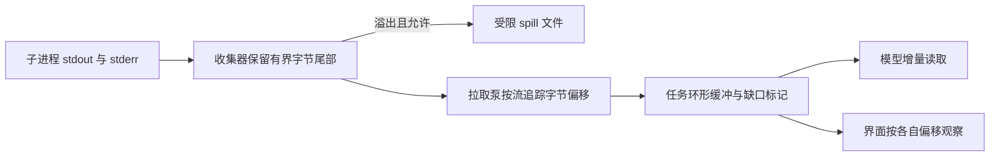

# 22｜Shell、子进程、PTY 与 SSH

> 源码基线为 DeepSeek Harness `dsh-v0.2.3-alpha.2`，提交 `4b399c39a6d1479cd84ca591b4d7c88e24d38a96`。[系列目录](../README.md) · [上一篇](21-coding-agent-code-navigation-and-editing.md) · [上游仓库](https://github.com/deepseek-ai/deepseek-harness)

Coding Agent 改完代码后可能做三件事。跑一条类型检查，开一个持续运行的开发服务器，或者在调试器里逐步执行。第一件要退出码和 stderr，第二件要可查询、可停止的任务 ID，第三件需要保留终端状态。DSH 让这些入口共享进程启动和清理的能力，但各自决定什么时候向模型返回结果。[Shell 子系统](../deepseek-harness/packages/shell/README.zh.md) · [Subprocess 契约](../deepseek-harness/packages/subprocess/subprocess/README.zh.md)

## 1. 一次命令、后台任务和 PTY 应该怎么选

| 场景 | DSH 入口 | 调用结束时拿到什么 |
| --- | --- | --- |
| 运行一次类型检查 | `bash` 或 `pwsh` 通过 `ctx.shell` 执行。 | 退出状态与有界 stdout、stderr。支持提升时也可能返回后台任务 ID。 |
| 保持开发服务器运行 | 在支持的组合中用 `run_in_background`，由 `ctx.jobs` 接管。 | 任务 ID。后续用 `job_output`、`job_list` 或 `job_kill`。 |
| 在调试器或 REPL 中交互 | 持久 Shell 或显式 PTY 工具，通过 `ctx.terminals` 管理。 | 终端会话和一段输出，保留当前 Shell、前台程序与交互状态。 |

基础组合挂载 `subprocess-local`，POSIX 平台通过 `bash-sandbox` 提供 Bash，Windows 走 `pwsh-sandbox`。持久工具由组合决定。比如仓库里另有以 `bash` 注册的持久工具，以及放在实验包里的 `terminal_open`、`terminal_send`、`terminal_read` 等显式 PTY 工具。查看真实请求的工具声明及当前 Preset，才能知道一个模型调用走的是哪个实现。[基础组合](../deepseek-harness/packages/bundle/base/cordis.patch.yml#L235) · [持久 Bash 注册](../deepseek-harness/packages/shell/tool-bash-persistent/src/index.ts#L401) · [显式 PTY 工具](../deepseek-harness/packages/experimental/tool-terminal/src/index.ts#L154)

## 2. 一次性 Bash 怎样准备并启动子进程

`tool-bash` 先解析本次命令的权限策略和审批结果，用 Session 工作目录作为默认值，再收集 `shellEnv` 提供的会话环境。`ctx.shell.resolve()` 生成带预算的请求。每条一次性 Bash 命令用新进程执行，基础形式为 `['bash', '-c', command]`，沙箱提供方可在执行前准备受限制的 argv。上一条命令里改变的 Shell 变量或工作目录不会成为下一条新 Shell 的状态。需要保持目录时，可以显式传 `workdir`，或者使用持久终端。[Bash 工具入口](../deepseek-harness/packages/shell/tool-bash/src/index.ts#L524) · [Bash argv](../deepseek-harness/packages/shell/bash-local/src/index.ts#L187) · [沙箱 Bash 执行器](../deepseek-harness/packages/shell/bash-sandbox/src/index.ts)

`ctx.subprocess.spawn()` 接收经过选择的 argv、cwd、stdio、环境变量、宽限期和取消信号。它按参数数组启动程序。需要管道、变量展开或 Shell 语法时，由上层显式选择 Bash 等解释器。环境先过滤继承的凭据形态名称和旧 `DSH_*`，再合并显式环境。在 Bash 封装内部，终端环境、调用方环境和运行时提供的 `dshEnv` 依次覆盖，后者可带当前 Session ID。默认清洗控制的是自动继承，显式交给进程的凭据仍要受调用授权与执行环境约束。[子进程输入契约](../deepseek-harness/packages/subprocess/subprocess/README.zh.md#use-this-package) · [环境清洗](../deepseek-harness/packages/subprocess/subprocess/src/index.ts#L57) · [合并顺序](../deepseek-harness/packages/shell/bash-local/src/index.ts#L149) · [会话环境](../deepseek-harness/packages/shell/shell-env/src/index.ts#L164)

Bash 执行器分别收集 stdout 与 stderr。退出码、信号、超时和上游取消分别记录，启动或进程提供方故障可以使 `result()` 拒绝。测试命令退出码为 1 时，Agent 要读命令的诊断。若执行器在启动阶段就失败，则应先处理环境或运行器故障。这两类情况对下一步行动的含义不同。[执行截止时间](../deepseek-harness/packages/shell/bash-local/src/index.ts#L201) · [结果投影](../deepseek-harness/packages/shell/bash-local/src/index.ts#L370)

## 3. 为什么取消、退出和清理完成是三个状态

| 观察到什么 | 能得出什么 |
| --- | --- |
| `job_kill` 返回请求已接受 | 已调用生产者的取消入口，任务进入 `stopping`，还要观察结算。 |
| 子进程 `done` 已完成 | 有直接命令的退出结果。收集模式会等管道排空一段有界时间。 |
| `waitForExit()` 返回 `true` | 提供方已确认它能管理和观察的进程范围停稳。观察失败或等待被取消分别有自己的结果。 |

子进程的取消信号与显式 `terminate()` 进入同一终止流程。POSIX 路径通常先发 `SIGTERM`，宽限期后升级 `SIGKILL`。发送信号与确认进程范围退出都使用同一个 owner。直接命令退出后仍要保留这次终止安排，让它能触达存活成员。如果后代继承了 stdout 管道，子进程结果有独立的排空上限避免一直等 EOF。范围清理仍由 `waitForExit()` 判定。[停止请求](../deepseek-harness/packages/jobs/jobs-local/src/index.ts#L500) · [范围观察与信号](../deepseek-harness/packages/subprocess/subprocess-local/src/spawn.ts#L337) · [有界排空](../deepseek-harness/packages/subprocess/subprocess-local/src/spawn.ts#L397)

Linux 普通进程和 PTY 在满足条件时使用临时的 user-systemd scope。scope 管理一组进程，直接命令退出后范围仍可存活。Windows 普通进程可用 Job Object，当前 ConPTY 走另一条路径。macOS 或原生范围管理器不可用时，退化为进程组、进程树或终端会话观察。降级后能确认的范围更窄。宿主卸载 `subprocess-local` 时，尝试终止保留的进程并等待范围停稳，PTY 也要等待关闭，清理故障会向上报告。[平台选择与降级](../deepseek-harness/packages/subprocess/subprocess-local/src/index.ts#L252) · [卸载清理](../deepseek-harness/packages/subprocess/subprocess-local/src/index.ts#L135) · [systemd scope 文档](https://www.freedesktop.org/software/systemd/man/latest/systemd.scope.html#Description) · [Windows Job Object 文档](https://learn.microsoft.com/en-us/windows/win32/procthread/job-objects)

Agent 对象销毁时，Jobs 注册表向其任务发取消、等待任务结算并撤掉记录，终端服务也收尾该 Agent 的会话和仍在创建的终端。任务结算取决于生产者上报。普通 Bash 生产者据命令退出事实收尾，因此 UI 看见 `killed` 还要结合后端的范围观察，才能回答是否有后代残留。生产系统可以分别记录取消请求、直接退出、范围确认与确认失败。[任务所有权清理](../deepseek-harness/packages/jobs/jobs-local/src/index.ts#L661) · [Bash 任务结果映射](../deepseek-harness/packages/shell/tool-bash/src/background.ts#L43) · [PTY 所有者清理](../deepseek-harness/packages/terminal/terminal/src/index.ts#L405)

## 4. 后台任务怎样接管前台超时和慢速输出

`run_in_background` 先交给 Jobs 注册表做准入。它检查当前 Agent 有没有配套控制工具，以及该所有者剩余的并发容量，通过后才执行启动函数。显式后台运行没有这次前台调用的等待超时。普通 Bash 在开启 `promoteOnTimeout` 且注册成功时，也可以从一开始就以任务运行，由前台工具等待。等待超时且 Shell 执行句柄已经可用时，工具返回当前输出与任务 ID，后续 `job_output` 从已消费位置继续。若超时发生在准备阶段且句柄还未发布，会请求取消准备。普通前台任务注册失败时，工具退回超时终止的执行路径。调用被上游取消时，该次等待会尝试停止任务。[准入条件](../deepseek-harness/packages/jobs/jobs-local/src/index.ts#L219) · [三条 Bash 执行路径](../deepseek-harness/packages/shell/tool-bash/src/index.ts#L544) · [前台等待与交接](../deepseek-harness/packages/shell/tool-bash/src/index.ts#L340) · [等待超时快照](../deepseek-harness/snapshots/session/bash-startup-timeout/session.v4.jsonl#L18)

进程收集器按字节保留尾部。打开 spill 且首次溢出时，把之前保留的头部和后续输出写入私有文件。若超过 spill 的总上限或落盘失败，丢弃不完整的 spill，只留下内存尾部。`readFrom(fromByte)` 采用全流绝对字节偏移，读取者落后于保留窗口时会收到 `lossy`。Jobs 在此之上用拉取泵为各流推进偏移，标记缺口，结算前再排空一次。模型用 `job_output` 推进自己的消费位置，界面用 `readAt` 观察，不影响模型的下一次读取。生产者、注册表与模型输入分别有自己的容量上限。[保尾与 spill](../deepseek-harness/packages/subprocess/subprocess-local/src/output.ts#L151) · [偏移读取](../deepseek-harness/packages/subprocess/subprocess-local/src/output.ts#L253) · [拉取泵](../deepseek-harness/packages/jobs/jobs-local/src/pump.ts#L53) · [模型读取与观察接口](../deepseek-harness/packages/jobs/jobs-local/src/index.ts#L331)

例如后台构建每秒输出数十 MiB，而模型只等候最后的报错。保尾让末段诊断留下，spill 在预算内提供更多上下文。界面可以按偏移增量读取并明确展示缺口。若必须保留完整审计日志，应另设经过权限控制的持久日志与保留期限。仓库的任务准入快照还展示了另一条边界：同一 Agent 的唯一槽位被占用时，第二条后台命令在进程启动前就被拒绝。[准入拒绝快照](../deepseek-harness/snapshots/session/background-job-admission/session.v4.jsonl#L23) · [取消与结算快照](../deepseek-harness/snapshots/session/background-job-admission/session.v4.jsonl#L28)

## 5. 持久 PTY 怎样处理交互和背压

PTY 给交互式程序提供终端接口。`spawnTerminal()` 分配真实 PTY，DSH 的本地实现通过 node-pty 接收终端输出，读取的是交互字节流。相同会话里可以继续使用前一次输入留下的 Shell 状态或 REPL 变量，也可调整终端尺寸、查看前台进程组或向它发信号。前台中断与关闭整个会话有不同意图。`terminal_signal` 面向前台任务，`terminal_close` 会等待终端后端清理进程范围。[PTY 契约](../deepseek-harness/packages/subprocess/subprocess/README.zh.md#use-this-package) · [PTY 分配](../deepseek-harness/packages/subprocess/subprocess-local/src/index.ts#L319) · [信号与关闭工具](../deepseek-harness/packages/experimental/tool-terminal/src/index.ts#L345) · [会话关闭](../deepseek-harness/packages/terminal/terminal-bash/src/session.ts#L779)

交互式 Shell 通常不会在每条命令完成后退出。后端先限制每个终端同时只能有一个交互发送，再用私有 prompt 标记、前台进程组和输入等待来判断何时返回，有时会按静默窗口给出 `inferred_idle`。看到一段时间没有输出只是推断，等待响应结束也不等于前台程序退出。模型侧保留有界 scrollback，本地 PTY 输出写入下游缓冲遇到背压时暂停 node-pty 读取，收到 `drain` 再继续。仓库快照记录了打开、分页读取、关闭和最终列表清空。[终端发送互斥](../deepseek-harness/packages/terminal/terminal/src/index.ts#L219) · [就绪判断](../deepseek-harness/packages/terminal/terminal-bash/src/session.ts#L554) · [PTY 背压](../deepseek-harness/packages/subprocess/subprocess-local/src/terminal.ts#L100) · [终端生命周期快照](../deepseek-harness/snapshots/session/pty-tools-sandbox-backend/session.v4.jsonl#L16)

## 6. SSH 怎样把同一套执行契约搬到远端

SSH 组合用 `subprocess-ssh` 和 `fs-ssh` 把启动进程、工作目录和文件读取放进同一个远端执行环境，若要执行沙箱策略，还可以挂载 `sandbox-ssh`。上层 Bash、LSP 和 PTY 仍通过原有接口调用后端。Host 使用 OpenSSH 主连接启动远端 helper，开启严格主机密钥检查与非交互认证，关闭 agent 转发。握手核对协议及 helper 摘要。私有管理 RPC 在主连接上传输，程序数据流走独立转发的 Unix socket 和通道，并用每流 TLS 预共享密钥认证。独立通道让管理消息和程序输出分开处理，底层仍共享同一条 SSH 连接的网络容量。[SSH 组合](../deepseek-harness/packages/ssh/README.zh.md) · [连接与握手](../deepseek-harness/packages/ssh/ssh/src/index.ts#L299) · [管理与数据通道](../deepseek-harness/packages/ssh/ssh/README.zh.md#understand-the-implementation) · [OpenSSH 客户端选项](https://man.openbsd.org/ssh_config)

Host 定期发送 heartbeat。远端 helper 在租约过期、收到 EOF 或收到终止信号时启动托管清理。正常停止可用远端进程操作回包确认。网络断开时，本地待处理调用失败，此时远端可能已执行相关操作，清理也未必能由客户端确认。DSH 这条路径不会自动重连重放。若设计可恢复的远程 Agent Runner，可以把操作分配给具有独立租约的执行实例，用请求 ID 查询启动、退出和清理状态，对有副作用的动作单独做去重或冲突检查。[客户端心跳](../deepseek-harness/packages/ssh/ssh/src/index.ts#L320) · [helper 租约](../deepseek-harness/packages/ssh/ssh/src/helper.ts#L62) · [远端终止与确认](../deepseek-harness/packages/ssh/subprocess-ssh/src/index.ts#L157) · [租约清理用例](../deepseek-harness/packages/ssh/ssh/tests/helper-boundaries.spec.ts#L72)

## 7. 面试官怎么逐层追问

### bash 超时后任务一定停了吗？

先看调用走哪条路径。前台等待可以在进程已经启动时把它交给后台任务，真正的执行超时则触发终止。追问终止已经发出时如何证明没有残留，答出直接退出与受管范围确认的区别，再说明不同平台后端各能观察到哪些成员。

### 让模型每十秒读一次日志，如何保证还有关键错误？

先解释有界保尾、独立的字节游标、缺口标记及可选 spill。再追问 UI 先读了一页会不会影响模型。DSH 把界面按偏移读取和模型消费位置分开。若关键错误出现在中间且必须保留，要另外抽取结构化诊断或持久日志。

### 为什么 REPL 要开 PTY，工具返回了就能继续发命令吗？

PTY 提供交互式终端和跨调用的进程状态。继续问同一会话如何判断前一个输入已经停在可接收输入的位置。候选人应能解释前台进程组、prompt、输入等待与静默推断，并区分中断前台活动和销毁整个终端。

### SSH 断线后能否自动换机器重新跑？

先问前一次操作有没有副作用，结果能否查询。再说明租约到期会触发远端清理，但本地断线本身不能证明远端已执行或已清理。可恢复设计要有稳定操作身份、终止确认及去重协议。重试写操作之前应核对原执行的状态。

下一篇继续追沙箱、审批和凭据，重点看一次批准应绑定哪些参数与运行时身份。
