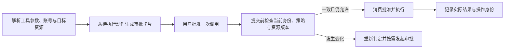

# 23｜沙箱、审批与凭据

> 源码基线为 DeepSeek Harness `dsh-v0.2.3-alpha.2`，提交 `4b399c39a6d1479cd84ca591b4d7c88e24d38a96`。[系列目录](../README.md) · [上一篇](22-shell-subprocess-pty-and-ssh.md) · [上游仓库](https://github.com/deepseek-ai/deepseek-harness)

假设用户让 Agent 在当前项目生成一份报告。工具可以在工作区内写入，随后模型又提出要把报告复制到工作区之外。此时需要回答三个问题：当前工具被允许改哪些文件？更宽的访问范围由谁批准？若下一步还要调用企业文档服务，本次请求使用的是谁的账号？DSH 用沙箱、审批和凭据服务分别处理这些问题。

## 1. 会话权限预设怎样变成每次调用的策略

| 基础组合的预设 | 沙箱模式 | 审批策略 |
| --- | --- | --- |
| `read-only` | 拒绝受该后端约束的文件变更。 | `ask` |
| `workspace-write` | 工作区与后端支持的临时区域可写，可按策略附加写入根。 | `ask` |
| `danger-full-access` | 该沙箱层不再限制文件变更，仍受操作系统和业务服务权限约束。 | `never` |

`permission-presets` 把沙箱模式和审批策略做成一个可切换的组合。独立 `sandbox-policy` 的默认值是 `read-only`，基础 Bundle 在没有部署覆盖时选择 `workspace-write`，搭配 `ask`。新 Session 会把有效的预设、沙箱模式和审批策略写入日志，用户后来切换时追加变更事件。改变新会话默认设置不会改写过去会话保存的值。`never` 的含义是拒绝需要审批的请求，所以它可以与本来就无需文件沙箱升权的模式搭配。[基础配置](../deepseek-harness/packages/bundle/base/cordis.patch.yml#L244) · [沙箱服务默认值](../deepseek-harness/packages/sandbox/sandbox-policy/README.zh.md#use-this-package) · [预设切换与初始化](../deepseek-harness/packages/interaction/permission-presets/src/index.ts#L475)

调用策略解析时，当前调用指定且已批准的模式优先，再看会话记录，最后回到部署默认值。工作区根取 Session 的当前工作目录，缺省时可回退到会话头或部署根。会话迁移到 worktree 后，后续调用使用新的工作区。按 Session 动态注册的额外写入根参与策略解析，挂载与清理影响后续调用，已取得策略的进程仍在原有边界下执行。[逐调用策略解析](../deepseek-harness/packages/sandbox/sandbox-policy/src/index.ts#L203) · [会话附加目录](../deepseek-harness/packages/sandbox/sandbox-policy/README.zh.md#use-this-package)

## 2. 文件工具和子进程怎样执行边界

**直接调用文件工具。** `tool-fs` 解析调用策略，`fs-sandbox` 对写入、编辑、补丁、删除和移动做检查。`workspace-write` 下，后端在修改前重新规范化目标路径，用共享的 `writableRoots()` 判定它是否在可写目录内，并把检查过的目标交给实际操作。移动会检查两端。越界返回结构化的 `FS_SANDBOX_DENIED`。读取仍走底层文件系统能力，写入边界无法代替数据读取权限。[文件沙箱检查](../deepseek-harness/packages/fs/fs-sandbox/src/index.ts#L136) · [文件沙箱的读写范围](../deepseek-harness/packages/fs/fs-sandbox/README.zh.md#use-this-package)

**执行进程。** `bash-sandbox` 让 `ctx.sandbox.confine()` 按策略包装命令，由平台 runner 执行。Linux 先尝试 bubblewrap，再尝试 Landlock。bubblewrap 用挂载与命名空间约束进程能操作的文件系统，Landlock 通过内核规则限制文件访问。macOS 用 Seatbelt profile。Windows 用受限令牌和 ACL，并报告 `partial` 强制执行。这个标记描述后端能覆盖的文件效果范围。不同平台的附加写入目录支持也有差异。[Bash 沙箱执行器](../deepseek-harness/packages/shell/bash-sandbox/src/index.ts) · [平台 runner 与边界](../deepseek-harness/packages/sandbox/sandbox-local/README.zh.md#understand-the-implementation) · [包装命令](../deepseek-harness/packages/sandbox/sandbox-local/src/index.ts#L343) · [bubblewrap 项目文档](https://github.com/containers/bubblewrap) · [Windows 受限令牌](https://learn.microsoft.com/en-us/windows/win32/secauthz/restricted-tokens)

排错时要分清「命令执行后被策略拒绝」「runner 自身启动失败」和「没有可用 runner」。提供方为调用者返回拒绝及 runner 故障的识别规则。缺少可用后端时，受限调用报 `SANDBOX_UNAVAILABLE`，不会以无约束方式执行。仓库快照分别记录了工作区内写入成功，以及缺少 runner 时受限 Bash 拒绝启动。[runner 的失败语义](../deepseek-harness/packages/sandbox/sandbox-local/README.zh.md#use-this-package) · [会话工作区快照](../deepseek-harness/snapshots/session/session-sandbox-root/session.v4.jsonl#L20) · [缺少后端的快照](../deepseek-harness/snapshots/session/missing-sandbox-runner/session.v4.jsonl#L19)

## 3. 一次性审批怎样路由、审计并用于执行

通用工具执行链可以在 `tools/pre-execute` 返回 `ask`，由 `ApprovalService` 询问。结果允许后，执行链还有 `tools.guard()` 检查，再派发工具。Bash 与文件工具的模式升权则在各自工具内部使用共享 `approveEscalation()`。请求更宽的模式要先校验目标模式与理由，再走审批服务。重复当前模式会沿用原权限，实际升权只在得到 `allowed-once` 后用于本次调用。拒绝、取消与没有可用渠道会返回相应失败。[通用执行链](../deepseek-harness/packages/core/tools/src/pipeline.ts#L191) · [通用审批接线](../deepseek-harness/packages/core/tools/src/pipeline.ts#L453) · [升权检查](../deepseek-harness/packages/sandbox/sandbox/src/escalation.ts#L209) · [文件工具升权](../deepseek-harness/packages/fs/tool-fs/src/sandbox.ts#L89)

`ApprovalService.request()` 要求 Session 正处于一个回合内。先写入 `approval/asked`，再按当前审批策略处理。`never` 在调用应答者之前返回拒绝。`ask` 把请求路由给可处理该 Agent 的应答者。Web 审批界面按会话显示请求，并用 `callId` 关联原工具展示。缺少应答者、应答者抛错或返回未知值时统一为 `unavailable`。上游取消时结束等待，晚到的用户回答不再改变决定。[请求与审计](../deepseek-harness/packages/interaction/user-approval/src/index.ts#L243) · [决定与取消](../deepseek-harness/packages/interaction/user-approval/src/index.ts#L294) · [Web 应答者](../deepseek-harness/packages/client/ui-approval/src/client/index.ts#L38) · [晚到回答用例](../deepseek-harness/packages/interaction/user-approval/tests/approval.spec.ts#L287)

决定写入 `approval/decided`，通过同一个审批请求 ID 与询问记录对应。询问带有工具名、可选调用 ID 和理由，决定记录结果。这两条是会话审计事件。`allowed-once` 返回给正在等待的调用，源码没有把历史决定登记为下一次工具调用的许可证。工具是否最终启动、完成或失败，要结合对应的工具调用与结果记录来判断。[审批事件字段](../deepseek-harness/packages/interaction/user-approval/src/types.ts#L34) · [单次批准的范围](../deepseek-harness/packages/interaction/user-approval/README.zh.md)

## 4. 签入凭据怎样到达实际请求

| 概念 | 在 DSH 里的用法 |
| --- | --- |
| `CredentialRef` | 以环境变量形态的名字引用密钥。解析时优先选本地受管存储，其次是启动环境、项目 `.env` 和 DSH 主目录 `.env`。 |
| `CredentialKey` | 用插件作用域与记录 ID 定位结构化凭据，例如 OAuth grant。它没有环境回退。 |
| `AuthorizationSession.commit()` | 交互授权流程确认本次有效尝试后写入凭据记录。流程需要在当前尝试观察到实际存储更新，才报告 `authorized`。 |

本地后端把引用与记录写进主目录下的版本化 YAML。并发写入在文件锁内读最新文件、修改目标条目、以 `0600` 权限原子替换。远程或界面消费通常用 `describe` 一类接口读来源、配置状态或脱敏信息，提供方在真正发起请求时才解析密钥。以 DeepSeek 路由为例，API key 和账号登录由 `deepseekAuth` 依目标 API 能接受的凭据类型与部署目标解析。OAuth 连接器则按各自的凭据 key 读取 grant。[引用与记录的契约](../deepseek-harness/packages/credentials/credentials/src/index.ts#L188) · [本地读取](../deepseek-harness/packages/credentials/credentials-local/src/index.ts#L638) · [加锁写入](../deepseek-harness/packages/credentials/credentials-local/src/index.ts#L758) · [授权提交](../deepseek-harness/packages/credentials/authorization/src/index.ts#L381) · [DeepSeek 请求凭据](../deepseek-harness/packages/account/deepseek-auth/README.zh.md#use-this-package)

本地 YAML 依赖 OS 文件权限，同一 UID 下的进程仍可能读取。子进程环境清洗可以减少无意继承，Provider 的脱敏逻辑可以减少凭据进入诊断。企业部署如果要求 Agent 无法直接读取长效凭据，应把长效凭据放在独立身份或凭据代理里，由代理代表当前用户调用指定服务，给执行环境只发当前动作需要的短期授权。读权限、出站网络和凭据可见性要作为独立边界设计。[本地存储的读取边界](../deepseek-harness/packages/credentials/credentials-local/README.zh.md#known-limitations-and-deferred-work) · [环境继承清洗](../deepseek-harness/packages/subprocess/subprocess/src/index.ts#L57)

## 5. 系统设计题｜怎样让批准只覆盖用户看到的动作

先确认这版 DSH 的实际保证。Bash 在等待审批前解析沙箱策略，批准后把本次模式放入调用策略，再解析这次执行的当前目录。审批服务使用 Agent、工具名、调用 ID 和理由来路由和审计。这些字段能把决定关联到一次工具调用，但事件本身没有保存经过规范化的完整动作，也没有单独的策略版本、资源版本或可跨进程核验的批准凭证。通用执行链的守卫可以复查通用审批结果，工具内发起的升权仍由具体工具执行路径落实约束。[Bash 升权与目录解析](../deepseek-harness/packages/shell/tool-bash/src/index.ts#L524) · [审批记录](../deepseek-harness/packages/interaction/user-approval/src/types.ts#L34) · [通用执行守卫](../deepseek-harness/packages/core/tools/src/pipeline.ts#L204)

在团队版 Agent 里，审批卡片应从实际请求生成。比如用户要批准写出一份报告，卡片显示目标和影响范围，宿主同时保存规范化参数、Session 和操作者身份、工作区、执行端、目标资源版本与当前策略版本。高风险动作在执行前重新读取权威状态并校验绑定。如果工作目录换了、同一文档切到了另一版，或用户身份与策略发生变化，应重新判定权限，必要时重新审批。可以加过期时间与一次性消费记录，避免重试时重复使用同一批准。

还要处理批准已消费但请求结果未知的窗口。遇到并发重试，宿主可用同一业务操作 ID 关联批准与远端执行记录。只接受一次提交，结果不明时先查询既有操作。审计保留调用 ID、动作摘要、决策理由和结果，凭据和不必要的敏感内容留在权限受控的存储里。

仓库文件、网页和 MCP 工具结果进入上下文时，应保留来源并按数据处理。资料里出现发送请求或权限说明，不能自动成为工具授权。宿主可以按来源和任务范围约束可用工具，也可以在执行前核对业务目标、账号、外部接收方及要发送的数据。审批需要展示真实动作，避免用模型复述的理由代替参数。内容过滤和结果脱敏减少暴露，关键权限仍由执行入口与远端服务判定。[执行前守卫](../deepseek-harness/packages/core/tools/src/pipeline.ts#L191) · [工具结果处理](../deepseek-harness/packages/core/tools/src/pipeline.ts#L497) · [OWASP 对间接提示注入的说明](https://genai.owasp.org/llmrisk/llm01-prompt-injection/)

## 6. 面试官怎么逐层追问

### workspace-write 和 ask 分别控制什么？

前者决定受约束执行能写哪些位置，后者决定触发审批时会不会询问用户。继续追问工作区迁入 worktree 时，答出后续调用读当前 Session 工作目录，并区分文件工具路径围栏与 Shell 进程的 OS 约束。

### 审批已经允许，工具还可能失败吗？

先说 `allowed-once` 只给当前请求。通用守卫仍可拒绝，沙箱准备、文件目标校验和远端授权也可能失败。追问用户在等待期间取消，回答服务会结算 `cancelled`，晚到的回答无效，审批日志与执行结果分别检查。

### 在环境里清掉 API key，Agent 就读不到秘密了吗？

环境清洗只约束自动继承，还要核对运行进程的身份、可读文件、凭据服务接口和出站目标。继续追问同一 UID 下的受管文件，应该说明权限位的作用范围。需要强隔离时，把长效凭据移给独立的业务代理，执行环境用每次动作所需的短期授权。

### 用户同意写一份报告，批准后目标路径或账号变了怎么办？

先确认批准针对的动作身份与实际参数。绑定目的地、账号、工作区和资源版本，执行前再检查当前策略。追问请求超时如何恢复，可以用一次性批准加业务操作 ID 做关联，先查原操作是否已经提交，再决定是否发起新的动作。

下一篇进入 Plan、Todo、Goal 与长任务控制，继续看哪些控制状态能随 Session 恢复。
