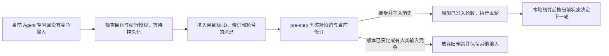

# 24｜Plan、Todo、Goal 与长任务控制

> 源码基线为 DeepSeek Harness `dsh-v0.2.3-alpha.2`，提交 `4b399c39a6d1479cd84ca591b4d7c88e24d38a96`。[系列目录](../README.md) · [上一篇](23-sandbox-approval-and-credentials.md) · [上游仓库](https://github.com/deepseek-ai/deepseek-harness)

假设用户让 Agent 迁移旧的配置格式。先审方案，这一轮改解析器和测试，之后再逐批迁移仓库里的配置。运行到一半用户关了宿主。下次打开 Session，系统需要知道已批准的计划模式、上一轮做过什么，以及目标是否还允许运行。DSH 把这些问题交给不同的组件。

| 组件 | 管什么 | 恢复时读到什么 |
| --- | --- | --- |
| Plan | 当前是在规划还是执行，以及用户如何评审计划。 | 从 `plan/mode` 重建已提交的状态。 |
| Todo | 本轮要做的事项，以及模型报告的进度。 | 可以回读事件，当前清单在下一轮开始时清空。 |
| Goal | 跨轮目标、修订、阶段和已准入轮数。 | 恢复目标状态与轮数，续行需要重新取得授权。 |
| 人工提问与 Guard | 等待回答、提醒模型跳出重复调用、传递执行截止时间。 | 部分问题可以从历史恢复为待答，运行中的等待和计时器由各自进程管理。 |

## 1. Plan 怎样等待人类评审并切换模式

`/plan` 进入计划模式，`/plan off` 退出。空闲期间切换会立即追加 `plan/mode`。如果已经打开一轮，目标状态先保存在 Session 对应的内存意图中，到下一个被接受的 `agent/pre-step` 才提交。会话投影用最后一次 `plan/mode` 决定当前模式，也能从 `/plan` 命令事件推导界面是否还有待生效的切换。恢复或 fork 能重建已记录的模式，正在等待的评审和未提交的内存意图需要按当前边界重新处理。[Plan 投影](../deepseek-harness/packages/plan/plan-mode/src/index.ts#L136) · [步骤边界](../deepseek-harness/packages/plan/plan-mode/src/index.ts#L229) · [模式切换](../deepseek-harness/packages/plan/plan-mode/src/index.ts#L453)

模型提交 `exit_plan_mode` 时，工具检查当前已提交的模式以及 Markdown 是否以标题开头，再用 `userQuestions.ask()` 发出 `plan-review`。界面可以呈现原始计划与批准选项。用户明确选择批准后，工具安排在下一步骤边界退出，让当前工具批次仍处于原模式。要求继续规划时，反馈回到模型。用户关闭评审以改用自己的语言回复时，工具可以结束当前轮，计划模式保持活跃。加载计划模式本身只提供提示词和评审入口，工具执行约束仍由沙箱与审批执行链提供。[评审实现](../deepseek-harness/packages/plan/plan-mode/src/index.ts#L318) · [批准与边界提交用例](../deepseek-harness/packages/plan/plan-mode/tests/plan-mode.spec.ts#L942) · [评审关闭用例](../deepseek-harness/packages/plan/plan-mode/tests/integration.spec.ts#L291) · [模式约束范围](../deepseek-harness/packages/plan/plan-mode/README.zh.md#use-this-package)

## 2. Todo 怎样展示本轮进度

`todo_write` 每次交一份完整清单。工具校验事项文本非空且去重，状态取 `pending`、`in_progress` 或 `completed`。部署可以限制最多一个进行中的事项，基础组合允许多个，用于并行工作。写入追加 `todo/write`，模型收到各状态的计数，客户端则可以读出对应的清单投影。[参数校验](../deepseek-harness/packages/todo/tool-todo/src/index.ts#L69) · [工具写入](../deepseek-harness/packages/todo/tool-todo/src/index.ts#L193) · [基础 Bundle 配置](../deepseek-harness/packages/bundle/base/cordis.patch.yml#L458)

投影上，`todo/write` 整表替换，`turn/end` 保留刚结束的清单，下一次 `turn/start` 将当前值清为 `null`。因此用户仍能看到本轮收尾的列表，下一轮可以根据工作区和最新结果重建新清单。它没有任务领取、派发、租约或条目级 CAS，勾选 `completed` 也只代表模型报告完成。源码快照记录了两个进行中和一个待办，工具结果只返回计数。需要跨轮保存任务所有权时，应在任务服务里表达这些状态。[投影更新](../deepseek-harness/packages/todo/tool-todo/src/index.ts#L118) · [跨轮清空用例](../deepseek-harness/packages/todo/tool-todo/tests/projection.spec.ts#L87) · [清单写入快照](../deepseek-harness/snapshots/session/todo-write/session.v4.jsonl#L17)

## 3. Goal 怎样保存目标并把续行权交给用户

基础组合把状态、交互和调度分开部署。`dsh-goal` 持有目标状态，`command-goal` 提供 `/goal` 命令，`tool-goal` 让模型通过 `get_goal`、`create_goal` 和 `update_goal` 使用目标。`goal-round-driver` 在这些组件旁边调度同一 Session 的后续回合。每个 Session 最多有一个当前目标，持久阶段包括 `active`、`paused`、`blocked` 与 `complete`。变更通过 `goal/change` 记入完整状态，清空时写入带修订的删除记录。更新需要精确的 `id + revision`，旧视图写入以 `GOAL_STALE_REVISION` 失败。[基础装配](../deepseek-harness/packages/bundle/base/cordis.patch.yml#L338) · [目标状态与变更](../deepseek-harness/packages/goal/goal/README.zh.md#use-this-package) · [版本检查](../deepseek-harness/packages/goal/goal/src/index.ts#L458)

持久阶段与自动续行开关各自有独立含义。`active` 表示目标尚可推进，`armed` 表示当前进程有权自动排下一轮。启动新的 Agent 生命周期时，`armed` 回到 `disarmed`，即使日志投影仍显示 `active`。服务层 `resume` 检查阶段与剩余轮数，通过时更新修订并重新启用续行。用户可用 `/goal resume`，模型也可在收到直接的人类继续请求后恢复 `active` 且 `disarmed` 的目标。若目标已经是持久的 `paused`，模型工具拒绝替用户恢复，由宿主面向用户的入口处理。[启动时停用续行](../deepseek-harness/packages/goal/goal/src/index.ts#L256) · [服务恢复](../deepseek-harness/packages/goal/goal/src/index.ts#L359) · [用户命令](../deepseek-harness/packages/goal/command-goal/src/index.ts#L166) · [模型工具的恢复边界](../deepseek-harness/packages/goal/tool-goal/src/index.ts#L267) · [fork 恢复用例](../deepseek-harness/packages/goal/goal/tests/goal.spec.ts#L226)

模型创建、编辑、暂停或恢复目标时，工具会检查执行者是当前运行的 Agent，并要求该顶层 Agent 的当前轮次有直接人类输入。自主 Goal Round 可以完成或阻塞自己绑定的目标，仍要核对目标 ID 和修订。权限依据来自运行时记录的消息归属和调用者身份。这样，一条由驱动器自己构造的提示词只拥有推进该轮所需的权限。[执行者检查](../deepseek-harness/packages/goal/tool-goal/src/authority.ts#L47) · [直接人类输入与自主轮权限](../deepseek-harness/packages/goal/tool-goal/src/authority.ts#L74)

## 4. Goal Round 何时计数，用户接管时怎样停

驱动器在 Agent 空闲、没有竞争的下一轮输入时工作。需要持久化时先 `flush()`，等待后重新看目标和竞争输入。挂载了子 Agent 服务时，还会等待当前 Agent 的后代工作。驱动器按 `roundsStarted + 1` 预留一轮，把目标 ID、revision 和轮号放进消息来源。`pre-step` 在下游处理前后都检查预留，编辑目标或插入竞争的人类输入时，旧预留就可能失效。[调度与持久化](../deepseek-harness/packages/goal/goal-round-driver/src/index.ts#L145) · [竞争输入](../deepseek-harness/packages/goal/goal-round-driver/src/index.ts#L315) · [两次准入检查](../deepseek-harness/packages/goal/goal-round-driver/src/index.ts#L371)

预算在对应的 Goal 消息被接纳并写成 `user/message` 时消耗。投影要求目标仍处于 `active`，并验证 ID、修订和下一轮编号，随后才增加 `roundsStarted`。排队后撤回的预留不消耗轮次，已经写入历史的轮次即使中途取消，也算作已开始。`maxGoalRounds` 默认 256。达到上限仍待续行时，驱动器记录 `round-limit` blocker。轮次预算独立于 token、时间、费用与工具调用配额。[日志计数](../deepseek-harness/packages/goal/goal/src/fold.ts#L315) · [默认上限](../deepseek-harness/packages/goal/goal/src/index.ts#L249) · [达到上限的处理](../deepseek-harness/packages/goal/goal-round-driver/src/index.ts#L182) · [编号与预算用例](../deepseek-harness/packages/goal/goal-round-driver/tests/goal-round-driver.spec.ts#L202)

宿主发起的暂停会取消当前运行轮，模型在自己的轮次调用暂停时可以正常结束。用户取消一个已接纳的 Goal Round，驱动器会在回到 idle 后按该轮的精确修订检查是否应暂停。若此时目标已重新恢复并换了修订，旧取消不能把它再暂停。Agent 销毁则停用续行，持久阶段可仍是 `active`。持久化检查失败、Agent 错误或轮次因 `max-tokens` 结束时，驱动器也会停用续行，恢复后可由用户检查现场再决定。[暂停和取消处理](../deepseek-harness/packages/goal/goal-round-driver/src/index.ts#L260) · [轮次结束分支](../deepseek-harness/packages/goal/goal-round-driver/src/index.ts#L338) · [旧取消与新修订用例](../deepseek-harness/packages/goal/goal-round-driver/tests/goal-round-driver.spec.ts#L379) · [检查点失败用例](../deepseek-harness/packages/goal/goal-round-driver/tests/goal-round-driver.spec.ts#L577)

## 5. 人工提问、重复提醒和超时如何配合

`ask_user_question` 支持常规阻塞式提问，也可配置定时等待。定时模式会等待一段时间，默认配置是 120 秒，界面可以接管倒计时。超时时返回带 `callId` 的 `pending`，Agent 可以继续独立工作。该问题可从会话投影恢复为 `continued`，后续回答通过对应 `callId` 进入 Agent 收件箱，在答复获准进入历史后结算问题。原工具调用已经结束，答复本身是一条后续的用户消息。Plan Review 使用阻塞式提问，具有自己的评审语义，没有这条延迟答复路径。[提问模式配置](../deepseek-harness/packages/interaction/tool-ask-user/src/index.ts#L17) · [定时等待与挂起](../deepseek-harness/packages/interaction/user-questions/src/index.ts#L250) · [继续回答及结算](../deepseek-harness/packages/interaction/user-questions/src/index.ts#L156) · [恢复待答用例](../deepseek-harness/packages/interaction/user-questions/tests/projection.spec.ts#L139)

重复调用提醒按 Agent 追踪同一工具名与规范化参数，忽略对象属性顺序的区别。基础 Bundle 在连续第 3、5、8 次发出提示，出现新的用户消息时重置。它在 `tools/post-execute` 附加提醒，PTC 内部的嵌套工具不计入这条链，提醒也不会停用重复调用。超时策略则属于执行层，用工具声明的 `timeoutMs` 派生 `AbortSignal`。到达期限会发取消，下游返回后才会按本包装层的超时原因改写为 `TOOL_TIMEOUT`。如果工具忽略取消，调用仍可能等待，需要由执行器负责进程清理或远端停止协议。[默认重复阈值](../deepseek-harness/packages/bundle/base/cordis.patch.yml#L468) · [计数与提醒](../deepseek-harness/packages/guard/repeat-tool-reminder/src/index.ts#L188) · [执行超时包装](../deepseek-harness/packages/guard/timeout-policy/src/index.ts#L50) · [协作取消边界](../deepseek-harness/packages/guard/timeout-policy/README.zh.md)

## 6. 系统设计题｜服务重启后怎样安全续跑

假设配置迁移已经处理 40 个文件，第 41 个文件的写入回包丢失，目标显示还有 6 轮预算。重启后先回放目标、修订、已准入轮数和人工状态，再检查第 41 个文件的当前版本与该操作的执行记录。已经确认成功的操作可以复用结果，状态不明的操作先对账。用户恢复后，应按最新目标和最新工作区重新生成余下步骤。Todo 描述工作顺序，文件版本和执行回执才能证明做到哪一步。

如果要扩展到多个 Worker，调度记录可用 `(session_id, goal_id, revision, round)` 作为准入身份。成功抢占租约后才能领取执行权，派发与记账最好有同一提交边界，或用可重放的事件和幂等键衔接。暂停、人工接管和修订变化要使旧租约失效，提交副作用前再次核对当前执行者与权限。预算还要单独跟踪调用次数、耗时或费用，把用户停止和额度耗尽记录为可诊断的原因。对于配置迁移这种可验证目标，可以用剩余旧格式文件数和回归测试结果做完成条件。DSH 的 Goal 驱动器目前由模型判断完成证据，没有独立评估器。[Goal 驱动器的完成判断](../deepseek-harness/packages/goal/goal-round-driver/README.zh.md#known-limitations-and-deferred-work)

## 7. 面试官怎么逐层追问

### Plan 已批准，为什么还需要 Goal 和 Todo？

Plan 明确先评审什么，Todo 给当前轮列事项，Goal 保存可跨轮推进的目标。继续追问批准与真正执行之间的边界。面试时可以答出，`exit_plan_mode` 在下一步骤边界提交模式切换，真正启动自动轮次还要单独满足 Goal 的续行条件。

### 已经排队的一轮在重启前被撤回，该不该扣预算？

DSH 在 Goal 消息准入并写入 Session 时计数。排队和实际开始之间还有修订检查，撤回的预留不计入。进一步追问写日志成功但工具没跑完的情况，要把已开始轮次、工具副作用和用户是否允许继续分别对账。

### 用户点击暂停后马上又点恢复，旧轮次的取消会怎样？

解释暂停会中断旧轮，恢复会推进目标修订。旧轮到 idle 才完成取消时，需要校验自己仍属于当前修订，才能决定是否暂停。可以继续问分布式实现，把修订、租约和提交前的权威检查串起来。

### 问题超时、工具超时和 Goal 耗尽预算有什么区别？

问题超时可以返回 `pending`，用户随后还能答。工具超时给下游发取消，强制清理取决于执行器。Goal 轮次用尽会记录阻塞并停止自动派发。继续追问服务恢复，答出哪种状态可从日志重建、哪种需要查询实际执行、何时要请人明确恢复。

下一篇进入 Subagent、Team 与 Workflow，继续看把工作交给多个 Agent 后，任务所有权和结果合并怎样落到源码。
