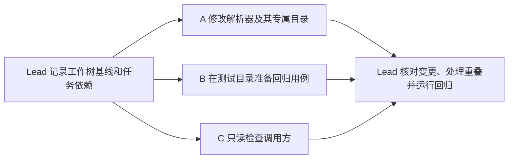

# 25｜Subagent、Team 与 Workflow

> 源码基线为 DeepSeek Harness `dsh-v0.2.3-alpha.2`，提交 `4b399c39a6d1479cd84ca591b4d7c88e24d38a96`。[系列目录](../README.md) · [上一篇](24-plan-todo-goal-and-long-running-tasks.md) · [上游仓库](https://github.com/deepseek-ai/deepseek-harness)

假设要迁移一个公共配置接口。父 Agent 想让 A 改解析器，B 补回归用例，C 审查调用方。任务看似可以并行，三者却可能引用同一个工作目录。DSH 提供三种工具来组织工作。Subagent 管子运行与消息，Team 管共享任务状态，Workflow 可以用脚本把依赖和并发写清楚。文件写入是否冲突，还要回到实际执行的工作区与文件权限检查。

## 1. spawn、fork 和外部 Provider 怎样选择上下文

| 模式 | 子 Agent 起点 | 执行与结果 |
| --- | --- | --- |
| 进程内 `spawn` | 全新子 Session，初始任务需要自足。默认沿用父级工作目录和模型选择，可按后端能力覆盖。 | 在同一宿主运行，使用自己的工具作用域。 |
| 进程内 `fork` | 捕获父 Session 最后一条 `turn/end` 之前的完整前缀，包含该结束事件。 | 继续使用此前对话作为背景。父 Agent 当前派发所在的轮次仍需在任务里明确交代。 |
| 外部 Provider | 由目标运行时建立自己的会话。以 ACP 为例，宿主提供选定工作目录与任务。 | 通过子进程协议拿到结算结果，模型、工具和权限响应由对应后端实现。 |

`subagent` 与 `subagent_fork` 是配置给模型的两个工具。调用进入 `ctx.subagents.startActivation()` 后，先按名称定位 Provider，再核对调用方是否是当前的父 Agent、委派深度以及后端的能力。进程内 Provider 走 `prepareContinuable()`，外部 Provider 走 `start()`。例如 `spawn` 可支持独立 Preset，`fork` 使用父级组合，ACP 提供方不接收 DSH 的 Preset 和结构化输出覆写。外部后端还能按产品选择 Codex 或 Claude Code 适配器，其能力契约由各自的 Provider 声明。[基础装配](../deepseek-harness/packages/bundle/base/cordis.patch.yml#L374) · [能力检查与分派](../deepseek-harness/packages/subagent/subagent/src/index.ts#L274) · [spawn 后端](../deepseek-harness/packages/subagent/subagent-spawn-in-process/README.zh.md#use-this-package) · [fork 前缀与能力](../deepseek-harness/packages/subagent/subagent-fork-in-process/src/index.ts#L38) · [ACP 后端](../deepseek-harness/packages/subagent/subagent-acp/README.zh.md#use-this-package) · [外部 Provider 分组](../deepseek-harness/packages/subagent/README.zh.md)

进程内子 Agent 有自己的 Session 和注册作用域。未选独立 Preset 时，子 Agent 加入父级当前的 Preset 代际，但父 Agent 局部注册的工具和局部限制不会随对话继承。安全状态有独立处理。创建前捕获父会话的显式沙箱覆盖，不传递某次工具调用临时获准的模式。挂载审批服务时，子 Agent 写入 `never`。这些委派事件追加在 fork 前缀之后，子会话恢复时能从自己的日志确定权限。[子 Session 元数据](../deepseek-harness/packages/subagent/subagent/src/child-agent.ts#L135) · [Preset 绑定](../deepseek-harness/packages/subagent/subagent/src/child-agent.ts#L192) · [进程内作用域](../deepseek-harness/packages/subagent/subagent-spawn-in-process/README.zh.md#understand-the-implementation) · [委派权限与持久事件](../deepseek-harness/packages/subagent/subagent/src/child-agent.ts#L243)

## 2. 活跃树怎样管理发布、等待和取消

管理器维护进程内 Activation，持久目录通过父 Session 的子 Agent 记录保存身份与谱系。创建本地子 Agent 时先预留名称，准备子会话并核对深度和活跃容量，最终接纳初始任务。默认委派深度为 1，树上的活跃子 Agent 容量为 8。工具调用得到的是启动回执和子 Agent 名称。等工作完成后，直接父 Agent 才通过收件箱获得结果。若父级正在运行，结果可以进入后续步骤。父级空闲时，通知可以触发处理。选择 `delivery: caller` 的程序化调用方则自己等待结果。[默认上限](../deepseek-harness/packages/subagent/subagent/src/index.ts#L187) · [准备与初始投递](../deepseek-harness/packages/subagent/subagent/src/manager.ts#L324) · [预留活跃容量](../deepseek-harness/packages/subagent/subagent/src/manager.ts#L715) · [工具启动回执](../deepseek-harness/packages/subagent/tool-subagent/src/index.ts#L328) · [完成结果投递](../deepseek-harness/packages/subagent/subagent/src/manager.ts#L1135)

`send_message` 可在同一棵树中寻址成员，`list_agents` 查看目录，`wait_agent` 只等调用者自己的下一步收件箱。收到消息只意味着有待处理输入，后续模型步骤才会消费。`wait_agent` 不负责读取结果正文，也不等待任意任务状态变化。宿主需要等待整棵树正在推进的工作时，可以用 `waitForTreeWork()`，它会重新观察等待期间新出现的后代，并区分正在推进的实例与空闲且留有停放消息的实例。[消息与等待工具](../deepseek-harness/packages/subagent/tool-subagent-control/README.zh.md#use-this-package) · [树级等待](../deepseek-harness/packages/subagent/subagent/src/manager.ts#L246)

取消的边界取决于谁拥有运行。启动阶段由调用信号参与取消，已经接纳的后台委派由 Activation 接管，父工具调用结束后仍能运行。对本地子 Agent 发中断，请求的是停止其当前轮并保留 Inbox。外部执行则中止其运行并进入释放。真正销毁运行时，管理器停止接纳新工作，取消并等待准备中的启动，再等待受管执行释放。这个边界也适用于外部 Provider 已经启动，但上层正好请求取消的竞态。[启动信号](../deepseek-harness/packages/subagent/subagent/src/manager.ts#L726) · [中断与管理器收尾](../deepseek-harness/packages/subagent/subagent/src/manager.ts#L224) · [接纳后取消所有权用例](../deepseek-harness/packages/subagent/subagent/tests/external-activation.spec.ts#L123)

## 3. Team 怎样用 CAS 保护任务所有权

Team 在根 Session 的活跃子 Agent 树上提供共享任务板，不另起一套工作进程。新 Session 默认关闭 Team 模式。根 Agent 开启后，全树的后续步骤可以看到 Team 工具。关闭模式会撤下后续的 Team 工具与指引，保留子 Agent 和历史任务。工具包括 `team_task_create`、`team_task_list`、`team_task_get` 与 `team_task_update`。[Team 模式](../deepseek-harness/packages/team/agent-team/src/index.ts#L45) · [会话开关](../deepseek-harness/packages/team/agent-team/src/index.ts#L89) · [任务工具](../deepseek-harness/packages/team/tool-agent-team/src/index.ts#L119)

任务初始是 `pending`、`revision = 1`，可以有依赖 `blockedBy` 和建议写入范围 `writeScopes`。领取时必须仍是 `pending`，依赖已经完成，且没有其他所有者。更新需要传 `expected_revision`。实现按 Team Lead 的 Session ID 将变更排到同一条串行队列上，在队列里重新读取当前任务并比较修订。两个成员若同时拿 revision 1 领取，同一队列内先提交的变成 revision 2，后一个得到 `TEAM_TASK_STALE_REVISION`。完成和释放要求当前所有者或 Lead，重新分派由 Lead 控制。[任务创建](../deepseek-harness/packages/team/agent-team/src/task-board.ts#L56) · [CAS 和领取](../deepseek-harness/packages/team/agent-team/src/task-board.ts#L118) · [重分派和版本递增](../deepseek-harness/packages/team/agent-team/src/task-board.ts#L192) · [串行队列实现](../deepseek-harness/packages/team/agent-team/src/journal.ts#L39)

每次提交向 Lead 日志追加完整的 `team/task`，再等待 `flush()`。如果事件已追加但持久化未确认，任务可能已经在当前进程可见，调用却返回 `TEAM_TASK_PERSISTENCE_UNCONFIRMED`。重试前要读任务状态。依赖校验会检查缺失、重复和环。`writeScopes` 的相等或目录包含关系只生成重叠提示，快照里 `src` 与 `src/feature` 同时进行时，工具仍允许任务进入 `in_progress`。任务 CAS 保护的是这一条任务的修订与所有权，文件写入需要另外协调。[提交与未确认结果](../deepseek-harness/packages/team/agent-team/src/journal.ts#L57) · [依赖图校验](../deepseek-harness/packages/team/agent-team/src/task-graph.ts#L26) · [重叠提示](../deepseek-harness/packages/team/agent-team/src/task-view.ts#L36) · [依赖未完成的拒绝](../deepseek-harness/snapshots/session/team-task-diagnostics/session.v4.jsonl#L30) · [重叠任务的领取结果](../deepseek-harness/snapshots/session/team-task-diagnostics/session.v4.jsonl#L58)

## 4. Workflow 怎样表达并行、数据依赖和清理

`workflow` 把 JavaScript 编排交给 `ctx.workflowEngine`。这份源码的 PTC 引擎在一个新的 Node 进程中运行脚本，使用调用 Session 的文件策略。脚本只通过暴露的 `agent()`、`parallel()`、`pipeline()`、`phase()` 和 `log()` 等入口编排。调用 `agent()` 时，Host 通过 Provider 启动子 Agent，设置 `delivery: caller`，把子结果交回脚本聚合。子对话的中间消息不会逐条写进父对话。成功的脚本返回普通 JSON 值。[工作流契约](../deepseek-harness/packages/workflow/workflow/README.zh.md#use-this-package) · [执行策略](../deepseek-harness/packages/workflow/workflow-ptc/src/host.ts#L295) · [子 Agent 调用桥](../deepseek-harness/packages/workflow/workflow-ptc/src/host.ts#L215)

| 编排接口 | 源码语义 | 配置迁移例子 |
| --- | --- | --- |
| `parallel(thunks)` | 正常返回前等待所有分支，结果按输入顺序排列。普通分支异常可转成 `null`，严重的运行时错误会提前拒绝，由宿主收尾。 | 等解析器、测试和调用方审查三份结果都齐了再汇总。 |
| `pipeline(items, ...stages)` | 每个元素依次经过各阶段，不同元素可交错执行。 | 仓库 A 分析完就可以进入审查，无需等仓库 B 也完成分析。 |
| `agent(prompt, opts)` | 获取并发槽位再启动子 Agent，受总量上限约束。有 schema 时可以返回结构化结果。 | 每份结果固定返回文件列表、检查证据和待确认问题。 |

引擎以 FIFO 等待队列限制并发启动，还限制单次运行允许申请的子 Agent 总量。子 Agent 正常返回失败时，脚本可收到 `null` 来处理局部缺失。Provider 的启动故障、结果 Promise 拒绝等严重错误则能使运行失败。前台工具等待结果并在结束时释放运行。后台路径把运行挂到 `ctx.jobs`，立即返回任务 ID。取消时中止脚本、收束待启动的任务，并释放所有已发布的子 Agent。持久记录保存顶层 run 和成员的生命周期，便于回看，运行时调度栈仍随进程结束。[并发与结果](../deepseek-harness/packages/workflow/workflow-ptc/src/runtime.ts#L140) · [parallel 与 pipeline](../deepseek-harness/packages/workflow/workflow-ptc/src/runtime.ts#L282) · [取消收尾](../deepseek-harness/packages/workflow/workflow-ptc/src/host.ts#L325) · [前后台与记录语义](../deepseek-harness/packages/workflow/tool-workflow/README.zh.md#understand-the-implementation) · [运行结果快照](../deepseek-harness/snapshots/session/workflow-run/session.v4.jsonl#L17)

## 5. 系统设计题｜三个子 Agent 共用一个 checkout

**先划分所有权。** A 与 B 编辑不同目录，C 回传审查结论和相关调用位置。共享接口、生成产物与锁文件由一个明确的写入方负责。必须同时更新同一文件时，把后一个任务设为依赖前一个，交接时说明已产生的 diff 和当前版本。任务板记录分工与依赖，执行后端还要能限制实际写入。对 formatter、代码生成等会触及多个目录的工具，可以交给 Lead 集中运行。

**提交前核对写入人和文件基线。** 同一 checkout 的文件修改如果需要硬限制，可以在执行中检查规范化路径、任务修订与有效租约。若 Shell 和文件工具都能修改，两个入口都要施加同样的规则。对于修改范围广或难以约束的任务，可用独立 worktree 加明确的父提交来隔离，完成后由 Lead 逐份合入。这样会增加合并与回归成本，但容易知道每份变更属于谁。

**收集能重放的证据。** 子 Agent 返回任务 ID、基线提交、受影响路径、变更摘要及测试结果。Lead 核对真实 diff，解决公共接口兼容性，再通过相关回归。若任务取消或 Worker 替换，先检查工作区残留和已经发生的写入，再决定是否重分派。任务 `completed`、分支已合入、集成测试通过是三个需要分别记录的事实。

## 6. 面试官怎么逐层追问

### 为什么 fork 子 Agent 没看到父 Agent 刚发出的完整需求？

先说 fork 前缀只截到父会话最后一个已结束轮次。当前派发轮仍在进行，任务提示词需要带上本轮的约束。继续追问父 Agent 改了 Preset 或权限以后会怎样，要把历史前缀、创建时获取的组合和委派权限分别讲清楚。

### 两个 Agent 同时领取同一任务，谁赢？能保证不会覆盖文件吗？

任务变更在同一 Team 队列里运行，按 `expected_revision` 比较，先提交的领取成功。随后追问它们各领了一个任务却都要写同一文件，答案要落在文件所有权、依赖、执行边界和实际 diff。任务 CAS 本身没有对工作树的写入锁。

### 父 Agent 取消时，子 Agent 和 Workflow 一定停了吗？

先分辨取消的是一次启动、一个已经接纳的后台子 Agent、一个 Workflow，还是整棵活跃树。启动信号与运行所有权在接纳边界变化。Workflow 由持有方取消并等待清理，单独的中断回执只说明请求已接纳。继续问晚到的启动，回答应检查子运行是否可能在取消后才发布，并等待它释放资源。

### 什么情况下该写 Workflow，什么情况下普通委派就够？

两项相对独立的分析可以直接委派、收集结果。有多批输入、明确阶段和标准化归并时，Workflow 的好处是可以直接表达并发上限、等待关系和失败分支。继续追问脚本汇总的其中一个值为 `null`，先确认该分支是不是必要证据，再通过返回结构定义可降级的范围。

下一篇进入本地 Job、Cron 与投递语义，继续看任务已经到期、消息已经入队、执行已经结束这三个时间点如何区分。
