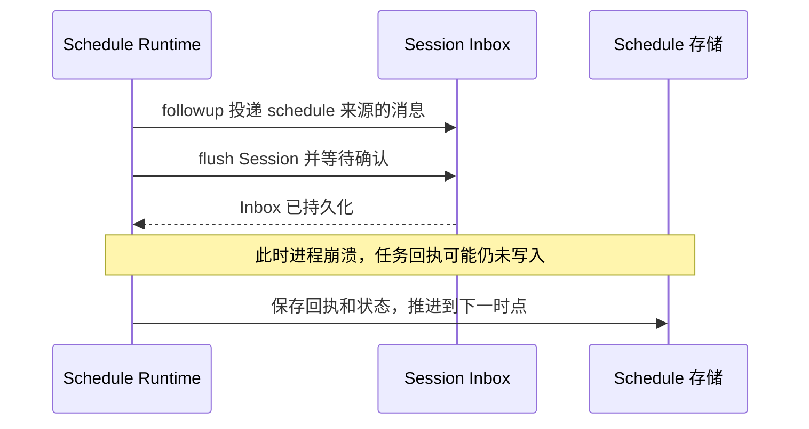

# 26｜本地 Job、Cron 与投递语义

> 源码基线为 DeepSeek Harness `dsh-v0.2.3-alpha.2`，提交 `4b399c39a6d1479cd84ca591b4d7c88e24d38a96`。[系列目录](../README.md) · [上一篇](25-subagent-team-and-workflow.md) · [上游仓库](https://github.com/deepseek-ai/deepseek-harness)

现在后台跑一遍构建，和「每个工作日早上九点检查构建状态」，在 DSH 里经过两套机制。前者马上启动，注册表装着进程或工作流的活动句柄。后者先保存规则，到期时把一条指令发给目标 Session。排查时要把计划时点、Inbox 持久确认和实际执行结果分开看。[Jobs Local](../deepseek-harness/packages/jobs/jobs-local/README.zh.md) · [Schedule](../deepseek-harness/packages/schedule/schedule/README.zh.md)

## 1. 本地 Job 怎样限流、取消与结算

| 关注点 | 进程内 Job | Schedule |
| --- | --- | --- |
| 拥有什么 | 当前运行、取消入口、输出环与最终结果。 | 规则、目标、任务状态与投递回执。 |
| 何时开始 | 工具调用通过准入就启动生产者。 | 到期或手动触发后向 Session 投递，由 Agent 消费指令。 |
| 重启后 | 可以回读 Session 保存的生命周期事件。活动任务与输出环不恢复。 | 任务规则从宿主存储加载，届时可重新计算到期并投递。 |

基础组合用 `jobs-local` 实现 `ctx.jobs`。启动时检查是否有服务于该 Agent 的任务控制器，并按所有者限制并发，默认最多 10 个。运行中和停止中的任务仍占槽位，终结后才释放。模型通过 `job_output` 消费增量输出，界面可用自己的绝对偏移读取。输出环默认在运行期保留 256 KiB，落后于保留窗口的读者会收到缺口提示。首次终态读取还可携带生产者的结构化结果，随后输出环收缩到默认 16 KiB。[基础装配](../deepseek-harness/packages/bundle/base/cordis.patch.yml#L96) · [准入检查](../deepseek-harness/packages/jobs/jobs-local/src/index.ts#L219) · [两种输出读取](../deepseek-harness/packages/jobs/jobs-local/src/index.ts#L331) · [终结读取](../deepseek-harness/packages/jobs/jobs-local/src/index.ts#L486)

`job_kill` 请求生产者取消，接受后进入 `stopping`。最终状态由生产者结算，注册表释放等待者并发出完成事件。如果结算时已有等待者，通知逻辑可以跳过这次重复播报。Agent 销毁时，注册表会取消它的活动任务、等待结算并移除记录。底层进程是否彻底停稳仍取决于生产者和进程后端。Session 日志可保留 `job/registered` 与 `job/settled`，宿主退出时缺少最后一条结算就应视为记录不完整。[取消与结算](../deepseek-harness/packages/jobs/jobs-local/src/index.ts#L500) · [完成通知](../deepseek-harness/packages/jobs/tool-jobs/src/index.ts#L426) · [所有者销毁](../deepseek-harness/packages/jobs/jobs-local/src/index.ts#L661) · [退出后的记录边界](../deepseek-harness/packages/jobs/jobs-local/README.zh.md#known-limitations-and-deferred-work)

## 2. Schedule 怎样存规则、状态和投递目标

Web Bundle 挂载宿主级 `ScheduleService`。界面与模型工具进入同一个管理服务，常见入口有 `schedule_create`、`schedule_list`、`schedule_view` 和 `schedule_edit`。任务写入 `ctx.storageDomain` 的 `schedule.tasks` 表，当前域版本为 2，兼容读取版本 1。基础组合把存储域路由到 JSON 后端。任务包含标题、指令、时间记录、目标及 `active`、`paused` 或 `ended` 状态。编辑和投递共用宿主串行队列，客户端传 `expectedUpdatedAt` 时可以拒绝基于旧值的修改。已结束任务仍可通过界面查看旧回执。[Web 装配](../deepseek-harness/packages/bundle/web-app/cordis.patch.yml#L137) · [模型工具](../deepseek-harness/packages/schedule/tool-schedule/README.zh.md#use-this-package) · [持久化域](../deepseek-harness/packages/schedule/schedule/src/storage.ts#L131) · [基础存储后端](../deepseek-harness/packages/bundle/base/cordis.patch.yml#L176) · [编辑冲突检查](../deepseek-harness/packages/schedule/schedule/src/index.ts#L546)

| 目标 | 何时解析 | 失败后的身份 |
| --- | --- | --- |
| `session` | 投递时激活或恢复已有的目标 Session。 | 仍指向同一 Session。 |
| `new_once` | 配置中先预留 Session ID，第一次投递时创建，之后复用。 | 可以重新寻找该预留 Session。 |
| `new` | 每次投递新建 Session，创建前保存 `pendingDelivery.targetSessionId`。 | 失败后可复用本次预留 ID，避免重试时无端多建一个 Session。 |

查看、编辑或删除任务时不会因此启动目标 Agent。已有 Session 的可用性可通过持久化头部验证。真正投递才经嵌入宿主或 Web Session Controller 激活目标，归档 Session 会被拒绝。`new` 的预留解决的是执行目的地身份。它只保存目标 Session ID，去重同一发生时点的提醒消息还需要别的机制。[管理与激活职责](../deepseek-harness/packages/schedule/schedule/README.zh.md#understand-the-implementation) · [目标解析与预留](../deepseek-harness/packages/schedule/schedule/src/runtime.ts#L418) · [先存身份再创建用例](../deepseek-harness/packages/schedule/schedule/tests/targets.spec.ts#L157)

## 3. Cron 与 RRULE 怎样计算到期和漏跑

这一版有延时、指定时点、固定间隔、每日、每周、Cron 和 RRULE 七种记录。模型创建和编辑入口用 `DTSTART` 加 `RRULE` 的受限格式，Web 自定义编辑器也接受显式时区的五字段 Cron。调度器同时保存规则与当前已经提交的 UTC `scheduledAt`。规则负责解释后续发生点，UTC 时点则让已提交的一次到期在重启、读取或只改标题时保持稳定。[时间规则与持久形态](../deepseek-harness/packages/schedule/schedule/README.zh.md#understand-the-implementation) · [Cron 解析和计算](../deepseek-harness/packages/util/time/src/cron.ts#L442) · [RRULE 实现](../deepseek-harness/packages/util/time/src/rrule.ts#L639) · [iCalendar 重复规则规范](https://www.rfc-editor.org/rfc/rfc5545#section-3.3.10)

固定间隔以已有发生点 `t0` 为锚，使用 `floor((now - t0) / interval)` 算出最近一次已到期的发生点，再加一个间隔得到未来目标。因此停机期间错过多次时只合并为最近一次，下一次仍沿既定节奏。Cron 根据规则时区求当前最近到期和未来第一个发生点，已存的 UTC 时点作为恢复依据。DST 跳过不存在的本地时间。钟表时间出现两次时，这份实现选较早的 UTC 时点，只计一次。源码还保留 Vixie 的日匹配语义，月日与星期两个字段都不以星号起始时，任一匹配即可。[间隔求值](../deepseek-harness/packages/schedule/schedule/src/domain.ts#L626) · [Cron 日期判定](../deepseek-harness/packages/util/time/src/cron.ts#L300) · [最近与未来时点](../deepseek-harness/packages/util/time/src/cron.ts#L469) · [夏令时用例](../deepseek-harness/packages/util/time/tests/cron.spec.ts#L212) · [停机补发用例](../deepseek-harness/packages/schedule/schedule/tests/runtime.spec.ts#L141)

运行时扫描活动任务，跳过已占槽位的任务，取最早下次可投递时间，只挂一个定时器。过长延迟会截到定时器能表示的范围，到时再评估。它在恢复 Session 前后都检查时点，防止墙钟回拨把原本到期的成员实际推回未来。多个到期且复用同一个 `session` 目标的重复任务可以合成一条消息，各自保存回执。手动立即执行共用准入检查，但不推进原本的定时发生点。[扫描与定时器](../deepseek-harness/packages/schedule/schedule/src/runtime.ts#L197) · [时钟回拨与批量投递](../deepseek-harness/packages/schedule/schedule/src/runtime.ts#L234) · [手动执行](../deepseek-harness/packages/schedule/schedule/src/runtime.ts#L135)

## 4. Inbox 持久化之后，回执究竟确认了什么

`send()` 生成新的 `messageId`，以 `source.kind = schedule` 调用 Agent 的 `followup()`。它在唤醒后立刻获取复用目标的 `whenIdle()`，再等 `ctx.sessions.flush()` 的持久确认。成功后，任务存储才更新 `scheduledAt`、`deliveredAt`、`messageId` 和目标 Session 等回执事实，同时推进下一时点或把任务标为 `ended`。回执里的 `scheduledAt` 是这次投递对应的发生时点，任务记录里的同名字段会推进。历史还保留当时的指令副本，默认每次追加时按最近 30 天和 200 条裁剪。[生成消息和确认](../deepseek-harness/packages/schedule/schedule/src/runtime.ts#L349) · [回执与任务推进](../deepseek-harness/packages/schedule/schedule/src/runtime.ts#L390) · [历史保留](../deepseek-harness/packages/schedule/schedule/src/delivery-history.ts#L19) · [回执默认值](../deepseek-harness/packages/schedule/schedule/src/index.ts#L99)

回执确认的是 Session 持久化已接纳这条提醒。测试用 Agent maintenance 暂停模型执行，仍能稳定观察到 Inbox 事件和随后的任务回执。复用目标的任务在同一 Host 内占用自身投递槽直到整个目标 Agent idle。每次新建 Session 的目标不持有这个槽，仍受最小投递间隔约束。因此「已投递」「模型已消费」「某项业务操作已完成」应由不同记录回答。[真实 Inbox 用例](../deepseek-harness/packages/schedule/schedule/tests/delivery.spec.ts#L13) · [槽位释放](../deepseek-harness/packages/schedule/schedule/src/runtime.ts#L370) · [最小投递间隔](../deepseek-harness/packages/schedule/schedule/src/runtime.ts#L288)

## 5. 怎样处理重启窗口与投递失败

| 崩溃点 | 重启后能看到什么 | DSH 怎样继续 |
| --- | --- | --- |
| 回执已写入，消息仍在目标 Inbox | 任务的 `lastDelivery.messageId` 能关联原消息。 | 符合调度或手动准入条件时查到旧条目，空闲 Agent 用同一消息身份重新排队并唤醒。 |
| Inbox 已确认，回执尚未写入 | 原消息可能已经在 Session 内，调度任务仍停在旧时点。 | 下次驱动时可能重新投递并分配新消息 ID。 |
| 发送、Session flush 或任务提交报告失败 | 失败前后的部分事实可能已经落地。 | 保持未确认的任务，当前轮跳过失败项，等新的驱动请求或重启再判断。 |

`recoverOutstandingExecution()` 依赖已存的 `lastDelivery`，在 Inbox 的下一步和下一轮中按 `messageId` 找消息。若是合并投递，还能给关联同一条消息的任务恢复槽位。对于没有保存新回执的窗口，模型可看到的提醒文本虽含任务 ID 和发生点，运行时恢复逻辑仍按回执查原消息。两次持久化提交之间没有共同事务，因此批量投递也可能发生同一消息已入队、部分成员回执已保存、另一些成员仍待确认的情况。[按回执恢复](../deepseek-harness/packages/schedule/schedule/src/runtime.ts#L305) · [同一身份唤醒用例](../deepseek-harness/packages/schedule/schedule/tests/execution.spec.ts#L37) · [批量逐个提交](../deepseek-harness/packages/schedule/schedule/src/runtime.ts#L265) · [写入失败用例](../deepseek-harness/packages/schedule/schedule/tests/runtime.spec.ts#L259)

**生产系统怎样去重。** 可以给自动发生点定义稳定 ID，例如用 `scheduleId + 规则修订 + occurrenceAtUTC`。先持久化待投递事实和目的地，向 Inbox 进行带此 ID 的幂等入队，再确认回执和推进计划。若两端不能共用事务，可使用事务性 outbox 和接收端唯一约束。批量传输时，每个任务有自己的发生点身份，一批共享一个消息信封。手动运行使用独立请求 ID。这样重试可以复用同一逻辑投递，业务动作仍需自己的幂等键和回执。

**怎样处理漏跑和时区修改。** 提醒类工作适合合并最近一次。账单或周期报送更适合建立可追踪的发生点台账，再按业务补发策略补齐。时区规则修改时保存新的规则修订，区分已经提交的 UTC 时点和待重新计算的未来时点。产品要明确 DST 空档是跳过还是延迟，重叠小时执行一次还是两次，并在预览里展示实际 UTC 发生点。

## 6. 面试官怎么逐层追问

### job_output 读完了，可以证明 Cron 已经完成了吗？

先区分当前进程的任务结果和定时指令投递，一个由生产者结算，一个确认 Session 持久化已接纳。继续追问模型发起了远端写操作却未收到回包，答案需要查业务回执。Agent 空闲也无法代替这份证明。

### Inbox 已刷盘，Schedule 还没写回执就崩溃，会怎样？

原消息可能已在 Inbox 中，任务仍停在旧发生点。DSH 的恢复查找依赖已提交回执，因此再次驱动时可能投递新消息。继续追问怎样修复，答出稳定发生点身份、幂等入队和独立的业务回执。

### Host 停机三个小时，每五分钟一次的任务要补几次？

先给出 DSH 的行为，合并成最近一次到期并保持原节奏。接着问这个策略是否适合累计计费或报送。能讲清哪些场景允许合并、哪些场景需要补齐，还应给出积压上限、过期策略和可审计的补发记录。

### 夏令时回拨出现两个 01:30，怎样保证任务身份稳定？

解释墙钟时间、时区规则和 UTC 发生点的区别。回答 DSH 的 Cron 选择较早的发生点。追问同一任务修改了时区时，应该说明如何处理旧修订已经确认的发生点、怎样计算新修订的未来时点，以及幂等身份为什么不能只用本地时间字符串。

下一篇继续看 Browser Use、Computer Use 与办公交付，重点比较结构化接口、页面语义与截图操作怎样验证结果。
