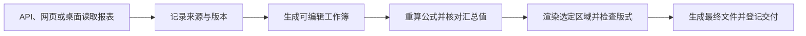

# 27｜Browser Use、Computer Use 与办公交付

> 源码基线为 DeepSeek Harness `dsh-v0.2.3-alpha.2`，提交 `4b399c39a6d1479cd84ca591b4d7c88e24d38a96`。[系列目录](../README.md) · [上一篇](26-local-jobs-cron-and-delivery.md) · [上游仓库](https://github.com/deepseek-ai/deepseek-harness)

假设用户要从企业报表页面取本季度数据，交付可编辑工作簿和 PDF。业务 API 可以返回带字段的数字，浏览器可以核对网页上显示的筛选条件，桌面操作可以打开只有 GUI 入口的应用。随后还需要检查文件的公式、版式与可打开性。一次点击返回成功、一个文件生成、用户拿到交付物，分别需要不同的证据。

## 1. 先选能解释动作和结果的接口

| 执行方式 | 适合取得的证据 | 主要代价 |
| --- | --- | --- |
| 结构化业务 API 或 MCP | 文档 ID、字段、版本、分页与业务结果。 | 需要连接器、权限和稳定的业务契约。 |
| 浏览器 DOM 或可访问性语义 | 标签页、控件角色、可见文本、操作前后的页面状态。 | 页面会重绘，旧控件引用和选择器可能失效。 |
| 桌面可访问性树或截图 | 应用、窗口、控件动作和可见画面。 | 依赖平台权限、窗口状态、缩放和模型识图能力。 |
| 文件格式库与 Office 渲染器 | 工作簿结构、公式、页数、字体与渲染结果。 | 原始编辑、计算和渲染需要分别验证，渲染与最终打开环境可能有差异。 |

读取报表时，如果已有受权的结构化接口，先用它确定报表 ID、季度与字段。若数据只能在网页上取得，可以观察语义树选择筛选器，再核对表格标题和记录范围。仅有桌面 GUI 时，先尝试应用的可访问性操作，视觉布局或无语义区域再使用截图。交付物的检查可以回到文件本身，关联来源版本与生成文件的版本。表里的依据可以写进同一份任务回执。

## 2. Browser Use 怎样挂载实际浏览器

`ctx.browserUse` 是独占注册表。它保存当前提供方的名字，实际工具由提供方注册，第二个提供方会被拒绝。这个基线的 Playwright MCP、Chrome DevTools MCP 和 Stagehand 后端都位于 `experimental`，需要显式组合。前两者启动固定版本的上游 MCP 进程，用 `mcp-client` 发现工具并适配结果。Playwright MCP 可提供基于页面可访问性信息的快照。Chrome DevTools MCP 通过浏览器调试连接提供页面和浏览器工具。[独占注册](../deepseek-harness/packages/browser-use/browser-use/src/index.ts#L28) · [实验包清单](../deepseek-harness/packages/experimental/README.md) · [Playwright 接入](../deepseek-harness/packages/experimental/browser-use-playwright-mcp/src/index.ts#L31) · [DevTools 接入](../deepseek-harness/packages/experimental/browser-use-chrome-devtools-mcp/src/index.ts#L30) · [Playwright ARIA 快照](https://playwright.dev/docs/aria-snapshots) · [Chrome DevTools Protocol](https://chromedevtools.github.io/devtools-protocol/)

两种 MCP 后端都通过共享的 `mountSessionMcp()` 在 Agent 作用域内挂载 stdio MCP 客户端。`launch` 启动隔离浏览器，`attach` 把外部浏览器连接独占分配给一个活跃 Agent。一个 Session 的浏览器操作入同一队列，其他拥有各自浏览器资源的 Session 可以继续执行。释放时先关闭自己的连接或资源，再等待排队操作收尾。附加模式只断开连接，外部浏览器保留。恢复对话可以回读以前的消息，浏览器 Cookie 或标签页由实际浏览器环境决定。[MCP 的 Agent 装配](../deepseek-harness/packages/experimental/browser-use-runtime/src/mcp.ts#L128) · [操作队列](../deepseek-harness/packages/experimental/browser-use-runtime/src/index.ts#L108) · [关闭与所有权](../deepseek-harness/packages/experimental/browser-use-runtime/src/index.ts#L162) · [附加与恢复说明](../deepseek-harness/packages/experimental/browser-use-playwright-mcp/README.zh.md#use-this-package)

Stagehand 走原生适配。宿主按模式启动或连接 Chromium，再用 Worker 调 Stagehand。`observe` 找符合描述的操作，`act` 执行自然语言描述的动作，`extract` 可按指定 schema 提取数据。这些方法使用独立配置的 Stagehand 模型，所以结构化提取仍需核对字段和值。仓库快照中，`stagehand_extract` 返回 JSON 文本，随后 `stagehand_screenshot` 返回图像。MCP 版浏览器截图则走通用 MCP 图像结果桥接，向模型传图要求附件服务和接受图像的模型路由。[Stagehand Worker 装配](../deepseek-harness/packages/experimental/browser-use-stagehand-native/src/index.ts#L99) · [原生能力实现](../deepseek-harness/packages/experimental/browser-use-stagehand-native/src/native.ts#L129) · [提取快照](../deepseek-harness/snapshots/session/browser-use-stagehand-native/session.v4.jsonl#L17) · [截图快照](../deepseek-harness/snapshots/session/browser-use-stagehand-native/session.v4.jsonl#L22) · [MCP 截图要求](../deepseek-harness/packages/experimental/browser-use-playwright-mcp/README.zh.md#model-experience)

## 3. Computer Use 怎样绑定应用、权限和坐标

`ctx.computerUse` 也是独占提供方注册表。原生 CUA 组合包随产品提供但默认关闭，这个基线支持 macOS 和原生 Windows Host。平台提供方把 macOS 辅助功能或 Windows UI Automation 与各自的窗口、截图和输入实现接到共享 CUA。PTC 通过 `run_code` 使用 `cua` 绑定，其他支持的组合通过 `cua_run_code` 运行。仓库也有 Cua Driver 的原生与 MCP 适配，两者都能走相同的工具结果通道，具体能力及桌面权限仍取决于后端。[独占注册](../deepseek-harness/packages/computer-use/computer-use/src/index.ts#L28) · [组合包支持范围](../deepseek-harness/packages/experimental/cua-bundle/README.zh.md#use-this-package) · [macOS 提供方](../deepseek-harness/packages/experimental/cua-macos/README.zh.md) · [Windows 提供方](../deepseek-harness/packages/experimental/cua-windows/README.zh.md) · [适配器清单](../deepseek-harness/packages/experimental/README.md)

原生 CUA 先定位应用，再取得应用和窗口句柄。操作系统的辅助功能或录屏权限让 helper 具备相应能力。DSH 仍单独询问用户是否同意读取、截图和控制所选应用。共享层可保存会话级授权，满足持久化条件时也能保存始终允许。评审期间撤销同一应用时，提交授权前会复核撤销代数和会话修订。撤销会取消相关操作并收尾连接，已经发送的输入需要重新观察应用确认结果。[应用选择与同意](../deepseek-harness/packages/experimental/cua/src/application-access.ts#L126) · [授权复查](../deepseek-harness/packages/experimental/cua/src/application-access.ts#L189) · [撤销与清理](../deepseek-harness/packages/experimental/cua/src/application-access.ts#L84)

可访问性读取会更新属于该应用和窗口的 `snapshotId`，元素操作随该快照身份请求。截图路径校验窗口 ID 与原始图像尺寸，经过附件服务把调整后的图像送给当前模型。宿主把实际送达的像素尺寸和截图时的窗口尺寸配对，绝对坐标输入由这组比例映射到原生坐标。窗口几何变化后，重新观测会丢掉不再匹配的映射。应用内容也可能在尺寸不变时更新，因此执行关键动作之前仍要确认当前画面，执行后再读目标状态。[对象与快照](../deepseek-harness/packages/experimental/cua/src/api.ts#L80) · [截图准入与模型图片](../deepseek-harness/packages/experimental/cua/src/index.ts#L325) · [坐标映射](../deepseek-harness/packages/experimental/cua/src/coordinates.ts#L16) · [原生适配的图像快照](../deepseek-harness/snapshots/session/computer-use-cua-driver-native/session.v4.jsonl#L17)

## 4. Office 生成、重算、渲染和交付怎样接起来

`office` Skill 给模型格式库的操作指南。写 XLSX 可以用 openpyxl 保存公式和单元格结构。需要刷新公式结果时调用 `office_recalculate`，并重新打开文件核对关键结果。`office_render` 从选中的文档页、幻灯片或工作表范围生成图片，检查裁切、字体和布局。`office_convert` 负责输出 PDF 等格式。渲染成功说明所选范围有可读图像，数据是否正确还要按来源与计算规则单独检查。[Office 指南](../deepseek-harness/packages/skill/skill-office/assets/office/SKILL.md) · [Office 工具](../deepseek-harness/packages/document/tool-office/README.zh.md#use-this-package)

加载 `office` 会在支持的组合中启用 Office 工具。Web 与 SDK 装配 `office-kit`，当前实现使用随产品或 sidecar 安装的 LibreOffice Kit。原生目标使用原生引擎，其他目标用 Node WASM。宿主用前台优先的转换队列控制并发、输入容量和等待量。相同的源版本和操作可以共享读取与转换，也可按内容摘要、操作参数与引擎代际复用结果。命中缓存前，工具仍会检查当前调用是否能读文件内容并确认源版本。否则会把一次旧授权下的渲染错误地复用到当前调用。[工具激活](../deepseek-harness/packages/document/tool-office/src/index.ts#L147) · [引擎与装配](../deepseek-harness/packages/document/office-kit/README.zh.md) · [队列与去重](../deepseek-harness/packages/document/office-kit/src/queue.ts#L140) · [内容摘要与代际](../deepseek-harness/packages/document/office-kit/src/queue.ts#L258) · [命中缓存前的授权](../deepseek-harness/packages/document/tool-office/src/index.ts#L257)

`office_render` 还要确认当前模型路由接受图像，结果经附件服务限量保存。缺少 renderer 或图像能力时，可继续做文件结构和数值核对，交付时说明已完成哪些检查。转换和重算返回 Host 上的临时文件，需要把最终文件放到 Session 可访问的位置。远端工作区无法映射 Host 输出时，工具会显式拒绝该路径。最终 `present` 核对文件存在且为普通文件，在工具成功后记录 `deliverables/presented`，Web 可显示交付卡片。记录的是用户可打开的路径。需要固定审核版本时，可以另存不可变制品，并把摘要关联到这次交付。[渲染与附件准入](../deepseek-harness/packages/document/tool-office/src/index.ts#L325) · [远端工作区限制](../deepseek-harness/packages/document/tool-office/src/index.ts#L403) · [缺少渲染器时的快照](../deepseek-harness/snapshots/session/office-skills-no-renderer/session.v4.jsonl#L21) · [交付记录](../deepseek-harness/packages/deliverables/tool-present/src/index.ts#L78) · [Web 交付卡片](../deepseek-harness/packages/bundle/web-app/cordis.patch.yml#L400)

## 5. 系统设计题｜如何证明办公自动化真正完成

把任务拆成读取、转换、核验和交付四个有记录的阶段。读取记录网页或文档版本、账号能力与数据范围。出现在页面或文件里的文字当作数据处理，执行权限来自任务授权与当前账号。读不到某一页时，记录缺口。对页内筛选或导出，调用后核对实际筛选值、文件类型和记录数，必要时重新观察。

每一份最终报告保存来源标识、结果文件摘要、核验范围和检查结果。对输入稳定、接口明确的阶段，优先做 schema 和业务不变量检查。对于视觉阶段，只渲染需要核验的页或区域，把证据与该文件版本关联。如果用户要求发布到外部位置，另外核对接收方、产物版本和本次授权。点击之后若没有得到确认，查询应用中的最新状态或业务操作回执，再决定是否重试。

## 6. 面试官怎么逐层追问

### 浏览器有截图能力，为什么还要保留 DOM 或可访问性树？

先从报表筛选说起。语义状态可以用角色、名称和字段解释操作，选中季度后还能复查；截图适合检查图表、遮挡和没有结构化描述的区域。继续追问页面刷新之后怎样继续，回答要重新定位目标，再检查前置条件和动作后的状态。

### Computer Use 插件已经开启，为什么仍然看不到截图或不能点击？

依次确认提供方与平台支持、系统权限、DSH 的应用授权、窗口身份，以及模型路由和附件能力。追问窗口刚调整大小，说明绝对像素依赖当前截图和原生尺寸的换算，旧映射不再可靠，要补一次新观测。

### Office 渲染结果缓存命中，还需要再做源文件授权吗？

要。可以沿 `authorizeContent()` 讲到一次有界的内容读取和版本检查。元数据可读时，内容权限仍可能已经变化。接着问缓存要带哪些身份，回答至少要覆盖源版本、具体操作和解释结果的引擎代际，并保持当前调用的读授权检查。

### 模型生成工作簿后，怎样让用户信任交付？

先按来源核对关键数字，确认公式存在且重算结果正确，再按需要检查页面或工作表截图。最后用 Session 可读文件登记交付，并说明检查范围。面试官可以继续问 HTML 显示、Office 渲染与用户实际打开的版本不一致怎么办，答案要能关联不可变产物、版本摘要和实际验证过的内容。

下一篇进入 Web、Desktop、SDK、ACP 与断线重连，继续看已经提交的历史和正在生成的流怎样恢复到客户端。
