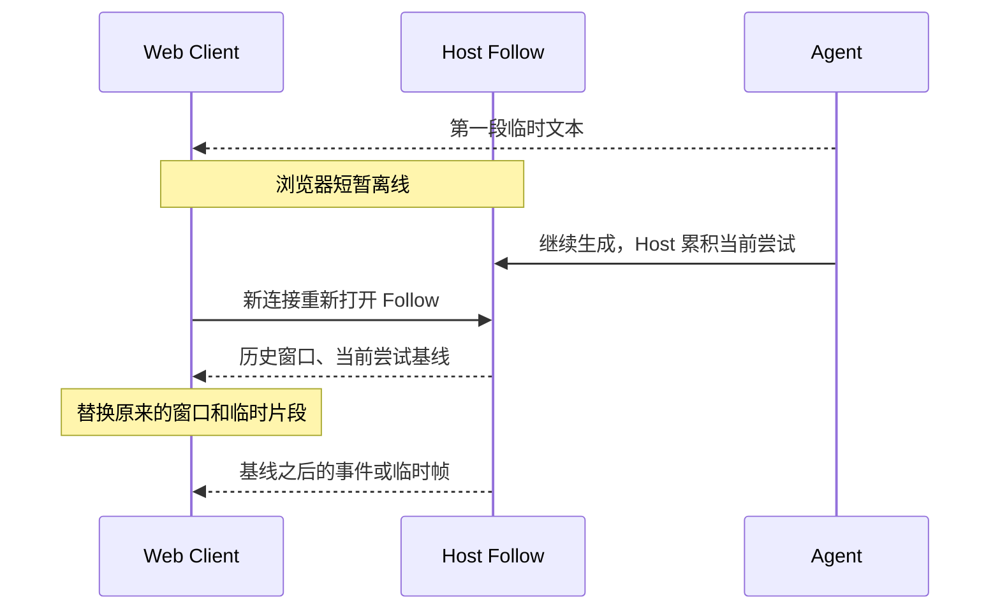

# 28｜Web、Desktop、SDK、ACP 与断线重连

> 源码基线为 DeepSeek Harness `dsh-v0.2.3-alpha.2`，提交 `4b399c39a6d1479cd84ca591b4d7c88e24d38a96`。[系列目录](../README.md) · [上一篇](27-browser-computer-use-and-office-delivery.md) · [上游仓库](https://github.com/deepseek-ai/deepseek-harness)

浏览器已经显示「开始分析」，断网十秒。Host 可能仍在写后半句，也可能已经完成整轮。客户端重连如果把旧 UI 和新收到的文本直接拼起来，容易得到「开始分析开始分析」。要解决这个问题，得区分已提交到 Session 的事件、当前模型尝试的临时输出，以及用来传输两者的连接。

## 1. Web Host、Client 和 Typert 各自负责什么

Web Host 的 Cordis 组合挂载 Session Controller、WebServer、Connection 和 API Gateway。它拥有 Agent、工作区与持久化。浏览器入口创建 `AppWebEntry`，再由 Client Loader 使用引导清单组装自己的插件树，经激活检查后挂载界面。React 消费的是客户端的会话数据与投影。会话运行时、模型调用和磁盘日志由 Host 提供。[Web 组合](../deepseek-harness/packages/bundle/web-app/README.zh.md) · [Host 装配](../deepseek-harness/packages/bundle/web-app/cordis.patch.yml#L117) · [浏览器入口](../deepseek-harness/apps/web/src/main.ts#L17) · [Client Loader](../deepseek-harness/packages/client/web/src/boot-client.ts#L50)

Typert 把 Host 的 `@Remote` 定义暴露给类型化的 Client。普通一元调用走 HTTP POST。流式 Remote 由 Gateway 用 `/api/remote.mux` WebSocket 承载。同一个 WebSocket 内，一个逻辑流用自己的 `streamId` 区分，帧可打开、发送项、结束或取消。客户端可以同时订阅会话、状态等多个流，关闭其中一个逻辑流会取消对应的订阅。物理连接断掉时，其上的逻辑流都需要恢复。Host 在调用业务 handler 前校验参数、会话定位和访问权限。[Gateway 的 Remote 契约](../deepseek-harness/packages/api/gateway/README.zh.md#host-service-typertgatewayservice-ctx-key-typertgateway) · [Web 传输分工](../deepseek-harness/packages/client/connection/README.zh.md#use-this-package) · [多路复用帧](../deepseek-harness/packages/api/gateway/src/stream-protocol.ts#L235)

连接层还有 `generation`。常规可回答交互的 Web Client 用内部 `$events` 流建立该代际，首帧 ready 后才认为连接就绪。断线或握手失败会使当前代际失效，再用带抖动的退避重试。浏览器报告离线时暂停重试，恢复网络后重新尝试。Gateway 负责重新打开载体，业务层决定重开后用游标补数据，还是收一份替换快照。[Connection generation](../deepseek-harness/packages/client/connection/README.zh.md#connection-generation) · [离线与退避](../deepseek-harness/packages/client/connection/src/client/connection.ts#L123) · [Gateway 的重连边界](../deepseek-harness/packages/api/gateway/README.zh.md)

## 2. Session Follow 怎样合并历史和实时流

| 数据 | Host 给什么 | Client 用什么对齐 |
| --- | --- | --- |
| 已提交的会话事件 | 历史窗口、`cursor`、`hasMore` 和其后的事件。 | Session `seq`，用它判断重叠与缺口。 |
| 会话投影 | 开场投影值及其 `asOfSeq`。 | 用投影基线更新界面状态，再处理后续更新。 |
| 当前 Assistant 尝试 | 可选的进程内基线及后续 `start`、`chunk`、`end` 帧。 | 流的 `revision`，和单次尝试的 `attemptId + index`。 |

`WebController.follow()` 先绑定历史监听器，以及请求选择的 Assistant 监听器，再读取会话观察值。这样读快照期间到达的事件也能先入队。输出的第一个帧是 `snapshot`，把历史窗口、header 与投影一起带给客户端。历史监听器将下一期待序号设为 `cursor + 1`，跳过已经包含在快照里的事件。Assistant 监听器则把快照和本订阅的本地到达序号一起取出，再过滤已包含的帧。这个本地序号用来裁剪开场队列，Assistant 对外的流修订仍用于后续连续性检查。[Follow 开场时序](../deepseek-harness/packages/api/session-controller/src/web/controller.ts#L32) · [历史队列裁剪](../deepseek-harness/packages/api/session-controller/src/history/listener.ts#L101) · [Assistant 的开场裁剪](../deepseek-harness/packages/api/session-controller/src/history/assistant-stream.ts#L84)

客户端重新连接时会接收一份当前历史窗口，替换已有窗口。正常增量中，全部落在已接收序号以内的记录可以跳过，部分重叠会被视为协议问题，出现序号缺口则按边界读取历史页补齐。重连开场游标落在已应用事件之前也会被视为协议问题。这一层只推进会话事件的游标，临时输出不会占用持久事件序号。[窗口替换和增量判断](../deepseek-harness/packages/api/gateway/src/client/journal-stream.ts#L277) · [重连窗口用例](../deepseek-harness/packages/api/session-controller/tests/transport.client.spec.ts#L565)

## 3. 离线十秒后，为什么不会重复出现半句话

**生成仍在进行。** Host 的 `SessionAssistantStreamAccumulator` 从连续帧累积当前尝试，基线包含 `attemptId`、开始时的会话序号、turn、step、`nextIndex` 与已收集的前缀。客户端替换窗口时先清除旧临时状态，再展开基线前缀，接下来只接受对应尝试和期待位置的片段。仓库用例先让客户端显示片段 `a`，模拟断线后返回含 `a`、`b` 的基线，最终显示两段。出现流修订或已知尝试片段位置缺口时，客户端重新取得基线。[Host 基线](../deepseek-harness/packages/api/session-controller/src/assistant-stream.ts#L27) · [客户端修订检查](../deepseek-harness/packages/api/session-controller/src/client/transport.ts#L206) · [替换现有片段](../deepseek-harness/packages/api/session-controller/src/client/sessions/assistant-stream.ts#L58) · [断线去重用例](../deepseek-harness/packages/api/session-controller/tests/sessions-service.client.spec.ts#L278)

**生成已经结束。** 开场历史可包含已提交的 `assistant/message`，结束后的尝试没有活动前缀要拼接。如果客户端在线时先看到持久消息、临时尝试还未结束，它会暂存对应的结算事件，等 `end` 里指明的 `seq` 来匹配。正常完成的消息先发布，到同一 `step/end` 收起临时片段。中断、失败或放弃按各自分支退役片段。缺口修复页只带历史时，客户端不会把旧临时内容接到新页上，必要时重新打开 Follow 获取成对基线。[结算匹配](../deepseek-harness/packages/api/session-controller/src/client/sessions/assistant-stream.ts#L104) · [临时片段退役](../deepseek-harness/packages/api/session-controller/src/client/sessions/assistant-stream.ts#L211) · [历史缺口修复](../deepseek-harness/packages/api/session-controller/src/client/sessions/session.ts#L804) · [正常结算用例](../deepseek-harness/packages/api/session-controller/tests/sessions-service.client.spec.ts#L193)

**Host 也重启了。** Assistant 累积器属于进程，Agent 销毁时清除。此时恢复的是可从持久日志读取的记录，旧生成流无法从进程内基线恢复。未结算工具调用还可能在会话修复时被标为结果未知，所以不能把断线或重启自动转成重发原请求。对可能产生副作用的操作，先查已有调用的记录与业务回执。[流生命周期](../deepseek-harness/packages/api/session-controller/src/history/assistant-stream.ts#L12) · [中断轮次修复](../deepseek-harness/packages/core/session/src/repair.ts#L18)

## 4. Desktop 怎样复用 Web，又怎样隔离原生能力

Electron 主进程创建窗口，关闭 renderer 的 Node 集成，启用 `contextIsolation` 和 sandbox，并通过 preload 暴露狭窄的原生方法。另一个子进程运行 Desktop Host，启动后用控制 IPC 通知主进程 Web 地址。主进程校验 ready 地址是预期的回环地址。文件选择、保存、启动通知等 Shell 能力经明确的 IPC 入口调用，Renderer 中普通的 Agent 业务仍使用 Web 客户端组合。[创建窗口](../deepseek-harness/apps/desktop/src/main.ts#L264) · [Host 子进程](../deepseek-harness/apps/desktop/src/host-process.ts#L220) · [地址验证](../deepseek-harness/apps/desktop/src/host-process.ts#L65) · [Preload API](../deepseek-harness/apps/desktop/src/preload-app.ts#L16) · [Electron 上下文隔离](https://www.electronjs.org/docs/latest/tutorial/context-isolation)

Desktop 从自有协议提供打包的静态 Web UI，将业务 HTTP 请求转发到本地 Host。preload 的 boot 方法给 Web 入口提供 `streamBaseUrl` 和脚本注入信息。WebSocket 则经实际的回环 Host 地址与 Gateway 通信，主进程在受信窗口与匹配目标的前提下处理身份信息。Desktop 复用了 Web 的 Session Follow，因此 renderer 重连与 Host 重启仍有不同的恢复结果。[静态资源与 HTTP 转发](../deepseek-harness/apps/desktop/src/main.ts#L803) · [Boot IPC 与 WebSocket](../deepseek-harness/apps/desktop/src/main.ts#L827) · [Web 上的 Desktop 引导](../deepseek-harness/apps/web/src/main.ts#L21)

## 5. TypeScript、Python SDK 和 ACP 在协议上有什么区别

| 入口 | 传输与调用 | 观察和完成边界 |
| --- | --- | --- |
| TypeScript / Python SDK | SDK 子进程的 stdio，逐行 JSON-RPC 2.0，使用 DSH 自己的方法和通知。 | `session/prompt` 返回入队消息 ID。高层 `run()` 先建订阅，再通过 `session/query` 提交并等待对应活动。 |
| ACP | 受信客户端或进程外 Agent 通过 stdio 调标准 ACP v1 方法。 | `session/prompt` 等到相关活动结算并完成有序更新交付。恢复会话通过 `session/resume`，旧更新不会重新发送一遍。 |

SDK 的 TypeScript 与 Python 实现用同一套协议字典。SDK 把普通文本或内容块送到 `session/query`，区分普通 prompt 和原生命令。低层调用接受消息后就可返回，调用方也能用 `session/wait` 观察根 Agent 与受管后代工作进入空闲。高层收到原生命令结果时用 `commandId` 关联对应的完成通知。客户端观察超时或回调失败并不能证明运行时没有执行，所以重试还要核对已有活动。[SDK 分帧与方法](../deepseek-harness/packages/sdk/protocol/README.zh.md#use-this-package) · [TypeScript 高层调用](../deepseek-harness/packages/sdk/client/src/api.ts#L255) · [Python 高层实现](../deepseek-harness/python/sdk/src/deepseek_harness/api.py#L242) · [JSON-RPC 2.0](https://www.jsonrpc.org/specification)

ACP 面向标准 Agent 交互。DSH 的 ACP profile 允许新建、列出、恢复和关闭可管理的会话，并把已经提交的 Assistant 消息、工具生命周期等映射成 `session/update`。同一会话只允许一个在处理的 prompt，连接上可以管理多个会话。取消和关闭分别处理提示词与会话的资源范围。连接断开时会收尾持有的 Agent 及其后代、排空更新并刷新持久化。重连后可以恢复持久会话，但不能把它当成 Web Follow 的逐片段恢复接口。[DSH ACP 实现约定](../deepseek-harness/packages/acp/acp/README.zh.md#use-this-package) · [持久会话恢复](../deepseek-harness/packages/acp/acp/src/index.ts#L241) · [标准更新映射](../deepseek-harness/packages/acp/acp/src/updates.ts#L26) · [ACP v1 概览](https://agentclientprotocol.com/protocol/v1/overview)

## 6. 面试官怎么逐层追问

### WebSocket 重连成功后，界面为什么还需要一份 Session 快照？

WebSocket 恢复了载体，Session Follow 才恢复业务状态。先订阅再读快照避免中间漏掉事件，接着按快照边界丢重叠并处理增量。继续追问通知有缺口如何处理，答出持久事件可以按序号查历史页，不能默认所有临时通知也可从日志找回。

### 模型回复分片到了好几次，为什么不能用文本内容去重？

相邻片段可能本来就相同。DSH 依靠流修订以及 `attemptId + index` 判断归属和位置，用新基线替换临时前缀。再追问最终消息如何衔接，讲清持久结算事件、流的结束帧和 `step/end` 的匹配关系。

### Electron 的全部 Agent RPC 都经过 IPC 吗？

区分 Shell API 和 Agent API。主进程托管原生能力，preload 只暴露约定方法；会话和 Agent 能力继续通过复用的 HTTP 与 WebSocket 连接访问本地 Host。可以深挖 renderer 外链导航、发起方校验和 Host 意外退出时各自由谁处理。

### SDK 请求超时后，能不能直接再调用一次？ACP 呢？

先定位超时前请求是否已被接纳，区分请求 ID、入队消息 ID 和实际业务操作 ID。SDK 的等待结束与运行时已执行可以同时成立。ACP 有自己的取消与会话关闭入口，但取消也要结合实际结果。生产设计可以把提交幂等键与持久回执关联，把已确认历史和仍可恢复的活动作为两类查询。

下一篇继续看可观测性、Token 成本与性能诊断，追踪如何把连接等待、模型生成和工具执行放到同一条时间线上。
