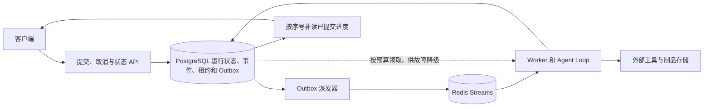

# 31｜用 Redis 和 PostgreSQL 设计云端 Agent 作业系统

> 源码基线为 DeepSeek Harness `dsh-v0.2.3-alpha.2`，提交 `4b399c39a6d1479cd84ca591b4d7c88e24d38a96`。[系列目录](../README.md) · [上一篇](30-agent-evaluation-replay-and-release-regression.md) · [上游仓库](https://github.com/deepseek-ai/deepseek-harness)

用户提交「生成报告，并把最终版本上传到已批准的位置」。Worker 成功上传后，来不及保存回执就退出。接替的 Worker 能看到任务尚未完成，却未必知道报告是否已经上传。云端 Agent 作业系统要能回答三件事：当前谁有权执行，之前做到哪里，接下来哪一步可以安全重试。

## 1. 从 DSH 的运行边界得到什么要求

这份 DSH 基础组合的后台 Jobs 使用 `jobs-local`，活动句柄属于进程。会话使用 JSONL 持久化，业务记录通过 `storage-domain` 走配置选定的后端，基础组合选用 JSON。Schedule 把提醒先投进 Session，等待持久确认后再保存任务回执。两次写入之间出现故障时，调度器可能再次投递。会话修复也把已经启动但没有结果的工具调用标为 `TOOL_OUTCOME_UNKNOWN`。这些源码路径说明了为什么云端恢复需要单独记录调度、执行和外部提交。[Jobs 装配](../deepseek-harness/packages/bundle/base/cordis.patch.yml#L96) · [会话持久化](../deepseek-harness/packages/bundle/base/cordis.patch.yml#L142) · [业务存储](../deepseek-harness/packages/bundle/base/cordis.patch.yml#L176) · [Schedule 持久确认](../deepseek-harness/packages/schedule/schedule/src/runtime.ts#L349) · [工具结果修复](../deepseek-harness/packages/core/session/src/repair.ts#L179)

下面设计一个单地域、多租户的服务。用户需要提交、查询、订阅进度和取消任务。Worker 或消息层重启后可以继续已确认的工作，超时或未知结果要可解释。选 PostgreSQL 保留权威状态，以 Redis 做派发和热点访问。执行耐久性取决于持久层的部署和故障模型，消息承载故障期间则允许延迟上升并限制新增流量。

## 2. PostgreSQL 怎样表达 Run、Attempt 与 Step

| 记录 | 持久字段与约束 |
| --- | --- |
| `runs` | `tenant_id`、任务状态、输入摘要、提交幂等键、可执行时间、派发代数、租约持有者、到期时间、`fence`。同租户提交键唯一。 |
| `run_attempts` | `run_id + attempt_no` 唯一，记录本次调度归属、开始及结束、失败分类。每次重新取得执行权生成一个新 Attempt。 |
| `run_steps` | 关联 Run 和 Attempt，记录模型或工具步骤、状态、检查点和制品引用。每条记录保留当次尝试的身份，可追溯重跑从哪里开始。 |
| `tool_operations` | `operation_id` 唯一，记录跨 Attempt 稳定的逻辑操作身份、请求摘要、目标、状态及远端回执。 |
| `run_events`、`outbox` | 事件按 Run 的序号持久化。Outbox 记录待发布的派发事件，在同一事务里和产生它的状态一起写入。 |

Run 从 `queued` 进入 `running`。需要退避可进入 `retry_wait`，到期再排队。执行权丢失时先回收旧租约并进入恢复判断。重新排队要以同一事务递增派发代数并写入下一条 Outbox，旧消息由代数校验识别。外部结果需要查询或人工确认时，置为 `blocked` 并保存原因。成功、失败和取消分别记为终态。取消请求先持久化，Worker 在合适的边界停止。已经发生的外部动作要继续保留它的回执或未知状态。

提交 API 用 `tenant_id + idempotency_key` 去重。同一键和同一输入返回已有 Run，同一键配不同输入就拒绝。创建 Run、首条进度事件和首条 Outbox 在一个短事务提交，确认后才能返回已接纳。数据库事务只保护本地状态，调用 LLM 或外部工具在事务外完成。需要派发时，Outbox 发布器按批领取，记录发布尝试。它可能在 Redis 已收消息但数据库还没记发布状态时退出，所以消费者必须能吸收重复投递。[PostgreSQL 事务隔离](https://www.postgresql.org/docs/18/transaction-iso.html)

## 3. Redis 的三种结构各适合放什么

| 结构 | 在方案中的用途 | 恢复依据 |
| --- | --- | --- |
| Pub/Sub | 通知订阅者「有新进度」，降低频繁查库。 | 断开时消息可能丢失，客户端用已接收事件序号补读 PostgreSQL。 [投递语义](https://redis.io/docs/latest/develop/pubsub/) |
| Streams | 转交可执行 Run，消息里放 `run_id`、派发代数和 Outbox ID。用 consumer group 分摊工作。 | PEL 记录已分配但未确认的消息。可重领，再由数据库决定可否执行。 [Streams](https://redis.io/docs/latest/develop/data-types/streams/) |
| Sorted Set | 以可执行时间为 score，表达迟延唤醒或重试提醒。 | 用 PostgreSQL 的 `available_at` 扫描与重建唤醒索引。 [有序集合](https://redis.io/docs/latest/commands/zadd/) |

限流可以用 Redis 维护短窗口计数或令牌桶，按租户、模型路由与工具类别控制流量。计数扣减与过期策略要一起处理。计费额度或必须遵守的硬上限应由持久记录或可信额度服务校验。热点状态可以用带版本与 TTL 的缓存，读取执行权、取消、授权等关键条件时仍检查可信来源。数据削峰、反压和每租户并发配额要一起设计，否则单个租户仍可能占满 Worker。[Redis 计数器模式](https://redis.io/docs/latest/commands/incr/)

## 4. ACK、重领和执行租约怎样配合

1. **派发。** Worker 用 `XREADGROUP` 取消息。收到消息只意味着传输层把它分给了一个消费者。消费者核对任务代数、状态及可执行时间。
2. **领取。** PostgreSQL 短事务有条件地把对应 `queued` 的 Run 改为 `running`，更新 `lease_owner`、`lease_until`，递增 `fence` 并写入 Attempt。竞争领取只有一方能把当前代数从排队变成运行。
3. **确认。** 本方案在持久领取已确认后 `XACK`，把恢复责任交给 PostgreSQL 的租约扫描。若消息仍指向正在正常运行、已结算或已被后续代数取代的任务，可按查到的持久状态处理重复派发。数据库状态尚未确认时，保留消息待重领。
4. **续租与恢复。** 长调用期间由单独的心跳续租。用数据库时钟判断租约，并在续租与提交时检查当前所有者、`fence` 和有效期。租约失效后，旧 Worker 不能再修改 Run、Step 或操作记录。扫描器需要先判断未决的工具动作，再决定恢复、退避重跑或阻塞。

`XAUTOCLAIM` 转移消费组里长期空闲的待确认条目。它处理投递的占用关系，业务执行权仍由数据库的代数和租约决定。ACK 即使失败，也只是可能再次收到同一条消息。反过来，ACK 成功后 Worker 也可能崩溃，此时必须靠过期租约扫描继续。选择在领取后确认可以让 PEL 保持较短，代价是需要独立可靠的租约恢复器。[XREADGROUP](https://redis.io/docs/latest/commands/xreadgroup/) · [XACK](https://redis.io/docs/latest/commands/xack/) · [XAUTOCLAIM](https://redis.io/docs/latest/commands/xautoclaim/)

## 5. 外部副作用已发生，为什么要先对账

在实际上传前，先保存逻辑操作 `operation_id`、请求摘要、目标及本次批准的产物版本。首次发请求前先持久化「可能已发送」状态，再调用外部服务并尽量使用这一稳定操作 ID 做幂等键。两步之间即使崩溃，也应按结果未知处理。上传成功后，在一个本地事务记录回执、完成 Step 并更新 Run 进度，只允许持有有效 `fence` 的 Worker 提交。运营界面要区分准备调用、发出请求、收到远端确认和本地回执提交。

| 旧 Worker 崩溃的位置 | 接管者的动作 |
| --- | --- |
| 可以确认请求未发出 | 重新检查当前权限和目标版本，再按原逻辑操作身份执行。 |
| 请求可能已经执行，回执没落库 | 先按操作 ID 查远端。若支持持久幂等，可以用同一键和同一请求重试，并读取既有结果。 |
| 回执已经提交 | 从持久检查点继续后续步骤。 |
| 结果未知且远端没有查询、幂等或可判定的业务约束 | 保持阻塞，显示已知信息，等人工核对后再决定补做。 |

典型时间线是 Worker A 抢到 `fence = 41`，报告已在外部落地，A 来不及保存回执。Worker B 接管时得到 `fence = 42`。B 按原操作 ID 查询或幂等重试，得到原先的上传结果后提交。A 若之后苏醒，它的旧写入会被本地条件拒绝。如果远端接受 fencing token，也能在远端拒绝旧持有者。远端只支持幂等时，仍要维持同一业务身份与请求内容。若远端完全无协作，本地 fencing 只能约束本地提交。

失败重试按原因设上限与带抖动的退避，永久参数错误或授权拒绝可提前结束。预算耗尽的任务可以进入持久死信记录，保存失败分类、尝试次数及最后检查点。人工重放前重新确认权限和已有操作。重放 Run 可以产生新 Attempt，之前那个未知的外部调用仍保留原 `operation_id`。

## 6. Redis 故障时如何降级和清理积压

Redis 不可用时，已接纳的 Run 与 Outbox 仍在 PostgreSQL。低流量下可由限额 Worker 直接从数据库领任务，用 `FOR UPDATE SKIP LOCKED` 找到一批可领行，并在同一短事务完成状态、租约和 Attempt 的写入。排队索引可按 `available_at` 和稳定任务 ID 排序，只索引 `queued` 行。租约扫描可以按 `lease_until` 查运行中任务。实际选批大小、索引和连接池容量要看查询计划与数据库负载。Redis 恢复后，迟到的旧消息继续走同一领取判定。[PostgreSQL 行锁与 SKIP LOCKED](https://www.postgresql.org/docs/18/sql-select.html#SQL-FOR-UPDATE-SHARE) · [PostgreSQL 部分索引](https://www.postgresql.org/docs/18/indexes-partial.html)

降级时先保住已接受的 Run。按队列年龄和租户配额限制新任务，避免全部 Worker 高频轮询打满数据库。Outbox 已标记发过，但 Redis 数据可能在故障中丢失时，定期从仍未被领取的 Run 重建派发。恢复后的回放要按年龄、业务优先级和租户公平性排队。客户端用已确认序号补读进度。控制面至少观察最老等待年龄、Outbox 积压、租约过期次数、未决外部操作和死信量。

做容量算例时，假设平均接纳 30 个 Run 每秒，每个 Run 平均占用执行槽 20 秒，在稳定流量下约有 600 个活跃执行槽需求。这个量级只反映假设的均值。真正定容还要测等待长尾、Provider 配额、并行工具分支和故障后积压。没有高吞吐需求时，可以先用数据库派发实现完整恢复契约，再把 Redis 加到热点路径。

## 7. 面试官怎么逐层追问

### 有了 Redis Streams，为什么还要 PostgreSQL Outbox？

提交成功必须同时保存 Run 和应派发事实。Outbox 把两件事放进一个数据库事务。发布器可在外部发消息后再记录状态，失败会导致可吸收的重复。继续追问 Redis 恢复后如何重建队列，就要沿 Run 是否仍在排队、代数与领取状态来判断。

### XAUTOCLAIM 把消息给新 Worker，旧 Worker 还活着怎么办？

消费组的消息所有权和任务执行租约有各自的语义。业务上用数据库的有条件领取和递增 `fence` 拒绝旧提交。接着问旧 Worker 能否继续向外部发请求，答案取决于远端幂等、fencing 支持和业务对账。

### 上传已经成功，Worker 在确认前退出，能不能自动重试？

先查询有无可复用的远端回执，或远端是否接受同一逻辑操作的稳定幂等键。然后说明该操作 ID 要跨 Attempt 保留。对于没有可判定证据的外部写入，由系统报告未知并暂停自动重放。

### Redis 挂了，怎样继续执行又不拖垮 PostgreSQL？

通过低并发、短事务和有索引的批量领取保住已接纳任务。把限流、缓存失效和状态恢复的降级策略说清楚。进一步追问故障后积压很大时，给出队列年龄、租户限额、受控补派和遗留消息去重的顺序。

下一篇《从零设计一个最小 DSH》会收回到单进程，把 Agent Loop、模型适配、工具执行和会话恢复放进一条最小链路。
