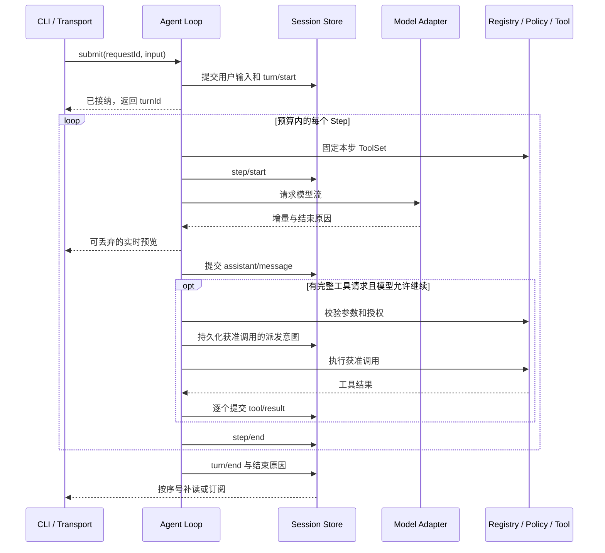

# 32｜从零设计一个最小 DSH

> 源码基线为 DeepSeek Harness `dsh-v0.2.3-alpha.2`，提交 `4b399c39a6d1479cd84ca591b4d7c88e24d38a96`。[系列目录](../README.md) · [上一篇](31-cloud-agent-jobs-with-redis-and-postgresql.md) · [上游仓库](https://github.com/deepseek-ai/deepseek-harness)

用户让 Agent「读取项目说明，把摘要写到团队报告中」。模型生成到一半时，用户按了取消。另一轮运行中，工具已经发出写入请求，Agent 却在收到回执前退出。两次都表现为任务中断。第一种要决定保留多少生成内容，第二种要查清外部操作是否生效。最小 Harness 的接口要能表达这种区别。

## 1. 从 DSH 的执行顺序确定系统边界

DSH 在每个 Step 开始前解析本步可用工具并准备提示词。模型流结束后，Agent Loop 追加最终的 `assistant/message`，再把其中的工具调用交给工具层。一般情况下，工具结果进入后续 Step 的输入。源码快照里可以沿着 `assistant/message → tool/call → tool/result → step/start` 看到这条链路。DSH 还支持并行工具调用和终止型工具，下面的版本先用串行执行和一个明确的结束判定。[Step 准备](../deepseek-harness/packages/core/agent-loop/src/agent.ts#L286) · [消息提交与工具派发](../deepseek-harness/packages/core/agent-loop/src/agent.ts#L556) · [工具轮次快照](../deepseek-harness/snapshots/session/bash-tool-turn/session.v4.jsonl#L15)

初版限定为单进程 CLI、一个模型适配器、每个 Session 同时只运行一个 Turn。工具只有读取工作区文档和写入已授权的报告目标，工具按助手消息里的顺序执行。用户可以提交、看进度、取消和重开会话，进程恢复时要能说明上个 Turn 停在哪里。这里的 Turn 是一次用户请求的处理过程，Step 是构造下一次模型输入到处理本步工具结果的过程，Attempt 是本步内一次模型请求。模型连接失败后重试会新增 Attempt，已经完成的 Step 继续保留。

## 2. 六个接口及其职责

| 部件 | 最小接口 | 接口负责的约束 |
| --- | --- | --- |
| Agent Loop | `run(turnId, signal)` | 依序提交 Step 状态，构造模型输入并处理退出原因。限制每个 Turn 的步数、时间和工具调用次数，模型重试也消耗预算。 |
| Model Adapter | `stream(request, signal) → AsyncIterable<ModelEvent>` | 统一文本增量、工具参数增量、用量和结束原因。按块组装参数，只有完整结束的模型输出能提出待执行的工具请求。 |
| Tool Registry | `resolve(context) → ToolSet` | 为每个 Step 固定工具名、参数 schema、能力描述和执行句柄。模型参数解析后再走运行时校验。 |
| Policy | `authorize(call, context) → allow / deny / ask` | 基于身份、工具、目标及参数判定。审批绑定具体调用和参数快照，派发时再次核对当前授权。 |
| Session Store | `append(sessionId, expectedSeq, events)`、`read(sessionId, afterSeq)` | 分配递增序号，原子提交事件批次并报告持久确认。序号不匹配时返回冲突，由恢复逻辑重读后决定下一步。 |
| Transport | `submit(requestId, input)`、`cancel(turnId)`、`follow(sessionId, afterSeq)` | 负责输入、幂等接纳和事件订阅。取消返回请求受理，Turn 的实际结束由事件流确认。 |

`ToolSet` 保证模型看到的定义和执行句柄来自同一份快照，Policy 则判断动作现在是否仍有权执行。比如用户批准将报告写到文档 A，等待期间报告目标变成文档 B，原批准不能复用。即使目标没有变化，文档权限也可能被撤回。DSH 工具流水线提供执行前钩子、审批和最终 guard，最小实现可以用一个类型化的授权接口连接这些检查。[模型流类型](../deepseek-harness/packages/llm/llm/src/types.ts#L496) · [工具定义](../deepseek-harness/packages/core/tools/src/schema.ts#L484) · [执行前流水线](../deepseek-harness/packages/core/tools/src/pipeline.ts#L191)

## 3. 正常会话的最小时序

提交阶段把 `requestId`、用户输入和 `turn/start` 放在同一批事件中。若 CLI 的接纳回执丢了，使用同一 ID 和相同输入重试应返回已有 `turnId`。同一 ID 带来不同输入则报冲突。Step 内工具校验或授权失败时，为该调用提交结构化错误结果，无需记录派发意图。每个调用都收尾后再进入下一次模型请求。模型直接给出最终回答就结束 Turn，步数、时间或用量耗尽时保存明确的结束原因。

会话历史可投影出两种视图。面向用户的视图呈现已确认的消息、进度和失败原因，面向模型的视图按适配器协议组装消息及其成对的工具调用和结果。实时块用 `attemptId` 和块位置更新预览，最终记录用 `seq` 确认。用量或审批事件可以留在历史中，由投影决定是否进入提示词。DSH 的流结束帧也会带上对应会话事件的序号。[流增量和结束帧](../deepseek-harness/packages/core/agent-loop/src/assistant-stream.ts#L60)

初版可用单写入者的 JSONL 文件，每批事件作为一条完整记录，写入并同步完成后再给出持久确认。重开时从最后一条完整记录继续，只有格式能识别为未完成的尾批才可裁掉。已提交记录有结构错误时应报告损坏。这个方案对应本文的事件批次接口，DSH 自带 JSONL 后端还有压缩帧、延迟建档和损坏检测等实现细节。[DSH JSONL 持久化](../deepseek-harness/packages/session/session-persistence-jsonl/README.zh.md)

## 4. 模型生成到一半时，取消如何收尾

DSH 消费模型流时检查取消信号。如果 Attempt 已经启动且还有可保留内容，会保存带 `interrupted: true` 的助手消息。组装器保留有内容的文本和推理块，丢弃工具调用块。已经启动却没有可保留内容时，写入 `assistant/attempt`。因此哪怕网络上已收到看似完整的参数，该中断路径也不会拿它发起工具请求。[取消分支](../deepseek-harness/packages/core/agent-loop/src/agent.ts#L484) · [中断块组装](../deepseek-harness/packages/llm/llm/src/assembler.ts#L162)

在最小版本中，`cancel` 先提交取消意图，再触发本地 `AbortSignal`。第一步让重启后的进程知道这个 Turn 已请求停止，第二步尽快收掉正在等待的 I/O。异步任务返回后，Loop 在提交或派发前核对当前 Attempt 是否仍有效，并重新检查取消状态。正常结束与取消用同一个 Session 写入队列确定先后，抢到终态的提交只生效一次。适配器若忽略信号，应停止接受它的迟到增量，并受有界等待控制。

优雅取消时，本方案保存已收到的可展示文本并标明中断。进程硬退出时，从已确认的持久前缀恢复，之前只推到屏幕上的字可能无法找回。可重试的模型错误可以在同一 Step 新建 Attempt。用户主动取消后结束 Turn，下次由用户发起继续。此时若工具已经越过派发边界，会话仍须处理它的结果。

## 5. 工具已发出请求，结果如何恢复

DSH 工具层追加 `tool/call`，正常结果使用同一调用 ID，并引用调用事件序号。修复逻辑扫描助手消息里的工具请求。缺少结果且找到 `tool/call` 时，补 `TOOL_OUTCOME_UNKNOWN`。没有找到 `tool/call` 时，补 `TOOL_NOT_STARTED`。这些标记解释的是恢复视图里有哪些证据。尤其在历史分叉中，截断位置之后的父会话仍可能执行过该操作。[工具事件写入](../deepseek-harness/packages/core/tools/src/batch.ts#L243) · [修复逻辑](../deepseek-harness/packages/core/session/src/repair.ts#L157) · [分叉边界测试](../deepseek-harness/packages/core/session/tests/fork.spec.ts#L325)

要让最小版本有明确的可重试边界，规定**外部写入必须等派发意图持久确认后才能发请求**。这个约束覆盖一次故障窗口。进程可能在意图落盘后、请求发送前退出，也可能在外部提交后、本地记结果前退出。两者留下相同的本地记录，都先按未知处理。

| 恢复时看到的持久状态 | 系统如何处理 |
| --- | --- |
| 有完整模型调用，无派发意图 | 结束旧调用并记录未开始。需要继续时生成新调用，重新验证授权和输入。 |
| 有派发意图，有最终结果 | 使用已确认结果。已知失败是否重试由工具错误分类和预算决定。 |
| 有派发意图，无最终结果 | 给旧调用补未知结果。有查询接口时按逻辑操作 ID 查回执。有明确幂等契约时，可在有效期内用同一键和相同参数重试。 |

`callId` 配对模型工具消息，`operationId` 标识一次业务操作。后者跨重试保留，绑定租户、工具、目标和规范化参数摘要。恢复后的迟到回执可以追加独立的对账事件并更新操作状态，原调用依然只有一条协议结果。远端缺少查询和幂等能力时，保留待确认状态，暂停依赖该写入的后续步骤。重启时先补齐缺失的工具结果，再关闭 Step 和 Turn，把这些变更作为一批带期望序号的事件提交。若同一恢复动作重复触发，重读后已闭合的调用不会再补一遍。[悬挂调用与轮次收尾](../deepseek-harness/packages/core/session/src/repair.ts#L43)

## 6. 从本地进程长成多入口服务

第一步把 CLI 命令限定在 Transport 内，本地 Loop 和 Store 走上述接口。第二步提供 stdio JSON-RPC，让编辑器或 SDK 调用同一个提交、取消和订阅入口。第三步加 Web 服务，客户端重连先获取快照及其高水位序号，再消费更高序号的事件。快照与订阅的衔接要通过原子切点或从事件日志补读消除空档。实时块预览可以丢失，下次收到持久消息就能校正。慢订阅者由有界队列和游标恢复处理，连接关闭后按任务的生命周期继续执行。[JSON-RPC 2.0](https://www.jsonrpc.org/specification) · [DSH SDK 协议](../deepseek-harness/packages/sdk/protocol/README.zh.md) · [Web Session Controller](../deepseek-harness/packages/api/session-controller/src/web/controller.ts#L32)

进程拆成多个 Worker 后，Session Store 的期望序号负责发现写入冲突，执行权还要由租约和递增代数管理。序号校验能拦住旧 Worker 写日志，外部写入仍依赖远端操作的幂等和对账规则。等吞吐、隔离或跨进程恢复确实需要作业调度时，再引入上一篇的数据库、派发层和租户配额。[云端作业系统](31-cloud-agent-jobs-with-redis-and-postgresql.md)

## 7. 面试官怎么逐层追问

### DSH 为什么先写 Assistant 消息，再执行工具？

Assistant 消息固定了本步调用的集合和身份，工具结果可以按调用 ID 与它配对。此时遇到崩溃，恢复能从历史中找到哪些调用仍缺结果。再问模型流能不能边收到 JSON 边调用，先讲完整参数、结束原因和运行时授权，再讲提前执行会给取消和恢复带来什么负担。

### 用户按下取消时，为什么还可能看到一条工具结果？

取消到达时工具可能已经派发，甚至已在远端提交。说明取消请求、停止继续调度、工具实际结束这三个时点，并给出如何保存真实回执。追问「工具忽略取消」时，解释哪些结果还能进入对账，哪些晚到信号必须被旧 Attempt 的身份检查挡住，避免已取消的 Turn 再发起模型请求。

### 派发记录已经落盘，怎样判断重试会不会写两次？

先给出崩溃前后本地日志完全相同的两条时间线，再解释远端查询、稳定幂等键及有效期。拿不到外部证据就把动作保留为未知。追问「模型再调用一次同名工具会自动去重吗」时，说明工具名相同只能证明能力相同，业务操作身份还取决于目标、参数和用户意图。

### CLI、SDK 和 Web 同时操作同一会话，怎样保持一致？

三种入口共享提交与订阅契约。同一请求 ID 只接纳一次，Session 只有一个有效执行者，客户端按事件序号补读。继续追问断线重连可用哪个序号、并行按取消会生成几次终态、以及为什么版本检查拦得住旧日志却可能拦不住已经发出的外部 HTTP 请求。

下一篇《设计一个云端 Coding Agent》会把这些边界放进仓库任务，讨论隔离工作区、检索与编辑、测试证据以及用户与 Agent 同时修改文件的情况。
