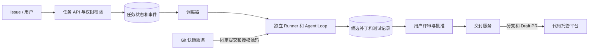

# 33｜设计一个云端 Coding Agent

> 源码基线为 DeepSeek Harness `dsh-v0.2.3-alpha.2`，提交 `4b399c39a6d1479cd84ca591b4d7c88e24d38a96`。[系列目录](../README.md) · [上一篇](32-design-a-minimal-dsh.md) · [上游仓库](https://github.com/deepseek-ai/deepseek-harness)

用户把一个 Issue 交给 Agent：「订单列表翻页时，创建时间相同的记录偶尔会重复。请修复，并提交供评审的变更。」Agent 需要先看清排序字段、游标格式和旧客户端的兼容要求，再改代码和测试。云端服务还要能回答三个问题：它从哪个提交开始，测试通过的是哪份代码，最终送去评审的又是哪一份。

## 1. 从 DSH 已有的能力出发

DSH 的实验性 `enter_worktree` 可以进入已登记的工作树，或从指定本地提交、分支、标签创建新的检出。创建路径先解析出 `baseCommit`，再创建分支和检出目录，切换 Session 的工作目录。工具入口仅传递 `name` 和 `from`，本身不会发起 fetch。`exit_worktree` 返回原检出，保留工作树和分支。Forge 组合也能把会话关联的变更请求、检查结果和差异展示到界面，GitHub 状态通过宿主已登录的 `gh` 获取。[工具入口](../deepseek-harness/packages/experimental/tool-worktree/src/index.ts#L47) · [检出实现](../deepseek-harness/packages/experimental/worktree/src/index.ts#L338) · [Forge 组合](../deepseek-harness/packages/experimental/forge-bundle/README.zh.md)

下面的云端方案复用前两篇的 Agent Loop、会话事件与作业恢复思路。每次任务绑定一个仓库、一个 Issue 和一条目标分支。默认交付可下载的补丁和测试报告，经批准可创建 Draft PR，合并由现有仓库流程处理。首版支持一个 Git 托管平台和一组固定语言环境。运行可以持续数分钟，用户断线后可以补读进度，也能在尚未派发外部操作时取消。[最小 DSH](32-design-a-minimal-dsh.md) · [云端作业系统](31-cloud-agent-jobs-with-redis-and-postgresql.md)

## 2. 先固定任务输入，再建立执行环境

接纳请求时记录 `taskId`、租户、仓库 ID、Issue 快照、目标分支、解析出的 `baseCommit` 和验收约定。分支名会移动，Runner 按固定提交物化源码。若排队期间目标分支有更新，旧提交仍可用于定位和生成补丁，交付前再显式处理目标变化。Issue 被编辑也遵循同一规则，更新验收约定应产生新版本。相同来源请求重复投递时，返回同一次任务。用户主动要求重跑时，生成能关联原任务的新运行记录。Issue、仓库文件和工具输出提供业务上下文，工具权限由控制面决定。

控制面保存运行状态和事件，制品存储保留候选源码、补丁与测试记录，Runner 的磁盘用于执行期间的临时数据。Worker 每次领取获得当前执行代数。任务中断后从已提交的候选快照恢复，旧 Worker 的迟到结果需要通过代数检查。`准备环境 → 探索 → 编辑 → 验证 → 等待评审 → 交付` 是任务阶段，每个阶段应记录当前输入、产物和阻塞原因。等待评审时释放 Runner，用户要求调整时从指定候选提交重开环境。

## 3. Worktree 管版本，Runner 管执行隔离

共享 Git 对象可减少获取同一仓库的开销。Git linked worktree 有独立的 `HEAD` 和索引，但会共享对象库、多数 refs 和默认仓库配置。云端生产方案把源端镜像放在受控快照服务。Runner 内使用任务私有检出及 Git 元数据。需要为同一任务的基线和候选建立两个检出时，可以在这个私有仓库中使用 worktree。按仓库权限分区并验证访问后，快照服务才可向任务提供固定提交的数据。Runner 回收与镜像、制品的保留周期各自管理。[Git worktree 的共享规则](https://git-scm.com/docs/git-worktree#_refs)

每个运行代数使用独立的临时执行环境，包含固定镜像、独立可写目录、非特权身份和 CPU、内存、进程数、磁盘与时限配额。对执行仓库代码的多租户场景，可以选每任务轻量 VM，把测试子进程限制在该环境内。源码读取凭据由快照服务管理，交付凭据由交付服务管理。依赖走受控出口，租户策略也要决定私有代码片段和日志能进入哪个模型服务。任务停止时回收 Runner，候选源码及其可见范围随制品策略保存。DSH 的文件沙箱与进程沙箱接线可以借鉴到 Runner 内部。[文件工具的写入检查](../deepseek-harness/packages/fs/fs-sandbox/src/index.ts#L136) · [Bash 沙箱接线](../deepseek-harness/packages/shell/bash-sandbox/src/index.ts)

## 4. 大仓库怎么定位，如何处理并发编辑

先用路径、包清单和关键字找候选目录，再用 LSP 查定义、引用和实现。订单翻页任务可以先找列表入口、游标的构造与解析、实际排序和过滤条件，再读该模块的测试。把候选路径和相关片段带给模型，索引和原文件留在工作区。DSH 的文件搜索通过 ripgrep 运行并限制返回体积，LSP 提供方按工作区调度请求，必要时再启动语言服务器。大仓库可把词法索引按仓库与提交缓存，在当前候选树上叠加已改文件的结果。LSP 语义结果还受工作区版本、工具链和依赖影响，编辑后要更新相关状态。[DSH 搜索执行](../deepseek-harness/packages/fs/tool-fs-search/src/search-core.ts#L199) · [LSP 工作区队列](../deepseek-harness/packages/lsp/lsp-stdio/src/index.ts#L276)

下载时间成为瓶颈时，可以先选定包和依赖闭包做 sparse checkout，托管端支持时再加 partial clone 延迟拉取 blob。两者分别控制物化的路径与获取的对象。编译器需要的共享配置、生成输入和跨包依赖要按需补齐，缺对象时由受控快照服务补取。搜索有路径范围或条数上限时，把范围写进返回值。一次局部「无匹配」只能说明已覆盖的范围里没有结果。[Git clone 的 sparse 与 filter 选项](https://git-scm.com/docs/git-clone#Documentation/git-clone.txt---sparse)

有两层并发要分别处理。

| 并发发生在哪里 | 怎样检测 | 怎样继续 |
| --- | --- | --- |
| 用户在同一个远端工作区编辑，或两个工具同时写 | 修改接口携带读取时的文件版本或工作区 revision。共享工作区把所有写入放进同一服务，原子检查期望版本并提交。 | 返回冲突和当前版本，重读后重新生成修改。多文件变更可先在私有暂存树组装，再按期望 revision 一次发布候选快照。 |
| 用户本地另有一份工作树，或有人更新了目标分支 | 独立工作区不会看到用户未提交的文件。目标分支更新后，对比 `baseCommit`、候选提交和最新目标提交。 | PR 保留各自修改，合并冲突交给评审者或显式生成新候选。干净合并也要重新检验语义和必要的测试。 |

DSH 提供文件观察策略，开启后可在 `read` 和后续写入之间保留版本。其测试覆盖两次编辑在同一旧版本上竞争，只有一次提交成功，另一次得到 `FS_STALE_VERSION`。该策略在基础组合默认关闭。它检验的是受控工具路径，云端共享工作区仍要统一 IDE、文件工具等写入入口。有任意仓库进程能直接改工作区时，把它产生的改动留在私有快照中并核对差异，再尝试发布候选版本。[观察策略](../deepseek-harness/packages/fs/fs-observation-policy/src/index.ts#L61) · [并发编辑测试](../deepseek-harness/packages/fs/tool-fs/tests/integration.spec.ts#L522) · [基础组合](../deepseek-harness/packages/bundle/base/cordis.patch.yml#L298)

## 5. 测试证据绑定到候选提交

对订单分页 Issue，验收项可以要求「多条订单拥有相同创建时间，跨页遍历时，每个符合过滤条件的订单恰好返回一次」。如果现有排序只用时间字段，候选修复可考虑加入唯一键，并保证排序与游标边界比较使用相同的字段、顺序和方向。是否修改公开游标格式要先看已有客户端。实现经 diff 核对后，保存候选提交 `C`，再在其干净检出上执行验证。测试为什么通过，需要结合实际选中的用例、断言和环境来解释。

Runner 为每次检查保存基础与候选提交、检查的命令和目录、解析出的用例数、镜像标识、依赖锁文件摘要、持续时间、退出状态、日志位置和裁剪状态。编译、类型检查与测试都要有各自的状态。能在不改生产代码的前提下将新回归用例放到基线 `B` 执行时，记录针对同一断言的失败证据。若基线因环境或接口不兼容而无法运行，只报告其真实状态。最终审阅的报告由 Runner 回执生成，模型负责说明改动和证据的联系。

| 检查结果 | 给用户的交付状态 |
| --- | --- |
| 目标用例和必跑检查成功 | 标记候选通过所列验证，列出覆盖范围。 |
| 安装超时或依赖仓库暂时不可用 | 按预算重试准备阶段，仍失败则标记验证受阻，保留候选和安装日志。 |
| 私有包缺权限，或锁文件与清单不一致 | 说明对应原因。权限由授权通道处理。可能改变依赖集合的修复需要成为可审阅的改动。 |
| 断言失败、没有选中用例或被取消 | 分别记为失败、未执行有效用例或取消，保留此前已完成的检查。 |

依赖缓存至少按运行平台、工具链版本、锁文件和访问域区分，安装失败的临时目录不进入缓存。改动一旦生成 `C2`，原来 `C` 的报告仍可查，但候选 `C2` 要重新取得自己的必跑检查回执。测试与提交之间若还有 formatter 或代码生成步骤，应先生成新的候选内容，再对最终候选验证。

## 6. 人工批准与交付如何收口

评审页展示 Issue、基础提交、候选提交、diff、验证状态和待确认项。批准绑定仓库、候选提交、目标分支和动作，并核对当前审批人权限。用户批准 `C1` 后，模型再生成 `C2`，需要重新批准。目标分支前进时，交付服务检查批准所关联的目标版本是否仍适用。要求基于最新目标验证时，先生成新候选或合并预览，对其重新检查。单独验证一个修复分支，只能证明该分支上的结果。

工作区里的 Agent 准备变更，交付服务负责远端写入。以 GitHub 为例，服务可使用受限于安装仓库和权限范围的短期安装令牌。先登记交付请求，使用任务专属分支和预期提交建立对应关系，再根据 head 与 base 查询或创建 Draft PR。推送成功后 PR 创建失败时可以接续。创建请求超时则先查远端是否已有对应 PR。发现分支内容与交付记录不符时，暂停并保留远端修改。最终回执记录实际 head 和 PR ID，方便核对远端与评审页的候选是否一致。[GitHub App 安装认证](https://docs.github.com/en/apps/creating-github-apps/authenticating-with-a-github-app/authenticating-as-a-github-app-installation) · [工具结果未知的恢复](32-design-a-minimal-dsh.md)

## 7. 多任务并发先限制哪种资源

按租户限制排队长度、活跃 Runner 和模型并发，再按任务限制 Token、模型调用、命令时长、磁盘与网络用量。预先从预算里预留有上限的额度，完成后用已记录用量结算。等待人工审批时释放计算槽，恢复时重新排队。大仓库准备可以和模型执行分开计量，避免几次大型 checkout 独占所有网络或磁盘配额。两个任务修改同一个包时可以并行产出候选，交付阶段再处理目标分支变动。需要定序的操作是更新同一个交付分支或写入同一任务状态。

例如每分钟接纳 12 个任务，平均每个任务占用 Runner 5 分钟，稳定流量下约需要 60 个活跃 Runner。假设每个 Runner 分配 2 vCPU 和 4 GiB 内存，对应约 120 vCPU 与 240 GiB 的分配量。长尾安装、冷启动和模型限流会影响排队时间，生产定容还要分别看队列等待、源码准备、首次模型响应、验证时长、候选采纳率，以及每次可评审交付的成本。只看成功打开了多少 PR，会遗漏未进入评审的排队、环境故障和重复尝试。

## 8. 面试官怎么逐层追问

### DSH 已经能创建 worktree，放到云上还要设计什么？

沿 `enter_worktree` 讲到固定的 `baseCommit` 和会话目录切换，再说明共享对象、refs 和配置意味着哪些隔离还要由 Runner 提供。追问两个租户同时跑同一个私有仓库，就要说明源码授权、任务私有元数据和镜像缓存的访问边界。

### 百万文件的仓库怎么找改动点？搜索不到能下结论吗？

先确认包边界和检出范围，用文件路径和关键字把问题缩到少数候选，再用 LSP 查符号关系并读原文件。追问 sparse checkout 缺了共享依赖时，要能区分待物化文件、索引缺失和真实无引用，并解释怎样核对结果对应的代码版本。

### 用户把同一文件改了，为什么文件版本检查之后还可能有合并问题？

文件版本保护一次受控的工作区写入。独立分支还要结合原基础提交、Agent 候选和用户新提交做三方合并。继续追问「Git 自动合上了，还要测什么」，可举排序字段与游标边界分别被两人修改的例子。两处没有文本冲突，组合后仍可能破坏分页语义。

### 明明显示通过，为什么评审人要求重跑？私有包安装失败又怎么报告？

先核对当前候选提交、检查实际执行的用例和环境。候选或集成基线变化时，根据验收策略取得新的证据。安装失败属于环境准备状态，应保留日志、候选及已有检查结果。再问「用户已批准旧补丁、推送后服务又超时」，就要讲清按候选绑定的批准、按任务对账的远端状态和继续交付的条件。

下一篇《设计一个企业办公助理，WorkBuddy 类场景》会沿「读群消息、找文档、生成报告、经确认发出」展开，讨论企业权限、草稿、审批和交付。
