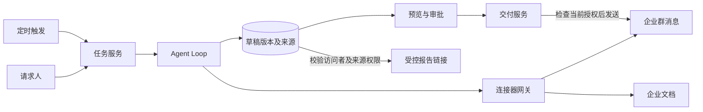

# 34｜设计一个企业办公助理，WorkBuddy 类场景

> 源码基线为 DeepSeek Harness `dsh-v0.2.3-alpha.2`，提交 `4b399c39a6d1479cd84ca591b4d7c88e24d38a96`。[系列目录](../README.md) · [上一篇](33-design-a-cloud-coding-agent.md) · [上游仓库](https://github.com/deepseek-ai/deepseek-harness)

项目负责人说：「整理本周项目群的讨论和迭代文档，列出下周要做的事，等我确认后发回项目群。」助理找到两份计划，其中一份后面的预算只有项目管理组能看。草稿生成后，负责人又把接收方改成了有外部协作者的联席群。面试时可以用这个场景串起账号连接、检索、报告生成、审批和发送。整条链路都要保留各自的权限和执行证据。

## 1. 从 DSH 的连接器和交付能力出发

DSH 的飞书插件注册厂商 CLI 账号入口，把 Skill 和 CLI 路径提供给模型。腾讯文档连接器则把服务注册到 MCP 管理器，默认按需加载工具。`present` 检查 Session 中的普通文件并写入 `deliverables/presented`，客户端据此可以展示交付卡片。`ApprovalService` 用 `approval/asked` 和 `approval/decided` 记录一次审批请求的结果。它们提供了读资料、呈现成果和询问用户的基础能力。[飞书连接器](../deepseek-harness/packages/connector/feishu/README.zh.md#use-this-package) · [腾讯文档接入](../deepseek-harness/packages/connector/tencent-docs/src/index.ts#L19) · [交付物登记](../deepseek-harness/packages/deliverables/tool-present/src/index.ts#L78) · [审批事件](../deepseek-harness/packages/interaction/user-approval/src/index.ts#L243)

下面设计企业部署的端到端链路。首版支持一个企业消息平台和一个文档来源，报告先在助理里预览，经批准后向一个明确目标发送受控链接。Agent Loop 负责找材料、写草稿和说明缺口，连接器网关负责读取，独立交付服务负责授权校验和发送。定时任务默认只生成草稿。群通知中的正文只放经过批准的提示语，周报内容由制品服务按访问者身份提供。

## 2. 账户连接、Scope 和资源 ACL 分别证明什么

每个连接记录 `tenantId`、提供方、外部组织与账号 ID、身份类型、凭据引用和授权版本。人手动发起时，请求人的企业身份与连接账号要显式绑定。读取可用个人委托身份，定时任务也能使用组织批准的服务身份，但后者需要独立的数据范围。以飞书为例，用户身份和应用身份使用不同类别的访问凭证。应用可以代发通知，代发权限由应用身份和目标资源约束。工作流仍要保存发起者、批准者和实际发信身份。[飞书访问凭证](https://open.feishu.cn/document/server-docs/api-call-guide/calling-process/get-access-token?lang=zh-CN)

一次读调用先核对租户与连接关系，再检查应用 Scope、委托身份和企业策略，最后由资源服务判断当前身份对具体群或文档的权限。比如用户在项目群里读到了链接，打开文档仍需有对应文档权限。文档 ACL 可能来自用户直接授权、群组成员身份或父目录继承。连接器应优先用提供方计算的实际能力和受权限约束的接口访问资源。以 Google Drive 为例，文件的 `capabilities` 会结合当前用户角色和文件设置表达可执行操作。[Google Drive 权限与文件能力](https://developers.google.com/workspace/drive/api/guides/manage-sharing#understand_file_capabilities)

令牌存放在凭据服务，模型只拿到带明确定义的工具和资源标识。用户从企业目录被停用或连接撤回后，控制面先停用绑定、提高授权版本并阻止相关任务继续调用工具，再处理本地凭据清理和上游撤销。Worker 在下一次调用时比较授权版本，正在读的调用即使迟到返回也要重新过准入才能写入草稿。上游撤销可能有传播时间，因此应用自身不能只依赖令牌自然过期。[OAuth Token 撤销规范](https://www.rfc-editor.org/rfc/rfc7009.html#section-2.1)

## 3. 读消息、找文档、生成可审核的草稿

任务先固定群 ID、时间区间和时区。按游标获取消息时记录分页范围、已读到的边界和缺页情况。引用的文档逐个解析为可信提供方的资源 ID 后读取，消息和文档里的指令只作为原始内容。搜索可使用托管平台的接口。若为规模化检索建立自己的索引，应按租户限定查询，以权限过滤候选，并在文本进入模型前对候选重新验证读取权限。标题、片段、引用位置和结果数量也可能泄露资料，用户可见结果同样受过滤约束。

草稿保留 `draftVersion`、内容摘要、来源版本清单、已覆盖的时间范围、无法取得的资料及审核所需的引用。每条关键事实最好绑定确切消息 ID、文档 ID 和段落，意见与待确认事项分开呈现。报告可以先生成结论与负责人，再核对引用是否支持结论。若缺文档、分页超时或计划存在冲突，草稿应把缺口标出来，并允许用户缩小目标、补充资料或继续审批符合当前验收条件的版本。

派生内容要有后续可执行的访问规则。默认把一份含原始摘要的报告访问范围限制在各项来源可对外分享的受众交集内，再叠加租户策略与这次指定的接收范围。标题和未注明出处的生成段落也按整份制品的来源约束处理。若预算文档只面向项目管理组，广发版本的做法是从获准供联席群阅读的资料重新生成一个独立版本，核对引用和内容，再单独审批。缓存键可以带租户、身份、授权版本和来源版本，命中时仍执行当前读取规则。权限查询不可用时先暂停访问，等到能复核再返回受限内容。DSH 的 Office 工具也在选择缓存路径前先检查输入读取能力与版本，可作为单文件场景的参考。[Office 工具的源文件检查](../deepseek-harness/packages/document/tool-office/src/index.ts#L257)

## 4. 审批需要确认一份可复核的发送请求

审批页展示被冻结的报告、引用范围、附件或链接、发信身份和解析后的目标群或接收人。服务端保存 `tenantId`、`draftVersion` 与内容摘要、目标稳定 ID、渠道、发信身份、消息正文与附件摘要、批准人、期限和适用的策略版本。请求里涉及收件人从群名解析出的 ID 时，界面也应展示组织和外部成员标记，便于用户识别同名群。任一发送参数发生变化，就生成新的待审批请求。

| 变化发生的时点 | 交付服务的判定 |
| --- | --- |
| 生成之后更换接收人或改了消息正文 | 旧批准只绑定原请求。按新受众重新检查、生成适当版本并取得新的批准。 |
| 批准之后、发送之前有成员离职或文档权限被撤回 | 查请求人、批准人、发信连接与来源的当前资格。失效时暂停发送，必要时重建草稿或重新批准。 |
| 群 ID 相同，但加入了外部成员 | 把群成员或受众分类变化当成权限变化，按当前范围重新评估。无法在派发前可靠确认范围时，只在租户允许的渠道发送无敏感正文的受控访问入口，或暂停。 |
| 群消息已经发出，之后有新的撤权 | 受控链接在每次打开时执行当前授权。已读或已下载的内容需要按实际情况报告，撤销链接只能阻止之后从该入口访问。 |

审批与派发是两个时间点。交付服务获取执行权后重验批准与资源权限，在本地把授权版本、请求摘要和派发记录一并条件提交。它可以阻止使用旧草稿或旧授权版本的 Worker 领取操作。远端成员变更和发送之间仍有时间窗口，除非提供方支持带受众版本的条件写入。初版把消息正文限制为可向该渠道暴露的内容，落地页对每个阅读者复核身份与访问权限，链接预览也不返回受限标题。这样发往动态群的链接不会随着群成员增加而扩大报告访问权。

## 5. 发送、文档授权和通知回执怎么对账

本地交付由一个逻辑 `deliveryId` 标识。业务状态依次经历 `pending_approval`、`approved`、`dispatching`，再进入 `sent`、`failed` 或 `unknown`。撤销、过期和权限失效分别保留原因。派发前持久化意图，外部响应回来保存渠道、远端消息 ID、接收目标、发送时间和摘要。若网络超时，先用远端支持的关联标识查回执，或在提供方承诺的窗口内用同一幂等键和完全相同的请求重试。没有确认依据时保持结果未知，由操作人核对。回执的 `sent` 表示平台确认创建消息，是否送达、是否阅读和报告是否打开需要各自可获得的证据。[最小 DSH 的结果恢复](32-design-a-minimal-dsh.md)

如果产品还要支持把成品保存到企业文档平台，创建文件、配置分享 ACL 和发群通知是三个会分别成功或失败的动作。应先在受限位置创建和验证文档，按批准设置分享权限，确认后再发链接。文档已创建但发送失败时，重试只处理尚未确认的阶段。每步保存对象 ID 和实证状态，避免再次创建一份副本或重复加权限。审计记录应能追到谁以何身份批准把哪个版本交付给谁，正文、令牌和个人敏感字段按授权和保留策略单独管理。

## 6. 定时周报如何处理离职、漏跑与重复投递

每条规则保存组织、负责身份、时区、触发规则、来源范围和目标策略。到点后用 `scheduleId + scheduledAt` 标识一次发生，按租户唯一接纳。为周报可选择补最近一个有效周期并注明缺失范围。调度器保存应触发的时间与接纳回执，草稿作业和外发各有自己的状态。DSH Schedule 在 `followup` 后调用 Session 的 `flush`，此后才记录投递回执和下一时点。这说明可以把「提醒已进入会话」与「报告已生成或发送」落到不同记录上。[DSH 定时投递](../deepseek-harness/packages/schedule/schedule/src/runtime.ts#L349) · [Inbox 投递用例](../deepseek-harness/packages/schedule/schedule/tests/delivery.spec.ts#L13)

定时触发每次重验负责身份、委托有效性和当前可用的来源。成员离职后，由该成员委托的规则暂停，撤销未派发的发送请求，已经产出的草稿仍按现行 ACL 管理。运营管理员可以显式移交规则，由新负责人重新连接并批准发送策略。组织批准的服务身份若仍对原范围有权，可以按规则生成草稿，审批仍由有权的在职成员处理。批量周报集中启动时，按租户和连接器设并发上限，分页与限频重试都受任务截止时间约束。观测分别统计授权失败、草稿排队、审批等待和未知发送，才能定位积压阶段。

## 7. 面试官怎么逐层追问

### DSH 已经能连飞书、能用 present，离发送一份周报还有几步？

先讲清 Skill 怎样指导调用、连接器怎样使用真实账号、`present` 记录了什么。再依次说明生成可审阅草稿、冻结版本、批准本次投递、检查当前权限和保存远端回执。可继续追问「用户点开卡片，看到的是新文件还是被批准的版本」，用路径引用与不可变制品解释差别。

### 提交者看过两份文档，为什么项目群仍可能打不开报告？

提交者的权限只决定哪些资料可用于生成。受众要满足报告来源的分享约束与这次发送的范围。如果一个来源只对小组开放，先考虑受控链接及可见人群。要向更广的群分享时，从可分享来源生成新稿并重新审批。继续追问「预算数字没引用也能发吗」，要说明产物的权限规则跟随实际输入和派生内容。

### 群 ID 没变，审批结束后进了一个外部成员，怎么处理？

先复核批准绑定的目标和受众约束，区分能否确认群成员与能否控制每次打开报告。只有发送端检查和远端条件写入能共享同一判断边界时，才有更强的群范围保证。受控入口把阅读权限放在打开时验证，正文只含允许公开给该渠道的信息。继续追问「外部成员看到链接预览怎么办」，还要限制标题、缩略图和错误提示的暴露。

### 负责人离职后周报又被调度一次，发送 API 恰好超时，怎么排查？

按时间线找负责人的授权版本、该次调度的唯一键、派发意图和实际外部回执。如果撤权发生在派发前，工作流应暂停。已发起的操作进入对账，确认后再决定是补记回执还是关闭未知状态。追问「能否换一个管理员账号自动补发」，要说明移交会改变身份和数据范围，需要独立授权与审批。

下一篇《设计多租户 Skill／MCP 平台》会把例子里的连接器放进更大的能力平台，讨论目录、版本快照、按需连接、租户隔离和吊销。
