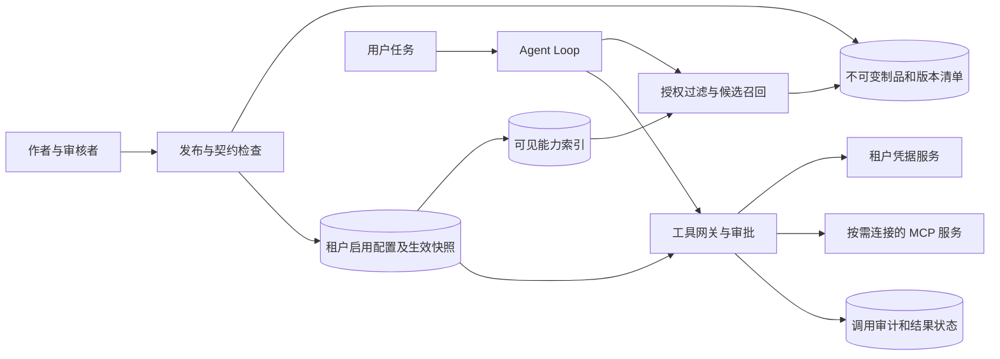

# 35｜设计多租户 Skill／MCP 平台

> 源码基线为 DeepSeek Harness `dsh-v0.2.3-alpha.2`，提交 `4b399c39a6d1479cd84ca591b4d7c88e24d38a96`。[系列目录](../README.md) · [上一篇](34-design-an-enterprise-workbuddy.md) · [上游仓库](https://github.com/deepseek-ai/deepseek-harness)

公司有 1 万个 Skill 和 100 个 MCP 服务。财务部的月结任务运行了半小时，期间报表 Skill 升级，原来用于交付的 MCP 服务又因授权问题被紧急吊销。系统需要回答：旧任务怎样复现之前读过的指导，下一步还能用什么能力，刚才发出的请求是否已经生效。

## 1. 从 DSH 的三个生命周期出发

DSH 的 `SkillRegistry` 按工作目录、作用域链和 revision 缓存合并后的目录，`tool-skill` 在模型调用前投放摘要，选中后再加载正文。MCP 的 `on-demand` 在服务连接且发现工具后提供一个加载器，选中的工具注册到调用方 Agent 的作用域。MCP 管理器对配置变化进行对账，连接代际的身份检查能挡住过期的工具目录提交。这三条源码路径分别回答目录如何发现、定义何时进入模型请求、旧连接何时停止发布状态。[Skill 目录缓存](../deepseek-harness/packages/skill/skill/src/index.ts#L522) · [模型目录注入](../deepseek-harness/packages/skill/tool-skill/src/index.ts#L226) · [Agent 按需加载](../deepseek-harness/packages/mcp/mcp-client/src/tool-loading.ts#L127) · [管理器配置对账](../deepseek-harness/packages/mcp/mcp-manager/src/index.ts#L426) · [连接代际检查](../deepseek-harness/packages/mcp/mcp-client/src/tools.ts#L216)

企业方案要再处理租户发布、跨 Worker 恢复和全局吊销。首版只接入已审核的 Skill 制品和受管远端 MCP。用户提交任务时固定能力版本，执行时检查当前权限。可见、可加载、可调用和调用已生效，要在不同环节各有证据。

## 2. 发布面与执行面怎样配合

| 记录 | 标识与版本 | 解决的问题 |
| --- | --- | --- |
| Skill 制品 | `skillId + version + digest` | 固定摘要、正文、引用资源和所需能力。内容放对象存储，按摘要校验。 |
| MCP 发布版本 | `serverId + releaseId` | 固定审核过的端点身份、协议兼容范围、工具清单、schema 摘要及操作类型。 |
| 租户快照 | `tenantId + catalogRevision` | 记录已启用的能力版本、灰度配置和可见范围，能定位任务启动时的组合。 |
| 授权与吊销状态 | `tenantId + subjectId + grantId` 加策略版本 | 记录当前主体、授权资源与实时禁用状态。读取和调用时查当前结果。 |
| 远端调用 | `callId`、`operationId`、连接代际 | 关联模型调用、远端业务操作和某次连接，用来判断迟到结果、重复请求和未知结果。 |

发布审批先验证清单、制品与依赖。生成候选索引后，只有当它能按指定 revision 查询时，才原子切换租户生效指针。索引未就绪时沿用当前有效版本。提交新任务时将路由选中的 revision 写入任务记录，重启后用这个记录定位历史制品。普通升级可保留一段旧版本，回收时同时检查任务租约与保留期限。紧急吊销由独立的当前状态决定，索引尚未刷新也要拒绝被吊销版本的加载和执行。

Skill 制品发布时检查固定摘要、来源、引用路径和所需工具。DSH 的上游 Skill 安装已有按清单保留文件、校验摘要和暂存后发布的例子。云端还要给组织设置审核与启用权限。正文是提交给模型的工作指南，只能请求平台已经批准的能力。若某个 Skill 需要运行代码，把脚本及依赖作为单独审核的执行制品，经工具网关进入隔离环境。发布者提供的说明和只读标记可供排序和展示，最终权限与操作分类以平台审核配置为准。[上游 Skill 校验](../deepseek-harness/packages/connector/upstream-skills/src/archive.ts#L156) · [暂存与发布](../deepseek-harness/packages/connector/upstream-skills/src/index.ts#L221) · [Agent Skills 规范](https://agentskills.io/specification)

## 3. 1 万个 Skill 怎样只露出当前任务需要的几十条

候选先按租户、主体、项目、快照 revision 和已启用能力筛选，再用标签、关键词和语义召回排序。每轮只放少量摘要，例如候选上限 20 条，每条假设平均约 40 Token，摘要本体约 800 Token。加载后再取正文和明确需要的资料，完整工具 schema 另设预算。用户明确指定名称可以走精确查询，仍要通过同样的可见性检查。召回不足时，可在授权目录内扩大搜索或让用户确认任务类型。

多语言名称、别名和团队自定义术语都进入索引，排序优先利用用户指定目标及数据域。读取索引时只查询该任务的有效版本。提交候选前重新应用当前 ACL 和吊销状态。若共享全局索引，应保证租户过滤在候选进入 Agent 之前生效，权限不足的标题、描述和计数也需要过滤。缓存键带租户、身份或确定等价的授权集合、revision 与查询摘要。命中缓存后仍复核当前规则。目录故障时可返回带完整性标记的可用子集，界面据此区分「暂时没有查全」和「已查完无结果」。

评估召回时用「任务描述、允许身份、正确 Skill／工具」组成样本，记录 `Recall@K`、误召回、实际加载率和完成率。再用同名但不同租户、部门术语冲突、用词很短、目录暂不完整等样本解释回归。召回高只代表候选找对了，仍需看模型是否选中正确版本，以及工具执行是否成功。未经授权的候选进入结果应作为单独的发布阻断指标。

## 4. 100 个 MCP 服务怎样按需发现和调用

平台先从审核后的服务摘要召回少数端点，发现阶段此时才访问对应服务的 `tools/list`。DSH 自带的 `on-demand` 节省的是连接后进入模型请求的完整 schema。云端方案增加了连接前的服务选择，可以分别减少服务访问量与上下文大小。MCP 允许工具清单随请求授权变化。对支持缓存元数据的版本，`ttlMs` 和 `cacheScope` 可用于判断发现结果的有效期与复用范围，平台仍要按租户和授权边界限制缓存。不同协议版本由适配层处理发现和传输细节。[DSH 加载策略](../deepseek-harness/packages/mcp/mcp-client/README.zh.md#on-demand-tool-loading) · [MCP 工具发现规范](https://modelcontextprotocol.io/specification/2026-07-28/server/tools)

一次完整调用沿着「候选服务 → 当前身份发现 → 选中工具 → 固定本步 schema → 验证参数和授权 → 远端调用 → 结构化结果」推进。网关使用 `tenantId`、端点及版本、协议版本、主体和授权记录区分可共享的客户端上下文。带服务端会话状态的旧版连接还要区分会话归属。远端端点经审核登记。OAuth 使用目标资源适用的凭据，令牌保留在网关或凭据服务，模型只拿到工具声明和结果。调用前根据真实参数检查目标资源、Scope 和审批，例如「把报告同步到哪个站点」。一个只读凭据下发现的工具列表不能当成另一主体的可用工具列表。[MCP 授权规范](https://modelcontextprotocol.io/specification/2026-07-28/basic/authorization)

对同一授权边界内重复发起的发现请求可以合并，按租户和服务分别设置并发、超时和等待上限。远端通知目录变化时，当前连接代际可以触发刷新。返回结果与发布清单比对后，再让下一步重建工具声明。远端删除工具、改变 schema，或变更运行语义时，网关停止不符合审核契约的调用。参数结构一致也可能伴随写入范围变化，因此上线前仍需契约和业务检查。DSH 的重连用例覆盖旧同步返回的工具不会留在注册表，企业平台可把相同的代际条件扩到跨 Worker 发布。[调用与输出校验](../deepseek-harness/packages/mcp/mcp-client/src/tools.ts#L183) · [旧同步收尾用例](../deepseek-harness/packages/mcp/mcp-client/tests/reconnect.spec.ts#L477)

按题设扩展一个量级算例。若有 1,000 个活跃任务，每个都访问 100 台服务，最多会形成 10 万个任务与服务组合。每个任务先召回 3 台时，这一数量降到 3,000。实际 HTTP 连接数还要看协议、授权可共享的范围和连接池设置。观察发现延迟、冷启动比例、`tools/list` 页数和单租户活跃调用，才能判断瓶颈是在目录、连接还是远端配额。

## 5. 灰度、普通升级和紧急吊销

| 变更类型 | 新任务 | 已运行的任务 |
| --- | --- | --- |
| 普通升级 | 按租户和稳定灰度分组分配新快照。 | 继续用原快照，旧制品及端点在兼容期内保留。需要迁移时在 Step 边界更新能力版本，并重新取得必要的审批。 |
| 灰度回滚 | 路由切回仍被允许的版本，记录回滚 revision。 | 已使用新版的任务可在允许范围内结束，或从安全的检查点恢复到兼容版本。 |
| 紧急吊销 | 目录和加载入口停止提供被吊销资源。 | 网关阻止未获执行权的新调用，尝试取消在途操作。已产生的外部效果按实际证据对账。 |

普通升级要确认服务提供方能同时承接旧契约。例如 v1 和 v2 应有可区分的路由或明确的版本协商。若服务方原地覆盖行为，平台保存的快照只能保存旧定义，旧任务已无可调用的实现。这时暂停相关步骤，保留当前制品和调用历史，让任务在已确认的检查点迁移或重新计划。把旧定义绑定到新后端之前，要验证参数、权限和业务语义兼容。

紧急吊销需要明确生效边界。工具网关在登记派发前，从权威状态核对版本，并把调用占位与授权判定作为一个有序操作提交。吊销提交之后，未获派发资格的请求应被拒绝。与吊销重叠、已被接纳的请求进入在途集合，网关关停对应的连接、尽可能停止发送，并在上游支持时撤销凭据。如果业务要求远端在提交时拒绝已吊销的请求，远端也要在提交点检查匹配的授权状态。已经提交的写操作保留回执。发出请求但回执丢失时发起对账，无证据时报告结果未知。对旧连接迟到的读取结果，也要按当前权限决定能否写入上下文或展示。

月结例子里，任务仍可按原快照核对已做过的报表步骤。被紧急吊销的同步工具不能继续执行。若同名 v2 工具可用，Agent 重新选择时应展示端点与权限变化，再决定是否申请新的授权。`operationId` 只能在同一个业务请求、同一远端去重契约内复用。旧请求可能已生效时，换服务重放也可能造成重复交付。[未知外部效果的恢复](32-design-a-minimal-dsh.md)

## 6. 如何留证据和判断是否可以扩大灰度

审计记录任务与租户、审批主体、`catalogRevision`、Skill 摘要、服务发布版本、`schemaDigest`、当前策略版本、调用及连接代际、操作 ID、结果分类和远端回执引用。参数记录优先使用摘要和必要的脱敏字段，访问原始输入输出走独立授权。故障时沿「候选选错、加载失败、授权拒绝、远端失败、结果未知」定位阶段。一个工具注册成功，还要看到本次调用的结果才能说明任务往前走了。

发布检查覆盖四类行为。目录层检查召回、版本和权限过滤，契约层检查 MCP 发现、分页、输入输出校验和目录刷新，运行层检查任务恢复及跨租户隔离，交付层检查副作用和回执。灰度指标可看候选命中、任务成功率、发现与调用的 P95、非预期权限拒绝和结果未知比例。设定基线与灰度样本范围后再决定放量。出现跨租户可见性或绕过吊销的错误时，停止放量并吊销相关版本。普通延迟或质量回归可先切回仍获准的发布版本。

## 7. 面试官怎么逐层追问

### DSH 已有按需工具加载，为什么 100 台服务还需要目录召回？

从 DSH 的「连接、发现、挂载加载器、按 Agent 注册」答起，再说明每个阶段的成本。连接前召回减少远端访问，连接后选工具减少 schema Token。追问缓存是否可全局共享时，要能指出不同主体的发现结果可能不同，并说明怎样限定复用范围。

### 新版只改了描述，老任务可以直接切换吗？

先说明任务快照固定了哪些内容，再检查正文、依赖、授权和远端契约。目录摘要相同只能说明模型看到的目录没变。若旧端点已停止提供旧行为，任务要在安全的 Step 边界迁移。追问「回滚又遇到吊销」时，解释动态吊销为何优先于所有版本路由。

### 权限检查通过后、远端收到请求前才发现吊销，怎样算生效？

先明确平台的派发判定和吊销提交的先后，再判断请求是否已登记、已发出、有无回执。目录失效和连接中断都无法证明远端写入没有生效。继续追问有没有更强保证时，说明远端在提交时校验授权版本可以约束吊销后的写入，业务幂等则约束重复执行的效果。

### 灰度后成功率下降，怎样判断是检索退化还是服务升级造成？

先沿审计版本重建各组的候选、实际加载、请求结果与任务状态。分别对比授权后 `Recall@K`、工具发现失败、schema 拒绝和业务成功率，再按任务类型与租户分层。追问「某些任务取消了还算吗」，要先讲清统计分母与取消阶段，才能决定是否回滚和怎么验证修复。

下一篇《设计会话与企业知识检索》会把目录检索扩展到 Session 历史与企业文档，重点讨论增量索引、权限过滤、删除传播和重建。
