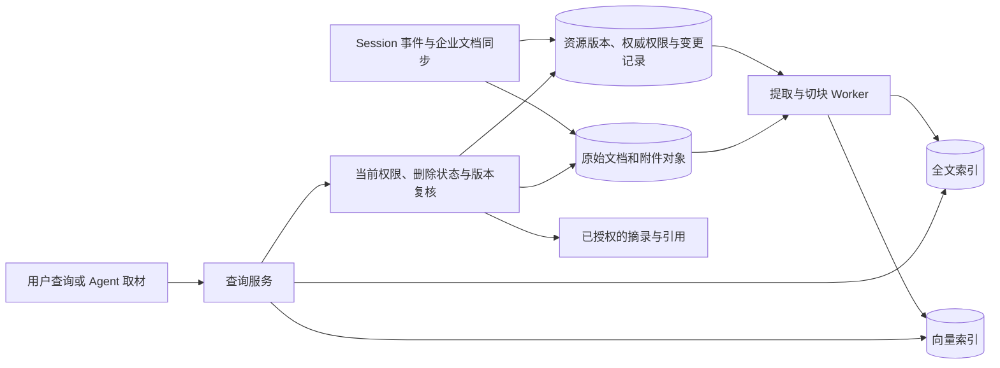
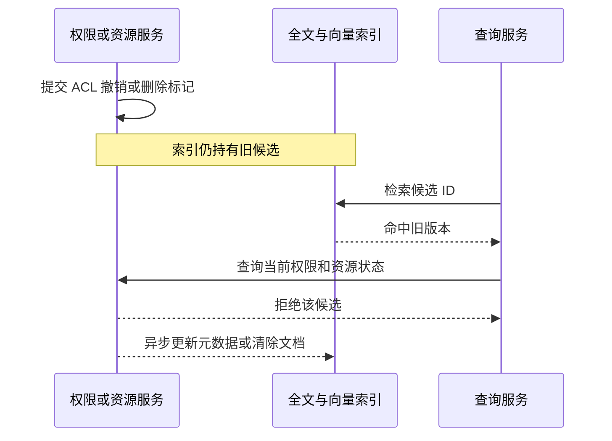

# 36｜设计会话与企业知识检索

> 源码基线为 DeepSeek Harness `dsh-v0.2.3-alpha.2`，提交 `4b399c39a6d1479cd84ca591b4d7c88e24d38a96`。[系列目录](../README.md) · [上一篇](35-design-a-multi-tenant-skill-mcp-platform.md) · [上游仓库](https://github.com/deepseek-ai/deepseek-harness)

用户问：「支付超时的处理方案在哪次会话里讨论过？团队的最新文档怎么说？」全文索引找到了含有错误码的旧消息，向量索引召回了一份很相似的运维文档。此时管理员刚撤销这名用户的文档访问权，索引还没同步。企业检索系统要同时回答三个问题：哪些内容相关，哪些版本仍有效，当前用户有权看到哪些。

## 1. DSH 怎样把会话变成可搜索内容

DSH 从 Session 原始事件提取语义文本，用 `sessionId + seq` 定位结果，并保留事件类型、时间和所属表层。经过压缩或替换后，旧消息仍可以存在于日志中，搜索文档会标成 `shadowed`。通用查询可以搜索多个表层。启用全文检索的 Web 正文入口则限定当前表层的用户与助手消息，并根据可见会话集合筛选结果。于是「压缩了模型历史」「产品搜索不到某条消息」和「源数据已删除」可以分别表达。[搜索文档构造](../deepseek-harness/packages/session-query/session-query/src/documents.ts#L36) · [表层标记](../deepseek-harness/packages/session-query/session-query/src/documents.ts#L57) · [Web 正文入口](../deepseek-harness/packages/api/session-controller/src/list.ts#L168)

DSH 的 SQLite 搜索在查询时对账。对已持久化的冷会话比较 revision，再读取新增或有变化的来源。活跃会话用连接内的 TEMP 索引覆盖同 ID 的持久文档，连旧文档中独有的命中也一起屏蔽。对账测试覆盖未改会话不重读、新增和变更重建、删除会话移出索引。云端可以沿用「索引由已确定的来源版本派生」的约束，把扫描对账改成持续消费变更。[查询时对账](../deepseek-harness/packages/session-query/session-query-sqlite/src/index.ts#L384) · [活跃文档覆盖](../deepseek-harness/packages/session-query/session-query-sqlite/src/index.ts#L798) · [新增、变更、删除测试](../deepseek-harness/packages/session-query/session-query-sqlite/tests/sqlite.spec.ts#L1127)

## 2. 权威状态、对象存储和两种索引

| 存储 | 保存的内容与读写约束 |
| --- | --- |
| Session 事件库 | 保存已提交的会话事件和序号，按投影规则重建可见表层。精确引用可以定位 `sessionId + seq`，回放时还要按当前权限读取。 |
| 资源与权限库 | 保存 `tenantId + sourceId`、当前内容版本、ACL 版本、删除状态、对象引用与变更记录。跨 Worker 使用可比较的资源版本来判断更新先后。 |
| 对象存储 | 保存版本化的文件、附件或已提取的规范文本。对象引用只定位字节，每次下载仍检查当前授权。 |
| 全文与向量索引 | 保存可由源数据重建的 chunk。各自记录版本、提取规则、索引代际和定位信息。向量还要标记 embedding 模型版本。 |

会话可以按单条消息、话题段落或相邻问答切块。企业文档优先保留标题层级和段落边界。一个 chunk 记录来源类型、源版本、查询时可核对的位置和内容范围。跨文档拼接会增加权限追溯的难度，默认每个 chunk 只引用同一授权边界内的来源。提取规则用允许列表明确哪些事件可检索，例如对话正文、经批准保存的交付物。工具原始输出与模型内部推理有独立的保留和访问规则。DSH 提取器和跨会话引用也各自明确定义了参与投影的内容。[DSH 文本提取](../deepseek-harness/packages/session-query/session-query/src/extraction.ts#L15) · [跨会话引用投影](../deepseek-harness/packages/context/session-reference/src/projection.ts#L39)

## 3. 增量消费如何挡住重复与乱序

自有数据写入时，先准备好不可变内容，再事务提交当前源版本与 Outbox 变更。对接外部文档时，Webhook 可以作为变更提示，拉取供应商版本或游标确认实际内容，并对漏投和断线周期性对账。消费端按资源归并变更，分别提取全文和向量。每个索引独立保存消费水位，只有已确认处理的连续前缀才推进检查点。若索引写成后 Worker 在确认前退出，重放同一版本应该得到相同结果。

切块写入使用 `tenantId + sourceId + contentVersion + chunkId` 作为稳定键。每个索引通过已提交的版本清单记录某个资源当前已完成的批次，所有必需 chunk 都写完后才发布这一批。先发布新版本再清理旧块。读取时只接受当前版本且已完成的索引批次，避免新旧段落混用。某个 chunk 的提取失败时保留明确的待重试状态。ACL 变更可以单独更新查询过滤元数据，沿用相同的正文与 embedding。

例如旧版 `v7` 的向量计算比 `v8` 更晚返回，提交前要检查资源当前版本与删除标记，版本清单也只允许向前发布。若索引系统和权限库之间缺少跨库事务，就用按版本隔离的键写入，再由查询端以权威状态过滤，同时异步回收旧数据。删除保留带版本的墓碑，直到旧队列消息、索引重建和恢复路径都无法再发布该旧版本。新建同名文档使用新的资源 ID。会话新增消息时可以只扩展新段落，压缩或替换会改变旧事件的表层，需更新受影响区间。

## 4. 全文、向量与当前授权如何组成查询

错误码、订单号、术语和人名优先用全文召回。中文可按查询类型选择分词、自定义词典或字符切分。语义相似但用词不同的问题交给向量召回。两路候选可按名次融合、按同一来源去重，然后对少量已确认有权使用的正文重排。不同 embedding 模型通常对应不同向量空间，换模型时应建新索引代际并单独验证召回。DSH 的本地搜索使用 FTS5 和自己的匹配片段排序，这里的混合检索属于云端设计。[DSH 排名实现](../deepseek-harness/packages/session-query/session-query-sqlite/src/index.ts#L798) · [FTS5 Tokenizer](https://www.sqlite.org/fts5.html#tokenizers)

租户边界优先进入索引查询。ACL 元数据可以在召回层缩小候选，最终在拿到候选 ID 后批量查权威状态，比较当前 ACL、删除状态与内容版本，通过后才物化摘录并送入重排器、模型或界面。标题、命中总数、引用链接和自动补全也受可见性控制。缓存按租户、身份、查询和代际隔离，命中后同样复核授权。向量索引里选择性很高的过滤条件会影响召回。比如 pgvector 的近似索引可以在扫描后过滤，部分查询需要有预算的迭代扫描、小范围精确搜索或合理分区，才能找到足够多的合格候选。[pgvector 过滤与迭代扫描](https://github.com/pgvector/pgvector#filtering)

查询可允许索引暂时少召回刚写入的内容。用户刚保存会话并要求立即搜索时，可对这个有界会话读取权威事件，合并尚未进索引的变更，或等待索引水位达到该次写入的位置。ACL 放宽后的新可见内容，也可能因为旧索引过滤暂时漏召回。查询授权服务不可用时，受影响的候选应停止返回。续页游标可以绑定租户、查询指纹、索引代际和稳定排序键，每页重新做授权检查。DSH 在语料代际改变时要求从第一页重新取，本方案也可采用这个契约。[DSH 游标校验](../deepseek-harness/packages/session-query/session-query-sqlite/src/index.ts#L962)

## 5. ACL 撤销与删除需要两条时间线

对自有数据，从权威撤权提交后的新查询开始，旧索引命中也要被拒绝。授权读路径需要满足这一生效契约，避免从滞后的只读副本拿到旧权限。正在执行的 RAG 在材料进入模型前再核对一次，权限变化通知可以中止尚在处理的查询。已经传给模型、客户端或经用户下载的内容需要按实际暴露范围处理。第三方文档若只同步本地 ACL，保证从本地确认变更后开始生效。要求以远端撤权时点为准时，应使用远端实时权限接口，或采用能提供所需时效保证的权威授权集成。

删除先提交资源不可用标记并切断入口，再异步清理全文、向量、缓存、对象、副本与过期备份。可以分别记录逻辑不可读、各索引已清理、对象已回收。若内容寻址对象被多个有效资源引用，要按引用范围处理回收，访问仍按各引用授权。服务端若保存了跨会话引文、缓存答案或导出的派生摘要，也要保留 lineage，才能按来源限制读取、删除派生物或重建答案。DSH 的会话引用会记录来源 ID 和捕获序号，云端可扩充为支持反向查询的来源关系。[捕获来源与序号](../deepseek-harness/packages/context/session-reference/src/index.ts#L366) · [对象读取与摘要核验](../deepseek-harness/packages/attachment/attachment-local/src/store.ts#L430)

## 6. 索引落后时怎么重建，怎么衡量效果

重建新代际时，先取得同一切点的源快照和对应的变更起点。全量扫描与增量回放在该切点衔接，删除事件也要参与。以 PostgreSQL 逻辑解码为例，使用复制槽导出的快照扫描，随后消费对应变更。若直接用一次普通查询的最大 Outbox 行号当切点，低号事务可能稍后才提交，容易漏掉更新。数据跨分片时记录各分片水位，保留掉线后可再次追赶的日志，并持续观察积压及日志留存。[PostgreSQL 逻辑解码与导出快照](https://www.postgresql.org/docs/current/logicaldecoding-explanation.html)

新代达到切换指定的水位后，核对源版本覆盖、删除标记、样本查询和授权结果，再切换查询路由。旧代可以保留一个受控回滚窗口，所有查询代际共享当前 ACL 与删除闸口。更换 embedding 时，旧模型和新模型各查对应向量空间，可以先旁路比较，再切流量。旧代索引最终从查询路径和存储中退役，否则继续占用容量并扩大删除的传播范围。

评估数据同时标注查询、主体、有效版本、相关证据和预期可见性。分别统计错误码等精确查询的首条命中、语义查询的 `Recall@K` 和 `nDCG@K`，再看授权后的结果数、引用正确率与延迟。运营指标可监测全文和向量各自的索引落后时间、事件缺口、删除队列年龄与待清理副本。发布时对同一查询使用不同角色，加入刚撤权、文档已删、缓存已命中和重建正在回放的场景，确认受限内容不会出现在模型上下文、摘要或结果计数中。

## 7. 面试官怎么逐层追问

### DSH 既有会话事件，为什么还需要全文索引？

先讲事件适合按来源和序号读取，全文索引适合跨会话匹配。再沿 DSH 的事件提取、`current` 与 `shadowed`、活跃表覆盖讲下去。继续问「压缩后还能搜到原句吗」，答案取决于搜索表层和历史的当前可见性。

### 向量索引只返回 50 个候选，过滤后只剩两条怎么办？

先验证租户与授权过滤放在哪个阶段。可以按授权范围缩小索引、在预算内扩大扫描，或对小范围走精确查询。接着看授权后的 `Recall@K` 和返回条数。可继续追问把更多候选交给模型能否补足，回答应先区分合规可用的候选与纯召回数量。

### 用户刚刚失去文档访问权，搜索返回了旧 ID，怎么办？

让索引只提供候选定位，由查询服务查当前 ACL、删除状态和版本。通过后才物化正文。继续追问「以前生成的摘要还看得到吗」，需要沿 lineage 找缓存、跨会话引用与已交付数据，分别说明访问约束和清理进度。

### 全量重建期间先删除文档，再收到迟到的旧更新，旧段落会回来吗？

说明源版本单调推进、删除墓碑保留，以及新索引如何从一致的快照切点跟进变更。再给出迟到 Worker 试图发布旧清单时的条件检查。最后说明即使索引物理上暂时仍有一份旧块，查询也会因权威删除状态拒绝返回。

下一篇《设计高并发在线 Agent 服务》会讨论 1,000 条活跃流下的连接、模型配额、持久化写入与背压。
