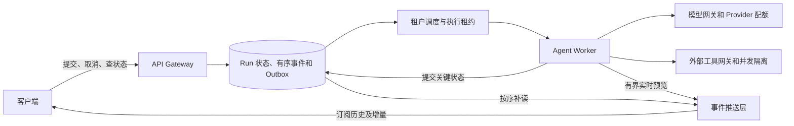

# 37｜设计高并发在线 Agent 服务

> 源码基线为 DeepSeek Harness `dsh-v0.2.3-alpha.2`，提交 `4b399c39a6d1479cd84ca591b4d7c88e24d38a96`。[系列目录](../README.md) · [上一篇](36-design-session-and-enterprise-knowledge-search.md) · [上游仓库](https://github.com/deepseek-ai/deepseek-harness)

面试官给了一个数字：线上同时有 1,000 条活跃流。用户在看回复，有的 Agent 在等模型，有的在跑工具，还有一批用户因为代理故障同时重连。设计题从定义这个数字开始。订阅连接、执行中的 Turn、Provider 请求和工具调用各有自己的生命周期，一次扩容能解决哪部分压力，要先算清楚。

## 1. DSH 给出哪些可复用的运行边界

DSH 的 Web `follow()` 先绑定监听器，再读取历史窗口和投影快照。快照之后只输出未覆盖的增量。历史事件使用 `seq`，Assistant 实时预览使用流代际与分片位置，最终流帧关联结算事件的序号。Agent Loop 给工具批次传入 `maxParallelToolCalls`，批次据此限制同时启动的调用。这个限制作用于单个批次，云端还需要给不同任务和租户设预算。[Web Follow 开场](../deepseek-harness/packages/api/session-controller/src/web/controller.ts#L32) · [Assistant 流结算](../deepseek-harness/packages/core/agent-loop/src/assistant-stream.ts#L79) · [工具批次配置](../deepseek-harness/packages/core/agent-loop/src/agent.ts#L578) · [批次并发条件](../deepseek-harness/packages/core/tools/src/batch.ts#L187)

下面设计一个单地域、多租户服务，支持提交 Turn、订阅输出、断线续看和主动取消。每个 Session 串行推进用户 Turn，跨 Session 并行执行。客户端掉线后，已接纳的任务按自身生命周期运行。容量不足时，服务可以延迟接纳或明确拒绝新请求，已承诺持久化的状态仍可查询。长时间等审批时保存可恢复检查点，释放计算槽，批准后重新入队。[云端作业系统](31-cloud-agent-jobs-with-redis-and-postgresql.md) · [最小 Harness 接口](32-design-a-minimal-dsh.md)

## 2. 提交、执行和推送怎么拆分

API Gateway 校验租户、Session 权限与幂等键。提交成功时，在同一个事务保存原始输入、Run 和待派发事实，再返回 `runId`。相同幂等键和参数返回已有 Run，参数不同则报告冲突。调度器只把任务分配给持有当前租约的 Worker，同一 Session 保留一个有效写入者。Worker 提交事件时比较执行代数和期望序号。它可以在迁移时重建已确认的状态，旧 Worker 的迟到写入应被拒绝。

模型网关负责路由、输入输出预算与 Provider 限流。工具网关负责授权、并发、执行超时、审批和外部回执。事件推送层可独立扩容，按 Session 分发已提交的历史和短命的预览数据。实时通知是唤醒信号，丢失后可用持久日志补读。Broker 负责派发和通知，数据库负责已接纳状态与执行权。在用户关闭页面时，推送层释放自己的订阅，独立的执行任务按配置继续。

## 3. 用 1,000 条活跃流做容量估算

题设先假定 1,000 个运行中的 Turn 各有一个在线订阅。Turn 自开始执行到结束平均 40 秒，接纳前排队和长时间人工审批另算。每个 Turn 平均发出 2 次模型请求，包含模型重试，调用 3 次外部工具。单次模型请求平均占槽 12 秒，观测用量为 6,000 输入 Token 和 400 输出 Token。单次工具调用实际占槽 2 秒。在稳态下，用「在途量 = 吞吐 × 平均占用时间」从 `1,000 ÷ 40` 得到约 25 个 Turn 每秒。

| 资源 | 计算 | 对应容量 |
| --- | --- | --- |
| 客户端订阅 | `1,000 × 1` | 1,000 条逻辑流。HTTP 连接数还取决于协议、多路复用和设备数。 |
| 模型请求速率 | `25 × 2 × 60` | 3,000 RPM。 |
| 模型用量 | `3,000 × 6,000` 输入，`3,000 × 400` 输出 | 1,800 万输入 TPM，120 万输出 TPM。先按观测用量算，再换算各 Provider 实际计入口径。 |
| 模型在途 | `25 × 2 × 12` | 平均 600 个请求占槽。 |
| 工具速率与在途 | `25 × 3`，`75 × 2` | 75 次调用每秒，平均 150 个工具占槽。 |
| 持久事件 | 假设每 Turn 20 条，`25 × 20` | 500 条每秒。每条平均 1 KiB 时，日均约 41.2 GiB 原始事件数据。 |
| 预览推送 | 按 600 个在途模型请求，每个平均 10 帧／秒，300 B／帧 | 约 6,000 帧／秒、1.8 MB／秒，假设一份预览只推给一个订阅者。 |

事件估算未计数据库索引、WAL、副本和大对象。落盘可以按事务分组，存用户输入、消息、工具调用与结果等业务事件。每个 Token 的展示增量走有界流，只有完成或按约定结算的内容进入持久消息。若需要保存完整生成轨迹用于审计，应另算写入与保留成本。网关为每条订阅预留最多 128 KiB 发送缓冲时，1,000 条累计上限约 125 MiB，进程其余状态与内核缓冲另外测量。容量上线前还要看模型耗时长尾、工具扇出、重连波峰和多端订阅。

举个配额不足的例子。假设路由可用 2,400 RPM 和 1,200 万输入 TPM，输入全部计额。它们分别能承载约 20 和 16.7 个 Turn 每秒，实际先碰输入 TPM。要承接题设的 25 个 Turn 每秒，得降低每轮模型用量、获得更多配额或按产品策略分配到获准的其他路由。Provider 还可能单独计算缓存输入、输出用量和短时突发。按 Provider、账号与模型记录配额口径，租户自己的费用预算另算。[API 配额口径示例](https://platform.claude.com/docs/en/api/rate-limits)

## 4. 配额、背压和重试怎样协作

调度按租户分配活动 Run 槽和有界队列，兼顾交互任务与批处理任务，避免长任务独占共享资源。一次模型调用从当前租户和 Provider 路由取得请求与 Token 预算，按输入估算和允许的输出预留，结束后按报告用量结算。用量缺失时保留可查的估算或保守占额。若反复拿不到下游槽，保存可续状态或等待有时限的队列，超出截止时间后结算为容量受限。工具并发按租户、服务和工具类型分别限流，给慢工具单独设等待上限。

| 出现的压力 | 背压动作 | 需要观察的指标 |
| --- | --- | --- |
| 模型返回限流，或首字延迟上升 | 按路由收紧并发和队列接纳。尊重 `Retry-After`，用带抖动的退避与重试预算控制重复请求。 | 路由队列年龄、实际 RPM／TPM、429 比例和重试放大倍数。 |
| 外部工具耗时陡增 | 限制该服务的在途量，把等待与实际执行区分开。对写操作超时先查回执。 | 按工具统计排队、执行延迟、超时和结果未知数。 |
| 数据库持久确认变慢 | 限制接纳和执行推进，合并允许同批提交的事件。已获准的外部写仍遵守派发意图的耐久边界。 | 提交耗时、连接池等待、积压年龄与事件记录速率。 |
| 部分客户端消费太慢 | 合并可以合并的预览，队列到上限时关闭订阅，允许按游标恢复。 | 每订阅积压字节、落后序号、断开与重连次数。 |

重试预算要贯穿 Gateway、Worker 和 Provider 适配器。三个层次各自重试三次会放大负载，明确由哪一层负责，并按实际 Attempt 计额。模型调用的重试可以新建 Attempt。对外部写入优先对账，再按业务幂等契约决定是否重试。上游限流用 `429` 表达时，可能带 `Retry-After`。本服务拒绝尚未接纳的请求时也应说明可重试条件，已经持久接纳的 Run 继续报告真实状态。[HTTP 429 与 Retry-After](https://datatracker.ietf.org/doc/html/rfc6585#section-4) · [DSH 重试边界](../deepseek-harness/packages/llm/llm-retry/src/index.ts#L157)

## 5. 流如何重连，慢客户端如何止损

提交和取消使用独立请求。单向推送可用 SSE，给持久事件设置 ID，预览沿用单独的 `attemptId + index`。重连时 `Last-Event-ID` 可以提供传输侧线索。应用如果需要精确知道 UI 已处理到哪里，可另带实际应用过的 `afterSeq`，并幂等处理重复。浏览器可能在收到某帧之后、更新界面之前断线，因此传输游标与应用进度有不同含义。[WHATWG SSE 重连与 Last-Event-ID](https://html.spec.whatwg.org/multipage/server-sent-events.html#the-last-event-id-header) · [DSH 客户端历史窗口处理](../deepseek-harness/packages/api/gateway/src/client/journal-stream.ts#L277)

新订阅先获取一个带高水位的快照，然后追赶快照后的事件。可先注册实时监听再取快照，也可直接从持久日志按序追赶，并以实时通知唤醒后续读取。二者都要验证重复与缺口。游标太旧超出在线保留窗口时，重新给有界快照并替换本地视图。当前 Attempt 若仍在运行，可附最新预览基线，按位置追增量。Worker 换代或预览超出保留范围时，清理旧预览并回到已提交会话状态。DSH 的客户端用例模拟断线后收到包含原片段的基线，验证界面不会把片段追加两次。[断线预览基线用例](../deepseek-harness/packages/api/session-controller/tests/sessions-service.client.spec.ts#L278)

慢客户端只影响自己的队列。积压时可以合并同一 Attempt 的相邻预览，或发送覆盖前缀的最新基线。若仍无法跟上，关闭连接并让客户端按已应用序号补读。持久事件仍留在权威日志。大量重连同时发生时，对重连加抖动、对补读设独立配额、限制快照大小。若 1,000 个客户端各补读 50 条，就会产生 5 万条事件读取需求，应与模型及工具执行隔离计量。

## 6. 用户取消、Worker 崩溃和远端提交如何收尾

取消接口先保存 `cancel_requested` 并通知执行方。Run 尚在队列时，调度器通过条件更新结束它。已执行时，Worker 停止安排下一 Step，并把取消传播到模型流及工具。取消与任务完成在权威状态上按条件提交定序。已经处于终态的 Run 返回该终态，重复取消返回已有状态。释放执行槽要根据实际工作停止情况或租约回收结果，避免仍在运行的进程继续占用资源时，调度器又补进相同数量的新任务。

模型流被中断时可以结算已收到的可展示文本，丢弃未完整结束的工具意图。外部工具尚未派发时，可记录明确的取消。已经发出请求时，按上游回执判断实际影响，必要时显示结果未知。Worker 崩溃后的接替者从持久检查点开始，当前代数阻止旧 Worker 继续提交会话状态。落在远端的副作用由操作 ID、幂等或对账处理。DSH 有取消赶上执行前钩子时跳过派发的用例，也有会话修复根据调用记录区分「未开始」和「结果未知」的分支。[DSH 模型取消](../deepseek-harness/packages/core/agent-loop/src/agent.ts#L484) · [工具执行前取消用例](../deepseek-harness/packages/core/tools/tests/tools.spec.ts#L1266) · [工具结果修复](../deepseek-harness/packages/core/session/src/repair.ts#L157)

运维时把同一 Run 的 API 接纳、排队、模型首字、工具步骤、持久结算和客户端可见时间连起来。若 `P95` 翻倍，先找最慢请求在哪段排队，再决定扩哪一层。连接耗尽时扩推送层，执行槽不足时扩 Worker，Provider 配额已满时先调路由与接纳。可同时跟踪持久事件积压、取消到实际结束的延迟和未知外部操作数，避免吞吐提升掩盖恢复质量下降。[性能指标与故障定位](29-observability-token-cost-and-performance.md)

## 7. 面试官怎么逐层追问

### DSH 已经能流式输出，为什么云端还要专门拆推送层？

先说明 DSH 怎样以快照衔接历史与实时帧，再说推送层承载连接、缓冲和重连补读。它可以独立扩容。继续问浏览器断开后任务怎么办，回到任务已接纳的持久状态及独立取消接口。

### 1,000 条活跃流需要多少模型配额？

先确认活跃流对应多少运行中的 Turn，再用平均时长得到 Turn 吞吐，然后乘每轮模型 Attempt 数和单次用量。题设下约需 3,000 RPM、1,800 万输入 TPM、120 万输出 TPM。追问「Provider 允许 2,400 RPM，能否达到 20 轮每秒」，要再检查输入 TPM、短时限流和重试预算。

### 代理重启后有 1,000 个客户端同时重连，该先扩哪里？

观察连接层和历史存储负载，按游标增量补读，限制快照工作量，并把重连接纳与 Worker 调度隔离。继续追问一条慢连接是否会拖慢其他人时，讲清每订阅的有界队列、预览退化方式和持久事件补读。

### 用户已收到取消确认，为什么工具仍可能在远端成功？

画出保存取消意图、检查派发、远端提交和写入回执的先后。取消可以阻止尚未派发的工具，已发请求要查询实际结果。追问「Worker 同时崩溃怎么办」，回答租约代数保护本地状态，业务操作 ID 和对账负责外部效果。

下一篇《综合模拟面试与故障推演》会把系列中的链路整理为 Harness 内核、Coding Agent 和企业 LLM 应用三套面试题。
