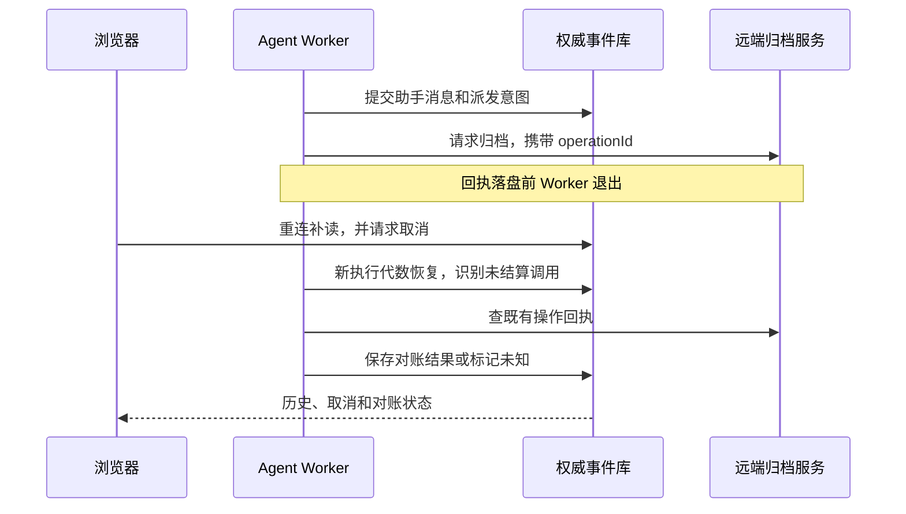
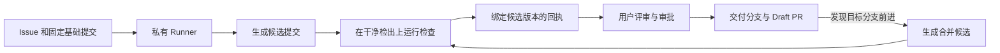
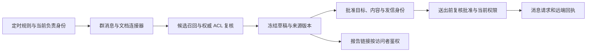

# 38｜综合模拟面试与故障推演

> 源码基线为 DeepSeek Harness `dsh-v0.2.3-alpha.2`，提交 `4b399c39a6d1479cd84ca591b4d7c88e24d38a96`。[系列目录](../README.md) · [上一篇](37-design-a-high-concurrency-agent-service.md) · [上游仓库](https://github.com/deepseek-ai/deepseek-harness)

面试官让你解释 DSH 的工具调用。讲到「工具成功，结果写回 Session」时，他把条件改成「远端已收到请求，Worker 没收到回执就退出」。这时要先说手里有哪些记录，再说哪些结论能从记录推出、哪些要查外部状态。本篇的三套题都用这种方式，从一条能定位到源码的正常路径开始，每次只改变一个条件。

| 题组 | 源码开场 | 现场需要给出的判断 |
| --- | --- | --- |
| Harness 内核 | Agent Loop、工具批次、Session 事件 | 工具可能已经生效时怎么恢复，重试会不会产生重复副作用。 |
| Coding Agent | 代码导航、文件观察、worktree | 同时编辑怎么合并，测试证据能否支持当前补丁进入评审。 |
| 企业 LLM 应用 | Skill、MCP、检索、审批和定时投递 | 撤权后旧索引命中怎么办，收件范围变化或发送超时后如何交付。 |

## 1. 第一套｜Harness 内核：从 Tool Call 追问到崩溃恢复

**题设。** 用户要求 Agent 生成周报并归档到团队文档库。模型给出一个工具调用，远端请求发出后 Worker 崩溃。浏览器重连了，用户还按了一次取消。请分别给出会话恢复、客户端显示和远端动作的处理方式。

### 第一问：从 DSH 源码讲一次模型回复如何推动下一步

一个 Turn 可以包含多个 Step。每个 Step 准备模型请求和当前工具集合，Provider 流经过组装后提交 `assistant/message`。如果模型能继续且含工具调用，工具批次记录调用和结果，下一 Step 再用这些结果组装请求。可以用 `turn + step + callId` 串起日志。流式预览另有尝试身份与分片位置，失败重试也可以发生在同一 Step。进一步问「模型还在流式返回参数时能否派发」，要指出 DSH 在消息结算后才进入这一派发路径，取消分支会排除工具调用块。[消息提交与派发](../deepseek-harness/packages/core/agent-loop/src/agent.ts#L484) · [中断块的组装](../deepseek-harness/packages/llm/llm/src/assembler.ts#L162) · [工具事件写入](../deepseek-harness/packages/core/tools/src/batch.ts#L243)

### 第二问：只看到 Assistant 的调用请求，或者还看到 tool/call，各说明什么？

恢复逻辑从 `assistant/message` 收集待配对调用，从 `tool/call` 取得开始记录，再用 `tool/result` 收尾。修复视图里，只看到请求会补 `TOOL_NOT_STARTED`，有开始记录却无结果会补 `TOOL_OUTCOME_UNKNOWN`。现场给候选人一份截断的日志，让他给每个悬挂调用补对应结果，再关闭 Step 和 Turn。继续追问分叉时，截断点后的父会话可能已经执行过工具。开始记录本身也只证明 Harness 记过这一调用，远端提交需要另找回执。[修复逻辑](../deepseek-harness/packages/core/session/src/repair.ts#L116) · [两种截断位置的测试](../deepseek-harness/packages/core/session/tests/fork.spec.ts#L325)

### 第三问：用户点了取消，Redis 中的任务消息又被领取，怎样控制重复执行？

在云端提案里，用 PostgreSQL 事务接纳 Run 和 Outbox。Redis Streams 用于派发，`XACK` 确认的是消费组消息。Worker 按租约和递增代数提交权威状态，旧执行者不能覆盖新状态。发送前保存派发意图，远端操作使用稳定的 `operationId`。接替者先查回执，或仅在远端承诺的幂等窗口内按原参数重试。无法查证时给出未知结果。浏览器的取消与断线分别处理。取消阻止还未派发的新动作，对已发请求尝试中止并对账。重连按最后应用的 `seq` 补读，旧预览按 Attempt 退役。[云端作业设计](31-cloud-agent-jobs-with-redis-and-postgresql.md) · [Redis XACK](https://redis.io/docs/latest/commands/xack/) · [DSH Follow 快照](../deepseek-harness/packages/api/session-controller/src/web/controller.ts#L32)

### 第四问：证据怎样支持方案，扩容优先看什么？

先找三个截点：开始记录以前、派发之后但结果以前、结果提交之后但 ACK 以前。分别验证没有远端派发、只对账未知操作、重复消费读取已有结算。DSH 的审批竞态测试覆盖了取消先于派发时拒绝工具启动。Session 批次校验用例覆盖整组拒绝。二者可支撑本地行为的解释，远端幂等与跨库恢复仍要在目标系统检查。假设每分钟接纳 900 轮、平均运行 40 秒，稳态约 600 个在途 Turn。若每轮平均发两次模型请求，约需 1,800 RPM。要继续计算 Token、工具槽和排队上限，再决定扩 Worker 还是补模型配额。[审批竞态用例](../deepseek-harness/packages/core/tools/tests/tools.spec.ts#L951) · [批次校验用例](../deepseek-harness/packages/core/session/tests/append.spec.ts#L188) · [并发容量估算](37-design-a-high-concurrency-agent-service.md)

## 2. 第二套｜Coding Agent：从并发文件修改追问到交付证据

**题设。** 账单导出 CSV 时，含逗号的备注会被解析成额外的一列。Agent 要生成补丁和测试。它读完导出函数后，用户也在修改该函数的换行处理。随后，私有依赖安装失败，目标分支又前进了一次。请说明什么结果可以交给评审者。

### 第一问：DSH 怎样在仓库中定位和修改代码？

先通过文件搜索找导出入口、序列化逻辑和对应测试。符号同名时可用 LSP 查定义和引用，再读原文件建立修改上下文。DSH 的 `read` 发出带版本的观察事件。启用 `fs-observation-policy` 后，后续编辑可携带读取时的版本，过期时报告 `FS_STALE_VERSION`。基础组合默认关闭这项策略。如果面试官说「搜索摘要里刚好看到那一行」，答完源码还要指出搜索预览与正式读取事件的边界。[搜索执行](../deepseek-harness/packages/fs/tool-fs-search/src/search-core.ts#L199) · [读取的版本观察](../deepseek-harness/packages/fs/tool-fs/src/read.ts#L138) · [默认组合](../deepseek-harness/packages/bundle/base/cordis.patch.yml#L298)

### 第二问：接入 worktree 后，用户和 Agent 同时改一个文件会不会丢改动？

DSH 实验性工作树能力可以固定基础提交并切换会话目录。Git worktree 有各自的工作状态，也会共享对象和多数引用。生产的执行隔离还由 Runner 提供。如果人与 Agent 共享一个远端工作区，要在同一写入服务做版本比较。各自使用独立检出时，用原始基础提交、用户提交和 Agent 候选做三方合并。两处改动即使没有文本冲突，也可能改变最后一行和字段转义的组合行为。合并后要重新验证这一语义。[DSH Worktree 工具](../deepseek-harness/packages/experimental/tool-worktree/src/index.ts#L47) · [Git Worktree 共享规则](https://git-scm.com/docs/git-worktree#_refs) · [并发编辑测试](../deepseek-harness/packages/fs/tool-fs/tests/integration.spec.ts#L522)

### 第三问：测试命令退出码是 0，能说补丁通过了吗？

还要核对实际选中的用例、运行目录、候选提交和环境。这里的回归断言可用标准 CSV 解析器读导出结果，验证记录数、列数和备注内容。若基线上能用同一用例复现失败，记录失败断言与候选的通过回执。安装私有依赖失败时标为环境阻塞，保留候选及已取得的检查结果，说明必跑检查的缺口。若候选 `C1` 测过，但最后评审的是合并后的 `C2`，新版本重新拿检查回执，更新审批。能否交付受阻的 Draft PR 由仓库规则和用户选择决定。

### 第四问：怎样在质量、排队和成本之间取舍？

大仓库先按受影响的包做关键词和 LSP 定位，发布前再扩到约定的依赖回归范围。Runner 使用固定镜像，缓存按锁文件、工具链、平台和可访问边界分区。假设每分钟接纳 30 个任务，每个平均占用 Runner 4 分钟，稳态需求约 120 个执行槽。若只有 60 个槽且耗时不变，平均只能承担约 15 个任务每分钟。先看依赖准备、模型等待还是测试占槽最多，再选择缩短准备时长、扩大容量或限制接纳。交付服务按已批准的候选推送任务分支。创建 PR 的请求超时先按任务分支、目标和候选对账。验证要覆盖工作区写冲突、零用例、头提交变更和重复发布，每种情况都应能通过日志和实际仓库状态核实。[Coding Agent 完整设计](33-design-a-cloud-coding-agent.md) · [修复正确性的评估](30-agent-evaluation-replay-and-release-regression.md)

## 3. 第三套｜企业 LLM 应用：从技能加载追问到权限变更

**题设。** 每周自动生成项目周报，来源包括群消息和文档。报告待审批时，原负责人离职，文档管理员撤销了对其中一份预算文档的访问，目标群又加入外部成员。索引仍能命中预算段落，消息接口随后超时。请解释不同阶段应保留什么、拒绝什么、核对什么。

### 第一问：DSH 如何从一个 Skill 找到能读文档的工具？

Skill 注册表在作用域内发现并汇总元数据，模型选中后加载正文。正文告诉模型如何完成任务。能力由宿主或连接器提供。像腾讯文档这样接入 MCP 的服务，连接后发现工具，`on-demand` 加载器再把选中的定义挂到 Agent 作用域。平台要分别记录 Skill 可见、服务已连接、工具已加载、当前调用获准。继续问企业目录有 1 万个 Skill 时，说明先按租户和身份召回少量可见候选，再加载选中的正文及 schema。[Skill 目录发布](../deepseek-harness/packages/skill/tool-skill/src/index.ts#L226) · [MCP 按需注册](../deepseek-harness/packages/mcp/mcp-client/src/tool-loading.ts#L127) · [多租户能力平台](35-design-a-multi-tenant-skill-mcp-platform.md)

### 第二问：预算段落还在索引里，模型可以先用它起草吗？

候选可由全文与向量两路召回。拿到候选 ID 后，用当前主体在权威来源核对 ACL、删除状态和内容版本，通过才读取正文、生成摘录或送入模型。已有草稿也应能追踪来源版本，用现行授权决定能否继续打开和发送。负责人离职时，个人委托规则先暂停，由新负责人完成移交与授权。对新受众生成周报时，用可分享的材料形成新版本并重新申请审批。要求候选人把「撤权已生效」和「旧向量已被物理清掉」画成两条时间线。[会话与企业知识检索](36-design-session-and-enterprise-knowledge-search.md) · [办公助理的访问与交付设计](34-design-an-enterprise-workbuddy.md)

### 第三问：群 ID 没变、发送请求又超时，能按原批准重发吗？

批准绑定报告版本、发信身份、目标 ID、允许的受众和实际发送内容。群成员范围变了就重新核对批准和租户策略。受控链接打开时仍要逐人鉴权，消息正文和链接预览只暴露该渠道允许看到的信息。若发送已经派发，持久化的 `deliveryId` 关联远端回执或幂等请求。先对账，再决定补记回执、按原契约安全重试，或保持未知并暂停。新目标或新内容属于新的发送动作。它需要独立的批准。

### 第四问：怎么证明定时任务确实完成，运营压力怎样拆？

DSH Schedule 在向 Inbox 投递后等待 Session `flush`，再写调度回执。仓库用例让 Agent 暂停模型执行，同时观察 Inbox 事件及回执，证明两者有不同的时点。云端方案用 `scheduleId + scheduledAt` 去重，再分别保存草稿生成、检查、审批和外发结果。验证可从三处观察：撤权后受限正文无法进入提示词，换收件人后旧批准被拒绝，超时重试后同一远端操作没有重复提交。假设同一时段 10 分钟内生成 600 份周报，每份平均读 6 次，均匀分布时平均需要 6 次读取每秒。批量到点会有峰值，按租户、连接器和截止时间排队，并把人工审批等待与计算槽分开计量。[定时投递源码](../deepseek-harness/packages/schedule/schedule/src/runtime.ts#L349) · [Inbox 回执用例](../deepseek-harness/packages/schedule/schedule/tests/delivery.spec.ts#L13)

## 4. 90 秒项目介绍

> 我以 DeepSeek Harness 的一个固定版本做了源码精读，主线是一次用户请求怎么经过 Agent Loop、模型适配和工具执行，最终变成可恢复的会话记录。模型每次请求前会组装上下文和本步工具集。回复结算为 Assistant 消息后，循环才把其中的调用交给工具层。后续模型请求会带着对应的工具结果。
>
> 我重点分析了两个故障。模型生成中途被取消时，系统可以结算已经收到的内容，丢弃未执行的工具调用块。外部工具发出请求后进程崩溃，恢复逻辑会根据日志区分未开始和结果未知，外部结果仍要用回执确认。
>
> 我还用同一套事件与恢复思路推演了两种产品。Coding Agent 把补丁、测试结果和批准绑定到同一提交。办公 Agent 在读取资料、生成草稿和发送时分别复核权限。DSH 的会话默认存 JSONL，云端作业里用 PostgreSQL 保存权威状态、Redis 做派发是我在笔记里提出的设计。源码、用例和生产假设在讲解时会逐一对应。

这段用于介绍源码研读与系统设计。若面试官问「你亲自实现过哪一块」，应补充自己的真实改动、负责范围和验证结果。用这段介绍准备时，可根据岗位选择 Coding Agent 或办公助理作为后续展开的例子。[默认 JSONL 装配](../deepseek-harness/packages/bundle/base/cordis.patch.yml#L142) · [Redis 与 PostgreSQL 设计](31-cloud-agent-jobs-with-redis-and-postgresql.md)

## 5. 10 分钟原理解读

| 时间 | 讲什么 | 可以画或指给面试官看什么 |
| --- | --- | --- |
| 0:00–1:30 | 入口加载 Profile、Bundle 和插件，解释本次调用选用哪些能力。 | 画入口、宿主、Agent 和 Session 四个角色。指向启动配置。 |
| 1:30–3:00 | 区分 Turn、Step 和模型 Attempt。解释上下文和 ToolSet 的准备。 | 画同一 Step 内一次失败、一次重试的时间线。 |
| 3:00–5:00 | 说明流式预览、最终 Assistant 消息、工具调用与工具结果怎样衔接。 | 从 `assistant/message` 画到 `tool/call`、`tool/result` 和下一 Step。 |
| 5:00–7:00 | 解释 Session 日志、模型输入投影和客户端快照。 | 用一个序号示例说明压缩替换与断线补读。 |
| 7:00–9:00 | 给出两种失败，分别在派发前取消和派发后丢回执。 | 画崩溃切点，逐项说手头有什么证据、下一步能做什么。 |
| 9:00–10:00 | 说明测试覆盖的行为和云端扩展需要的机制。 | 给出一个真实源码用例及一项生产设计取舍。 |

原理解读可以固定一个例子贯穿全程。选择这份仓库的工具轮次快照，从一条助手消息读到工具结果，再读下一次模型输出。讲取消时切到截断历史的测试，讲断线时切到订阅快照。这样面试官能沿证据追问，答题时也能指出某个结论在何处失效。[启动入口](01-headless-agent-run.md) · [工具轮次快照](../deepseek-harness/snapshots/session/bash-tool-turn/session.v4.jsonl#L15) · [日志与投影](08-session-event-log-projection-replay.md) · [断线与重连](28-web-desktop-sdk-acp-and-reconnect.md)

## 6. 45 分钟系统设计题答题结构

| 时间 | 要完成的内容 | 板书上应能核对的东西 |
| --- | --- | --- |
| 0–5 分钟 | 澄清用户、输入、成果、审批和成功条件。 | 三条核心需求，一个已知总量，一个明确的失败边界。 |
| 5–10 分钟 | 把规模换成吞吐、在途量、存储或配额。 | 单位、假设、平均值与突发条件，并指出哪个指标会先用完。 |
| 10–19 分钟 | 画架构并走一遍正常请求。 | 入口、执行器、权威存储、下游系统，标出至少两个持久确认点。 |
| 19–28 分钟 | 定义 API、业务 ID 与状态转移。 | 提交幂等键、版本或执行代数、批准绑定的输入、终态与回执。 |
| 28–37 分钟 | 展开最难的失败窗口和并发边界。 | 正常顺序、从哪一刻失败、恢复时有哪些记录、哪些动作可重试。 |
| 37–42 分钟 | 讨论替代方案、成本和扩容。 | 哪些能力适合单进程，跨 Worker 或跨租户后需要加什么，以及代价是什么。 |
| 42–45 分钟 | 说明如何验证，并收束到题设。 | 一个源码证据、关键故障需要观测的结果、容量及发布指标。 |

举一个 45 分钟收尾。选办公助理题时，画出「来源读取 → 受控草稿 → 已批准的发送请求 → 远端回执」。说明文档撤权的生效由权威权限检查决定，持续在途的发送由回执或对账决定。接着给出三条能观察到的结果：受限文本没有进入模型，过期批准没有获得派发资格，超时后的回执能对应原始操作。容量部分只用题设的周报规模和实际连接器配额估算，说明还要补测峰值。

面试官可以用四点判分。**源码定位**看回答能否落到文件、事件或用例。**边界判断**看能否讲清哪个状态已经确认，哪个仍未知。**设计取舍**看新组件是否解决了题设里的瓶颈。**验证方法**看能否提出具体观察值，并说明它支持哪个结论。这四点分别练完，再把同一例子压缩成口述版。[系列目录与主题阅读路线](../README.md)
